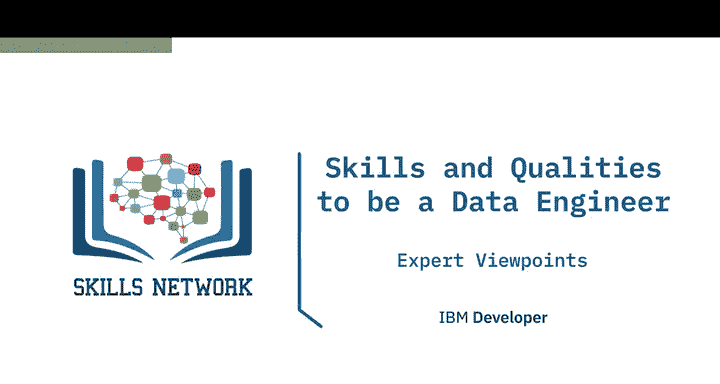

# IBM数据工程专业证书第1课：《数据工程入门课程（IBM）》introduction-to-data-engineering - P8：7_数据工程师技能素质视角.zh_en - GPT中英字幕课程资源 - BV1G94y1y7oT

In the first part of this video we will listen to data professionals talk about some of the technical skills required to be a successful data engineer Data engineering is a very fast evolving technology。

 and obviously you need to love data， otherwise you shouldn't be a data engineer and from coming to technical skills it really depends on what a data engineering needs are required to fulfill it。

 particular job for example， if you' are working in retail， you may need one skillet， for example。

 they may look for。Experience with relational databases and Cassandra or Google BigT kind of architectural related knowledge because they try to build 365 by 24 by7 applications and also build pipelines using CAfka streams and WebPMQ to perform some back office processing of the transactional data and then if you're working in healthcare you may need a different skill set if you're working in social media like Twitter or Facebook you would need different kinds of skill set so data engineering is a very wide topic。

Given the job role the requirements vary technical is actually the easy part because you can learn a new technology you can figure out new things it's important that you have the basic theory behind data structures and how to work with data if you don't enjoy change if you don't enjoy learning data engineering is not the right place for you there's a lot of change in in any data field and you have to be willing to roll with that change You need to have good networking skills about both land and then the van。

And you need to be good at understanding different kind of storages。

 the local storage as well as the club storage， and you need to have a very good knowledge of operating systems。

And then you should be an expert at databases， both RDBMS databases and the no SQL databases。

Programming knowledge is very， very helpful， any language a Java C or Python would be a very great value add。

And in today's data engineering， the landscape， automation is a very。

 very good skill to have in terms of technical skills。

Data engineer needs to work with one or more programming languages。

 operating systems and have a knowledge of IT infrastructure and landscape。

 so this includes computer architecture， cloud， virtual machines， containers。

 and different types of storage and how to use work with them。

And a data engineer needs to be very proficient at SQL and needs to have a working knowledge with one or more databases。

 both relational and No SQL。And it's not needed to get started， but it's very useful to have。

Knledge and experience of the bigger data engineering ecosystem， which includes ETL data pipelines。

 data warehouses， data lakes， and other big data systems。

Different companies have different requirements for their data engineers。

 even within the same company。The requirement， the skills required for each engineer may change over time as 13 girls。

But in general， in my opinion， therefore essential technical skills for data engineers。

 their are SQL and data modeling。ETL methodologies and programming skills like Python In the second part of this video。

 we will listen to data professionals talk about some of the qualities and soft skills required to be a successful data engineer。

So to become a data engineer and be successful at it。

 you need to enjoy problem solving and troubleshooting。You need to be good at teamwork。

 collaboration and communication。And it's good to be you know being good at logic and having an interest in coding is very useful from a data engineer from a non-technical perspective。

 we expect a data engineer to be a problem solver and we want him or her to have very good communication skills as data engineer is constantly involved with multiple teams so it helps if he's a good communicator。

 you should be very curious and you should be able to ask a lot of questions to the business users and technical users and then use that knowledge from those answers to build robust data pipelines using reliable data sources and sortable data pipelines。

 my saying has always been whether're working as a DBA or a data engineer the best one is a detail oriented control freak and that's because there。

Is a lot of detail involved in working with data it's important to really be comfortable with the details and get into the details and make sure that you don't leave any of the boxes unchecked control freak because my data environment that's my baby that's that's what I spend as much time with as my children sometimes and so that's that's something where I need to be in control or aware of the choices that are being made there and what tradeoffs those particular choices have the most important skills are soft skills you need to be able to interact with developers you need to be able to defend your choices to management you need to be able to advocate for the choices that you're making and the details of those choices and why they are important and why things need to be done in。

In a particular way， so those things and a work ethic and a passion to learn are the most important things。

 curiosities， good communication and egoists to learn， pretty and critical for data engineers。

