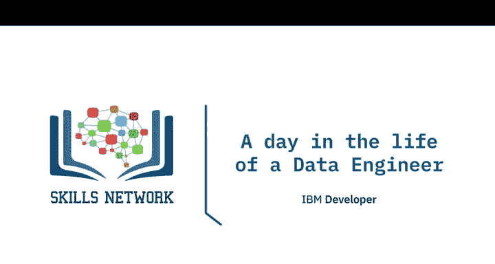
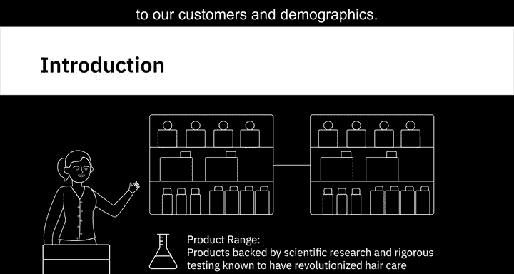
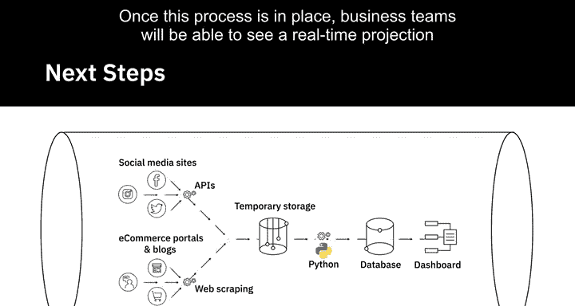
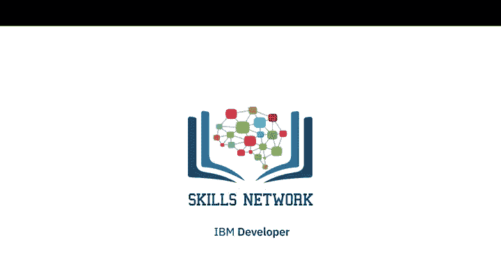

# IBM数据工程专业证书第1课：《数据工程入门课程（IBM）》introduction-to-data-engineering - P9：8_数据工程师的日常.zh_en - GPT中英字幕课程资源 - BV1G94y1y7oT

Hi， I'm Sarah Flinch。 I work as a data engineer in a multinational company that makes hair care products。

 Our products are backed by scientific research and rigorous testing and are known to have revolutionized hair care over the past couple of decades。

 As a company we are always investing in technologies and practices that can help us be connected to our customers and demographics。

 Currently， our company is in the final stages of launching a new shampoo in the market。

 In today's times， how a product gets talked about on social media has an immediate impact on sales numbers and brand perception。

 So it makes perfect sense that the business team， even before the product is launched is figuring out how they can tune in customer sentiment from day one of the launch。

 they want to keep a close eye on all social media and know what online communities such as Twitter。

 Facebook， Instagram， e-commerce platforms and bloggers say about。😊。

Their product， positive feedback， negative comments， suggestions。

 even comparisons with their current favorites。Our team of data scientists created the prototype of a dashboard using a sentiment analysis algorithm and dummy data to serve this goal。

 The dashboard displayed graphs of different customer sentiments plotted as scores across social media sources and consumer demographics。

 The idea was an instant hit and got to go ahead for implementation by the business team。😊。

This is where our team of data engineers stepped in to make this prototype a reality。

 My first task was to pull in data from all the social media sites and online sources identified by the business teams into the organization's environment。

 I started with As to pull the tweets and posts with our product hashtag into temporary storage。

 I then turned to the e-commerce portals and product review blogs to collect our product specific data and moved that into temporary storage as well。

 an activity known as web scraping。😊，Tweets， posts， comments， articles， even memes。

 There was quite a mix of formats and structures。 Once I had all the data I needed。

 I inspected it to assess the transformations that will need to be performed on this data before it can be loaded into the database。

 We decided to create a Python program for processing the data and loading it into the database。

 I cleaned up the data and transformed it into a format that would be stored in the database。

 This is the database from which the dashboard is pulling the data to display the reports。😊，Now。

 it's time to showcase the results to the data scientists。 It's exactly what they'd hoped to see。

 So it's a job well done。 but the job doesn't quite end here。

 Each time the business users need to see the current statistics。

 They will have to come back to us with a request to pull in the updated data。

 that would make it an inefficient solution。 Ily， they should be able to tune into customer sentiment and brand perception in real time。

 So the next action is for us to build a data pipeline that extracts。

 transforms and loads the data on an ongoing basis。 Once this process is in place。

 business teams will be able to see a real time projection each time they log into the dashboard。😊。

