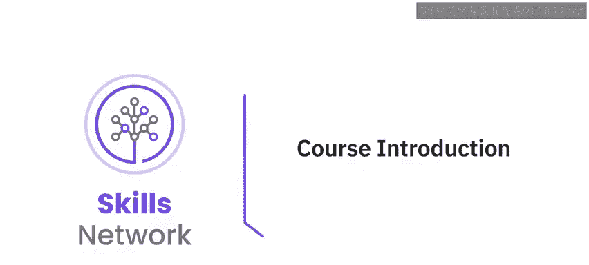
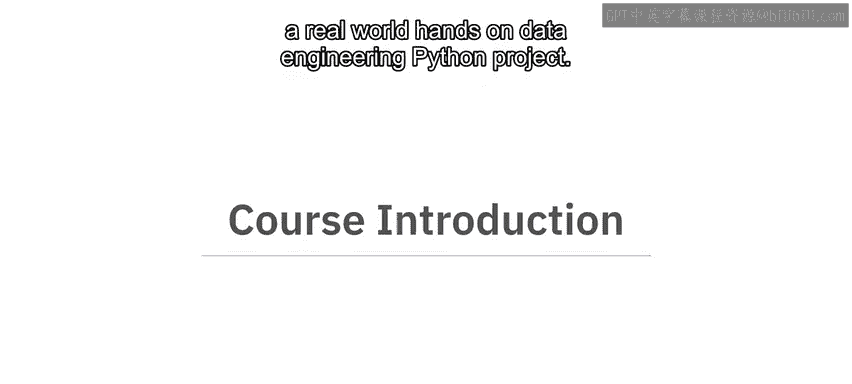
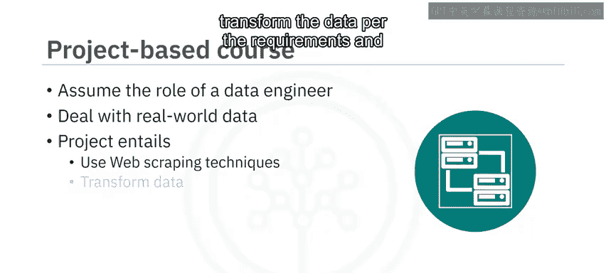
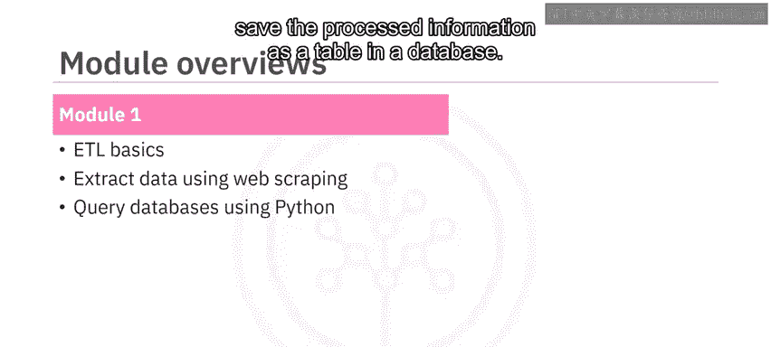
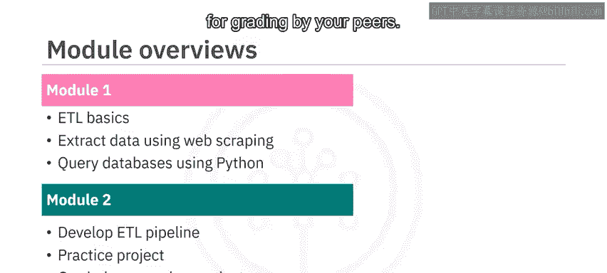
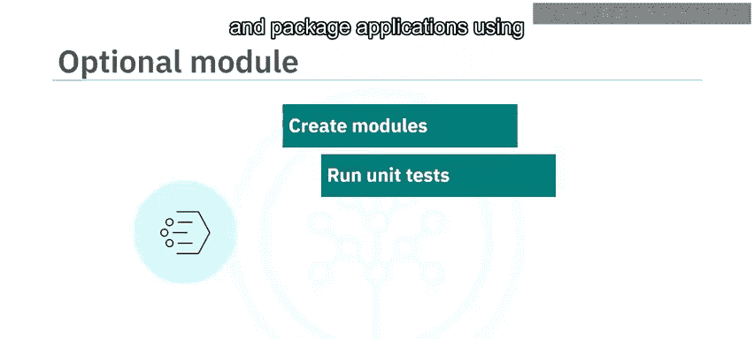
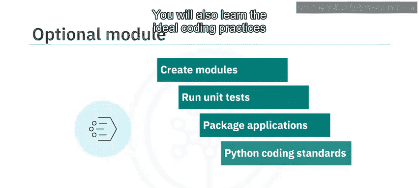
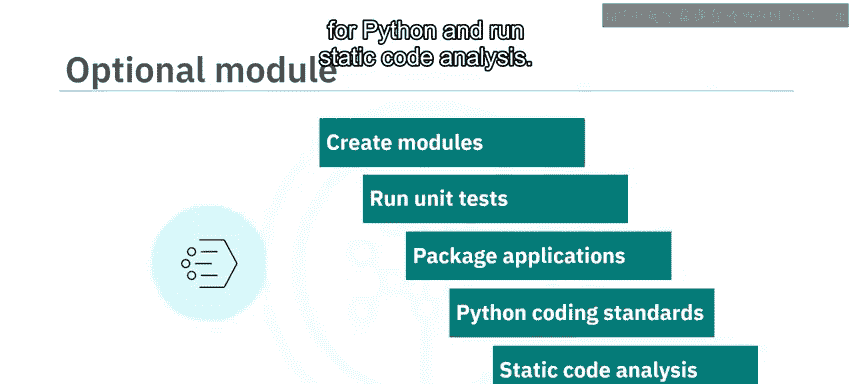
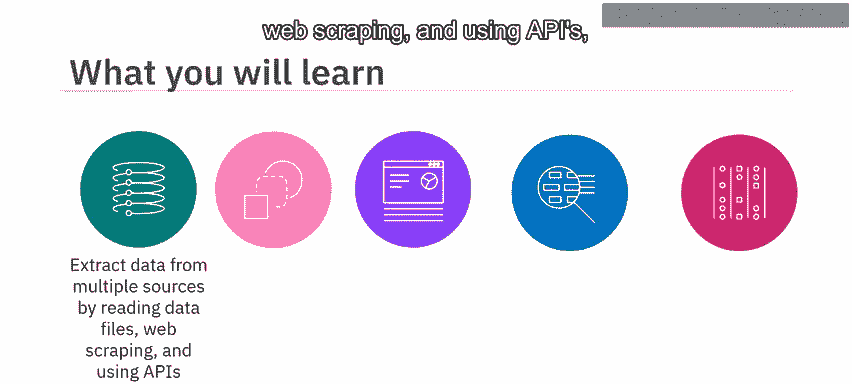
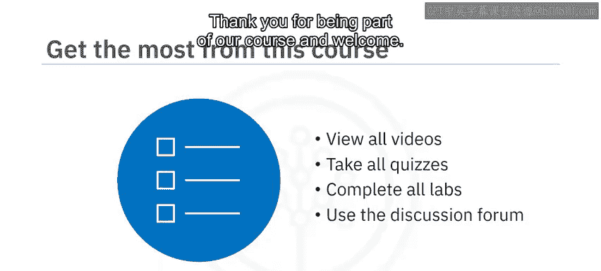

# IBM数据工程专业证书第3课：《Python数据工程项目课程（IBM）》python-project-for-data-engineering - P1：0_课程介绍.zh_en - GPT中英字幕课程资源 - BV1xz4y1W7Gb

Welcome to this course， where you accomplish a real world hands on data engineering Python project。

Data engineers are on the front line of data strategy and planning for any organization。

 data engineering tasks， including extraction or data transformation to a required format and loading it for further usage are the fundamental operations on which the entire data science industry depends This is one of the main reasons that data engineering positions are some of the most sought after jobs in the world today。

In this project based course， you will assume the role of a professional data engineer to train you in dealing with realworl data。

 you will use Python to retrieve the required data directly from a website using web scraping techniques。

 transform the data per the requirements and say that as a local file and a table in a database。

 you will also run basic queries on a data table， using Python。

This course is intended for anyone with basic programming knowledge。

 an elementary understanding of Python and interested in using it for data engineering applications。

Module 1 introduces you to extract， transform and load operations basics。

 you will also extract required information from web pages using web scraping techniques and APIs you will also access databases using Python and save the processed information as a table in a database in module2 you will apply the knowledge from the previous module to develop a functional ETL pipeline for acquiring and processing data from a website available in the public domain with one practice and one graded project。

 you will demonstrate your proficiency in creating ETL pipelines for data from different web links you will submit your project work for grading by your peers。

You will create modules， run unit tests， and package applications using Python in the Op moduleule 3。

 you will also learn the ideal coding practices for Python and run static code analysis。

After completing this course， you'll be able to extract data from multiple sources by reading data files。

 web scraping， and using APIs， transform data as required。

 load the process data into a desired format or database。

 create a full ETL pipeline for accessing and processing data derived from public websites。

 create Python modules， run unit tests and package applications。

There's a lot to cover here to get the most from this course。 Make sure to view every video。

 check your learning with each quiz and complete all the hands on labs。

 If you have any trouble with any of the course material。

 please don't hesitate to contact us in the discussion forum。 Thank you for being part of our course。

 and welcome。😊。

