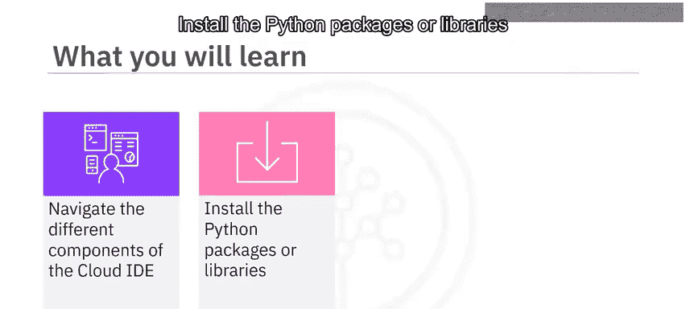
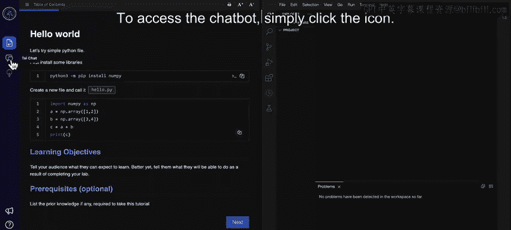
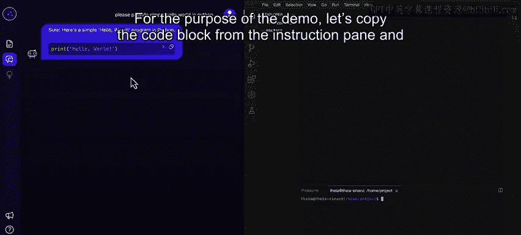
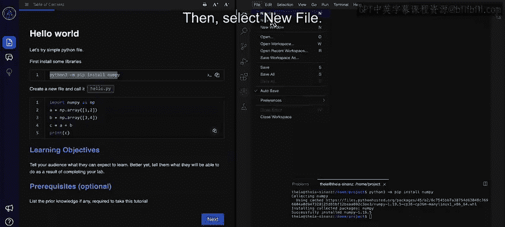
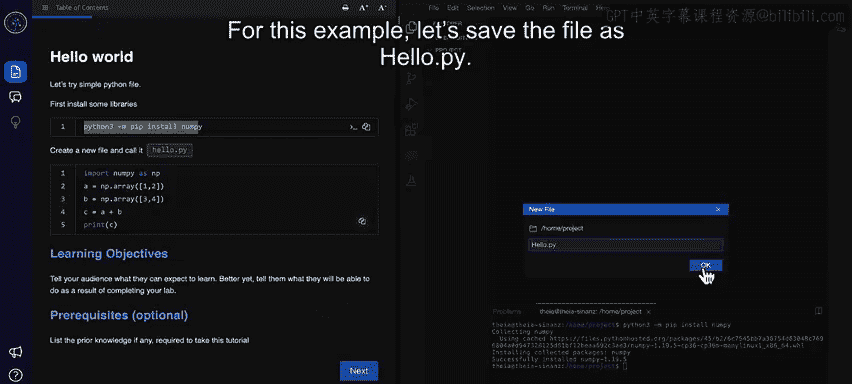
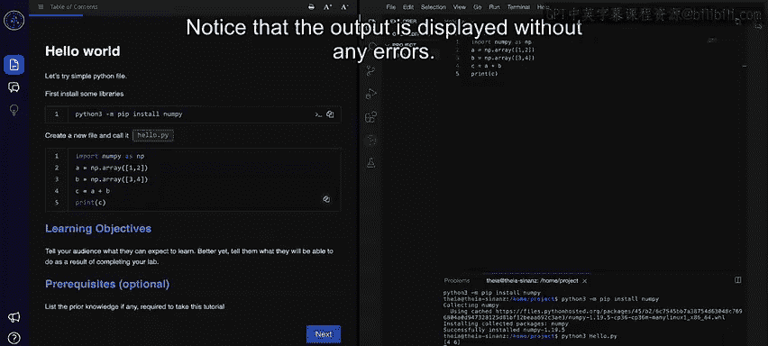
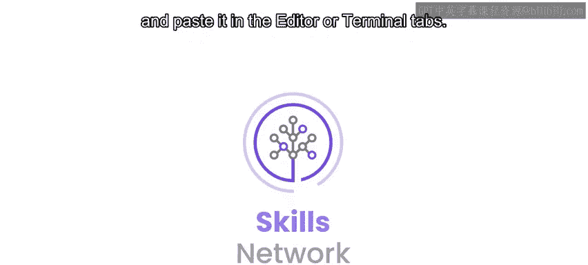

# IBM数据工程专业证书第3课：《Python数据工程项目课程（IBM）》python-project-for-data-engineering - P2：1_在 ide 中演示工作.zh_en - GPT中英字幕课程资源 - BV1xz4y1W7Gb

Hello everyone and welcome to the demo on the Cloud IDE or Integrated development En provided by the IBM Skills Network team Cloud IDE is a programming environment for learning。

 which you can use for writing， running， debugging and executing code directly in a browser without the need to install or configure any software or tools on your personal device。

In this demo， you will learn to navigate the different components of the cloud IdeE。

 Ins the Python packages or libraries， write code， execute code。😊。

When you open the cloud I DE， two main panes will be displayed。

 The left pane is referred to as the instructional pane。

 It displays the instructions that you need to follow to finish the project。

The pane on the right displays a programming interface where you can write and execute your code。

Please note that the right pane is similar to the VS code interface。

 which is a popular IDE for managing code。You can resize the instructional and code panes。

 for example， you can reduce the size of the instructional pane by dragging it from its margin towards the left。

 or you can increase the size by dragging the instructional pane towards the right。

You also have the option to modify the fonts and font size based on your preference。😊。

If there are multiple pages in the instructional pane， you will see the next and previous buttons。

These buttons enable you to navigate between the pages。 you can also preview an instructional page。

Notice the T of Contents button on the top left corner of the instructional pane。

Use this button to navigate through different sections of the instructions。Next。

 let's look at an AI enabled chatbot available on the Cloud IDE。

The IBM skillski Network team provides you with an AI enabled teaching assistant chatbot called TI。

 which provides you with help using the lab environment for coding assignments。

 The icon for tie is available on the left side of the instructional pane。😊，To access the chat bot。

 simply click the icon。

Let's try asking a question like， please provide me with simple Python code。As you can see。

 the code is displayed。 You can either copy or execute the code。Next。

 let's look at the programming interface of the IDE。😊。

The programming interface has several components； however。

 the two tabs that you will use frequently include the editor tab。

 where you write the code and the terminal tab where you execute the code。In the programming pane。

 there is also a skills network toolbox， which enables you to work with various database management environments。

 big data tools， cloud tools， embedded AI libraries， and launch applications that you build。

Before you begin writing the code， you will need to install the required Python libraries or packages in this cloud based environment。

You will need to perform this task in the terminal tab。To open a new terminal， click the Ter menu。

 then click New Teral。For the purpose of the demo， let's copy the code block from the instruction pane and paste it on the terminal。

Then， press enter to execute the command。Notice that the numpady library has been successfully installed。

 you can now import this library into your code。Let's now create a basic Python program in the programming pane。

 clickFile， then select new fileile。

The new file opens in the editor tab。It is a best practice to save the file before starting to add code。

😊，Since we are writing a Python code， save the file with a dot Pi extension from the file menu。

 click saveve or control S。When prompted， provide the file name for this example。

 let's save the file as Hello dot pi。

The next step is to add the code， you can manually type the code in the editor tab or copy and paste the code from the instruction pane if available to your file。

For the purposes of this demo， let's copy the code from the instruction pane and paste it in the file。

Don't forget to save the file。It's time to execute the code， Let's navigate back to the terminal tab。

Make sure that you are in the folder where the program file is stored。

 you can execute the file by typing Python 3 followed by the file name。For this example。

 that's Python3 Hello。 pi。Notice that the output is displayed without any errors。

This brings us to the end of the demonstration on the cloud IDE to summarize。

 Cloud IDE is a programming environment similar to VS code provided by IBM Skills Network for the purposes of learning and developing hands on skills。

The cloud IDE has two panes， instructional and programming you can use the table of Contents button on the instructional pane to navigate between instructional pages。

The programming pane provides the editor tab to write code and terminal tab to execute code。

You need to install the required libraries through the terminal。At any point during the labs。

 you can copy the code blocks from the instruction pane and paste it in the editor or terminal tabs。

