# IBM数据工程专业证书第3课：《Python数据工程项目课程（IBM）》python-project-for-data-engineering - P8：7_打包.zh_en - GPT中英字幕课程资源 - BV1xz4y1W7Gb

Welcome to Packaging After watching this video， you will be able to differentiate between Python module。

 package and library。😊。

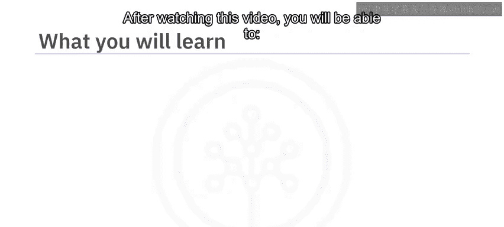

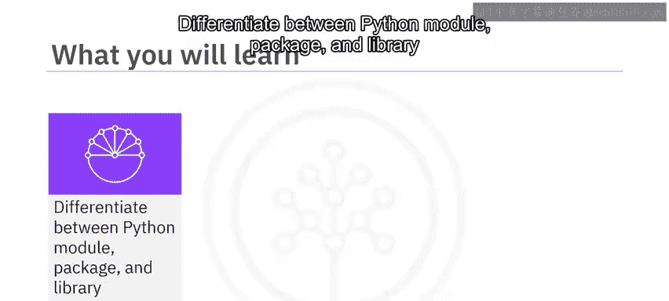

Create a Python package， verify a Python package， and use a Python package。

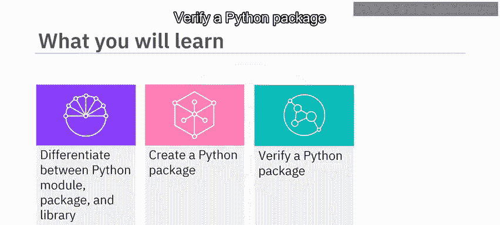

Modules， packages and libraries are frequently used terms in Python。

 Let's look at each of the terms in detail。😊。

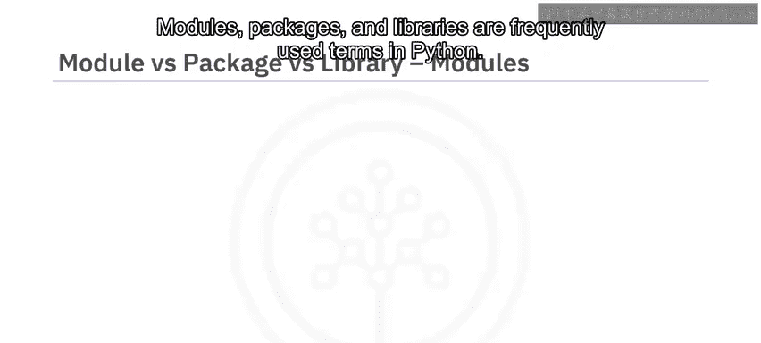

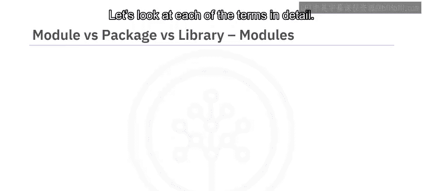

A Python module is a dot Py file containing Python definitions， statements， functions and classes。

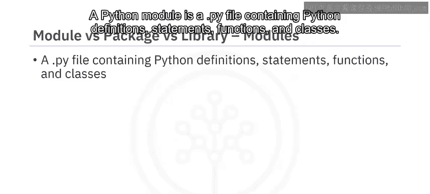

You can import a module to other scripts and notebooks， for example。

 consider a module named moduleule dot Pi that has two functions。

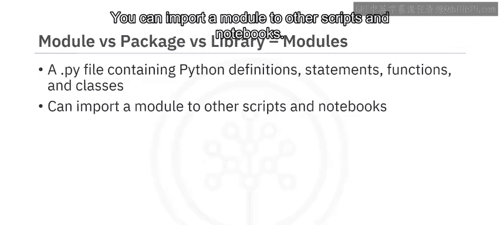

The first function is depth square open round bracket number， close round bracket， colon。

 returnturn number asterisk asterisk 2， which squares the input and returns the result as an output。

The second function is Death doubleubr open round bracket， number close round bracket colon。

 return number asterisk 2， which doubles the input and returns the result as an output。

If the function is in the same directory， you can import it and use the functions in that module。

Let's consider using the square function with print command。Print open round bracket。

 double quotes4 carrot symbol2， double quotes， comma square open round bracket。

 four close round bracket， close round bracket。The output is displayed as4 carroatt simple 2 equals 16。

Similarly， for the print Dor function with value 4， the output is 2 asterisk4 equals 8。

A package is a collection of Python modules into a dictionary with an underscore underscore in it underscore underscore dot Pi file。

 which distinguishes it from just a dictionary of Python scripts。

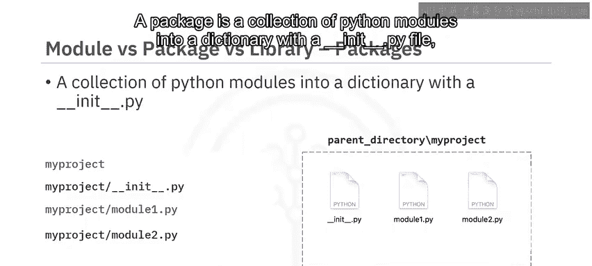

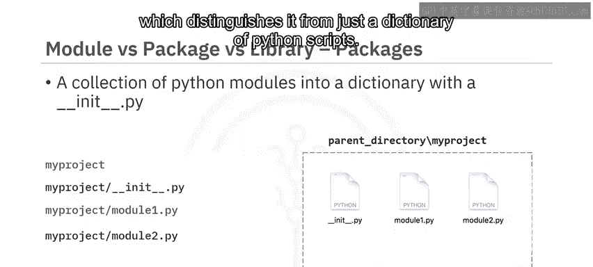

The example shows the package my project in parent directory with two modules。

 moduleule 1 dot pi and Moule 2 dot pi。

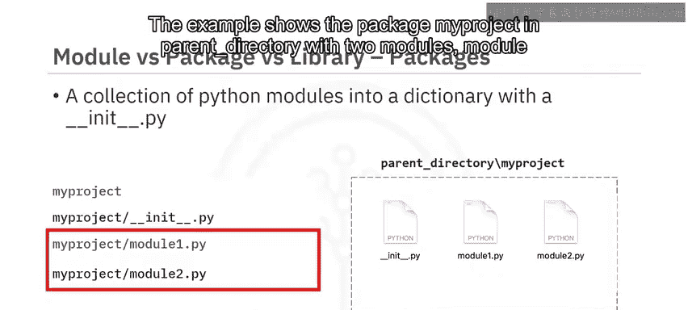

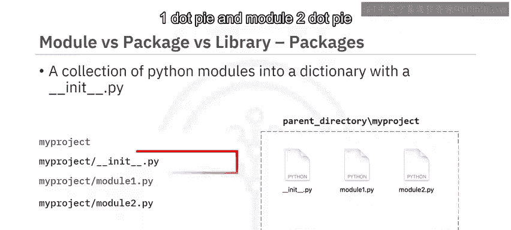

It also contains the underscore underscore in it， underscore underscore dot P file。

When you import a module or a package， the corresponding object created by Python is always of type module。

Note that the distinction between module and package is only at the file system level。

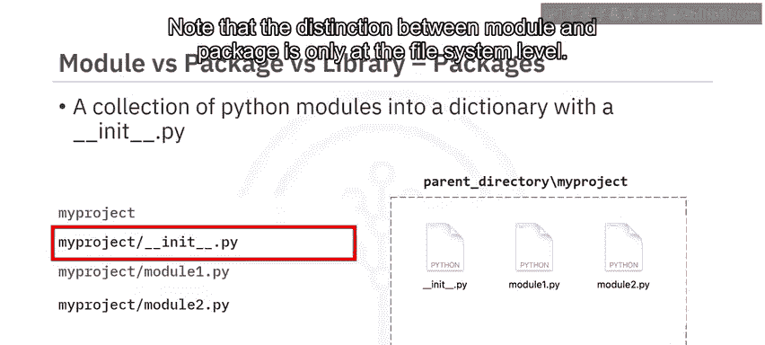

A library is a collection of packages， or it can be a single package。

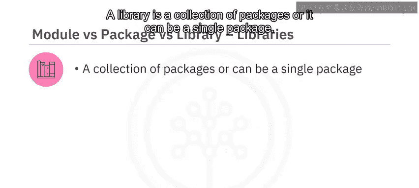

Examples include nue， pie torch， and pandas。

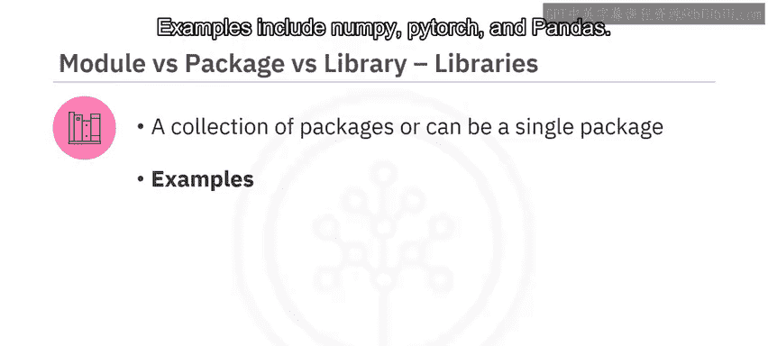

Note that the terms package and library are often used interchangeably。 Therefore。

 nuy pietorrch and pandas are also referred to as packages。

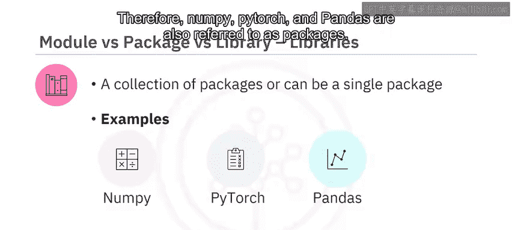

Let's look at the steps to create a Python package。

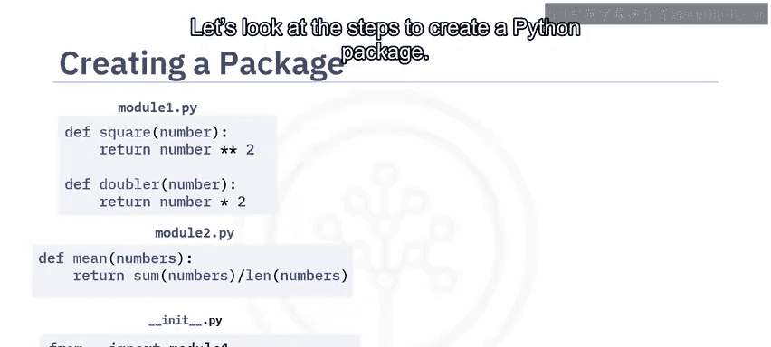

Consider there are two modules。 Module 1 dot pi has two functions。

 Square and Dubr Moule 2 dot pi has one function。 mean to make my project folder into a package。

 you must have underscore underscore in it underscore underscore dot pi as a file in the my project folder。

 The contents of the underscore underscore in it， underscore underscore dot pi file must be from dot import module 1 and from dot import module 2。

😊。

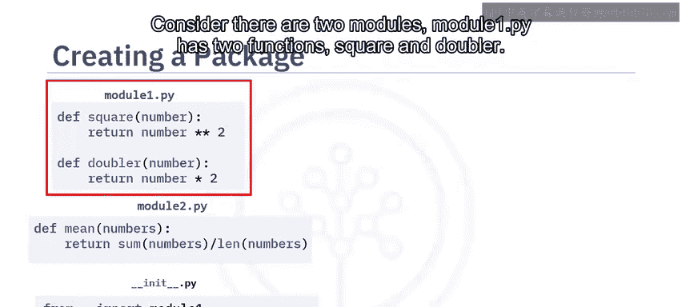

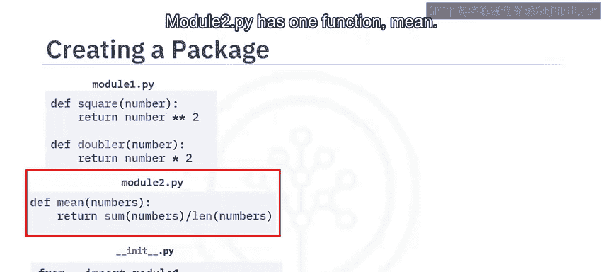

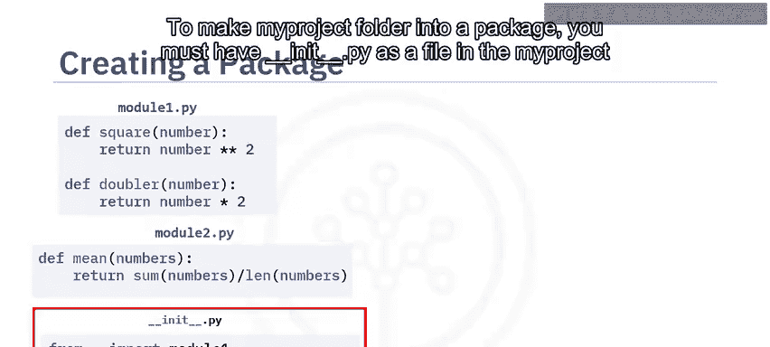

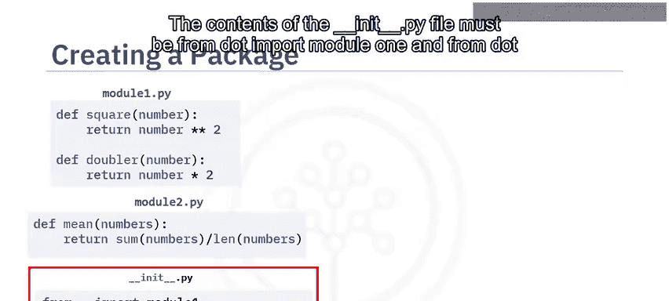

Typical steps to create a package include。First， create a folder with the package name。

 Then create an empty underscore underscore in it， underscore underscore dot pi file。

 create the required modules。 Finally， in the underscore underscore init。

 underscore underscore dot pi file。 Add code to reference the modules needed in the package After creating the package。

 you need to verify the package。 to verify the package。 First， open a bash terminal。

 make sure the directory is the same as the folder where your package is located。😊。

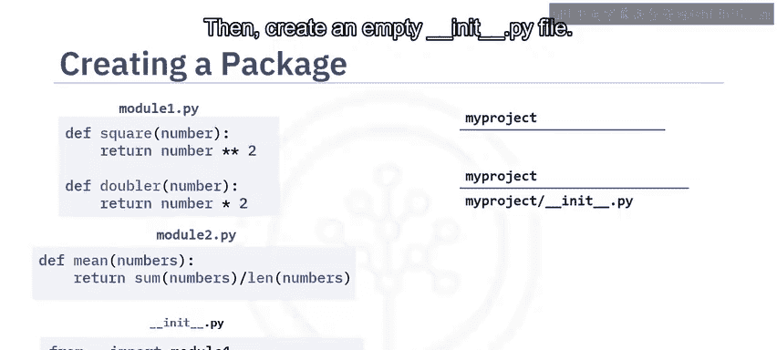

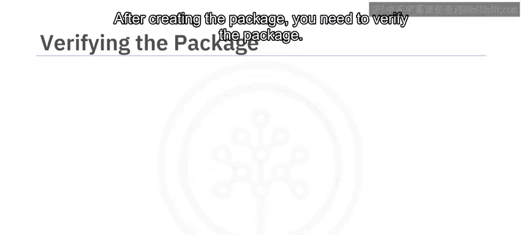

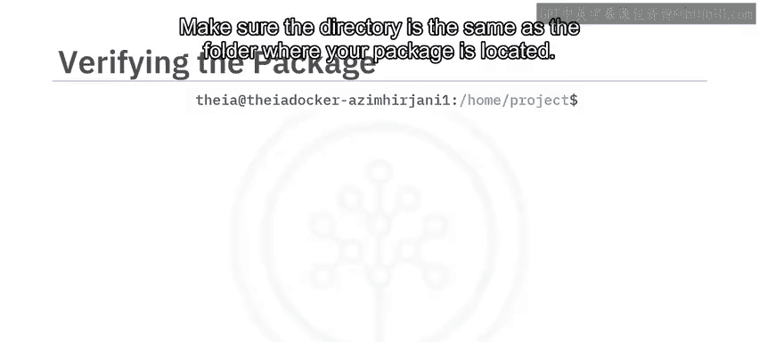

Open the Python interpreter by running the command Python in the shell。

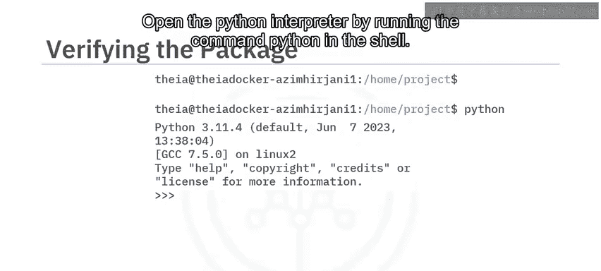

Using the Python prompt， type import followed by project name， for example， importmport My project。

 if the command runs without errors， it is an indication that the package is successfully loaded。

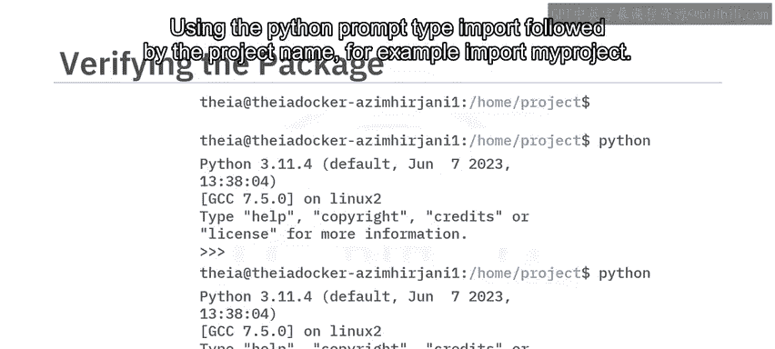

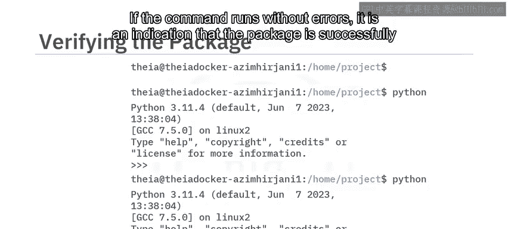

The general structure for testing your package is the package name， dot module name。

 dot function name， followed by the parameters without the curly brackets。

 but keeping the round brackets， for example， using my project， my project dot basic dot square。

 open round bracket2 close round bracket， the function will return the value 4。😊。

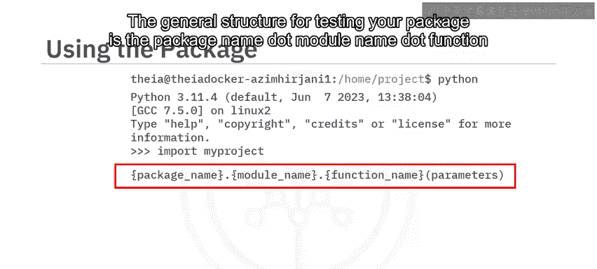

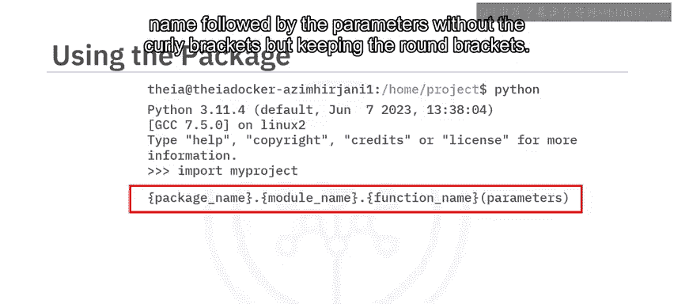

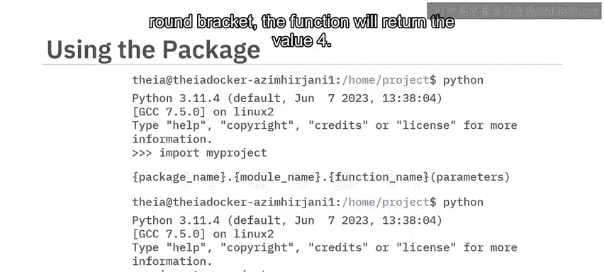

After creating the package， you can use it in the other scripts if the package folder is in the same directory。

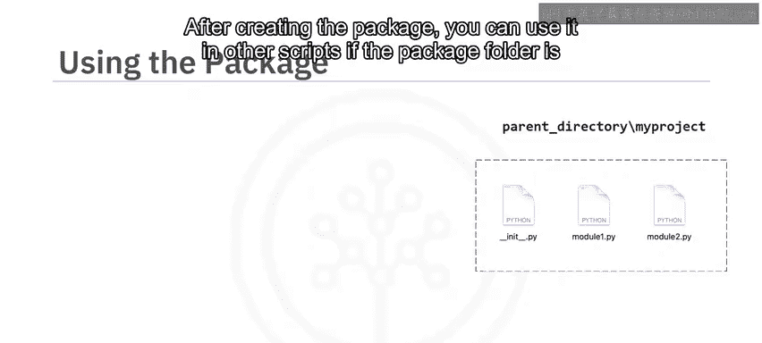

In this case， you have the file Test。 Pi in the parent directory。

You can import the functions in the package， for example。

 using the Python code from my project moduleule 1。

 import square comma doubleubr from my project moduleule 2， import mean print open round bracket。

 double quotes4 carrot symbol2 equals doubles comma square round bracket，4 close round bracket。

 close round bracket， print open round bracket2 asterisk 4 equals double quotea doubler open round bracket。

4 close round bracket， close round bracket， print open bracket double quote open round bracket 2 plus1 plus3。

 close round bracket， divided by three equals double comma mean open round bracket。

 open square bracket，2 comma1 comma 3 close square bracket， close round bracket， close round bracket。

😊，You can then run the functions and check if you get the correct results。In this video。

 you learn that a Python module is a Dot P file containing Python definitions， statements， functions。

 and classes。

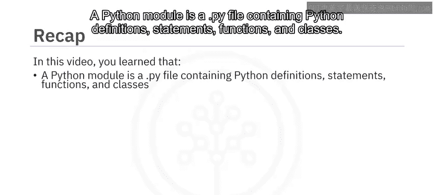

A package is a collection of Python modules into a dictionary with an underscore underscore in it。

 underscore underscore。P file。

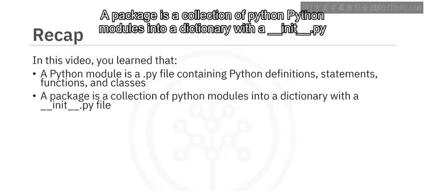

A library is a collection of packages， or it can be a single package。To create a package。

 create a folder with the package name， create an empty underscore underscore in it，_ underscore。

t Pfi。Create the required modules in the underscore underscore in it。

 underscore underscore dot P file， add code to reference the modules needed in the package。

You can verify the package via the bash terminal After creating the package。

 you can use it on other scripts if the package folder is in the same directory。😊。

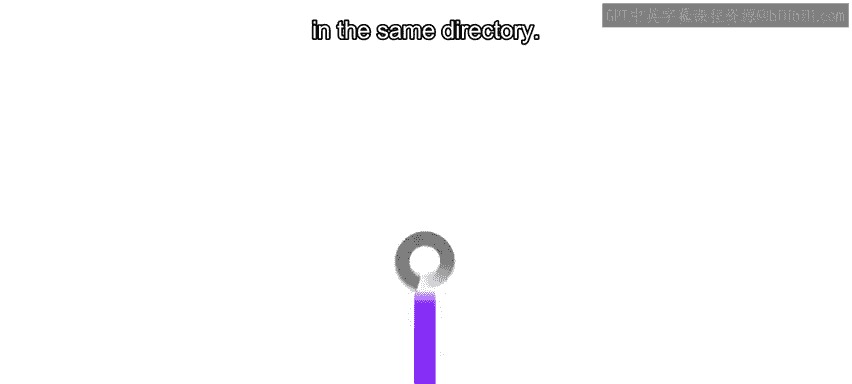