# IBM数据工程专业证书课程10：《NoSQL数据库导论》｜introduction-to-nosql-databases｜ - P10：9_从 rdbms 迁移到 nosql 数据库的挑战.zh_en - GPT中英字幕课程资源 - BV1UN41187Zz

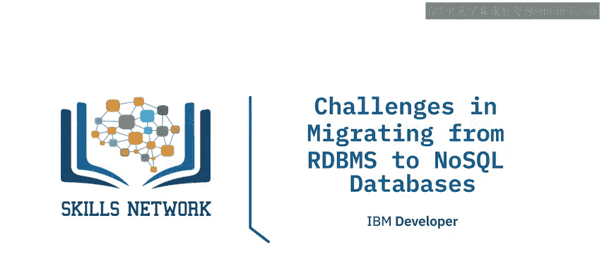

Welcome to Challenges in migrating from RDBMS to No SQL databases。

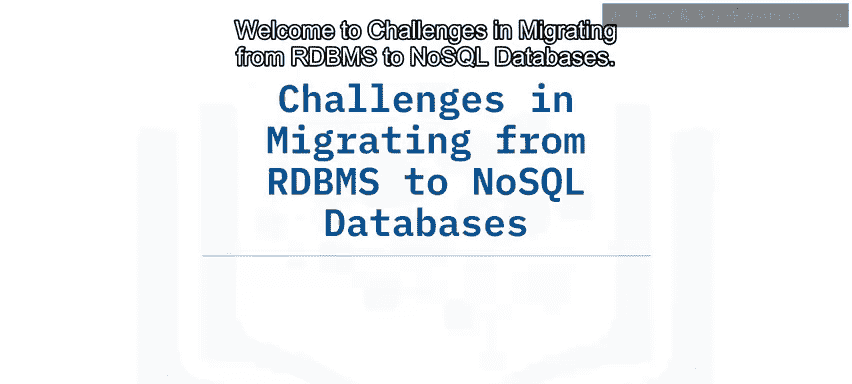

After watching this video， you will be able to describe in which cases RDBMS and no SQL are best used and describe the main differences between RDBMS and No SQL。

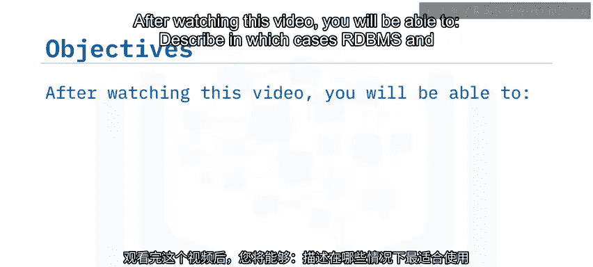

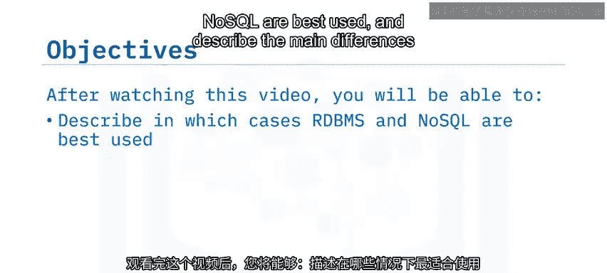

There is a misconception sometimes that either no SQL is the replacement of RDBMS or that you need to choose between relational and no SQL databases In reality。

 RDBMS and no SQL databases are not competing because they cater to quite different requirements and use cases。

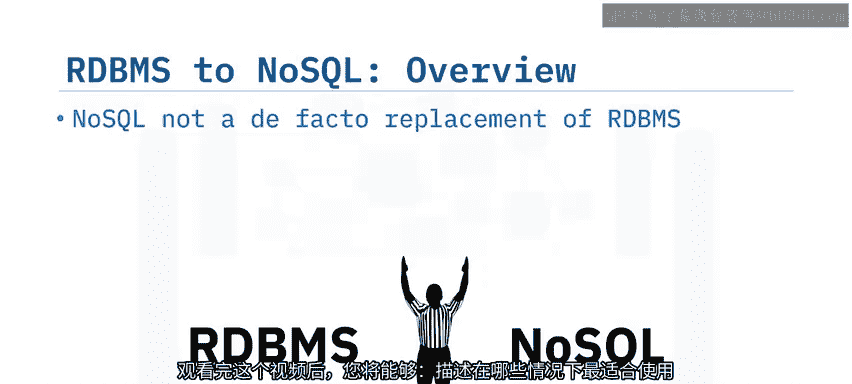

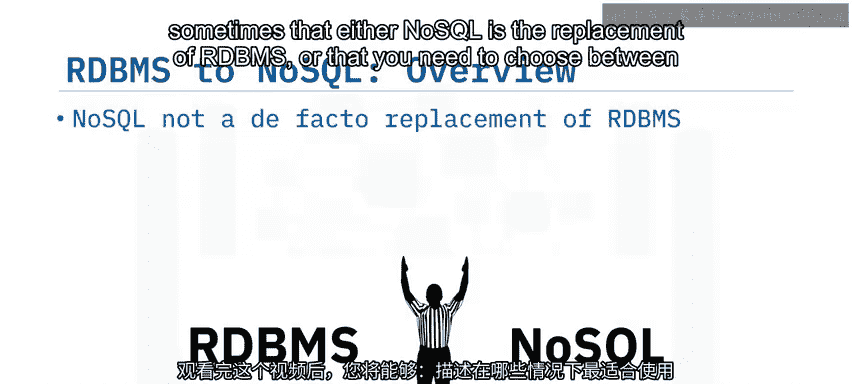

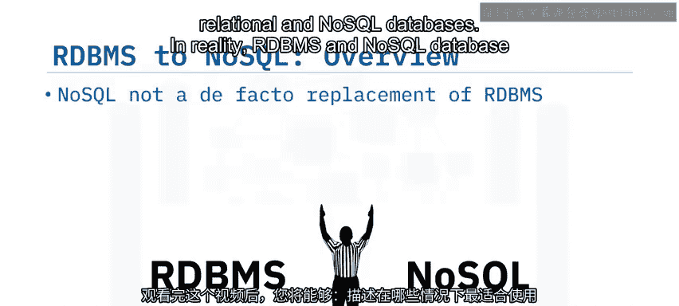

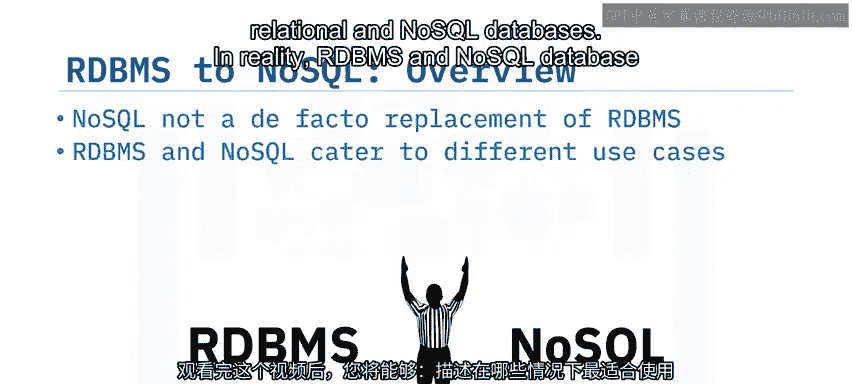

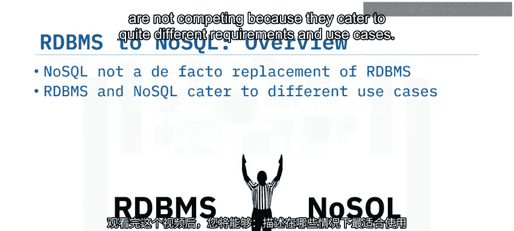

While it is possible to migrate from an R D BMS S system to a no SQL system。

 This should be done based on the characteristics required by your end solution。

 The change might be driven by additional performance or flexibility。 Whatever your reasons are。

 you need to analyze them against what no SQL can do for you。

Let us see some generic situations where we may go either relational or non relational。

 meaning no SQL。

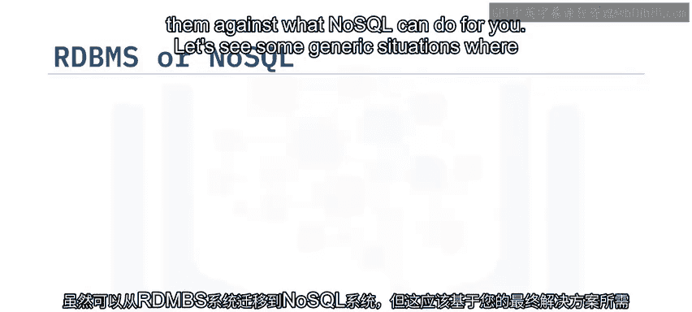

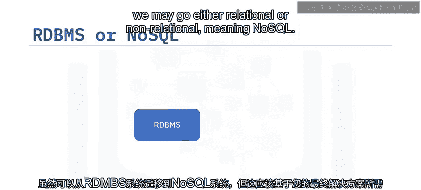

If you need full consistency for your data， if your data is structured。

 if you need multi document transactions and complicated joins， in this case。

 a relational database will make more sense。

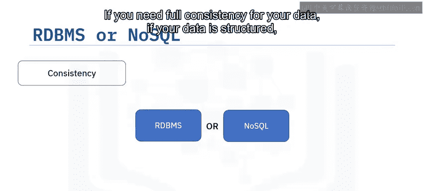

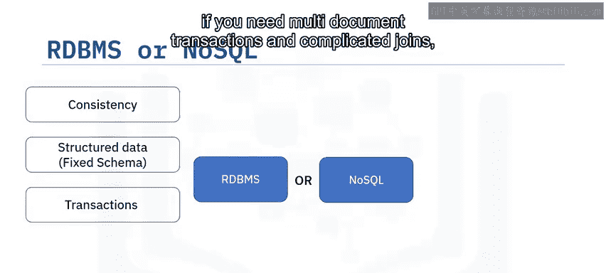

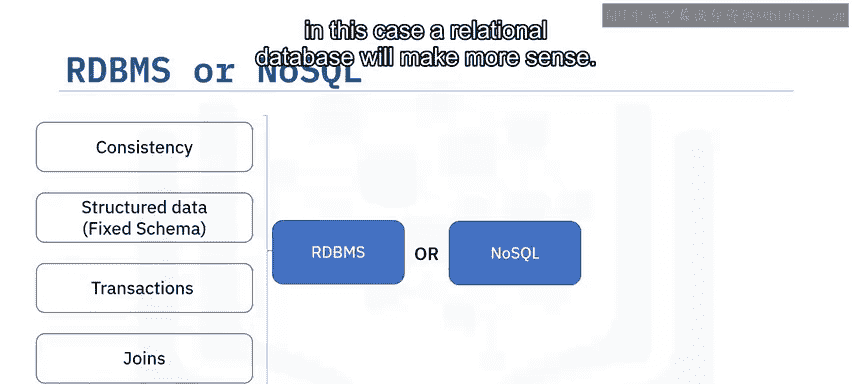

If you have loads of data and need a high performance system。

 if your data is unstructured and could benefit from a flexible schema。

 if your system needs to be available and scalable， then in this case。

 a no SQL database will make more sense。

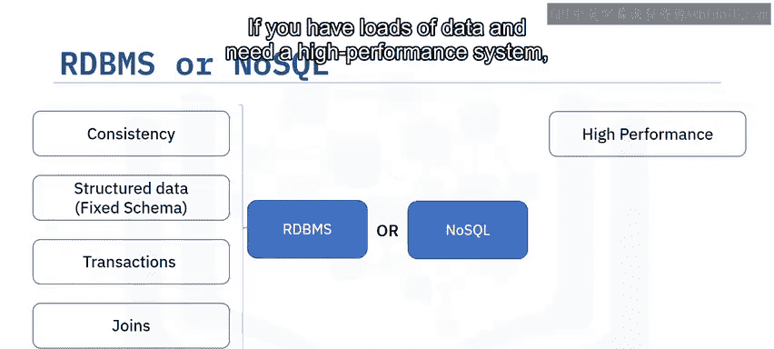

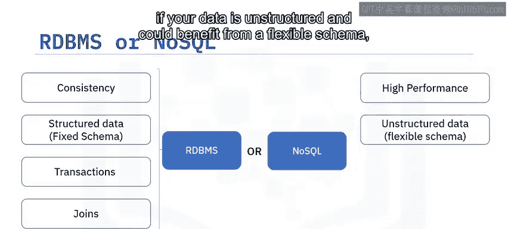

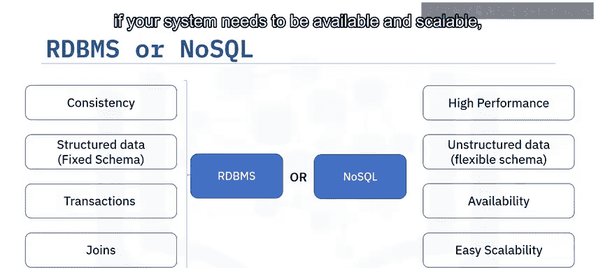

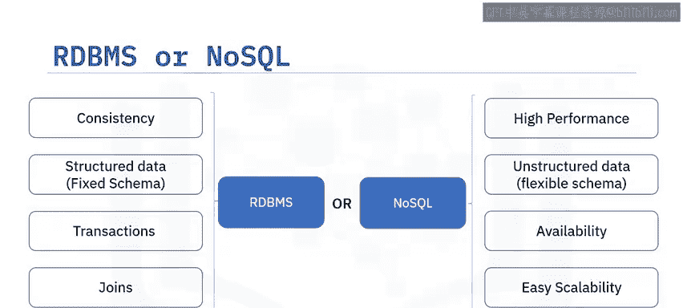

There might be other cases in which both relational and no SQL databases will be needed。

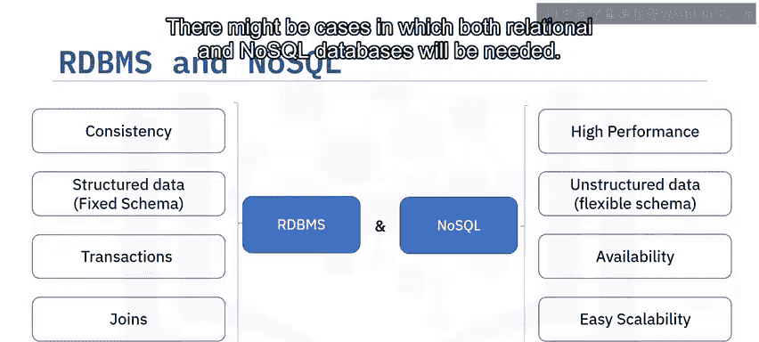

If you have too much data and need performance， and need to scale fast， but at the same time。

 you also need transactions， support and complex joins on your data。

 then you might think of a combined solution。

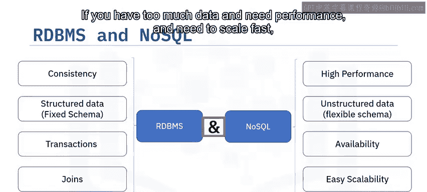

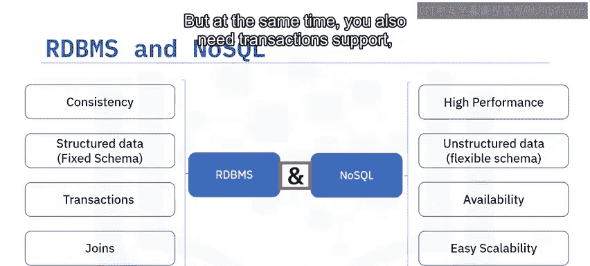

When embracing the no SQL world and coming from a relational one。

 there are a few things you should pay attention to， like the fact that in no SQL。

 your data model is driven by your queries。 not the data itself in a relational world。

 the solution design starts from the data。 The entities and their relationship。

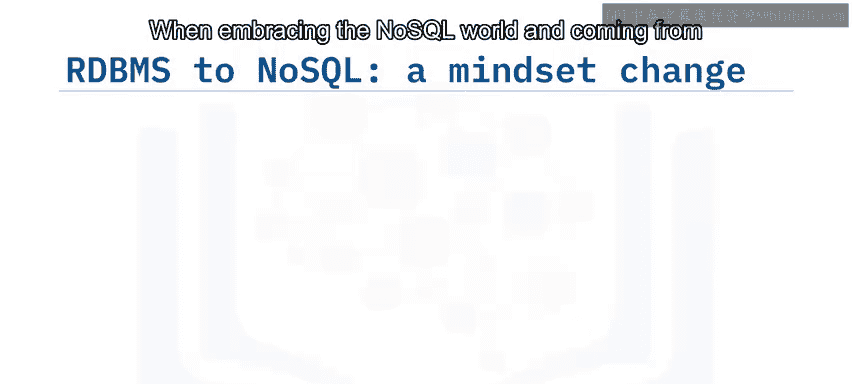

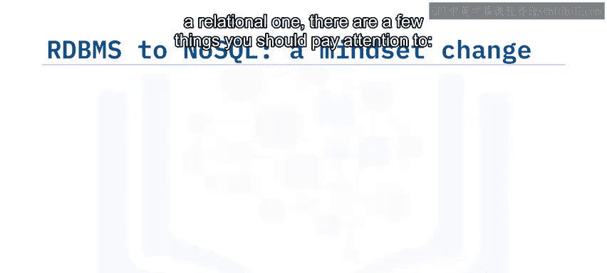

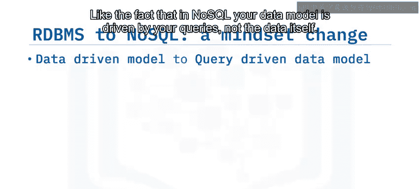

In no SQL， it's not the data that drives your data model or schema。

 it's the way your application accesses the data and the queries you are going to make。In no SQL。

 model should be based on how the app interacts with the data。

 rather than how the model can be stored as rows in one or more tables。

Another factor to pay attention to is the fact that in RDBMS data is normalized while in no SQL。

 it is denormalized with no SQL starting from your query means that you will structure your data on disk accordingly。

 Thus， you may need to store the same data in different models just to answer the question。

 and this will lead to data to normalization。While data in RDBMS is normalized。

 you need to be open to the situation in which you start with your queries instead of your data。

Remember our earlier acid versus base video， when migrating from relational to no SQL databases。

 you need to understand that sometimes services require availability more than consistency。

 when both availability and performance are needed， thus distributed systems。

 consistency cannot be ensured。

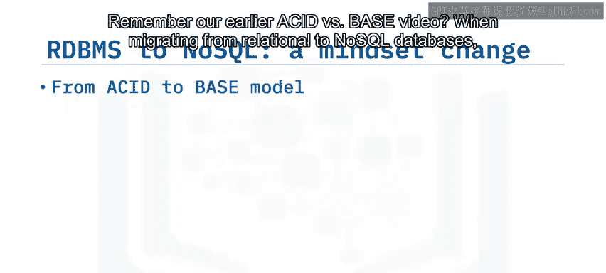

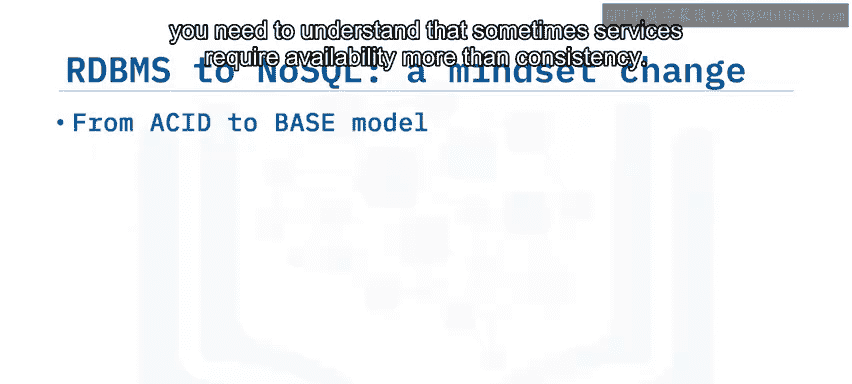

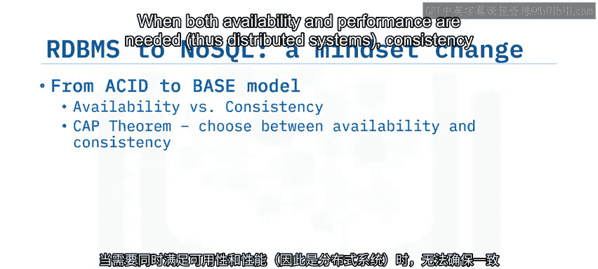

Remember CAP theorem， many of today's online services value availability more than consistency。

 and because of this， they look for systems that can provide it。

 taking into consideration the amount of data they are dealing with and their geographical presence。

One last thing to know when dealing with no SQL databases。

 these are not designed to support transactions or joins or complex processing。

 except in limited cases， you need to consider this when moving from RDBMS to no SQL。

In this video you have learned that no SQL systems are not a de facto replacement of RDBMS。

 RDBMS and no SQL cater to different use cases。

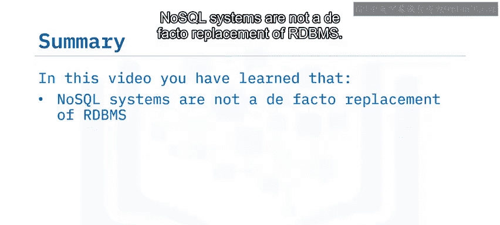

Your solution could use both RDBMS and no SQL。A migration from RDBMS to no SQL could be triggered by requirements of performance driven by data volume or flexibility in the schema or system scalability。

 and migrating from RDBMS to no SQL requires adoption of no SQL concepts。

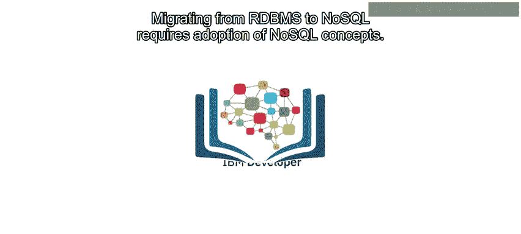