# IBM数据工程专业证书课程10：《NoSQL数据库导论》｜introduction-to-nosql-databases｜ - P11：10_mongodb 概述.zh_en - GPT中英字幕课程资源 - BV1UN41187Zz

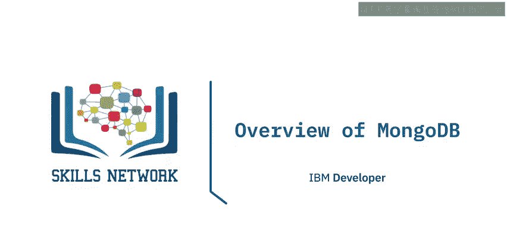

Welcome to an overview of Mongo DB After watching this video。

 you will be able to explain what MongoDB is list the different components of MongoDB and describe why and where to use Mongo DB Mongo DB is a document and a no SQL database instead of storing data in tables of rows or columns like SQL databases。

 each record in a MongoDB database is a document and you store the data in a non-relational way。

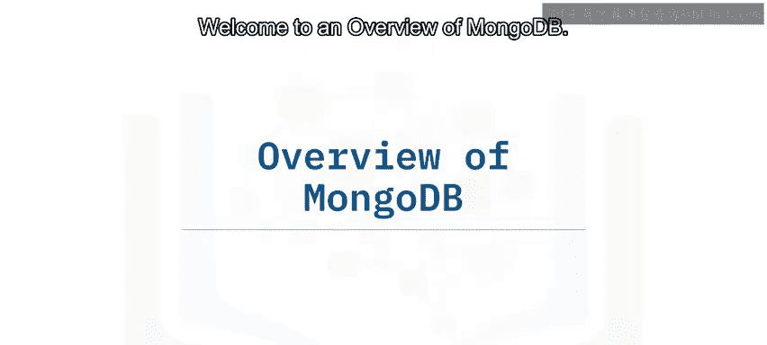

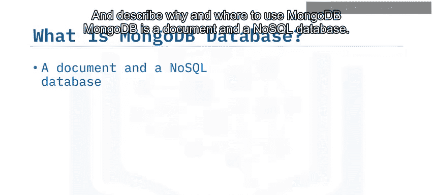

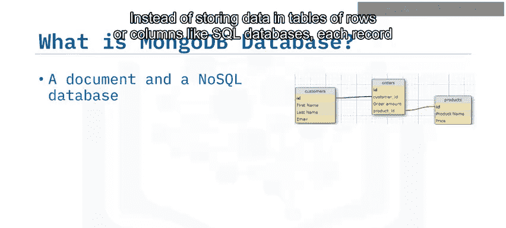

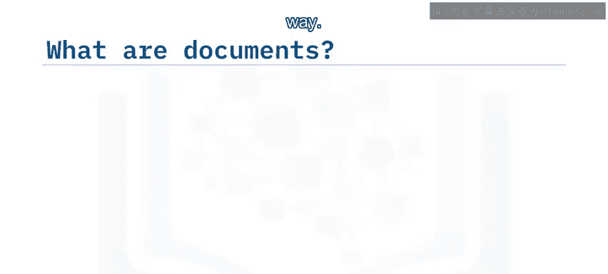

Documents are associative arrays like J objects or Python Dictionaries， for example。

 a student document representing a student's first name， last name， email address， and ID。

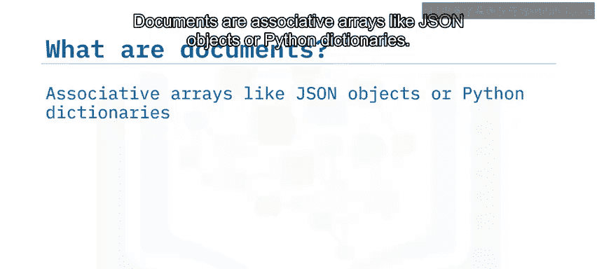

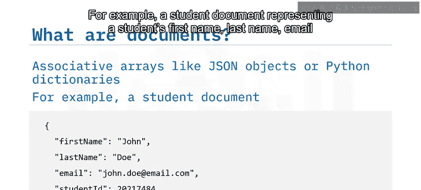

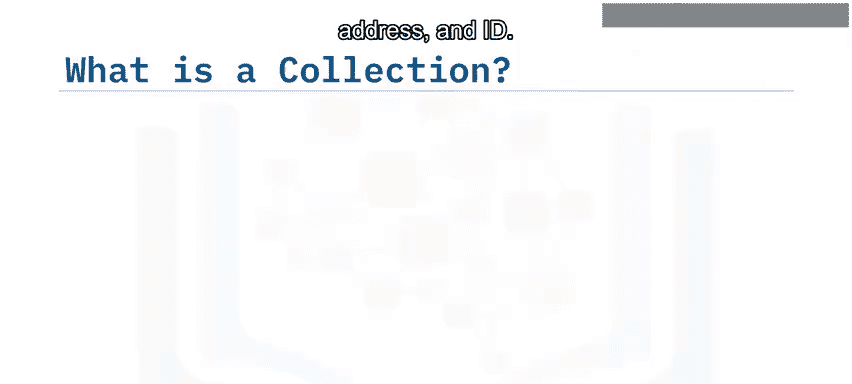

Mongo Dbi documents of similar type are grouped into a collection Our campus management system stores all student records or documents in the student's collection。

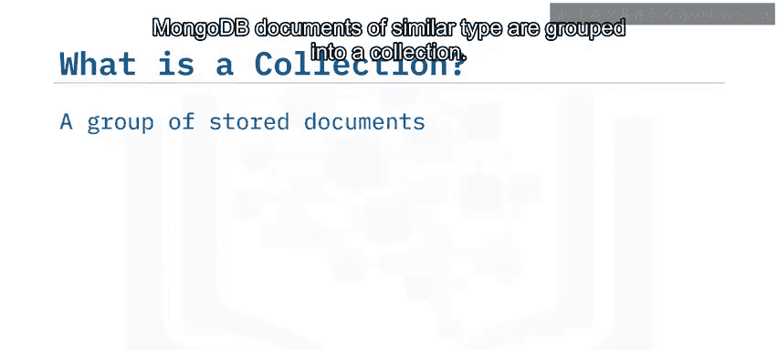

And similarly， all staff documents are stored in the employee's collection。

So what is a database following our previous example。

 the campus management system stores all different types of data related to it in a Mongo DB database called Campus Management DB Let's dissect our document in the document below。

 first name， last name， email and student ID， our fields or properties with values representing a student named John Doe。

 and each field name is unique within that document。

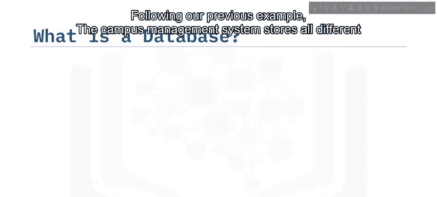

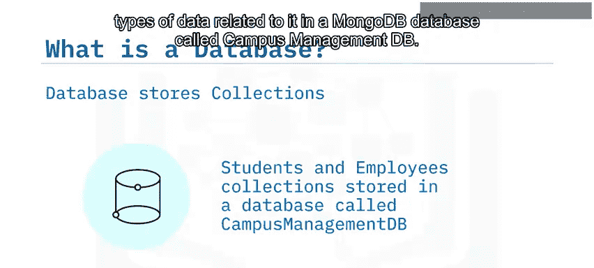

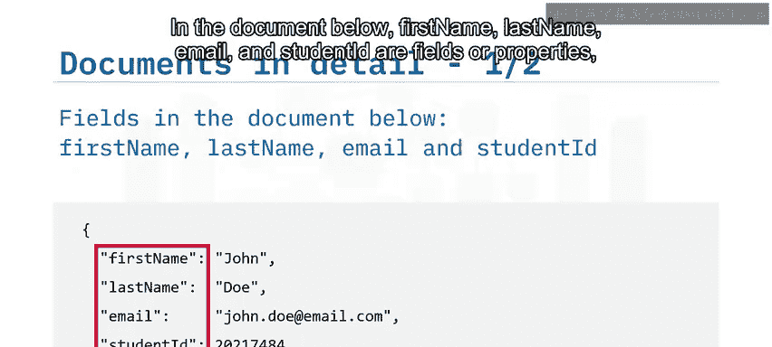

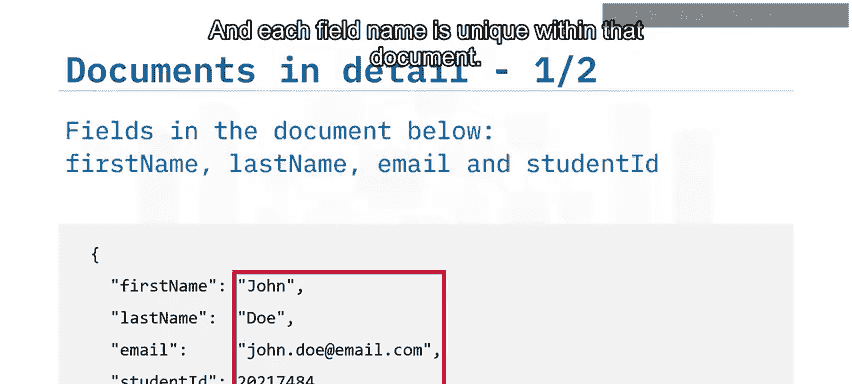

MongoDB supports a variety of data types， so you have the full capability to use the correct data type to store your information in。

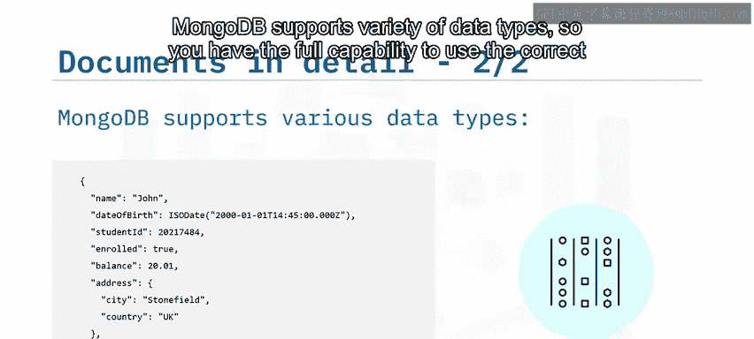

For example， dates should be stored as ISO date or Uniix style E dates。

 which will help you with queries likeG me all students born between 15th of January to 15th of February。

 Numbers can be stored either as whole numbers or decimals。

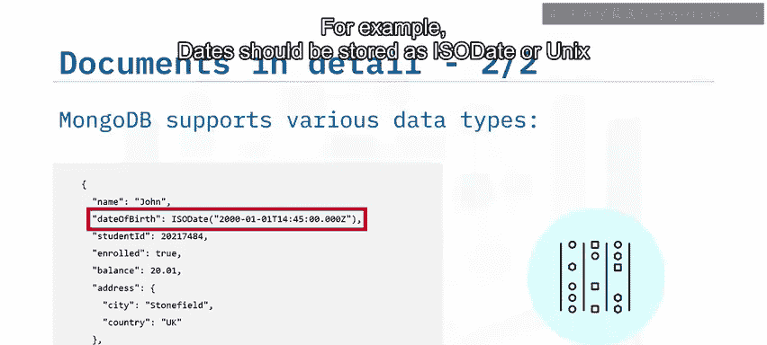

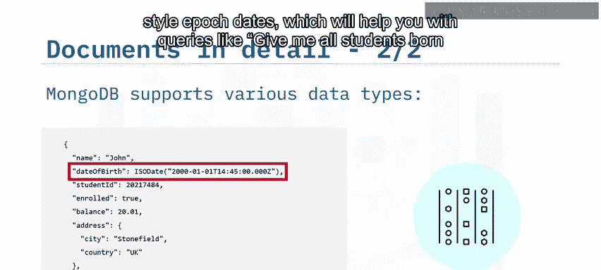

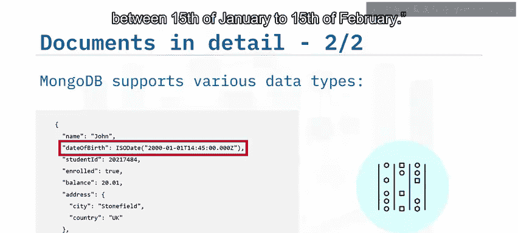

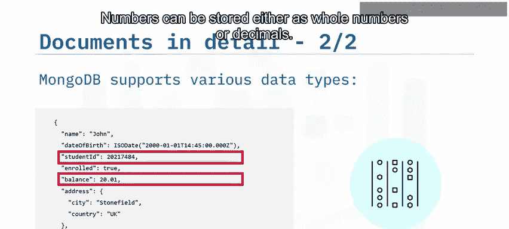

Being a document database， MongoDB also allows you to store sub documentscu to group secondary information together。

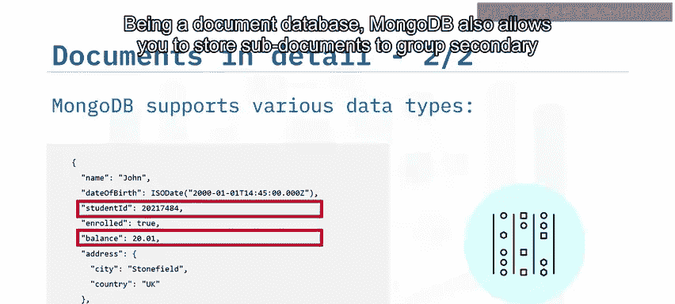

It also supports lists of values， not just text， but even different kinds mixed together。

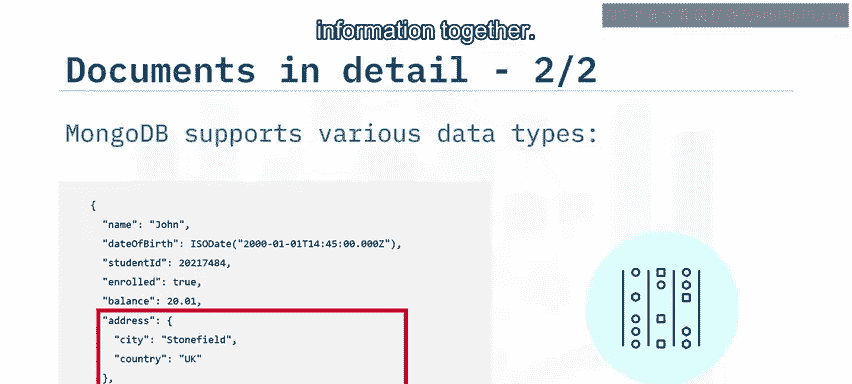

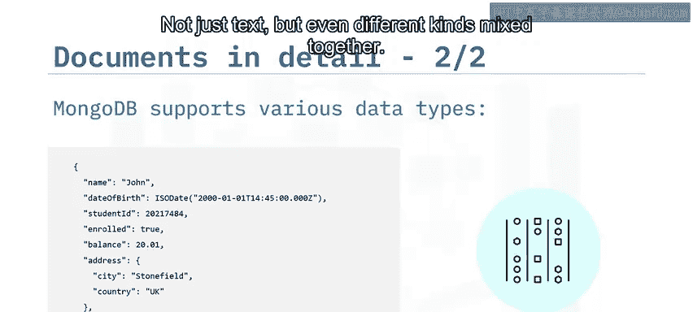

Working with Mongo Db is easy because you can focus on the data you are writing and how you are going to read it。

 Traditional relational databases required you to create the schema first。

 then create table structures that will hold your data。

 So if you decide to store an additional field， you will then have to alter your tables。

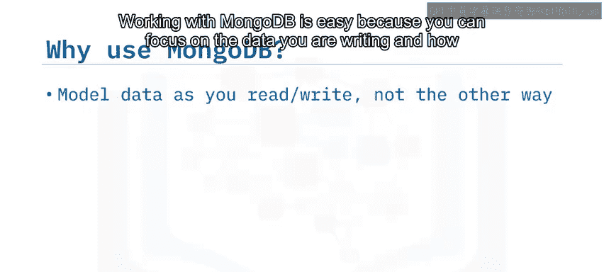

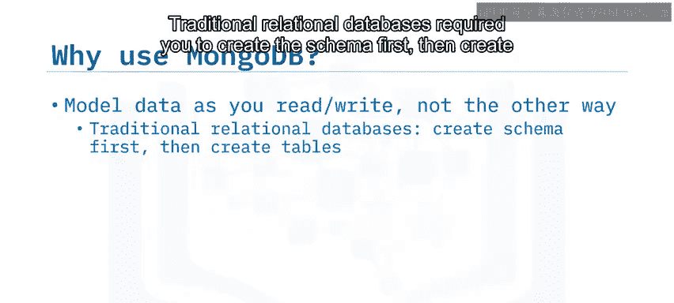

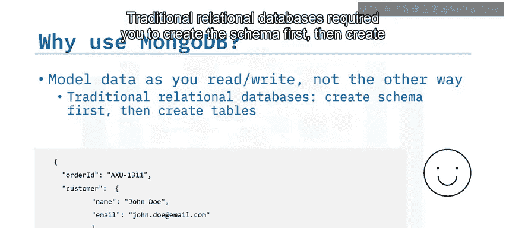

In Mongo Db， you change as you go along。MangoDB also gives you the power to bring in any structured or unstructured data。

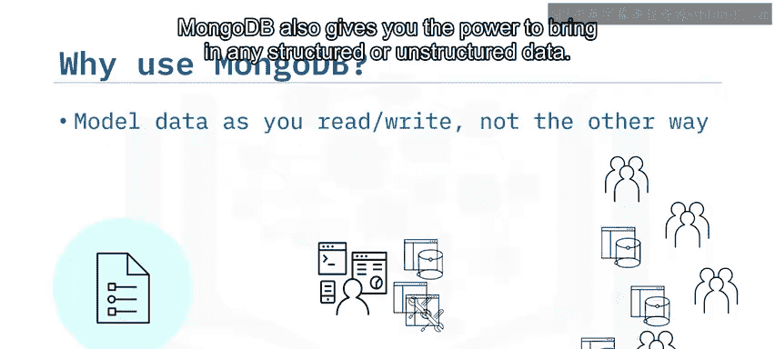

It also provides high availability by keeping multiple copies of your data。

 which we will cover in later topics。You can design complex data structures easily in Mongo DB without worrying about the complexity of how it is stored and how it should be linked。

 For example， your campus management application is also launched in the USA。

 where they do not store postcodes but have zip codes。

Scalability provided by MongoDB means as your data needs grow。

 you can easily scale vertically by introducing bigger， faster， better hardware。

 or horizontally by partitioning your data。All of that can be done whether you are running a self managedaged onpres Mongo DB or the hybrid or cloud hosted and fully managed services such as IBM Cloud databases for MongoDB。

 or Mongo DB Atlas on AWS， Azure and Google Cloud。In this video you have learned that MongoDb is a document and a no SQL database MongoDB supports various data types。

 Documents provide a flexible way of storing data MongoDB documents of a similar type are grouped into collections MongoDb models data as you read and write。

 bring structured or unstructured data and provides high availability and MongoDb can be used for a variety of purposes because of the flexibility of storing structured or unstructured data。

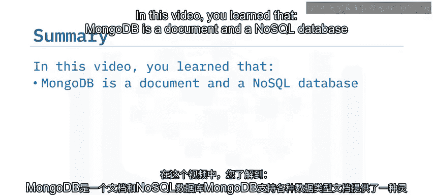

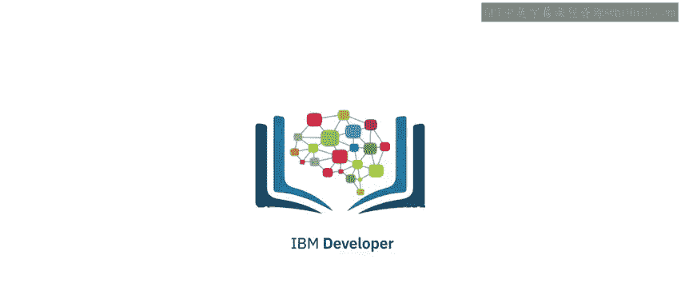