# IBM数据工程专业证书课程10：《NoSQL数据库导论》｜introduction-to-nosql-databases｜ - P12：11_mongodb 的优势.zh_en - GPT中英字幕课程资源 - BV1UN41187Zz

Welcome to Advages of MongoDB。After watching this video。

 you will be able to identify the key benefits of using MongoDB and explain why it suits your evolving data needs。

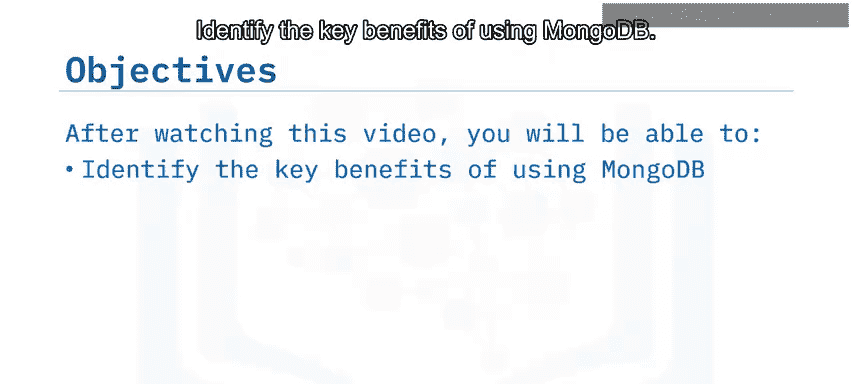

The first key benefits of using Mongo DB is the flexibility of its schema。

 Compare the two addresses shown here， there is no zip code for UK addresses and no postcode for American addresses。

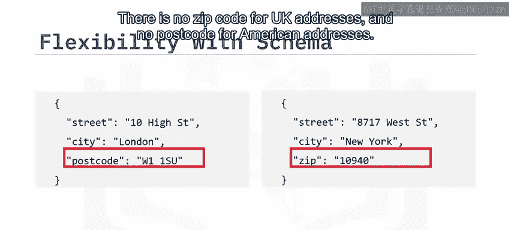

In a relational world where fields names must be present in each row。

 this would cause us to have either overarching fields or a lot of fields with no values。

 But storing in this format in Mongo Db is not a problem because it allows us this flexibility with the schema。

 This also allows us to store unstructured data。 For example。

 combining data of different shapes from different sources for analysis or storage。

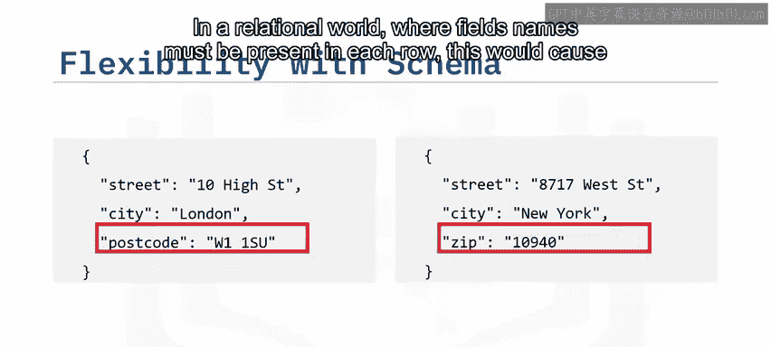

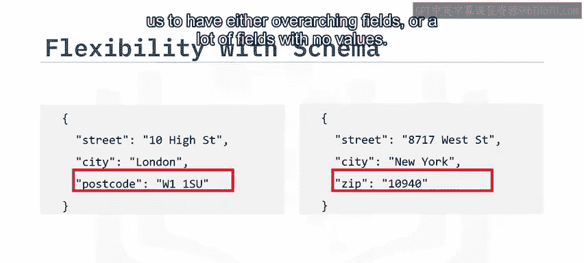

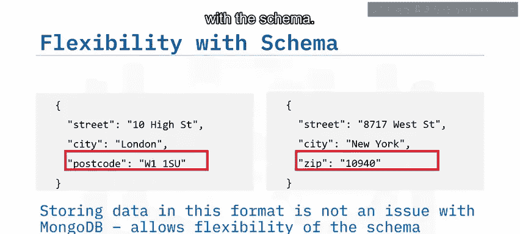

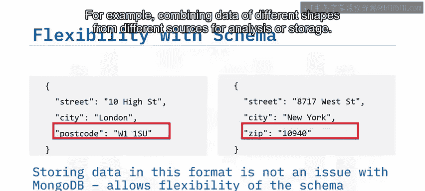

The second benefit of using Mongo DB is its code first approach Relational databases add complexity when you start because first you need to create your table design and only then are you allowed to work on your database。

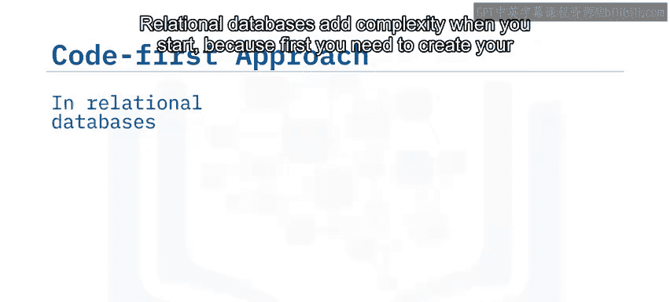

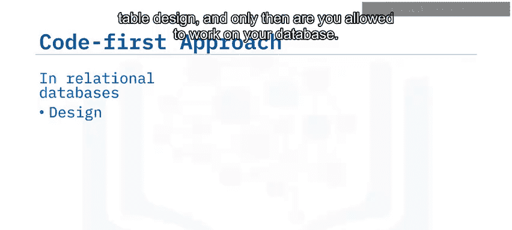

Since Mongo Db works on documents， it means you can access your data without having any complexity in between。

 There are no complex table definitions。 You can start writing your first data as soon as you connect to your Mongo Db database。

 This also eliminates the use of any third party frameworks to give you read and write operations。

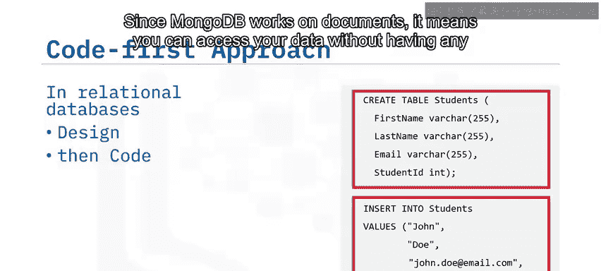

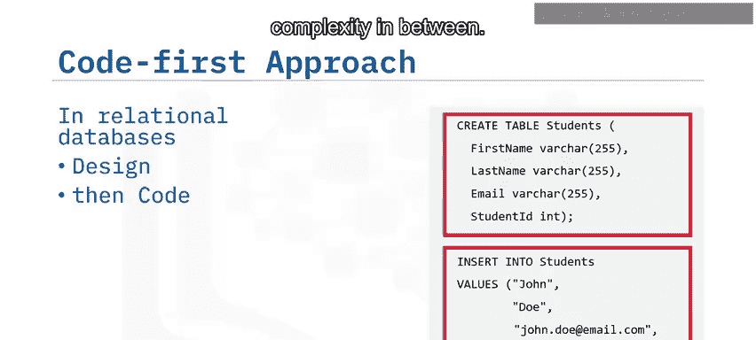

The third key benefit is an evolving schema。 Imagine you run a courier company。

 so you need to store delivery addresses with the massive changes in delivery procedures introduced in 2020。

 You need to quickly evolve your schema to store additional information about contactless delivery with minimal disruption With Mongo Db。

 This is easily possible。 All you need is to start storing this additional information in your delivery documents。

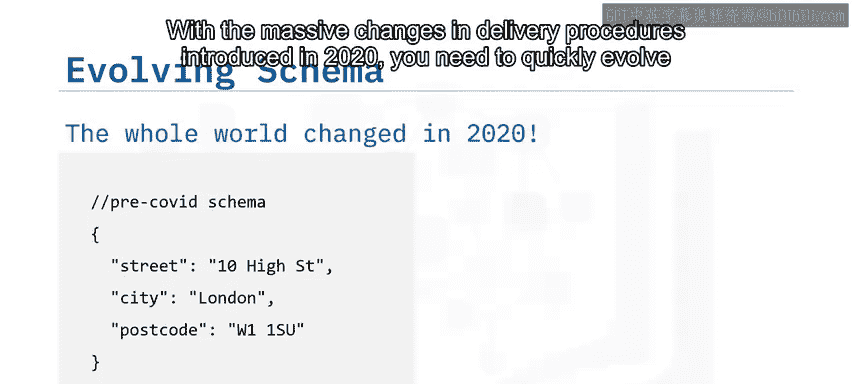

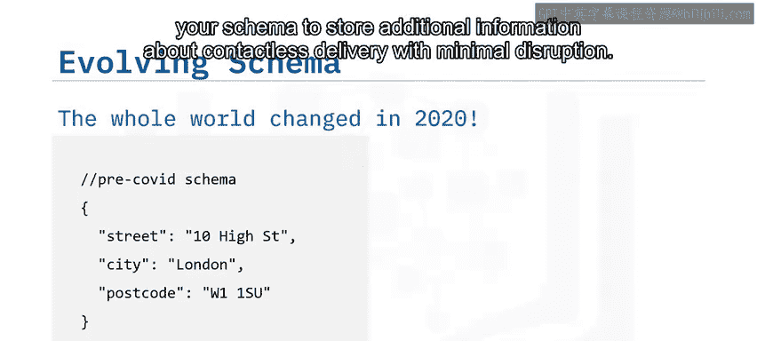

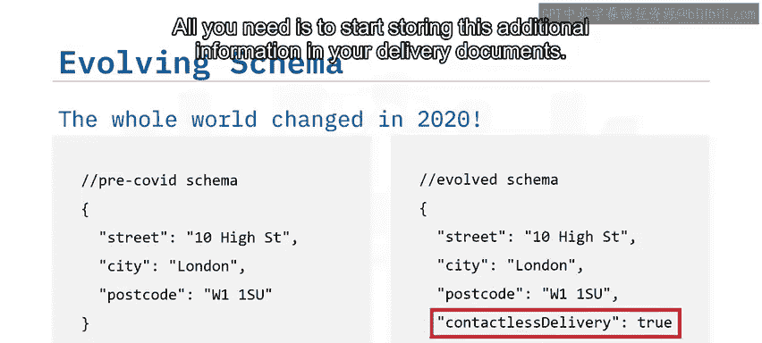

Let's look at an example of a stock market aggregator。

 This collects stock data from different sources。 Each piece of source data can be a different shape。

 which means it's essentially unstructured data when it comes to Mongo Db with the flexibility Mongo Db provides。

 we can store all this data together in one collection。

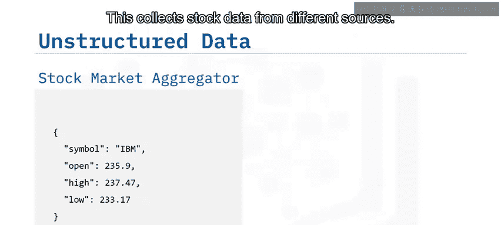

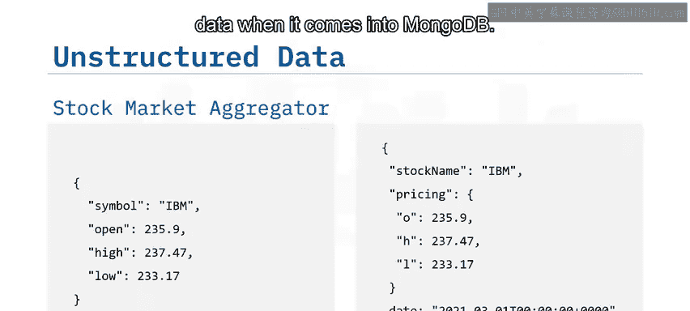

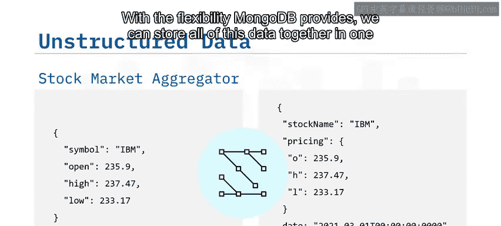

The next key benefit is querying and analytics capabilities。

 Mongo Que Laage or MQL has a number of operators that you can use to build fairly complex queries to find your data。

 If your queries are even more complex， you can use aggregation pipelines within Mongo DB。

 For example， group all student results by their year group and find top scoring students by semester。

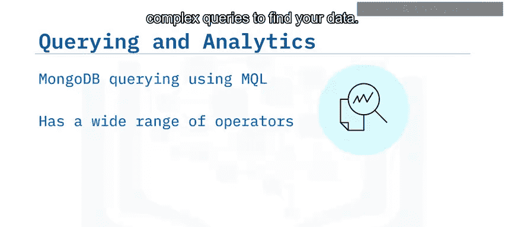

And the last key benefit we will discuss is high availability。

 Mongo Db natively supports being a highly available system by means of redundancy。

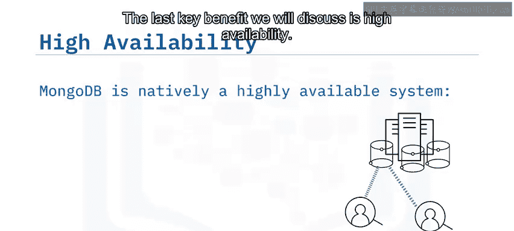

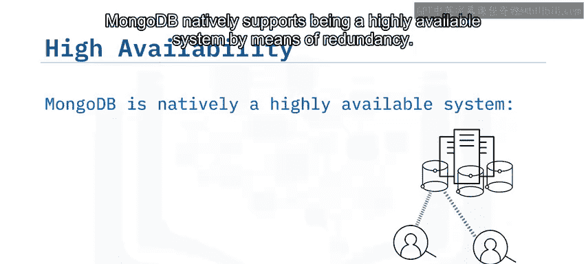

Typical Mongo Db setups are three node replicas sets。

 where one of them is a primary member and the others are secondary members。

 Replication keeps a copy of your data on other data bearing nodes in the cluster。

 if one system fails。 the other one takes over and you do not see any downtime。

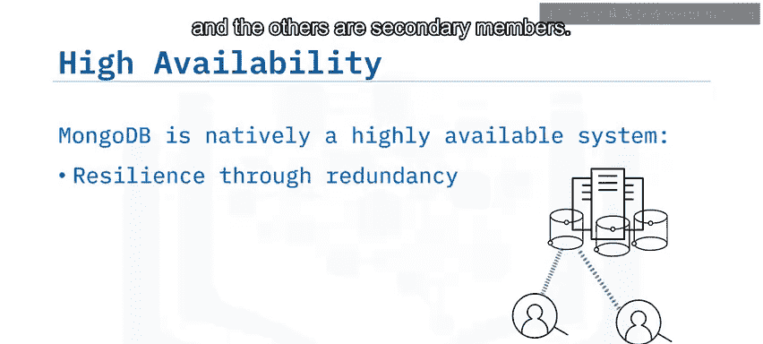

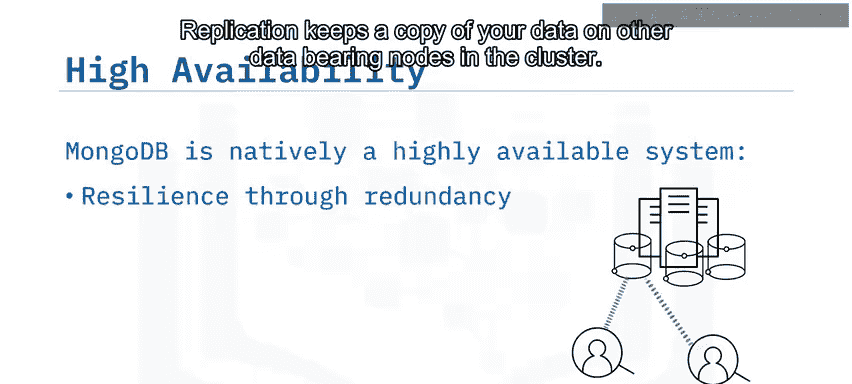

This also works for system maintenance situations where you might take away a node from making updates to software。

 operating systems， file systems， security patches， or your Mongo Db version。

 We will cover more on this subject later in the course in replication and sharding。In this video。

 you learned that the database schema can be flexible when working with MongoDB。

 You can change it as needed without involving complex data definition language statements。

 MongoDB uses a code first approach instead of a design then code approach。

MongoDb also utilizes an evolving schema complexplex data analysis can be done on the server using aggregation pipelines。

 and MongoDB provides native high availability。

