# IBM数据工程专业证书课程10：《NoSQL数据库导论》｜introduction-to-nosql-databases｜ - P13：12_mongodb 的用例.zh_en - GPT中英字幕课程资源 - BV1UN41187Zz

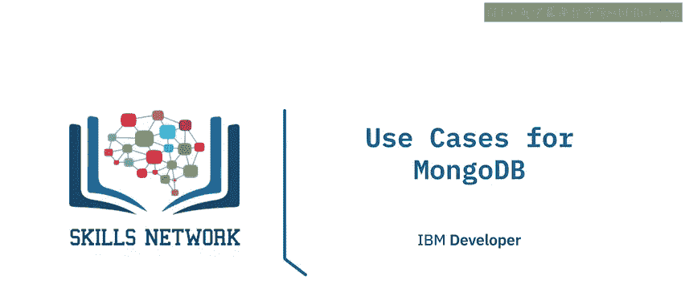

Welcome to use cases for Mongo Db。 After watching this video。

 you will be able to list the most common use cases for Mongo Db。 Describe the many sources。

 One view use case。 Describe the IoT use case。 Describe the E-commerce use case。

 Describe the realtime analytics use case。 De the gaming use case and describe the finance use case。

 Mongo Db allows you to bring data from different sources into it。

 So instead of each part of your data living in silos。

 you can ingest multiple shapes and formats of data into Mongo Db to get one view of it put together。

 This is helped by the flexible schema supported by Mongo Db。 Mongo Db can be used with Io devices。

 There are billions of Io devices around the globe。 These include small components。😊。

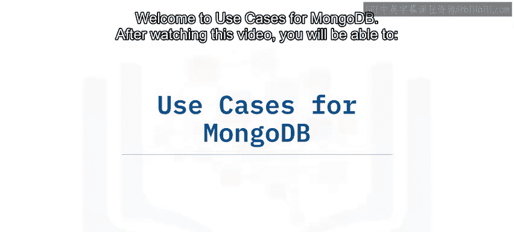

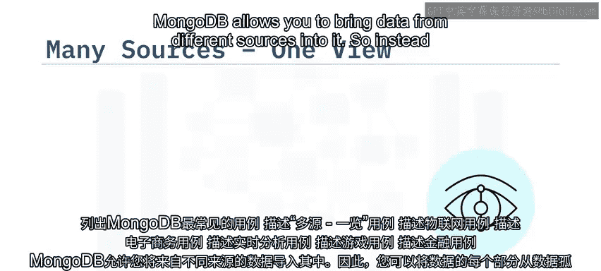

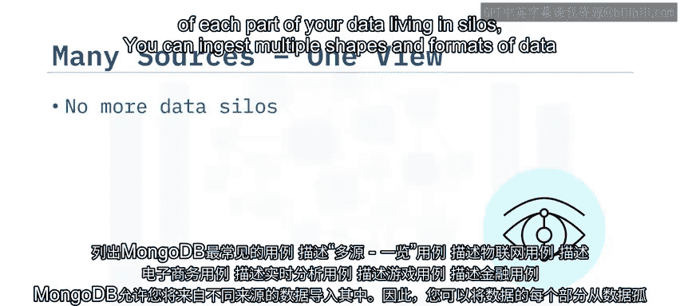

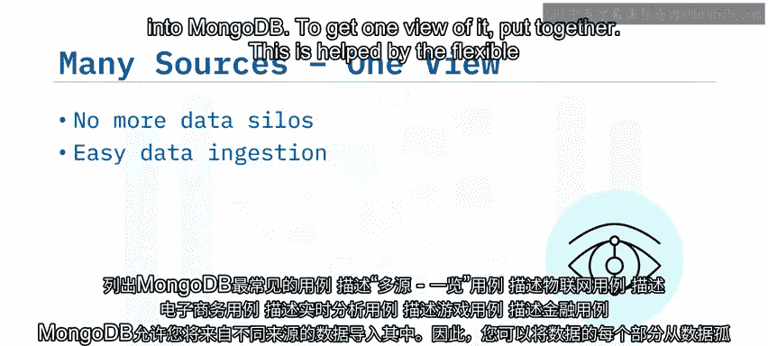

In your autonomous car to an internet connected light bulb。

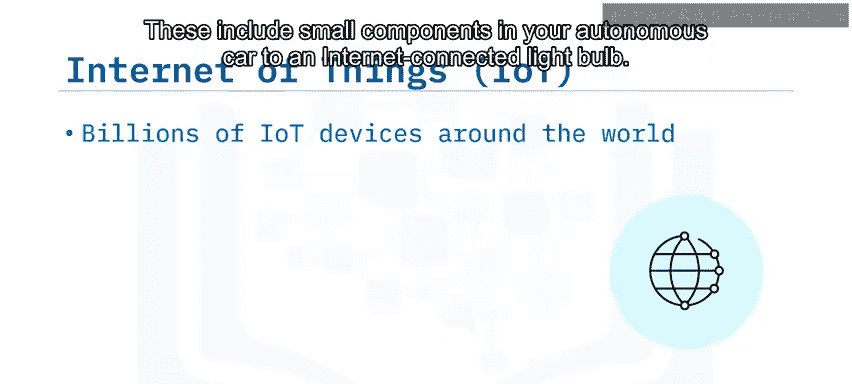

These devices generate vast amounts of data， for example。

 a weather station will send a temperature and wind speed reading every minute。

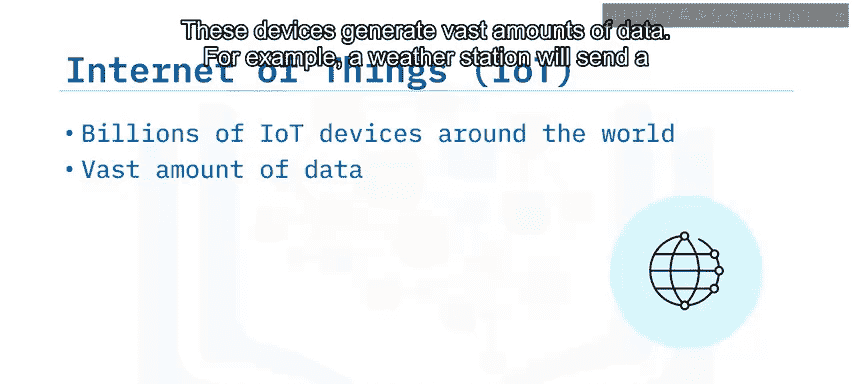

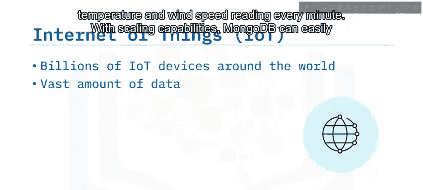

With scaling capabilities， MongoDB can easily store all of this data distributed globally。

 and once it is in MongoDB using the expressive querying capabilities。

 all of this data can be used in complex analysis and decision making。

Mongo Db can also be used with e-commerce Solutions。

 Products sold on an e-commerce website have different attributes。 For example。

 a phone has attributes such as storage， network and color。 A book will have attributes。

 such as publisher， writer and a number of pages。

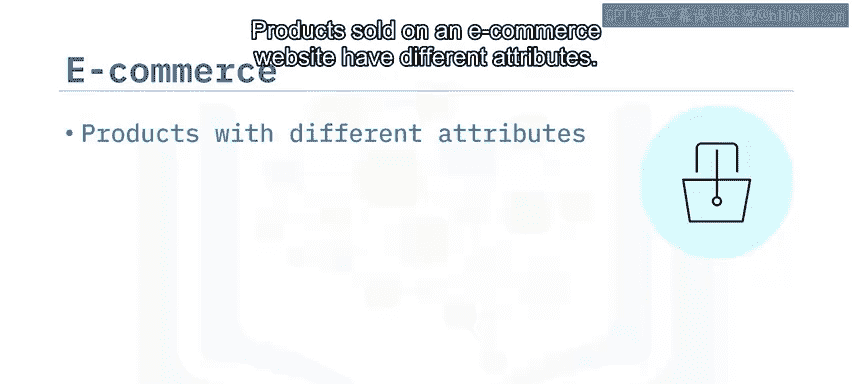

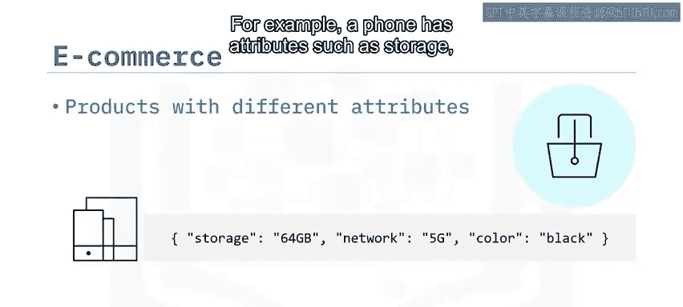

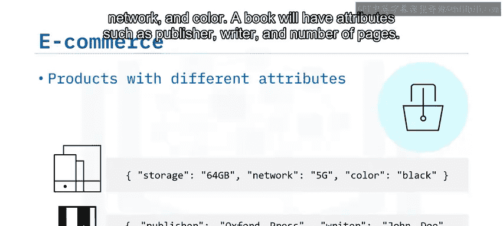

Products also have attributes such as top reviews， pricing。

 inventory and other metadata with the help of documents。

 sub documentscuments and list properties in Mongo Db。

 you can store this information together so it is optimized for reads。

 This makes MongoDb a perfect fit for use cases allowing dynamic schema。

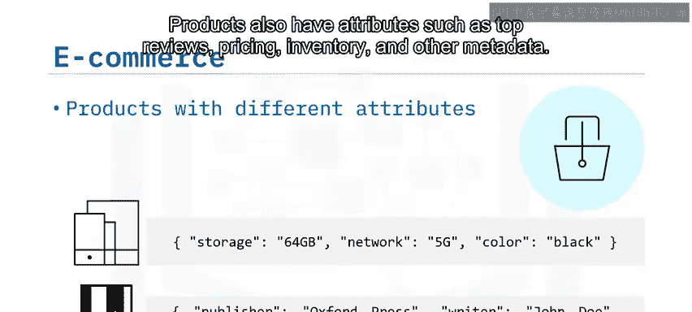

Mongo Db is a good fit when you want real time analytics。

 Most organizations want to make better decisions based on their data。

 doinging historical analysis is easy， but only a few can respond to changes happening minute by minute。

 and most of the time this is due to complex， Ex transform and load or E TL processes。 With Mongo Db。

 you can do most of the analysis where the data is stored。

 That data can be semistructured or completely unstructured。 All of this can be done in real time。

 Mongo Db has a part to play in the gaming world。 too。

 with more multiplayer games being played globally than ever。

 Getting the data across is hugely important。 with native scalability， also known as sharding。

 Mongo Db makes it easier to reach users around the world。😊。

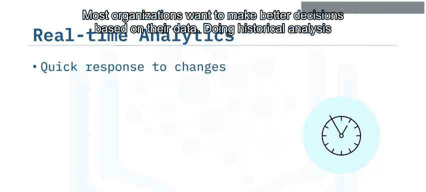

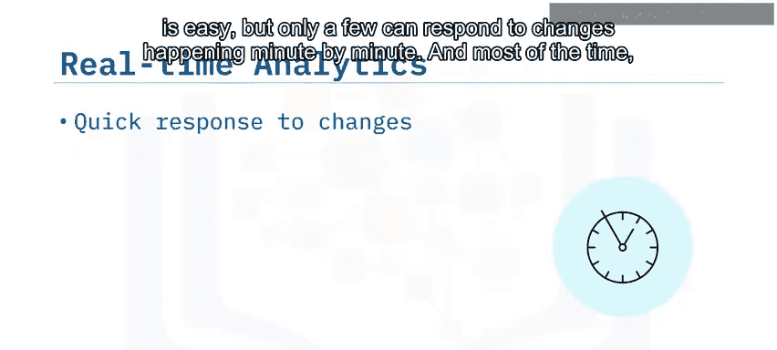

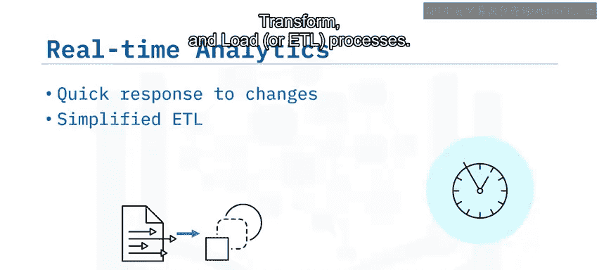

And again， with the flexible schema， it is easier to support ever changing data needs。

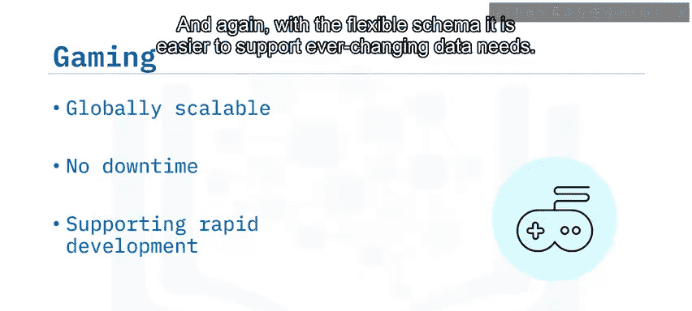

MongoDb has usage scenarios in the finance industry as well。 Nowadays。

 we want our banking transactions to be as quick as possible。

 while we also expect the financial industry to keep our information secure with MongoDb。

 you can perform thousands of operations on your database per second and all the information is encrypted while encrypt transfer and when stored on disk。

 you can additionally encrypt individual fields to avoid any data incident。

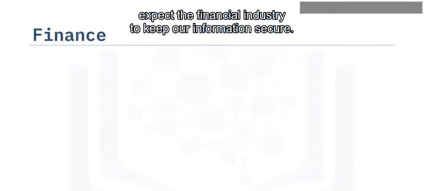

And finally， like every industry， financial institutions have much higher requirements for reliability and services being available around the clock。

 We expect our finances to be available without any downtime。

 This makes Mongo Db a good choice for banks， trading companies and the financial industry in general。

 In this video， you learned that Mongo Db can be used in a variety of use cases。

 The scalability it provides makes it easier to work across the globe。

 and it enables you to perform real time analysis on your data。😊。

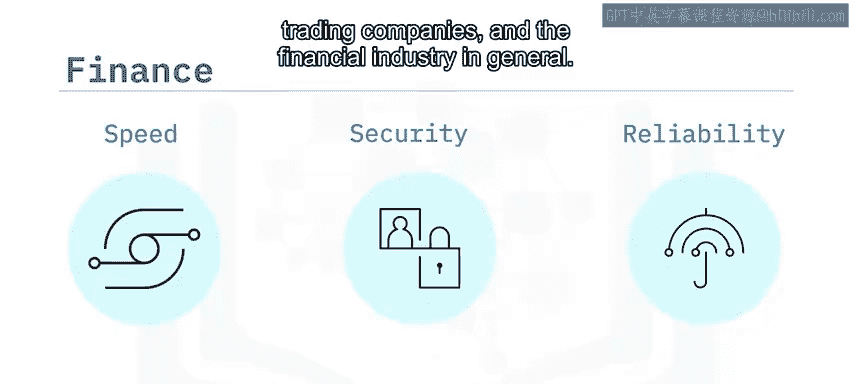

。

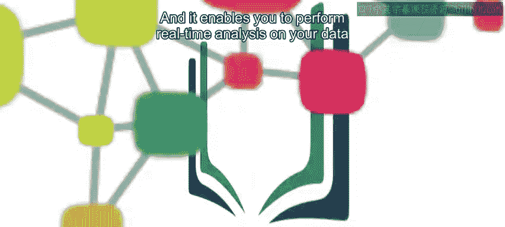