# IBM数据工程专业证书课程10：《NoSQL数据库导论》｜introduction-to-nosql-databases｜ - P15：14_索引.zh_en - GPT中英字幕课程资源 - BV1UN41187Zz

Welcome to indexes。 After watching this video， you will be able to explain why we need indexes。

 Use indexes to perform efficient searches and sorts。 and describe how Mongo Db stores indexes。

 Indexes help quickly locate data without looking for it everywhere。 For example。

 the British Library holds 25 million books。 You are looking for designing data intensive applications by Martin Klepman。

 Without indexes， you will need to look through all of them。 with indexes。

 you go into the computer section， then into the databases aisle， and finally on the M shelf。😊。

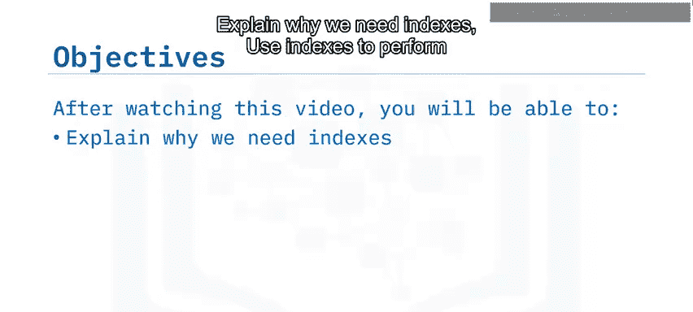

There you will find the book by Martin Klepman。We use indexes every day to find information quickly。

 For example， until a few years ago， telephone books were really popular。

 All the names were indexed by surname and first name。 So to find one person。

 you jump into the surname section。 D for Doe。 Then you go to the first names starting with J。

 And you can easily find John Doe。 Other everyday examples include a dictionary and an index at the end of a book。

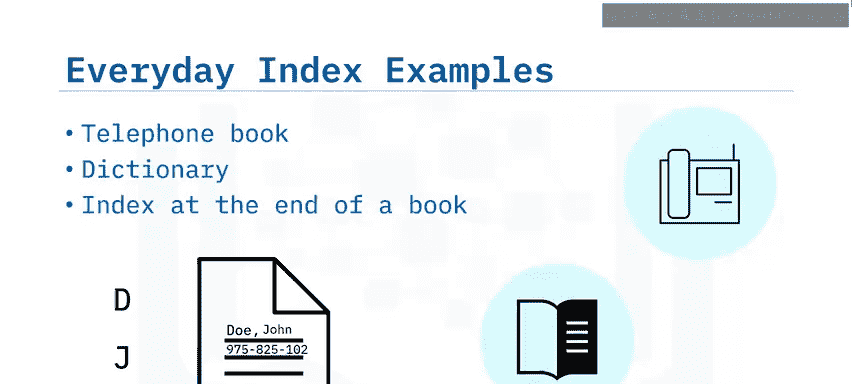

In database systems， indexes should be created for the most frequent queries in the campus management database for the course enrollment collection。

 we find students using course ID instead of scanning the whole collection。

 we create an index on the field course ID in the course enrollment collection。

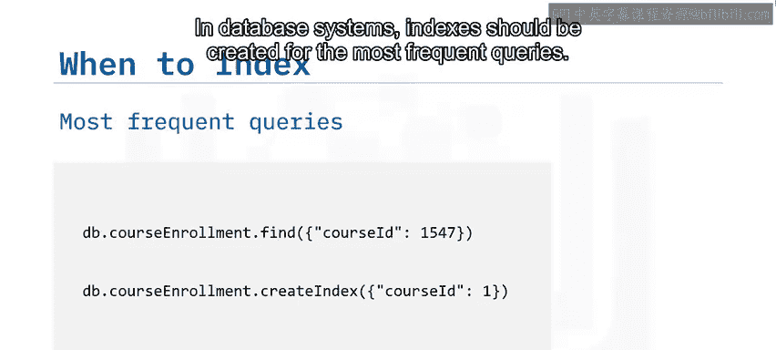

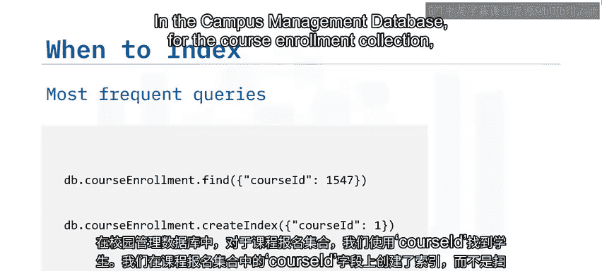

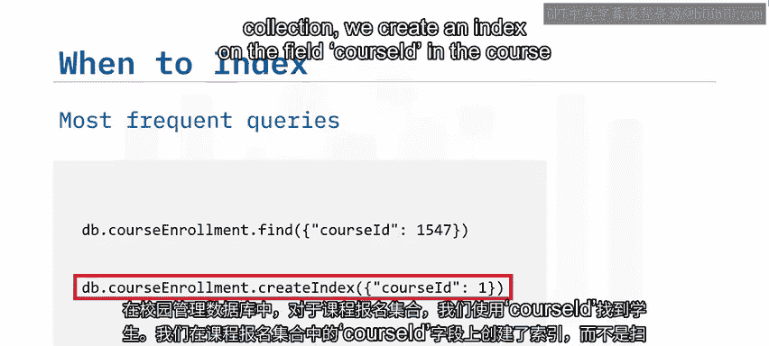

Course ID colon 1 means store the index in ascending order。

Our index on course ID will help find those documents more efficiently。

 but to organize the students by student ID in ascending order。

 MongoDb will need to perform inmeory sort， which will not be efficient in this situation。

 we can change our index to be a compound index， which means indexing more than one field。

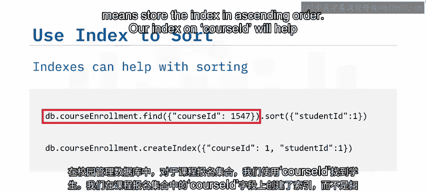

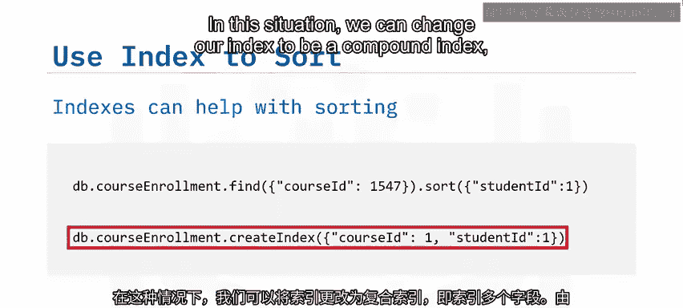

Because the items in the index are organized in ascending order。

 once we find all documents with a matching course ID of 1547。

 they will all be already sorted by student ID because of this index。

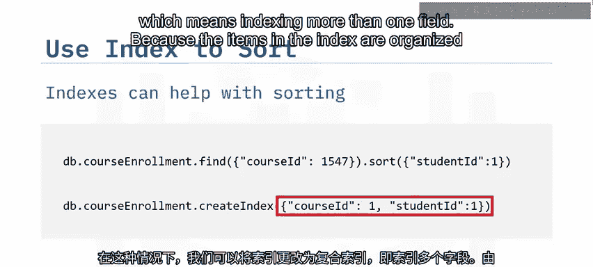

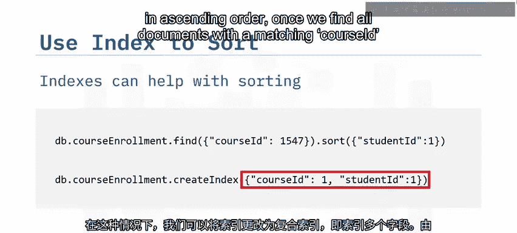

Indexes in Mongo Db are special data structures。 They store the fields you are indexing and a location where the document is stored on disk。

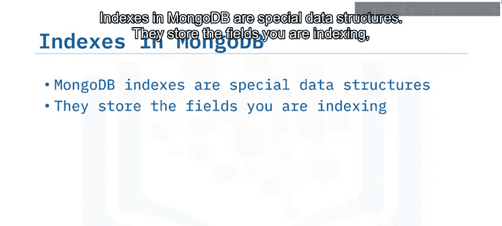

Mongo Db stores indexes in a tree form。 a balanced tree to be precise。 Imagine our last example。

 course I D being the first field in our compound index is in ascending order under each tree node。

 you will have students in ascending order too。 This makes finding documents much more efficient。

 whether it's an equality or arrange search。 And if you are sorting on a field which is already indexed。

 Mongo Db doesn't need to sort it again。

In this video， you learned that indexes help quickly locate data without looking for it everywhere indexes should be created for the most frequent queries。

 a compound index indexes more than one field MongoDB stores data being indexed on the index entry and a location of the document on disk。

 and finally MongoDB stores an index as a tree to make finding documents more efficient。

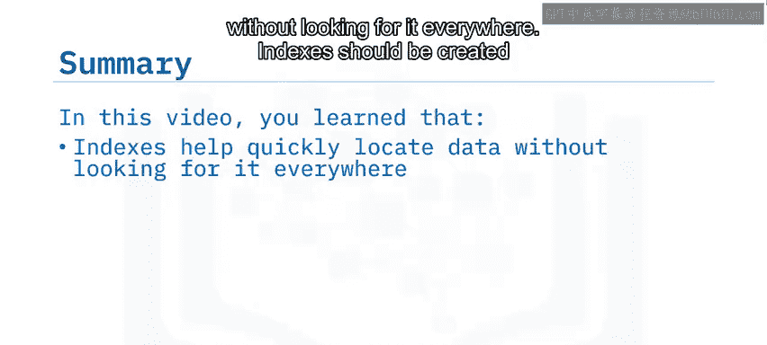

