# IBM数据工程专业证书课程10：《NoSQL数据库导论》｜introduction-to-nosql-databases｜ - P17：16_复制 分片.zh_en - GPT中英字幕课程资源 - BV1UN41187Zz

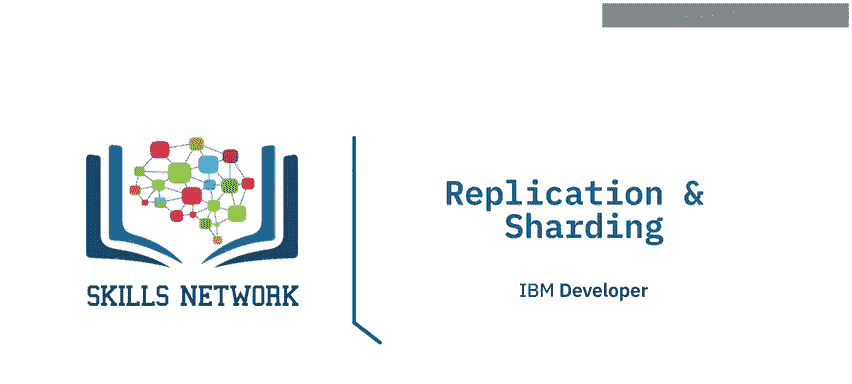

Welcome to Replication and Sarding。

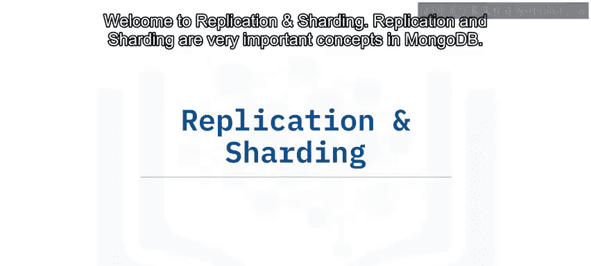

Replicationation and sharding are very important concepts in Mongo DB The scale and availability we see with MongoDB is achieved using these two concepts。

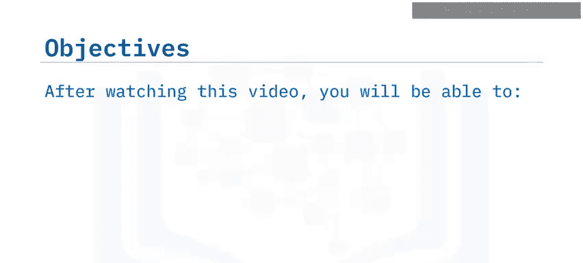

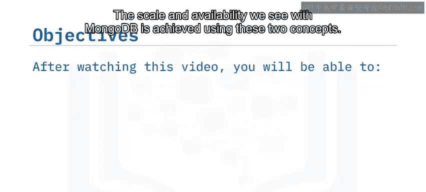

After watching this video， you will be able to describe what replication is。

 explain how it helps with high availability， and explain how sharding helps to scale a database。

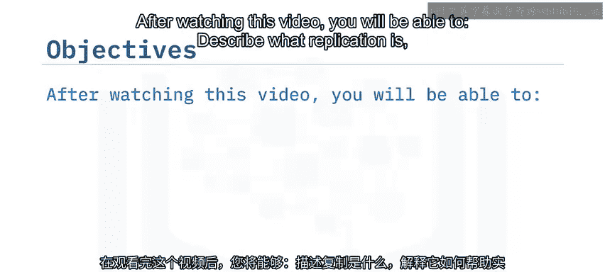

A typical Mongo D B cluster is made of three data bearing nodes。 All three nodes have the same data。

 hence the name replica set data is written to the primary node。

 which then gets replicated to the secondary nodes。

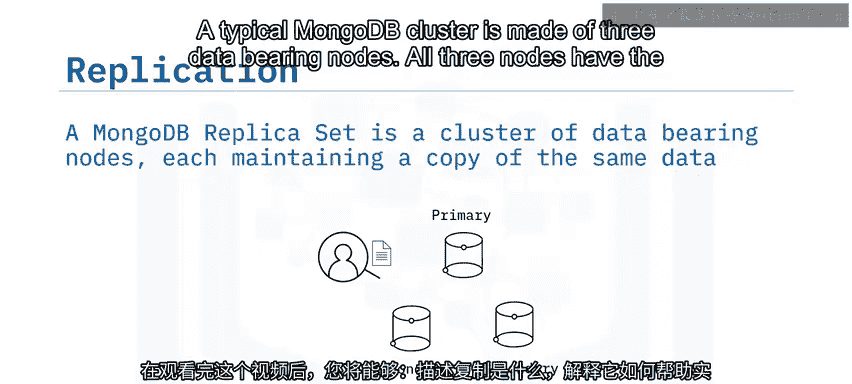

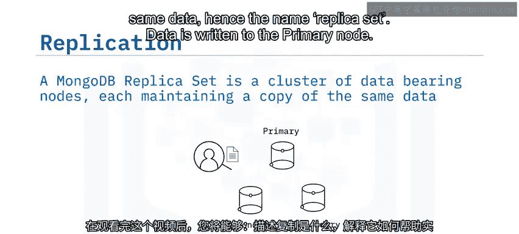

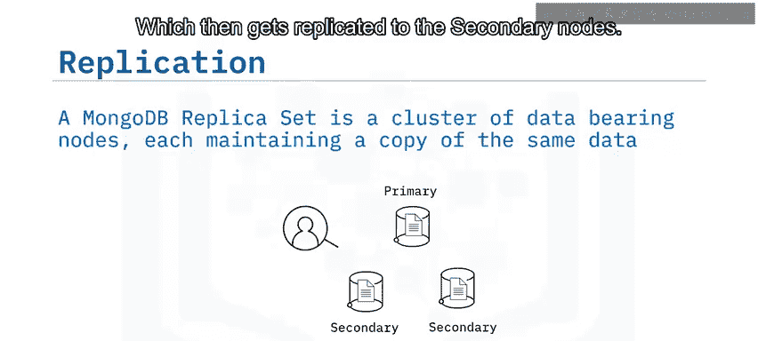

Having multiple copies of the data by the means of replication creates redundancy so that if one piece of a server hardware fails。

 you still have multiple copies of the data present。

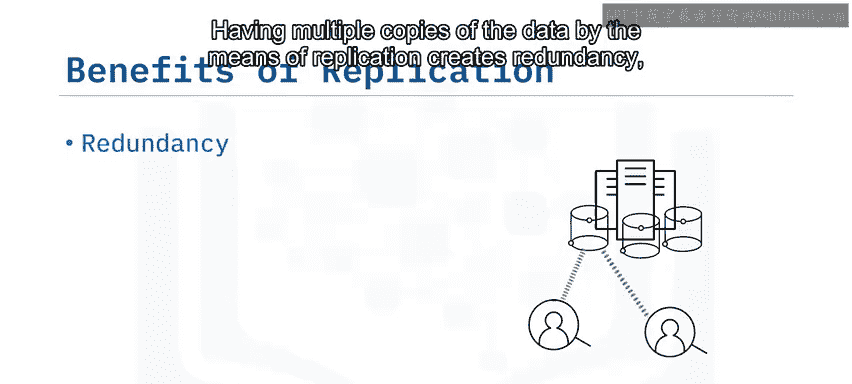

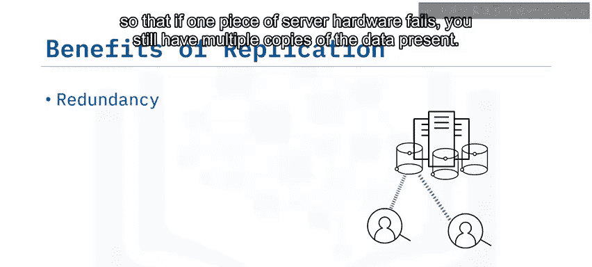

This provides you with a highly available database during such failures or during periods of planned maintenance。

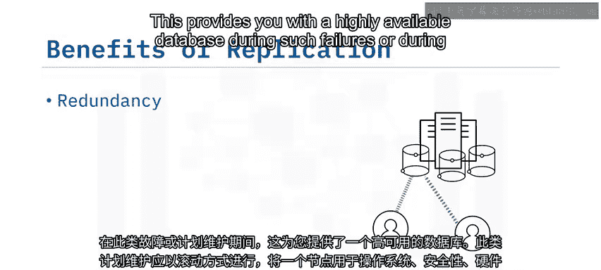

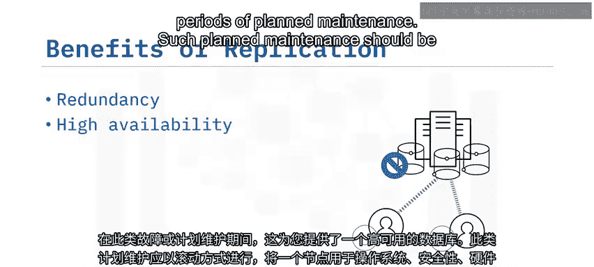

Such planned maintenance should be done in a rolling fashion， Ta one node out for operating system。

 security， hardware or software updates， or for upgrading Mongo Db itself。

 a common misconception about replication， is that it can save you from disasters。

 such as accidentally deleting your database。 Since it is a replica set。

 What happens on the primary will be replicated over to the secondaries。

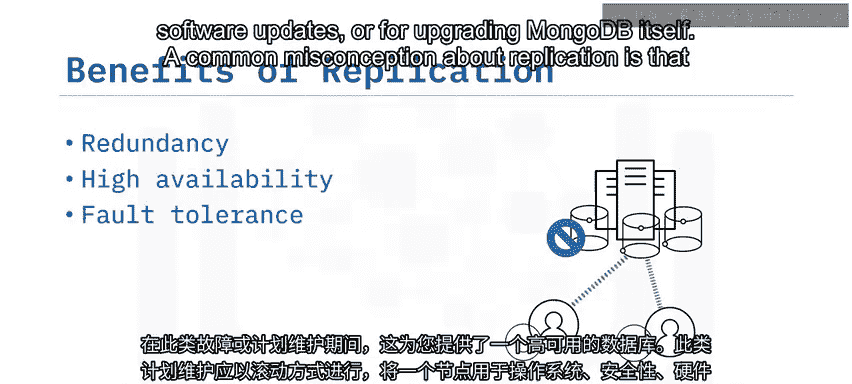

For disaster recovery scenarios， we rely on backups and restores。After using MongoDb for some time。

 you will probably outgrow your hardware。 For example。

 you need to store even more data or you want to improve your read and write performance。 Natural。

 you will invest in bigger and faster hardware to increase capacity。

 but sometimes that is not feasible。

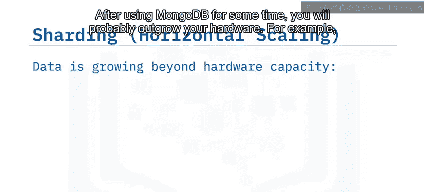

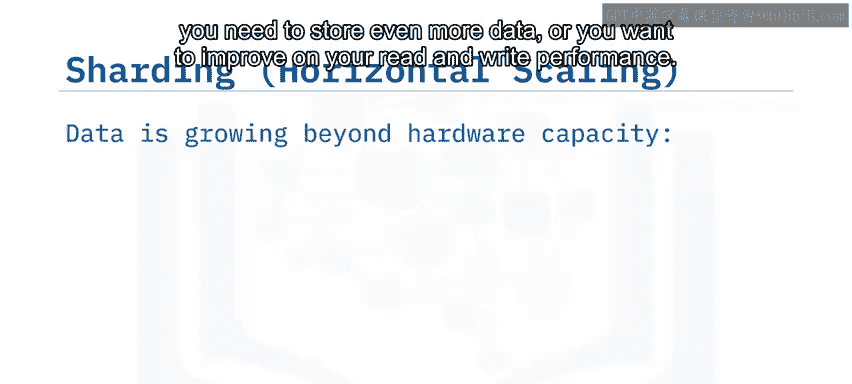

In those situations， you can scale horizontally by implementing sharding。

 which is the partitioning of your biggest collections。

Sharardding your biggest or most demanding collections has many benefits When you partition your data across shards。

 you increase your throughput by directing your queries only to relevant shards。

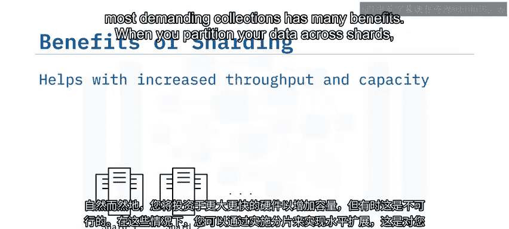

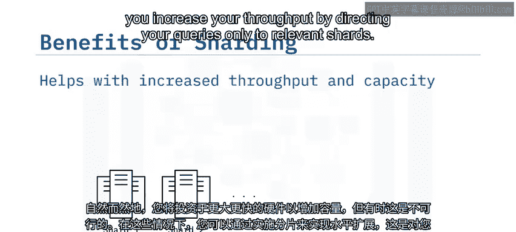

You are also then able to store more data， which previously you couldn't fit on a single node。

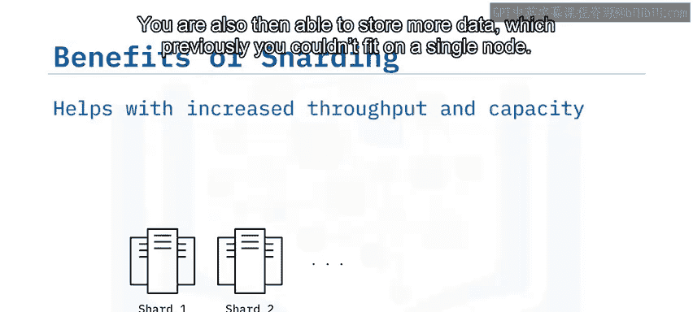

You could also split data across shards based on regions。

 so data for US customers will only live on shards running in the US while European customers have their data on European based shards。

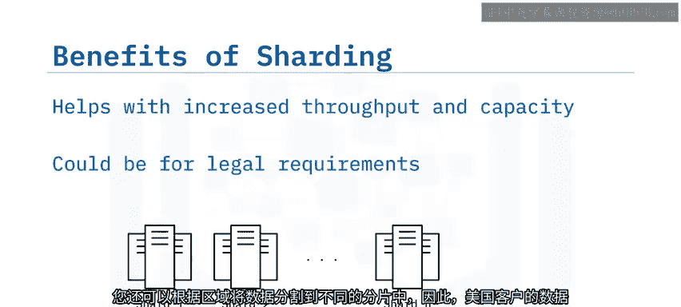

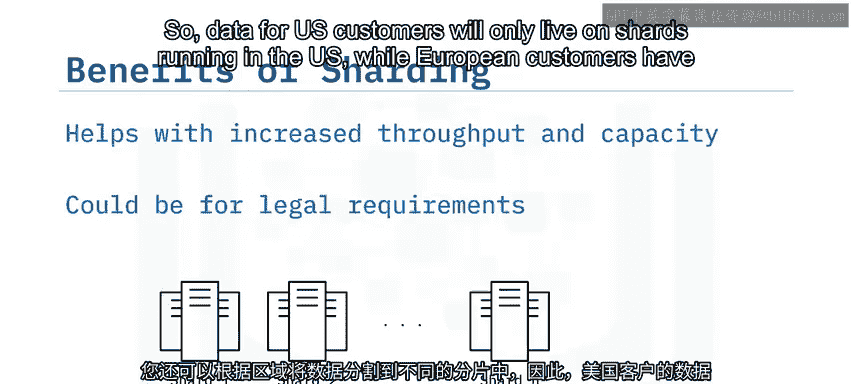

As a global application， you get one view of your database to manage。

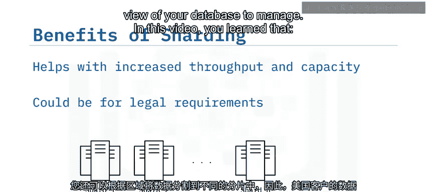

In this video， you learned that replication is duplication of data and any changes made to the data。

 Replication provides fault tolerance， redundancy and high availability of your data。

 Replication will not prevent a disaster， such as the deletions of documents。

 collections or even databases for those human errors。 We have backups。

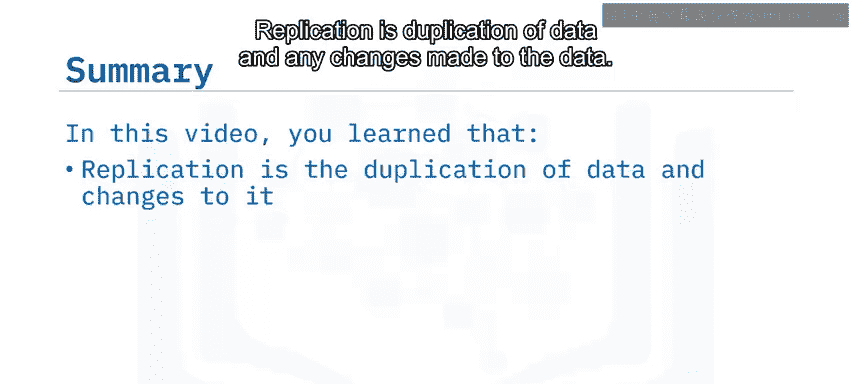

And for growing data sets， you can use sharding to scale horizontally。

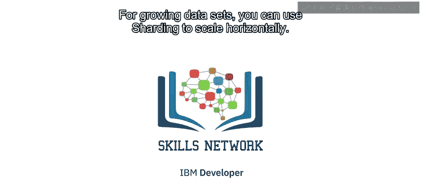