# IBM数据工程专业证书课程10：《NoSQL数据库导论》｜introduction-to-nosql-databases｜ - P19：18_cassandra 概述.zh_en - GPT中英字幕课程资源 - BV1UN41187Zz

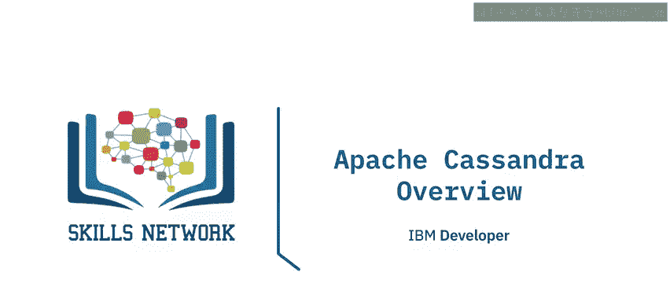

Welcome to Apache Cassandra Over This video is a short introduction to Apache Cassandra， its history。

 key capabilities and use cases。 After watching this video。

 you will be able to describe what Apache Cassandra is。

 Ex the role of Apache Cassandra in the no SQL space， Ex the differences when compared with Mongo Db。

 De the main capabilities of Apache Cassandra， identify the best usage scenarios for Apache Cassandra and describe common use cases that are a best fit for Apache Cassandra。

First， let's look at what Apache Cassandra is。 One of the best and most concise definitions of Cassandra has been given in the book Cassandra the Def guide。

 Apache Cassandra is an open source， distributed， decentralized， elastically scalable。

 highly available， fault tolerant， tunable and consistent database that bases its distribution design on Amazon's Dynamo and its data model on Google's Big table。

 created at Facebook it is now used at some of the most popular sites on the web。

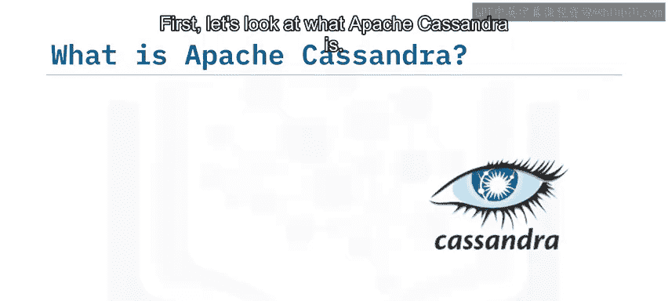

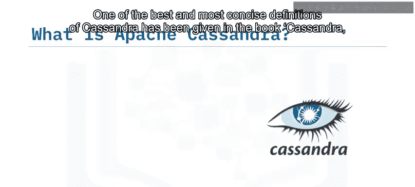

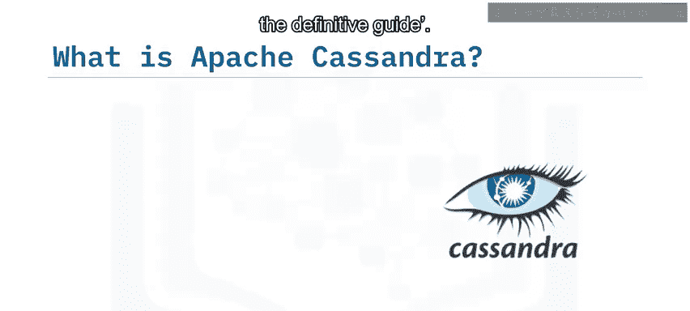

Some of the services that use Cassandra are Netflix， Spotify and Uber。

Let's put Cassandra in a bit of perspective versus what you've learned so far about NoSQL databases and particularly about MongoDB。

 the Dostore database， As you have probably noticed。

 no SQL databases tend to cater to very specific use cases。

 for example MongoDB usually covers search related use cases where the input data can be represented as key document type of entries。

 but what about the use cases where you need to record some data extremely rapidly and make it available immediately for read operations and all the while hundreds of thousands of requests are generated。

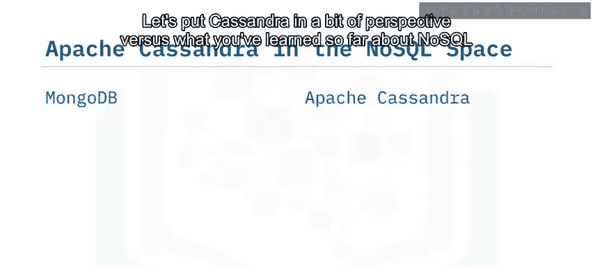

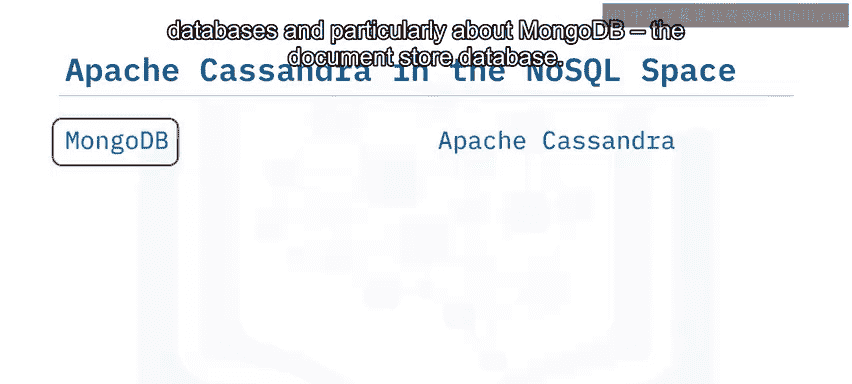

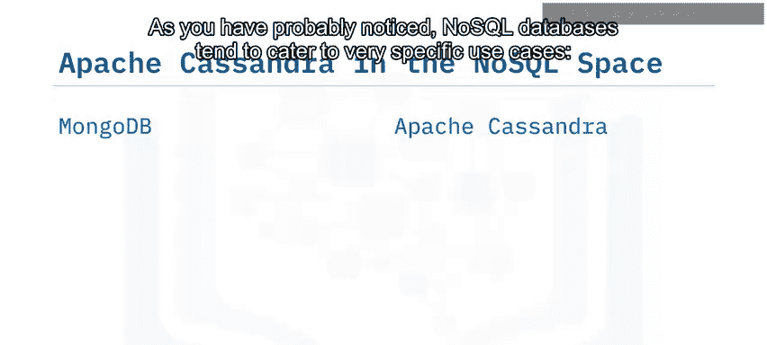

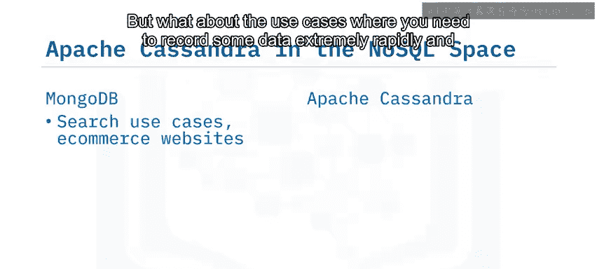

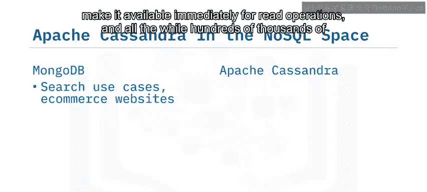

Take， for example， recording the transactions from an online shop or storing the user access info or profile for a service like Netflix In this case。

 a solution like Apache Cassandra could be of use While MongoDb caters to read specific use cases and thus is very much focused on consistency of the data。

 Cassandra caters to use cases that require fast storage of data。

 Ey retrieval of data by key availabilityability at all times。

 fast scalability and geographical distribution of the servers。

 One other important difference lies in the architectural choice While MongoDb has a primary secondary architecture。

 Cassandra has a simpler peerer to peer one。

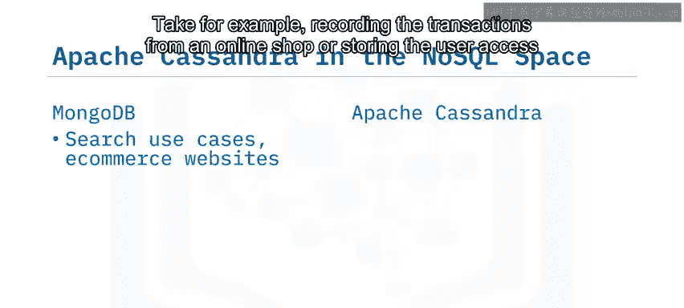

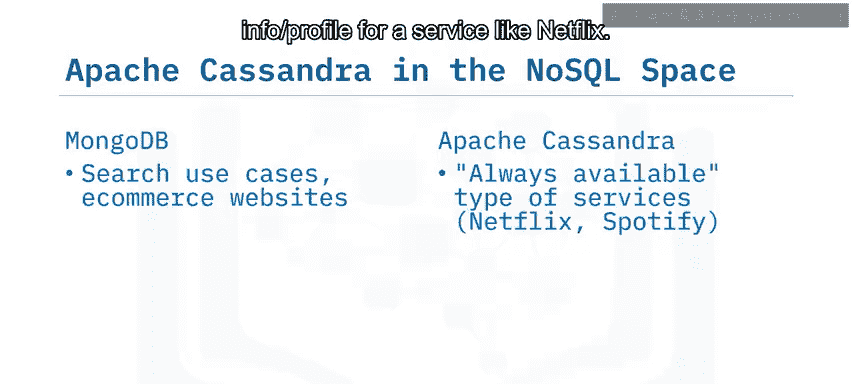

Cassandra has a set of features that sets it apart from other no SQL solutions。

 distributed and decentralized， simple peer to peer architecture。

 making Cassandra one of the friendliest no SQL database installations。

 always available with tunable consistency， favors availability overcon， false tolerant。

 extremely fast write throughput while it maintains cluster performance for other operations like Reed capability to scale clusters extremely fast in a linear fashion without the need to restart or reconfigure the service。

 Multi data centers deployment support making it extremely useful for services that need to be accessed worldwide and friendly SQL like query language。

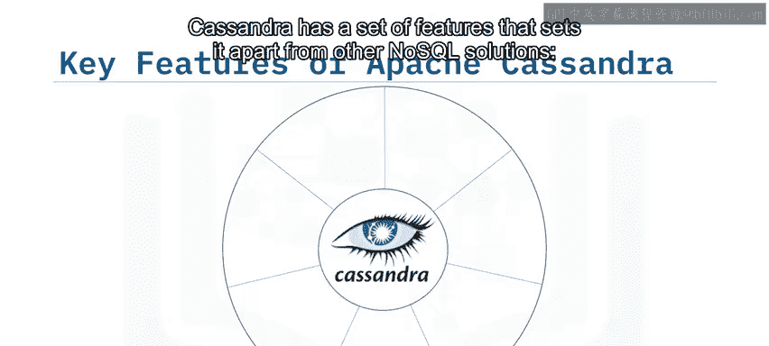

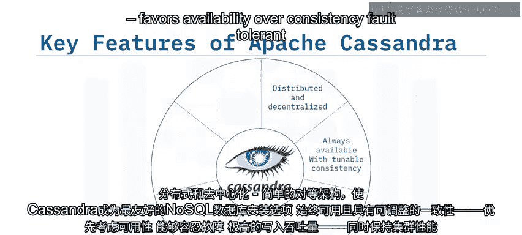

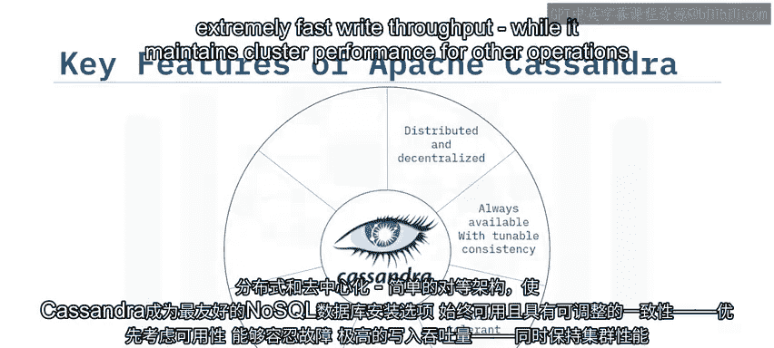

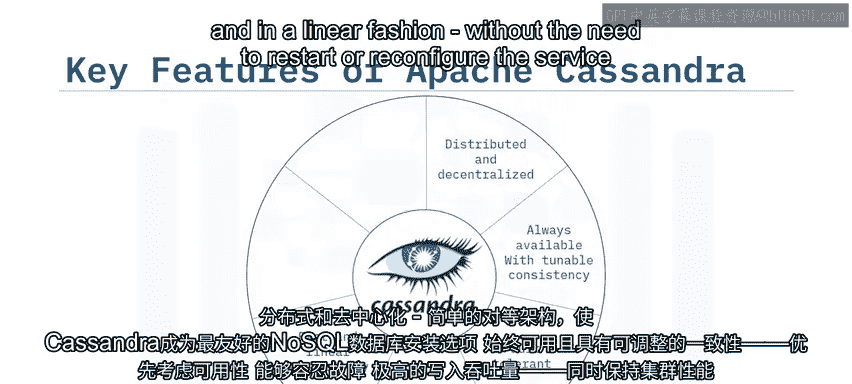

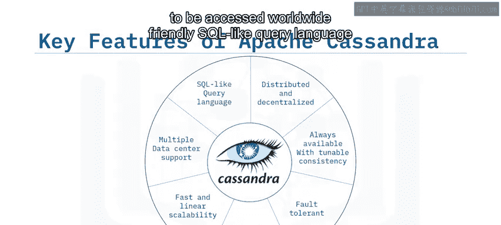

Apache Cassandra is currently one of the top 10 most popular solutions in the world。 It's a reliable。

 super performant and scalable database。 due to its popularity。

 Cassandra is sometimes mistaken as being a drop in replacement for relational databases。

 but Cassandra by design does not incorporate three major features of relational databases and thus should not be seen as a drop in replacement for a relational database。

 It does not support joins has limited aggregation support and has limited support for transactions。

 while rights to Cassandra are atomic isolated and durable in nature。

 the consistency part does not apply to Cassandra， as there is no concept of referential integrity or foreign keys。

 so for short， if you were thinking of using Cassandra to keep track of account balances at a bank。

 you probably should。

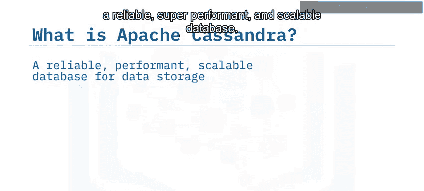

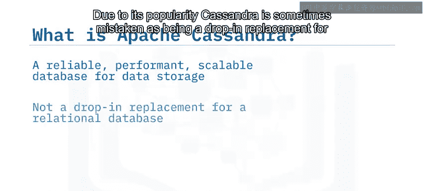

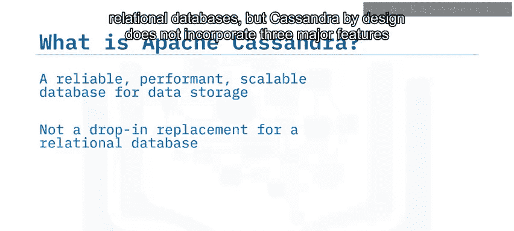

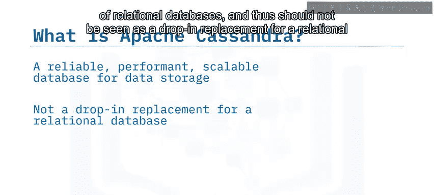

sIf your application has joins and aggregations requirements。

 then it is best when Cassandra is paired with processing engines like Apache Spark。

So in which usage scenarios would Apache Cassandra be a good fit when your application is right intensive and the number of write exceeds the number of reads。

 For example， storing all the clicks on your website or all the access attempts on your service when your data doesn't have that many updates or deletes。

 so it comes in an append like manner， When data access is done via a known primary key called a partition key。

 the key allows an even spread of the data inside the cluster。

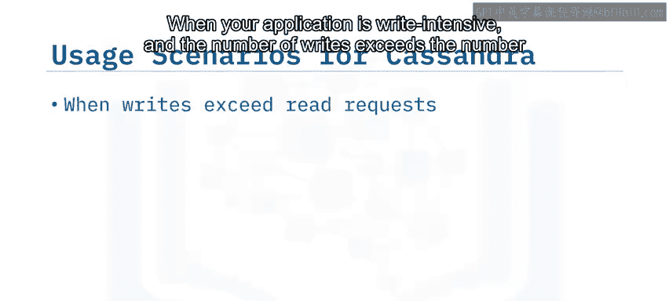

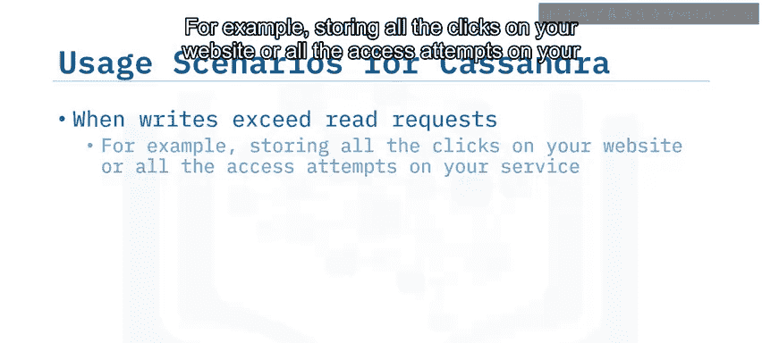

And when there's no need for joins or complex aggregations as part of your queries。

As mentioned previously， Cassandra is a best fit for globally always available types of online services and applications such as Netflix。

 Spotify and Uber， but of course there are many other use cases that can take advantage of its capabilities。

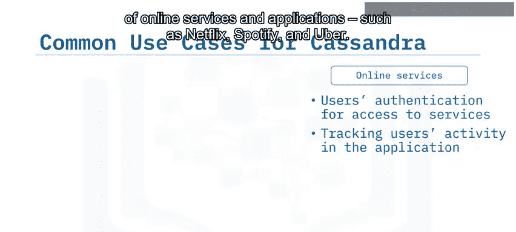

Storing transactions for analytical purposes for ecommerce-commerce websites or the users' interactions with the website in order to personalize their experience。

 Just storing users' profile info for services like session enrichment or granting personalized access to the service。

 Cassandra also thrives in time series use cases where data comes appendwise in a timely manner like weather updates from sensors where your query could be directed towards what happened to a certain sensor in a specific time interval In this video。

 you learned that Apache Cassandra is an open source， distributed， decentralized。

 elasticically scalable， High available， fault tolerant， tunable and consistent database。

 Apache Cassandra is best used by always available types of online applications that require a database that is always available that scales fast in situations of high traffic。

That can be installed in a geographically distributed manner。

 and that require a high write performance， and Apache Cassandra is best used by online services like Netflix。

 Uber and Spotify， E-commerce websites， and Time series applications。

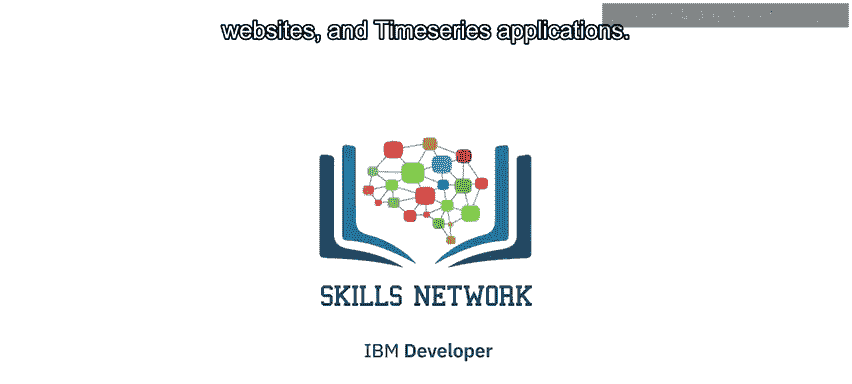