# IBM数据工程专业证书课程10：《NoSQL数据库导论》｜introduction-to-nosql-databases｜ - P1：0_nosql 概述.zh_en - GPT中英字幕课程资源 - BV1UN41187Zz

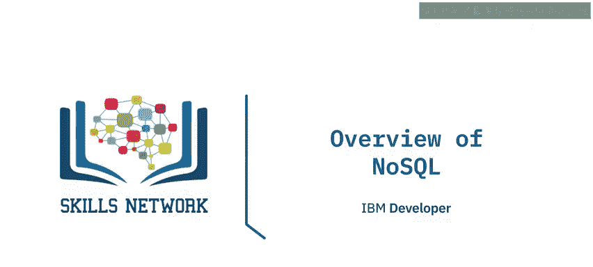

Welcome to an overview of No SQL This video defines the term no SQL and the technology at references。

 and it describes the history of No SQL in the database landscape。

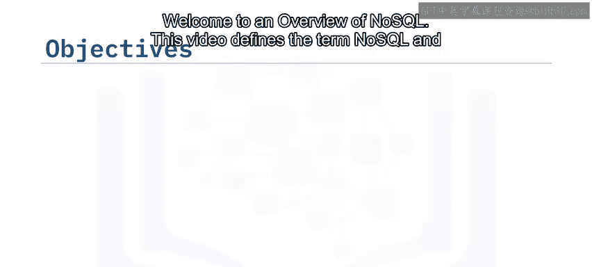

First， let us talk about the name， No SQL。 The name was introduced at an event to discuss all the new open source distributed databases that were coming onto the scene。

 and the name No SQL has stuck ever since。 Con to what it sounds like。

 No SQL actually stands for not only SQL， and not no SQL。

 The name no SQL really describes what it is not。 That is。

 it refers to a family of databases that very widely in style and technology。

 but which all share a common trait in that they are non-relational in nature。

 meaning they are not a standard row and column relational database management system or R DBMS。

 Therefore， a better name to describe these databases would be nonrelational。

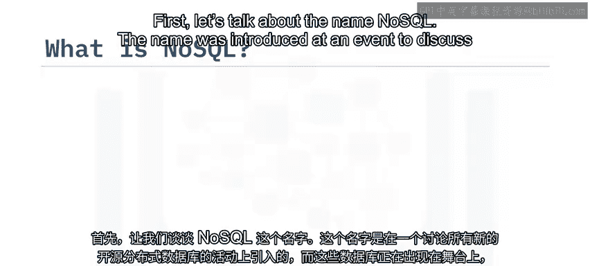

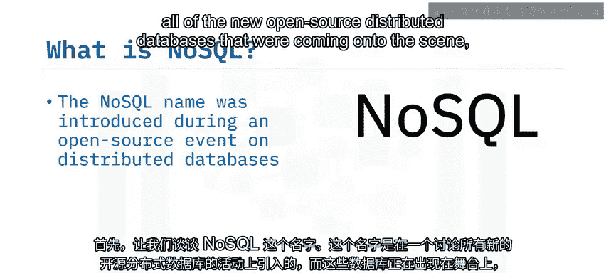

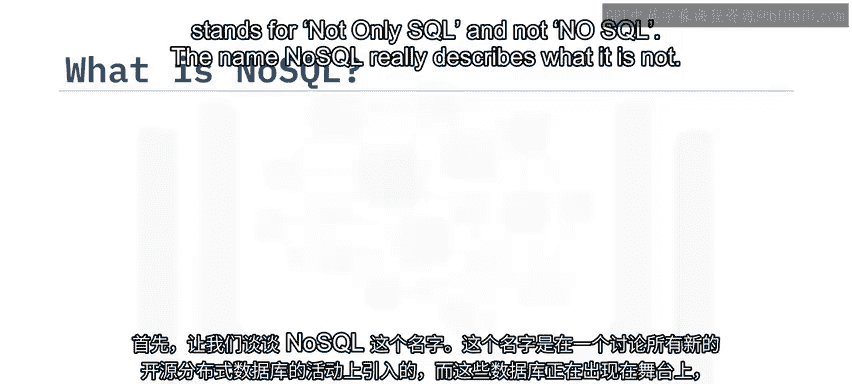

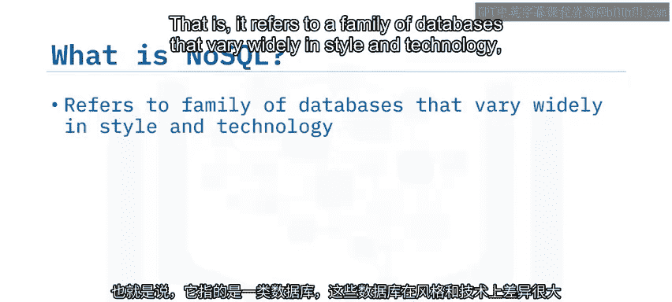

No SQL databases provide new ways of storing and querying data that address a number of issues for modern applications。

 Most importantly， the majority of no SQL databases are geared to handle a different breed of scale problems that have arisen associated with the big data movement by scale。

 we are referring to both the size of the data， but also the concurrent users acting on that data。

 No SQL databases are typically also more specialized in their use cases and can be much simpler to develop application functionality for than relational databases。

 We will get into more detail on the benefits of various no SQL databases in later videos in this course。

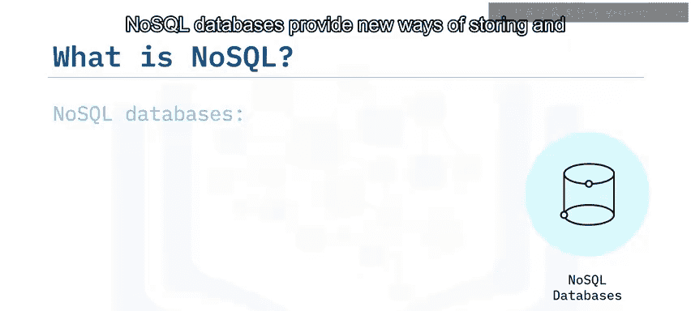

So let us take a quick look at the history of the No SQL movement。

 going back to the period between 1970 and 2000， although there were some nonrelational databases like IBM's IMS。

 which was a hierarchical database used for the Apollo space missions no less。

 the market was dominated by relational databases。

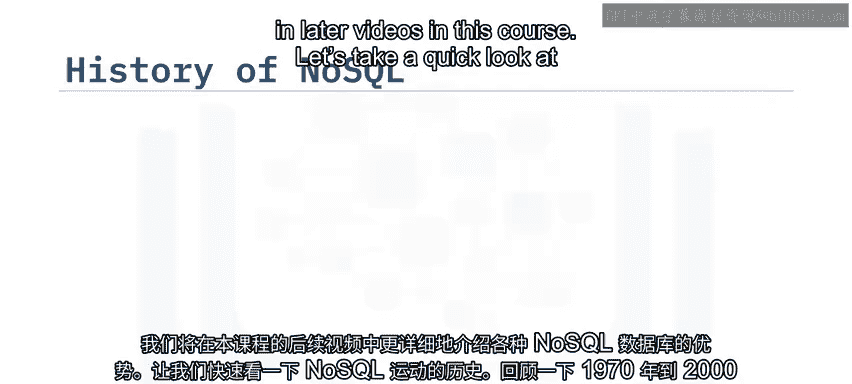

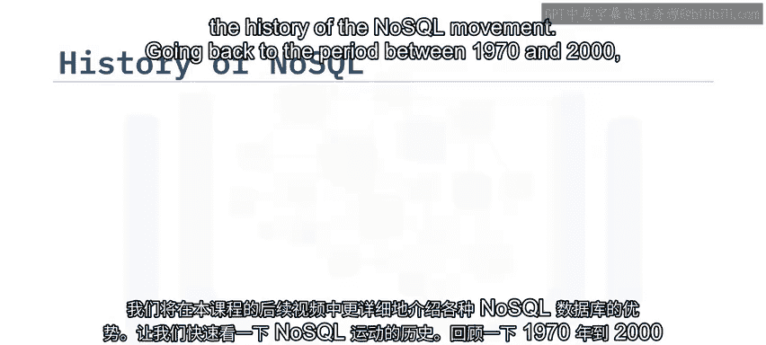

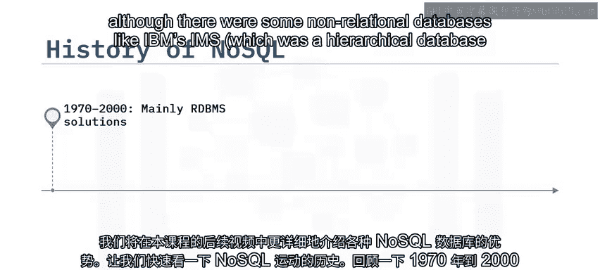

So when application architects and developers needed a data store for their applications。

 they were pretty much picking from a variety of common relational databases with Oracle， IBM， DB2。

 Microsoft SQL Ser， and MySQL being some of the more popular ones。

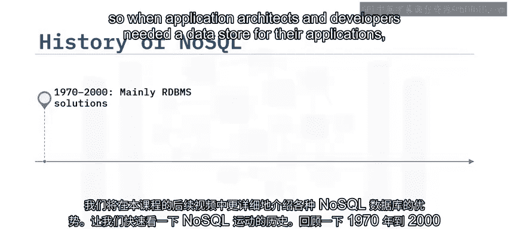

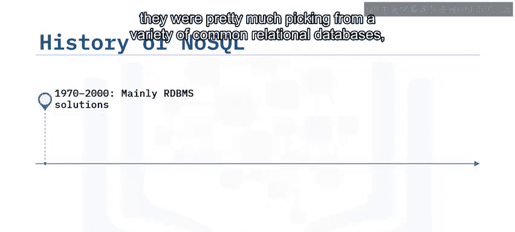

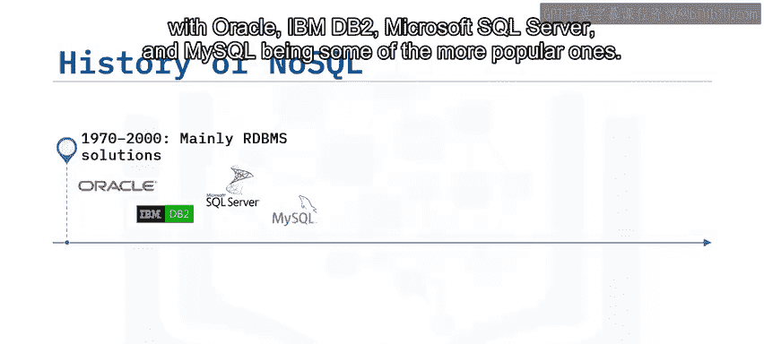

When internet applications and companies started exploding during the docom boom in the late 90s and early 2000s。

 applications went from predominantly serving thousands of internal employees at companies to needing to serve millions of users on the public internet for these applications availability and performance were paramount。

 and these new scale problems led to a drive to create new scalable technologies to support them。

 at this time several large tech companies such as IBM。

 Google and Facebook developed a lot of great technology and in turn released white papers and or opensourced the technology to the community。

 specific examples include Google's mapreduce white paperper which described how to process large datasets on distributed systems and Amazon's Dynamo White paperper。

 which detailed a way to evenly distribute data and workload within a cluster in a quoum style architecture。

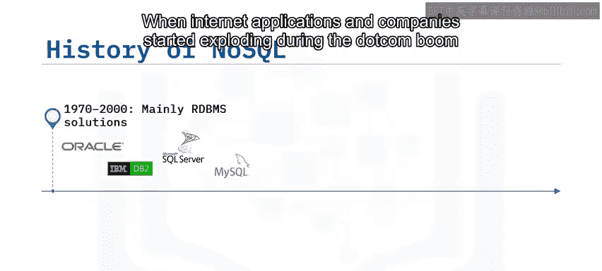

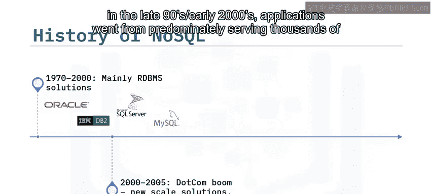

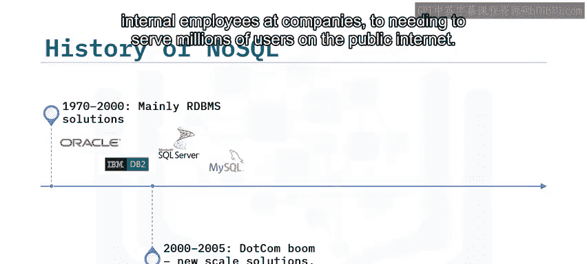

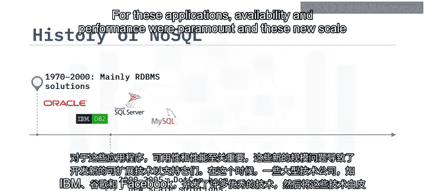

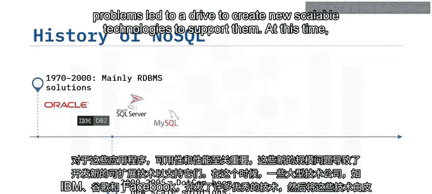

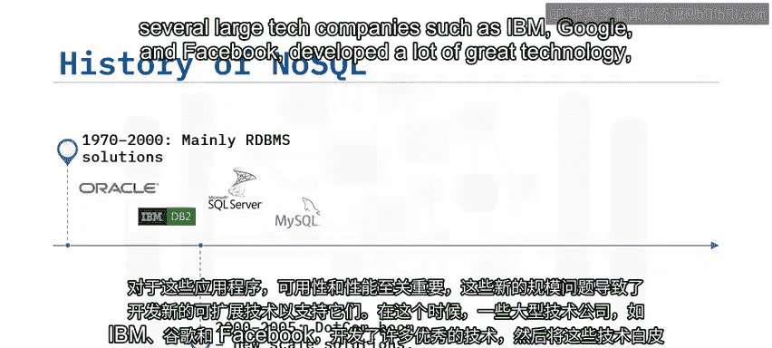

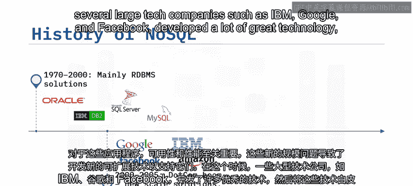

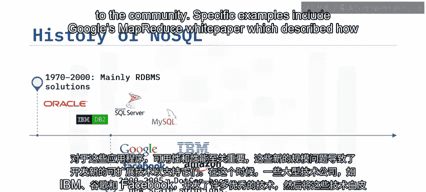

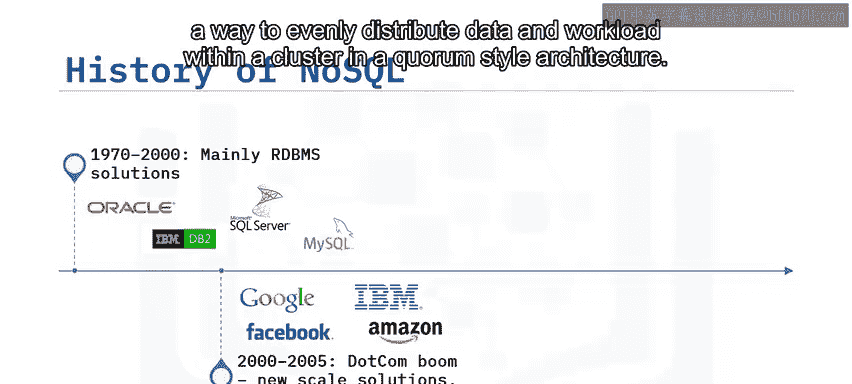

In the late 2000s， several new databases emerged on the scene。

 a large number of them from open source communities， databases like Apache Co Db。

 Cassandra and Hbase， as well as Mongo， Redis， ReAC and Neo4J became more prevalently used in applications。

 particularly in ones that required larger scale than a relational database could handle In the last 10 years or so。

 several nosQl databases have leveraged a fully managed service model。

 otherwise called database as a service or DBS， to offload the administration and maintenance from the end user and allow developers to focus on building applications with these modern databases Some examples include IBM Cloudant and Amazon Dynamo DB。

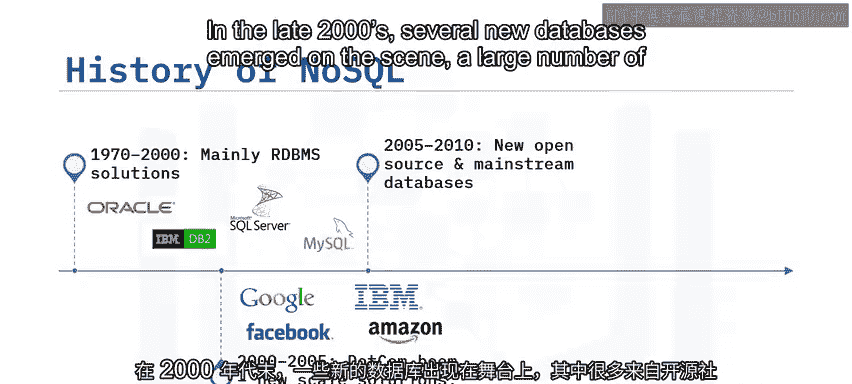

In this video， you learned the name no SQL stands for not only SQL。

 and the term no SQL refers to a class of databases that are non-relational in architecture。

 you also learned that although implementations of no SQL databases are technically different from each other。

 they all share some common traits， and you learned that historically relational databases were more prevalent。

 but since the year 2000， no SQL databases have become more popular in the database marketplace due to the scale demands of big data。

