# IBM数据工程专业证书课程10：《NoSQL数据库导论》｜introduction-to-nosql-databases｜ - P20：19_cassandra 的关键功能.zh_en - GPT中英字幕课程资源 - BV1UN41187Zz

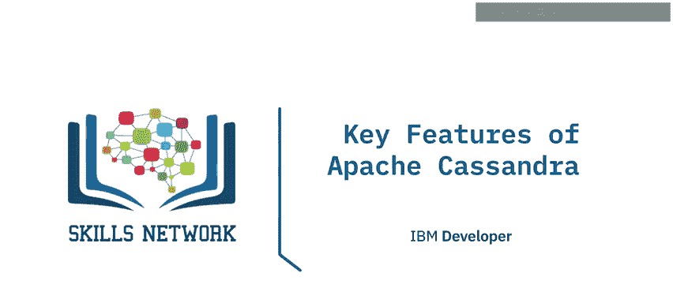

Welcome to key features of Apache Cassandra as we have learned in Cassandra overview。

 there are some key features that are specific to Cassandra。

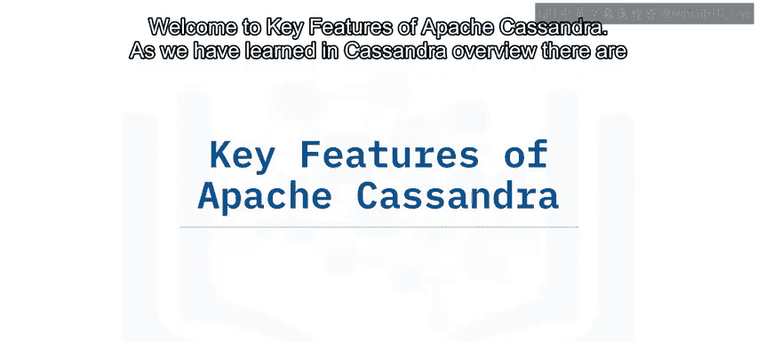

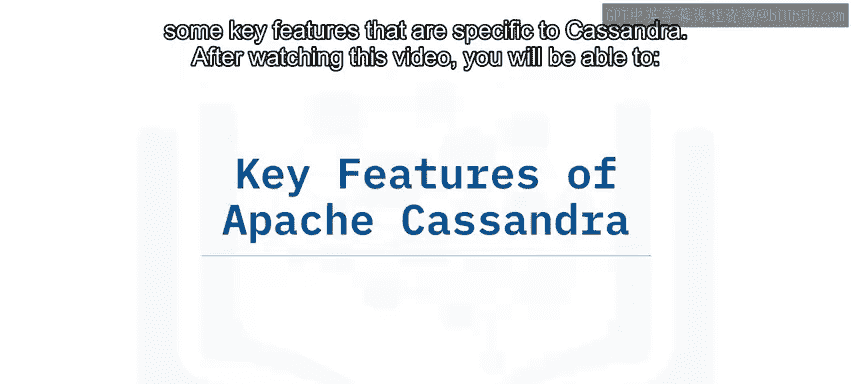

After watching this video， you will be able to explain what is meant by distributed and decentralized Describe how replication works in Cassandra list the difference between availability and consistency。

 De the scalability of Cassandra Explain how Cassandra provides highr throughput and explain what the CQL language is In this video we will go through some of the key features in order to understand what makes Apache Cassandra a distributed and decentralized。

 highly available， false tolerant， highr performanceant。

 elasticically scalable geographically distributed and easy to interact with database while all no SQL databases are distributed。

 you will not find many no SQL databases that are both distributed and decentralized distributed means that Cassandra clusters can be run on multiple machines。

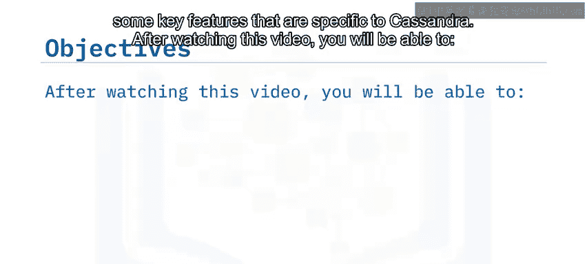

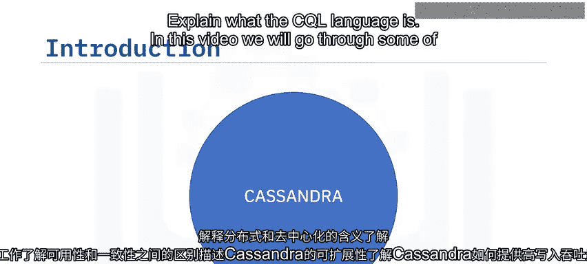

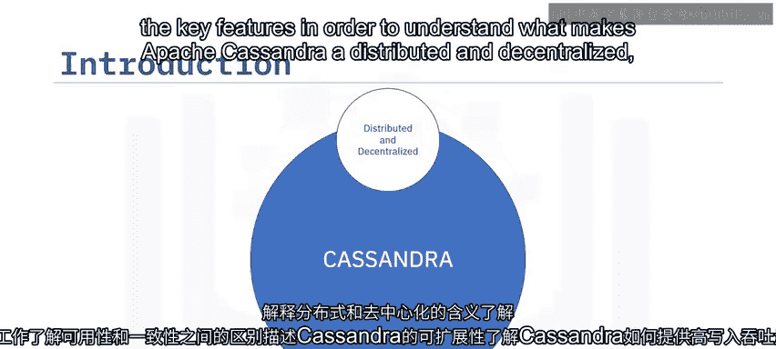

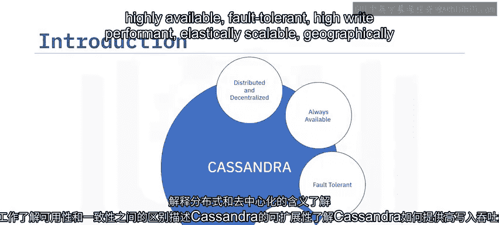

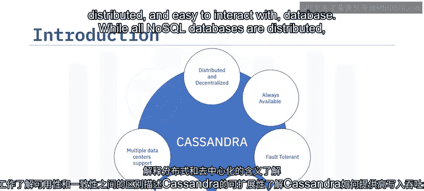

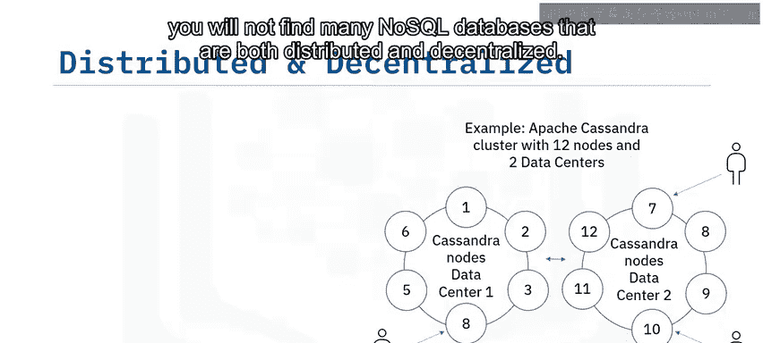

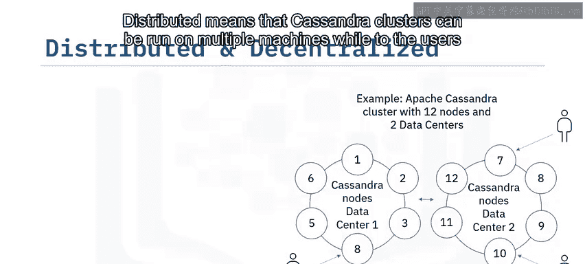

While to the users and applications， everything appears as a unified whole。

 the architecture is built in such a way that the combination of Cassandra application client and server will provide sufficient information to route the user request optimally in the cluster。

So as an end user， you can write data to any of the Cassandra nodes in the cluster and Cassandra will understand and serve your request Deralized means that every node in the Cassandra cluster is identical。

 that is there are no primary or secondary nodes。Cassandra uses peerer to peer communication protocol and keeps all the nodes in sync through a protocol called gossip。

How does data end up in this distributed architecture。

 It all starts with the queries that are planned to be performed。 Just to take a very simple example。

 you have some initial data containing user info and the state。

 if your queries are similar to I would like to know about all users in a state。 In this case。

 you need to group your data on the state column。 and this is done by declaring a table that has the state column as the partition key。

 We will come back to how data needs to be stored in the cluster。

 according to your queries in our next video。

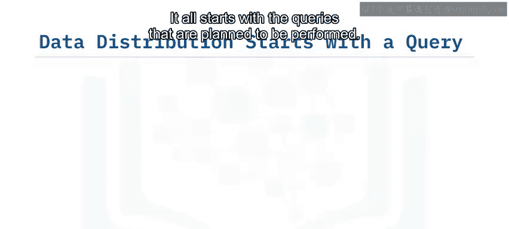

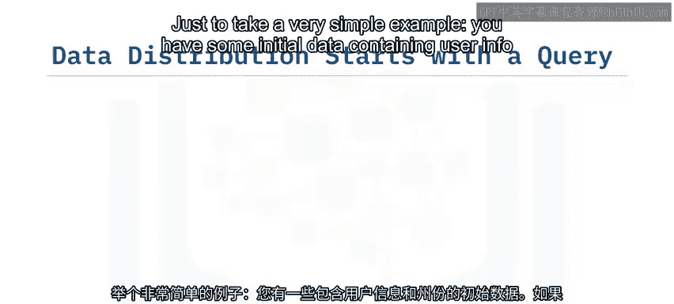

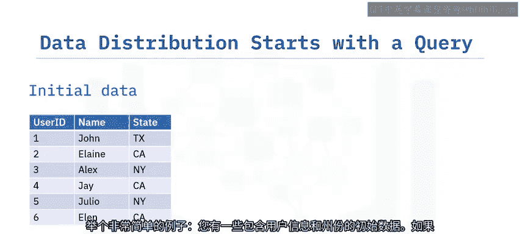

But until then， just remember that Cassandra groups data based on your declared partition key and then distributes the data in the cluster by hashing each partition key called tokens。

Each Cassandra node has a predefined list of supported token intervals and data is routed to the appropriate node based on the key value hash and this predefined token allocation in the cluster。

After data is initially distributed in the cluster， Cassandra proceeds with replicating the data。

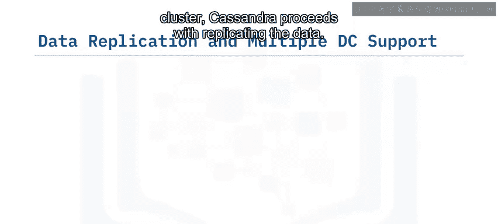

The number of replicas refer to how many nodes contain a certain piece of data at a particular time。

Data replication is done clockwise in the cluster， taking into consideration the rack and the data center's placement of the nodes。

Data replication is done according to the set replication factor。

 which specifies the number of nodes that will hold the replicas for each partition。

Let's take the data from the previous screen and try to distribute the California State data Partition CA in an8 node cluster distributed in two data centers。

 DC1 with Replication factor 3 and DC2 with Replication factor 2。

You can see in the diagram that some nodes are placed in the same rack。

 Cassandra will try to distribute data as much as possible between racks。

One of the most important Cassandra features is its availability。 Also。

 Cassandra is frequently referred to as eventual or tuable consistency in the sense that by default。

 Cassandra trades consistency in order to achieve availability。

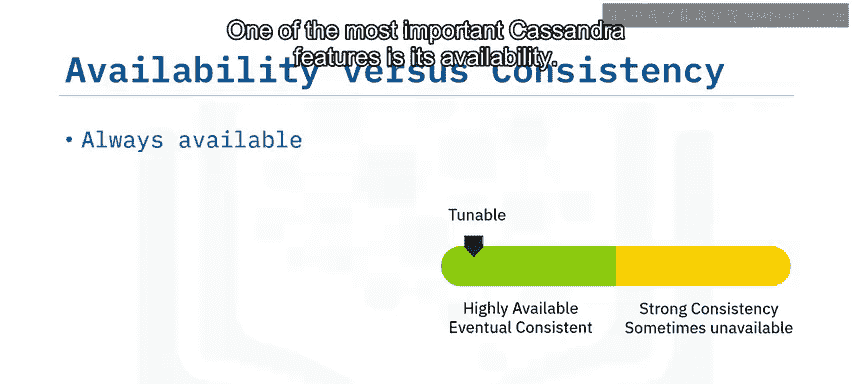

But the good news is that developers can control exactly how much consistency they would like to have strong or eventual。

As you may recall from the No SQL introduction video earlier in the course。

 distributed systems cannot， according to CA theorem， be consistent and available at the same time。

Cassandra has been designed to always be available， meaning that if you lose a part of your cluster。

 there will still be nodes available to answer the service request。

 though the return data might be inconsistent。 consistency of the data can be controlled at the operation level。

 and it is tuned between strong consistency and eventual consistency。 If data inconsistencies exist。

 these conflicts will be resolved during read operations。 This is another unique Cassandra feature。

 Fult tolerance is an inherent feature of the distributed and decentralized characteristic of Cassandra。

 The fact that all nodes have the same functions， communicate in a peer to peer manner。

 are distributed and the data is replicated， makes Cassandra a very tolerant and adaptable solution when nodes fail。

The user contacts one node of the cluster。 If the node is not responding。

 then the user will receive an error and contact another node。

 The same architectural flexibility is visible in the way Cassandra scales the capability of the clusters。

The cluster is scaled by simply adding nodes， and performance increases linearly with the number of added nodes。

 New nodes that are added immediately start serving traffic while existing nodes move some of their responsibilities towards the new added nodes。

 both adding and removing nodes is done seamlessly without interrupting cluster operations。😊。

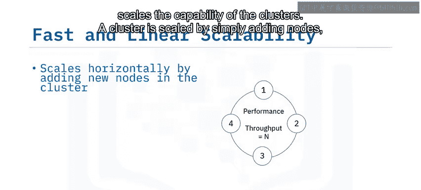

Cassandra gracefully handles large numbers of rights first by parallelzing rights to all nodes holding a replica of your data。

One important Cassandra fact， by default， there's no read before write at the node level。

 rightss are performed in memory， meaning no read before and then flushed on disk On disk。

 data is appended in a sequential manner with a data being reconciled later through compaction。

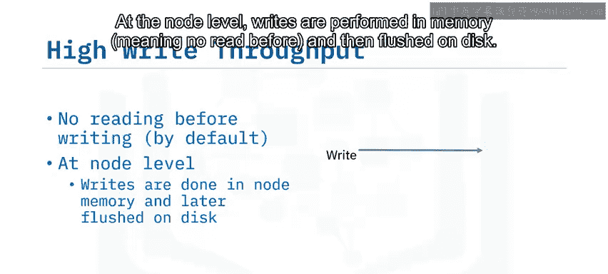

Cassandra queryery language or CQL for short， is the language used for data definition and manipulation。

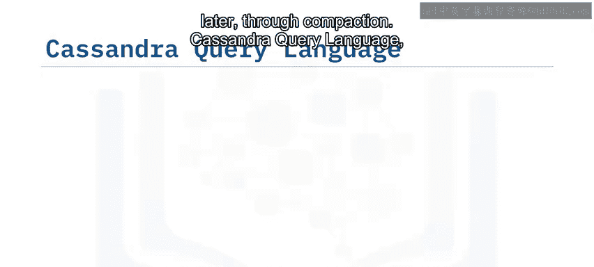

CQL syntax is similar to SQL syntax， thereby reducing the time a developer needs to get started with Cassandra operations like createreate table。

 insertert， updatedate， deletete， alter and more can be used in CQL。 be aware that while syntax wise。

 there are similarities between CQL and SQL。 The resemblance stops here。

 The ways write and read operations are executed in Cassandra are different than how these are executed in relational databases。

 but we will come back to this point in later videos in the course。

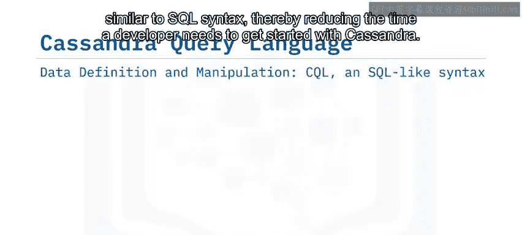

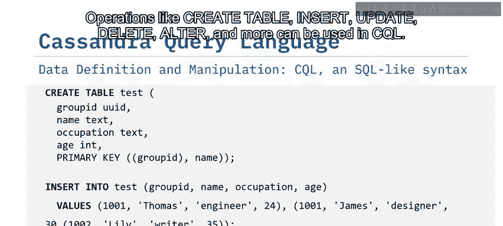

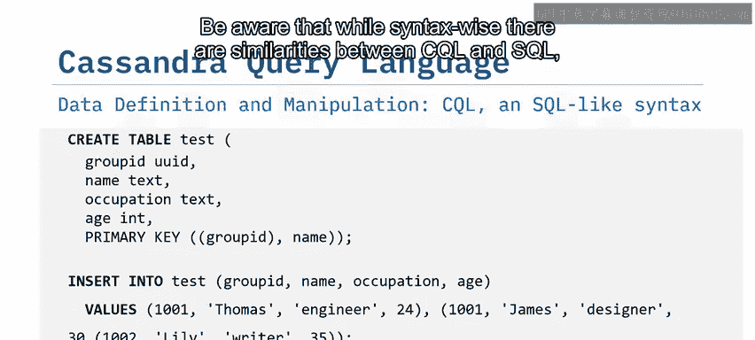

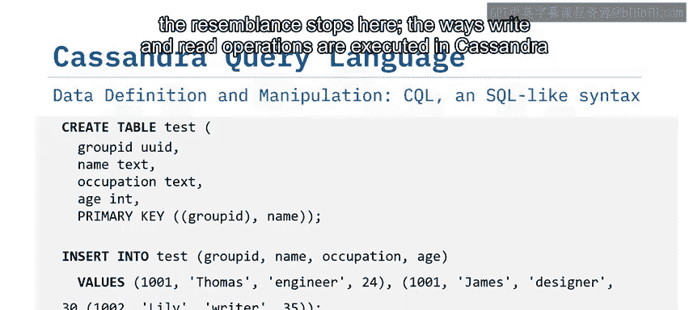

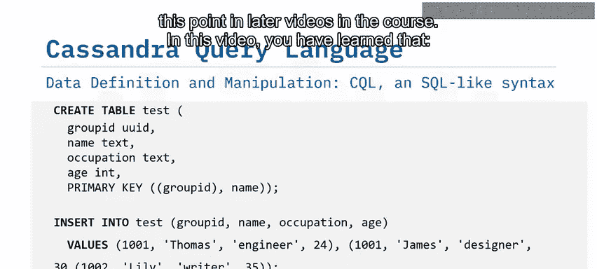

In this video， you have learned that its distributed and decentralized architecture helps Cassandra be available。

 scalable and fault tolerant。 Data distribution and replication takes place in one or more data center clusters。

 Cassandra provides high write throughput and CQL is the language used to communicate with Cassandra。

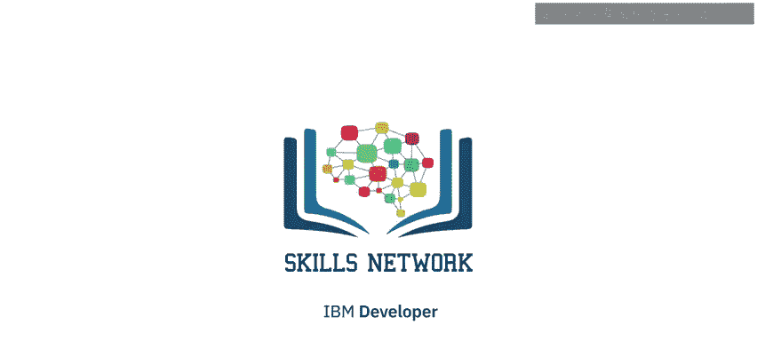