# IBM数据工程专业证书课程10：《NoSQL数据库导论》｜introduction-to-nosql-databases｜ - P21：20_cassandra 数据模型 第 1 部分.zh_en - GPT中英字幕课程资源 - BV1UN41187Zz

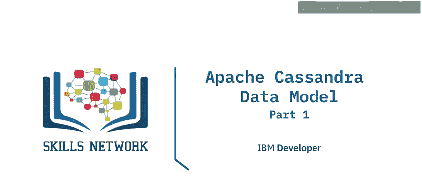

Welcome to Apache Cassandra Data Model Part1。

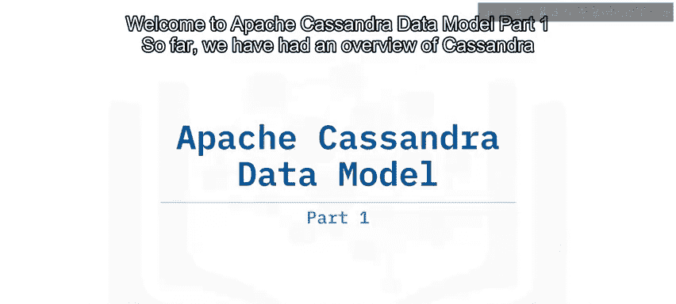

So far， we have had an overview of Cassandra and looked at its key features。

 Let's now take a look at the way Cassandra stores the data at cluster and node level for an optimized performance of the reads。

After watching this video， you will be able to describe the logical entities of the Cassandra data model。

 describe the role of primary keys in Cassandra tables， explain what partition keys are。

 and describe the two types of tables supported in Cassandra。

Cassandra stores data in tables， whose schema defines the storage of the data at cluster and node level。

 Tables are grouped in keyspaces。 A keyspace is a logical entity that contains one or more tables。

 A keyspace also defines a number of options that applies to all the tables it contains most prominent of which is the replication strategy used by the keyspace。

 It is generally encouraged to use one keyspace per application。

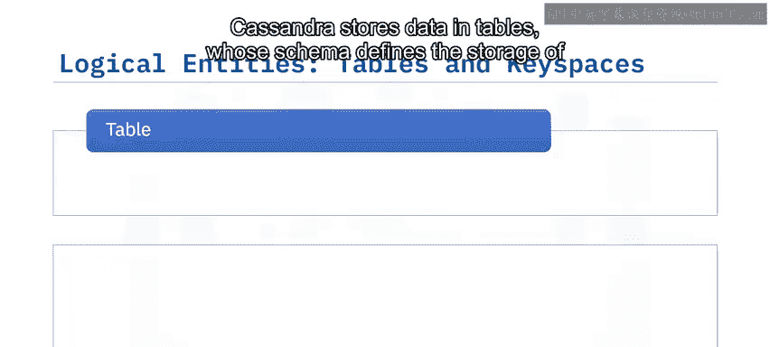

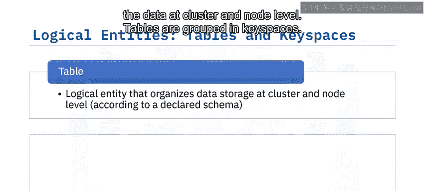

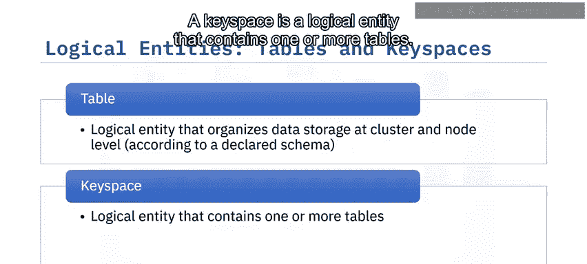

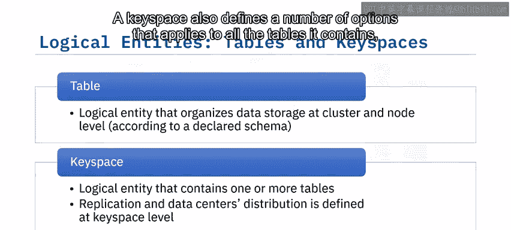

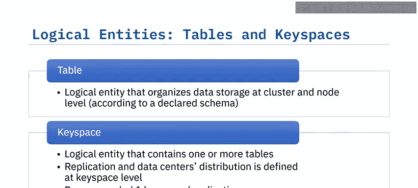

In later videos we will come back to the keyspace and its operations， but for the moment。

 let's just take an example of a keyspace and a table definition。

We have created a key space called Intro underscore Cassandra that has a replication factor of five data being split between two data centers with replication factor 2 in data center 1 and replication factor 3 in data center 2。

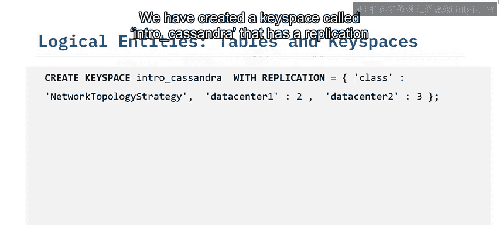

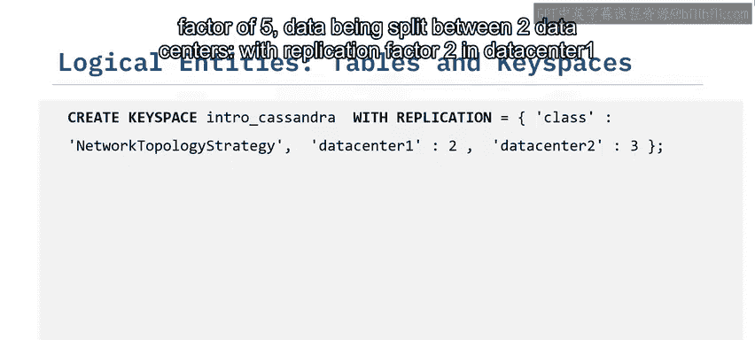

The next step would be to create tables in this keyspace To do this。

 we can either declare the working keyspace。 That is Intro underscore Cassandra。

 or we can directly create the table。 But in this case。

 we need to prefix the table name with the intended keyspace name。

 Intro underscore Cassandra dot groups。

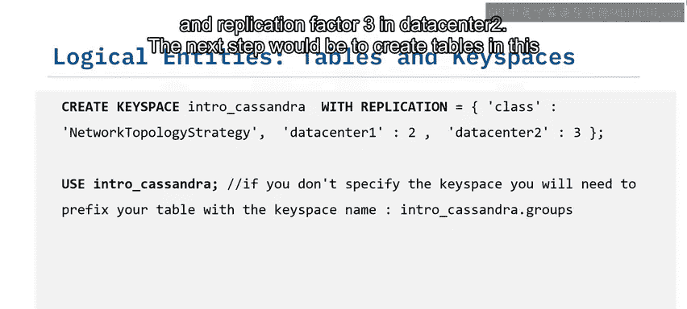

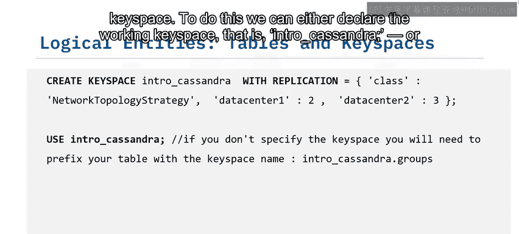

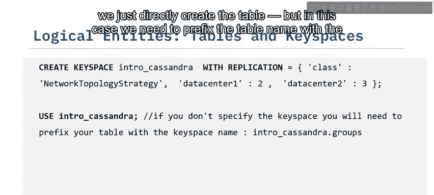

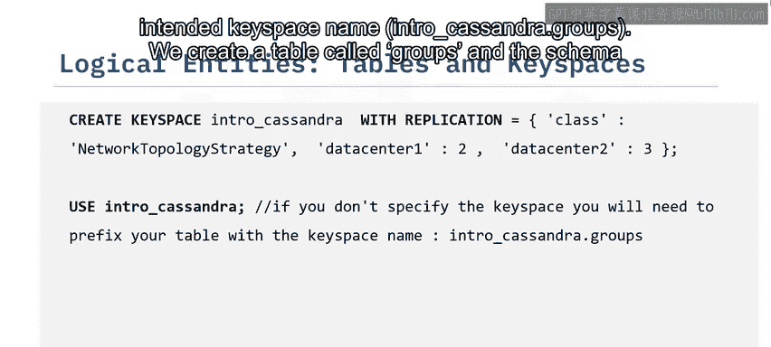

We create a table called groups and the schema for the table。

 What you see in this example is just C QL syntax， which we introduced in the key features video earlier。

 We will come back to the table schema later in this video。

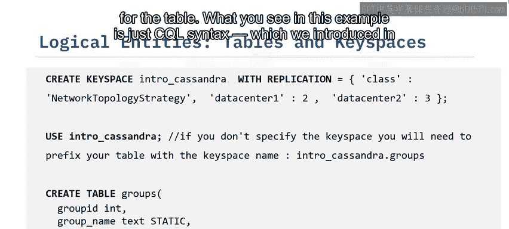

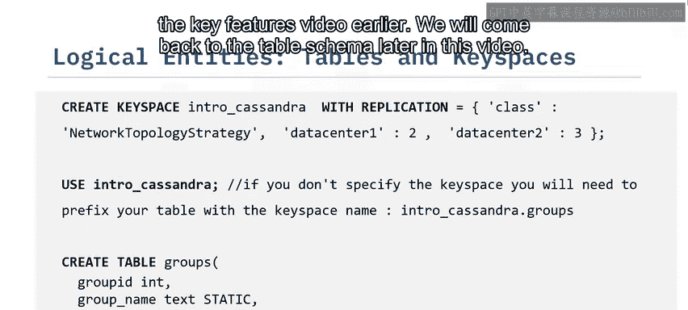

So tables are the logical entities that organize data storage at cluster and node level。

 they contain rows of columns。 you can create， drop and alter your tables without impacting the running updates on your data or the running queries in order to create a table we need to declare using Cassandra query language。

 a schema， a table schema comprises at least a definition of the table's primary key and the regular columns of the table。

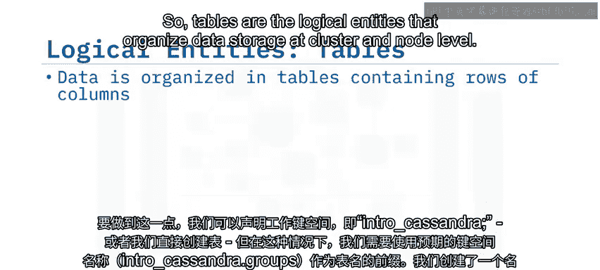

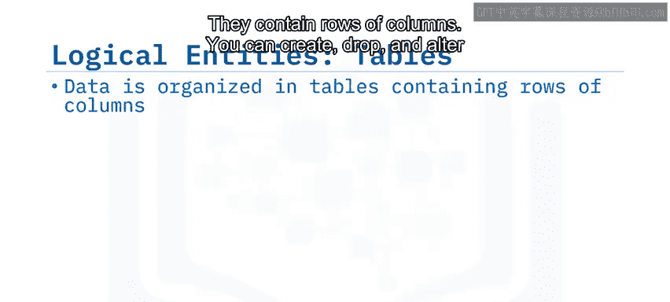

Going back to our previous example， table groups store information regarding several groups such as group ID。

 group name， and for each group， the username and age of their members。

You can see that the primary key is composed of two columns。

 group ID and user name In Cassandra denomination， the group ID column is called the Partition key and the username column is called the clustering key。

Let's talk a bit more about the primary key。 First of all。

 the primary key is basically a subset of the tables declared columns when creating a table besides declaring the tables columns。

 it is mandatory to specify the primary key as well the primary key once defined cannot be changed。

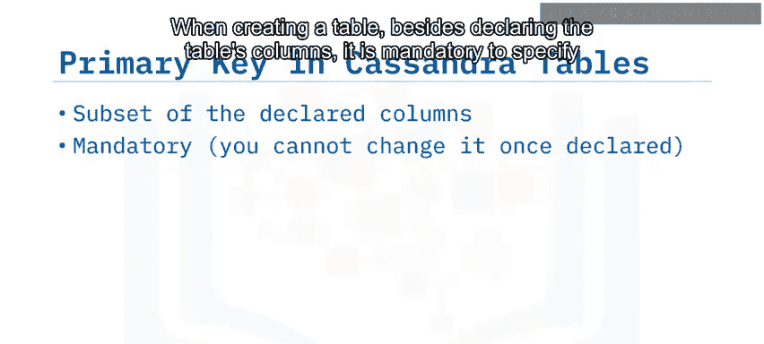

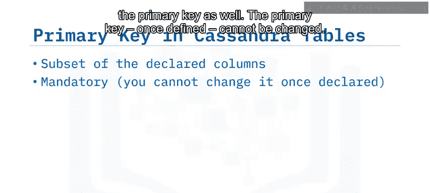

In Cassandra the primary key has two roles The first role is to optimize the read performance of your queries。

 Do not forget that the no SQL systems are query driven data modeling systems。

 meaning that table definitions can start only after the queries you would like to answer are defined you should build your primary key based on your queries。

And the second rule is to provide uniqueness to the queries。A primary key has two components。

 the mandatory component is called the partition key and optionally you can have one or more clustering keys。

When data is inserted into the cluster in a table， the data is grouped per partition key into partitions。

 and the first step is to apply a hash function to the partition key the partition key hash is used to determine what node and subsequent replicas will get the data。

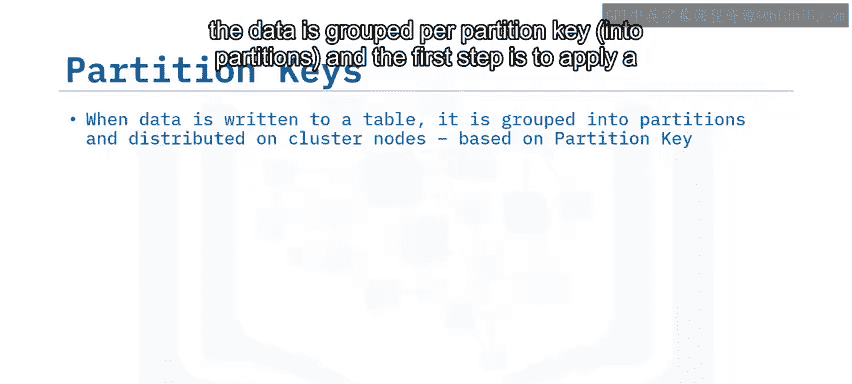

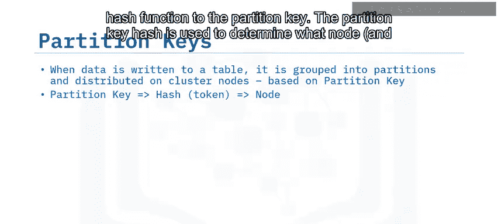

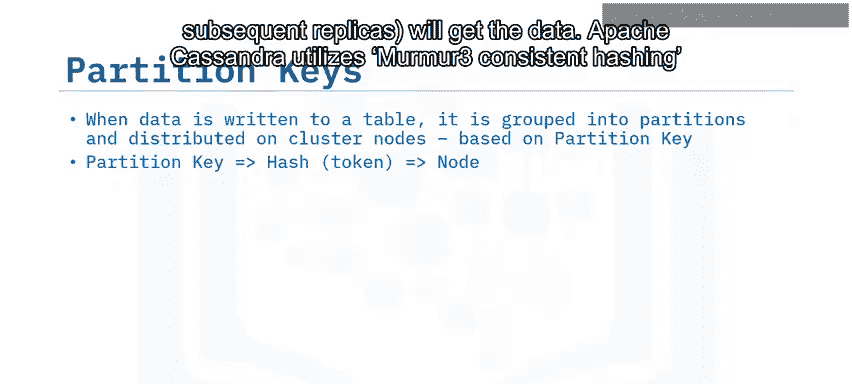

In simpler terms， a partition key determines the data locality in the cluster。

You can see in the diagram and table that data is grouped according to the partition key group IDd。

 and that each partition is distributed to one of the cluster nodes。

 The partition is the atom of storage in Cassandra。

 meaning that one partition's data will always be found on a node and its replicas in the case of a replication factor greater than one。

So if we want to answer the query， all users in group 12。

 then the query can address only the fourth node and we'll get the answer。In big clusters。

 those consisting of hundreds or thousands of nodes。

 limiting the number of nodes required to be contacted in order to answer the query is crucial for query performance。

Before we move to our next video to discuss clustering keys in more detail， first。

 let's define two more concepts， static and dynamic tables。

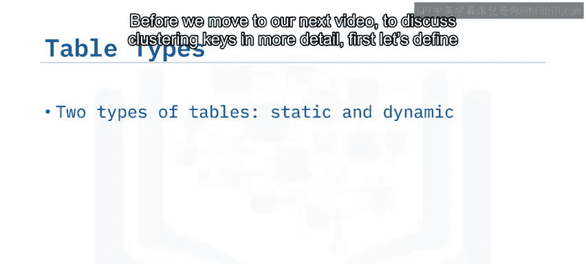

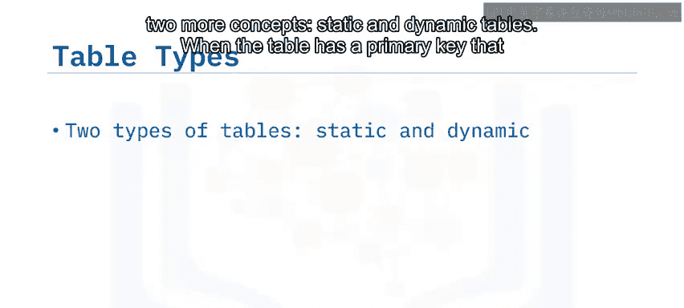

When the table has a primary key that contains only the partition key， single or multiple columns。

 and no clustering key， the table is called a static table。

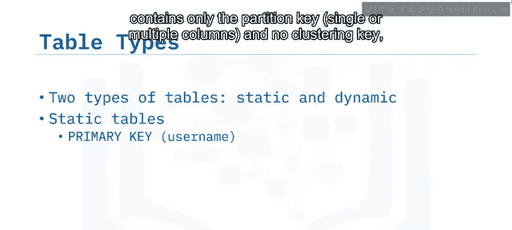

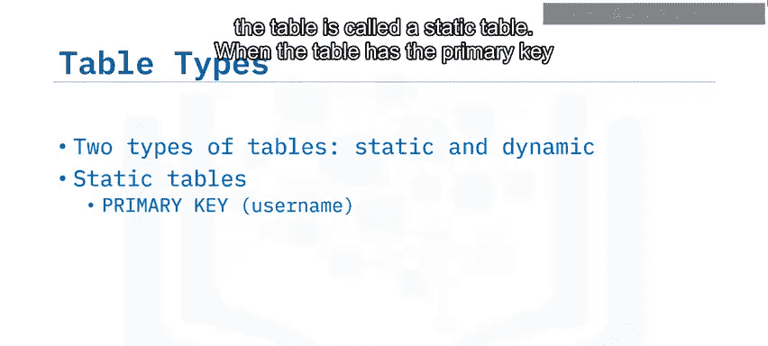

When the table has the primary key composed of both partition key or keys and clustering key or keys。

 the table is called a dynamic table。This user's table is a static table， as you can see。

 the primary key consists only of the partition。 this means that the number of distinct users we will have is the number of partitions we will have in our table。

In static tables， partitions have only one entry and thus are called static partitions。In this video。

 you learned that Cassandra stores data in tables and tables are grouped in key spaces。

 It is recommended to use one keyspace per application。 You can create。

 drop and alter your tables without impacting the running updates on your data or the running queries。

 The two roles of a primary key are to optimize the read performance for your queries on the table and to provide uniqueness to the entries。

 A primary key has two components。 a mandatory partition key and one or more optional clustering keys。

 Cassandra has two types of tables。 static and dynamic and static tables are those tables that have a primary key that contains only the partition key but no clustering key。

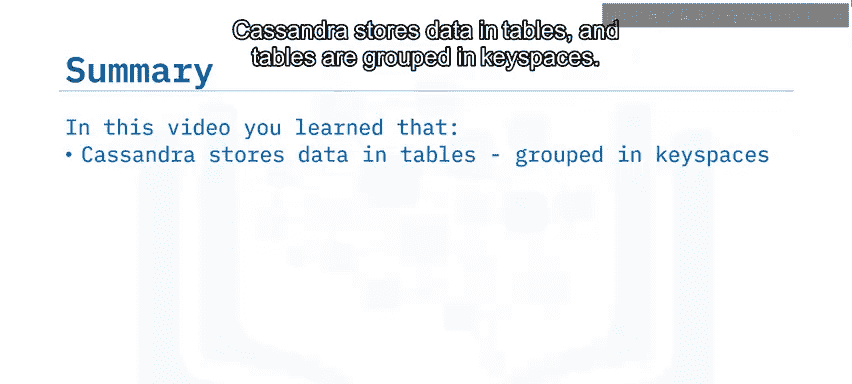

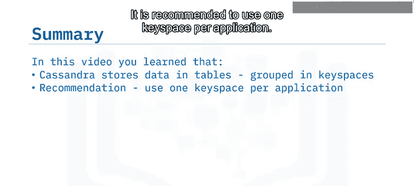