# IBM数据工程专业证书课程10：《NoSQL数据库导论》｜introduction-to-nosql-databases｜ - P22：21_cassandra 数据模型第 2 部分.zh_en - GPT中英字幕课程资源 - BV1UN41187Zz

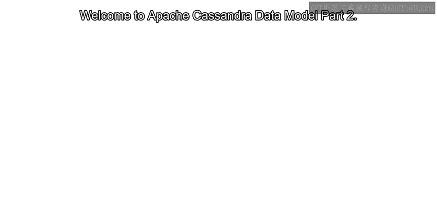

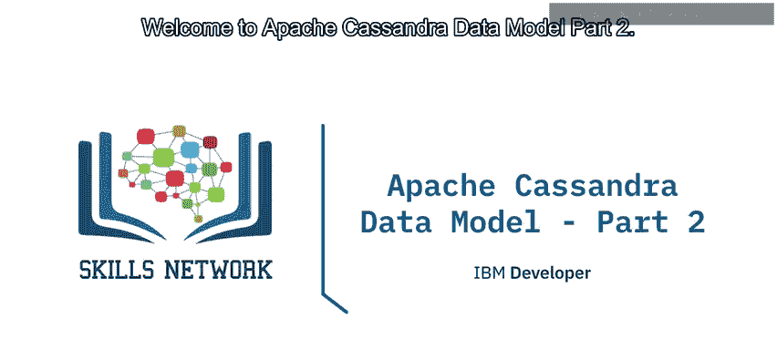

Welcome to Apache Cassandra Data model Part 2， let's move on with our Cassandra data modeling journey。

 having already introduced the primary key， the role of the partition key and the definition of static tables After watching this video you will be able to explain what clustering keys are。

 describe dynamic tables， and explain the basic guidelines for modeling your data。

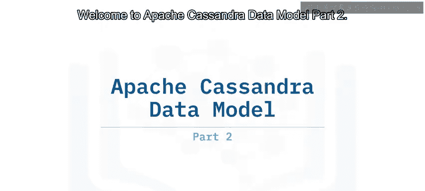

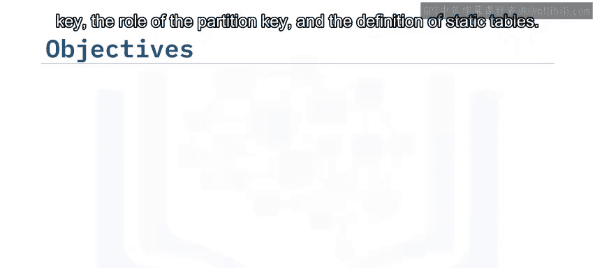

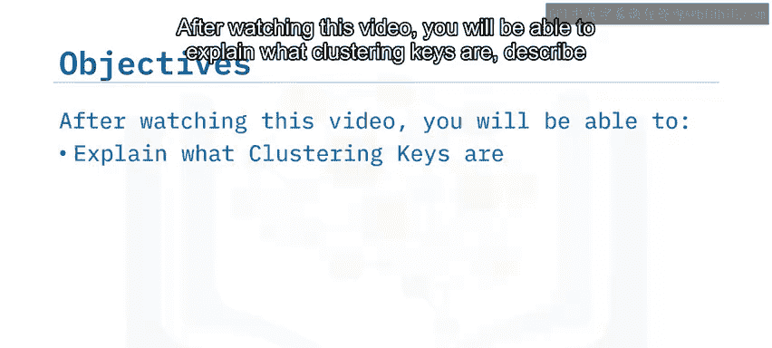

Going back to the groups table we looked at in the previous video in red。

 you can see that the second component of the primary key is called the clustering key。

 while the partition key is important for data locality。

 the clustering column specifies the order that the data is arranged in inside the partition that is ascending or descendending and optimizes the retrieval of similar values column data inside a partition。

 the clustering key can be a single or multiple column key， In our case。

 our clustering key contains only one column username。

 which means that the data inside the group partition is going to be stored by username by default in an ascending order。

 So when we query all users in a specific group data will be ordered by default in ascending order by the user's username。

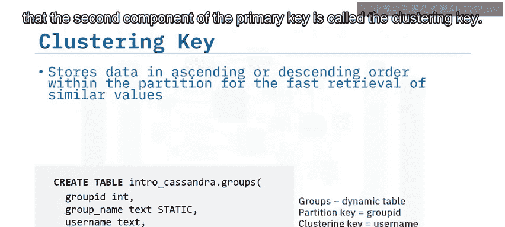

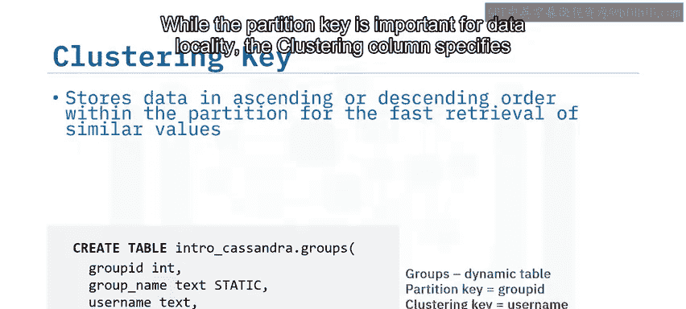

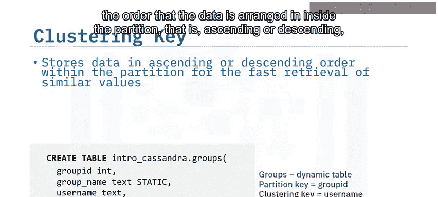

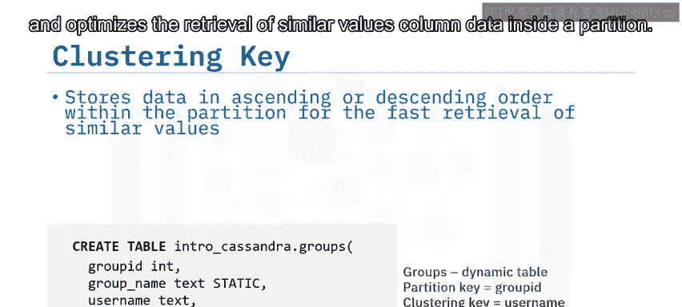

In this example， the clustering key was used for one main reason to add uniqueness to each entry。

 but actually， the clustering key is also very important for improving the read query performance。

 The next part of this video will illustrate this point。

Let's assume we would like an answer to the query， give me all users in Group ID 12 that are aged 32 In this case。

 one of the possible data models for answering such a query is to have a table with group ID as the partition key and age and username as clustering keys。

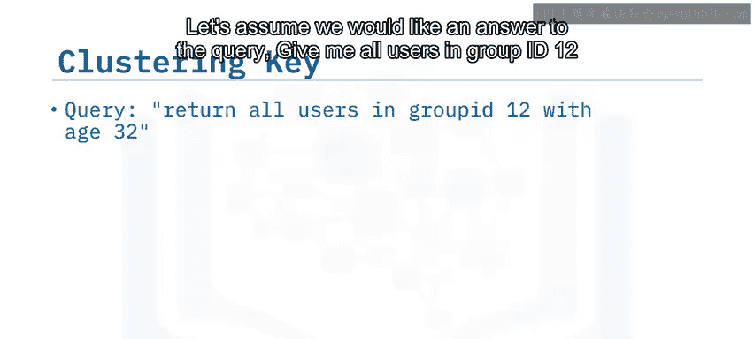

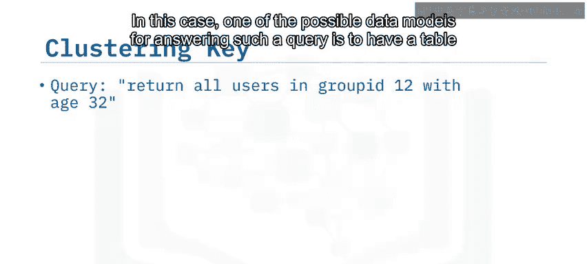

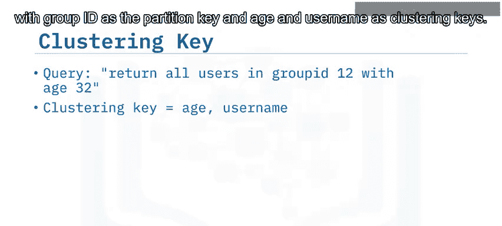

Data inside each partition is first grouped and ordered by age， and inside each age group。

 it is then grouped by username。 So in this case， all users in a certain group that have the same age will be stored together。

 Thus， a query such as give me all users in a certain group by group I D that are aged 32 will just locate the node that contains the partition for group 12 and read from that node just the two sequential records。

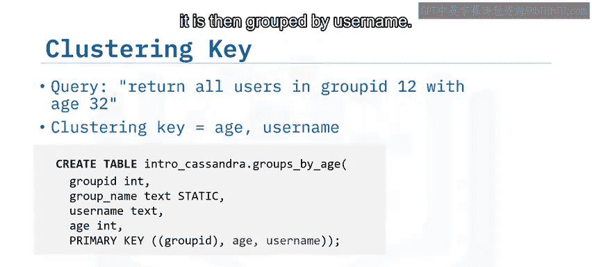

Reducing the amount of data to be read from a partition is crucial for query time。

 especially in the case of large partitions， in which Cassandra would have to read hundreds of megabytes of data in order to provide an answer from just a few kilobytes of data。

Let's insert a new entry in a dynamic table like groups insertsting new data in our table will just direct the right to the location of the partition and will increase the partition size from two to three entries in dynamic tables。

 Partitions grow dynamically with the number of distinct entries due to the presence of the clustering key in the primary key It's important to note that in this diagram。

 replication is not taken into account， so only one node holds the partition for group 45。

 for example。

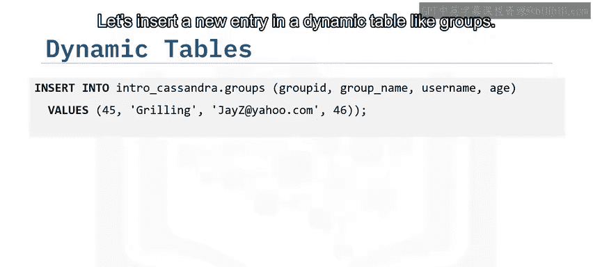

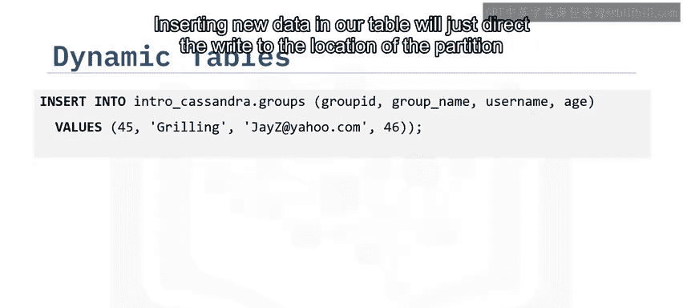

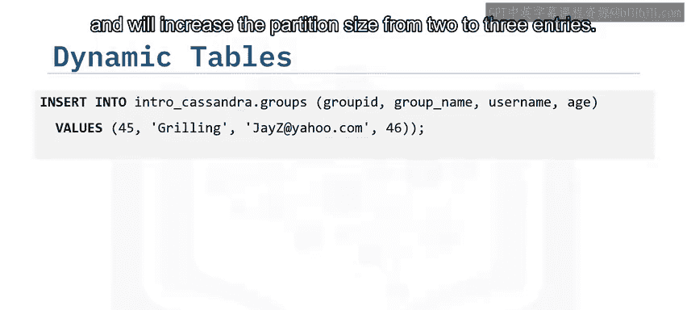

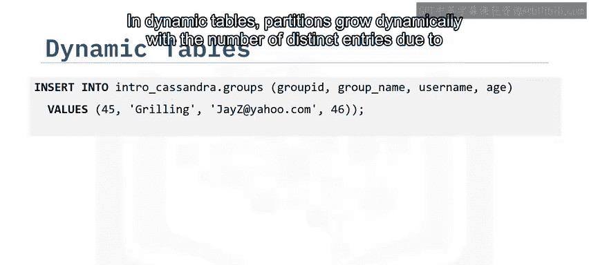

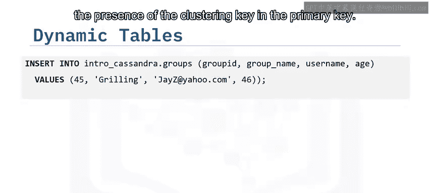

Every write or read for Group 45 will be routed to the second node of the cluster。

 As long as the cluster is not changed， this node will hold the data for Group 45。

 a change such as nodes added or leaving would trigger a new token allocation and subsequently data distribution。

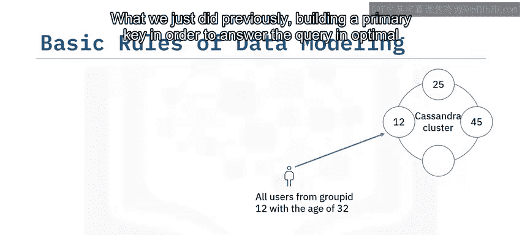

What we just did previously， building a primary key in order to answer the query in optimal time is the beginning of the data modeling process。

 There's much more to Cassandra modeling than primary key definition， but to keep it simple。

 we will refer back to this part， which is also the most important。

When building a primary key for a table， you should take into consideration the following simple rules。

 First， choose a partition key that starts answering your query。

 but that also spreads the data uniformly around the cluster。 For example。

 group Id might be a good partition key。 If there are many groups。

 Many distinct values for group I and group sizes are similar。 and secondly。

 build a primary key that allows you to minimize the number of partitions read in order to answer a certain query。

 Remember that data is distributed throughout the cluster。

 If we would need to read more partitions to answer the query。

 then we would need to potentially access several nodes in order to answer our query。

 This would affect the query time and even induce timeouts。 Thus。

 the primary key needs to be designed so that optimally。

 we read one partition in order to answer our query。And one note before we summarize。

 besides the basic rules discussed here， make sure you build a clustering key that helps you reduce the amount of data that needs to be read even further by ordering your clustering key columns according to your query。

 In this video， you learned that a clustering key specifies the order that the data is arranged inside the partition。

 ascending or descending。 A clustering key can be a single or multiple column key。

 A clustering key provides uniqueness to a primary key and improves read query performance。

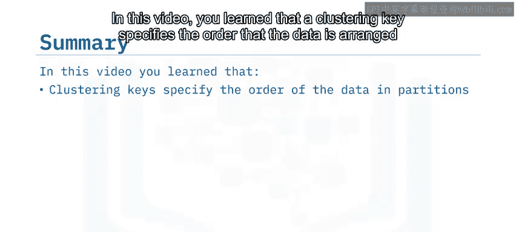

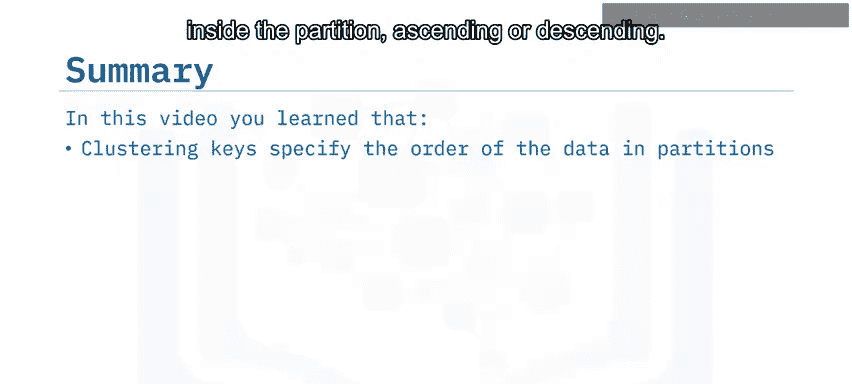

Reducing the amount of data to be read from a partition is crucial for query time。

 especially in the case of large partitions。In dynamic tables。

 partitions grow dynamically with the number of entries。

Building a primary key in order to answer the query in optimal time is the beginning of the data modeling process and to define a Cassandra table in order to get good read performance。

 you need to start with the queries you would like to answer。

 then build your primary key based on the query。