# IBM数据工程专业证书课程10：《NoSQL数据库导论》｜introduction-to-nosql-databases｜ - P25：24_键空间操作.zh_en - GPT中英字幕课程资源 - BV1UN41187Zz

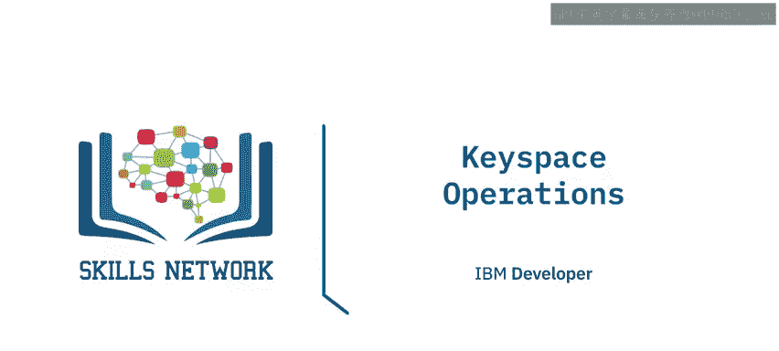

Welcome to Apache Cassandra Keyspace Op。

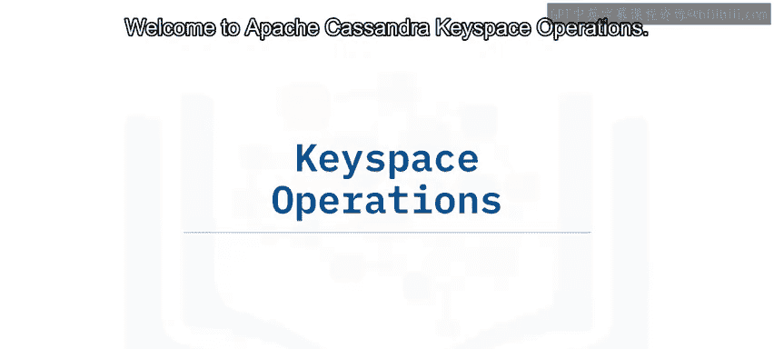

After completing this video you will be able to describe the role of keyspaces in Apache Cassandra。

 describe the replication factor and replication strategy， and create， modify and delete a keyspace。

In our previous videos， we talked about the two logical entities in Cassandra tables and keyspaces。

 We will continue discussing table operations in the next video， but for the moment。

 let's go into more details regarding keyspaces and keyspace operations。

 A keyspace needs to be defined before creating tables， as there is no default keyspace。

 A keyspace can contain any number of tables， and a table belongs to only one keyspace。

 Replication is specified at the keyspace level。 and you specify the replication factor during the creation of a keyspace。

 but the replication factor can be modified later。

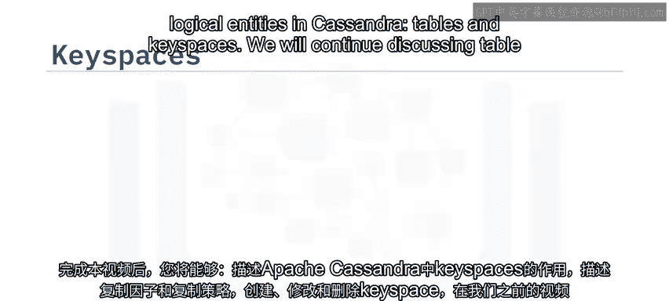

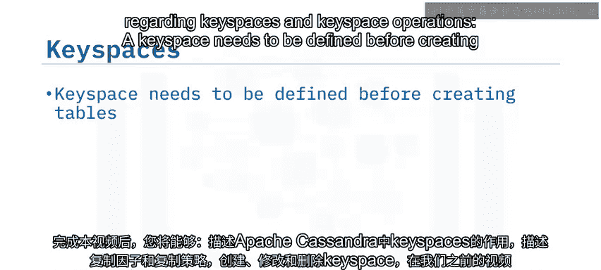

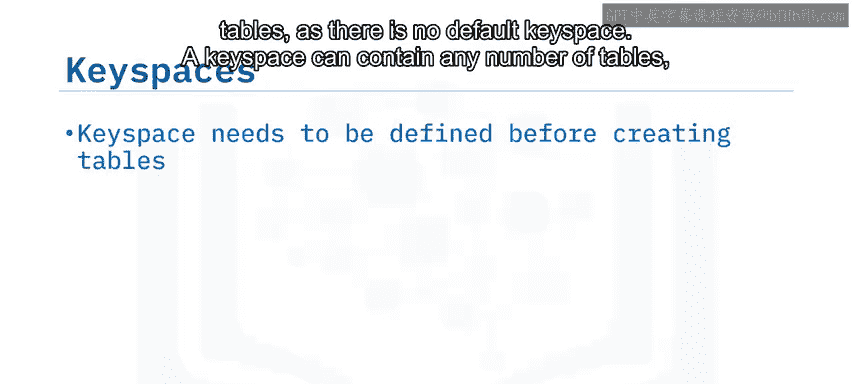

Let's take a CQL create keyspace example。 You can see that besides the name we need to set two parameters class。

 which refers to the replication strategy and the replication factor。

 which is set at each data center level In this example。

 we are creating a keyspace called Intro underscore Cassandra that replicates its data Aka tables partitions five times between the cluster nodes in three nodes from data center1 and two nodes from data center2。

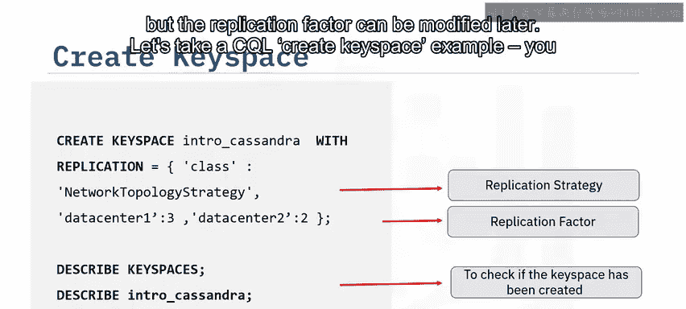

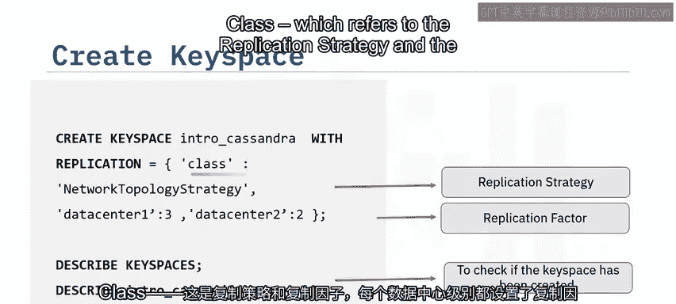

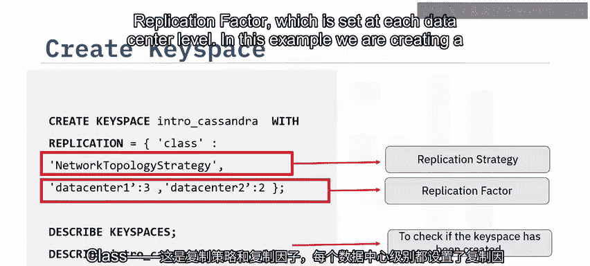

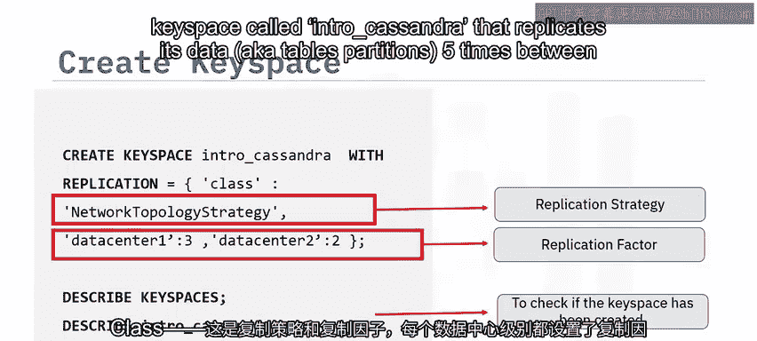

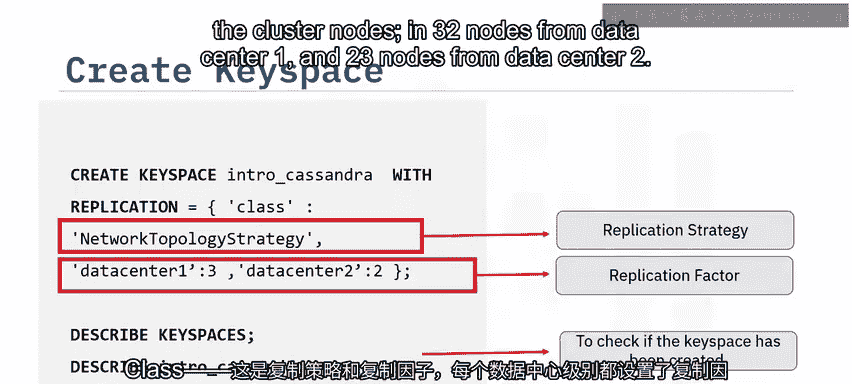

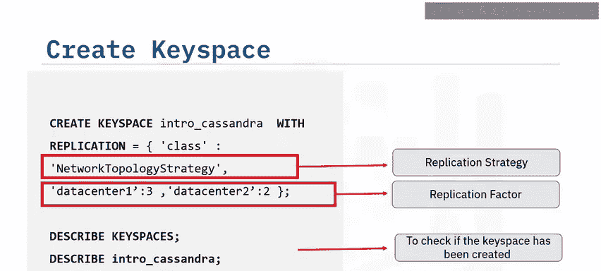

To check if the keyspace has been created， you can useDescribe keyspaces or describe then the name of the keyspace。

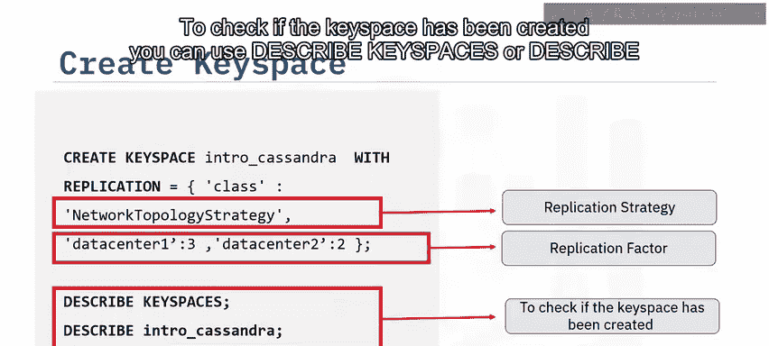

Replication factor refers to the number of replicas of data placed on different nodes。

 while replication strategy determines on which cluster nodes the replicas are going to be located after data is initially distributed according to partition key hashed and token preallocation。

 then data is also replicated according to these two pieces of information。

 replication factor and replication strategy。

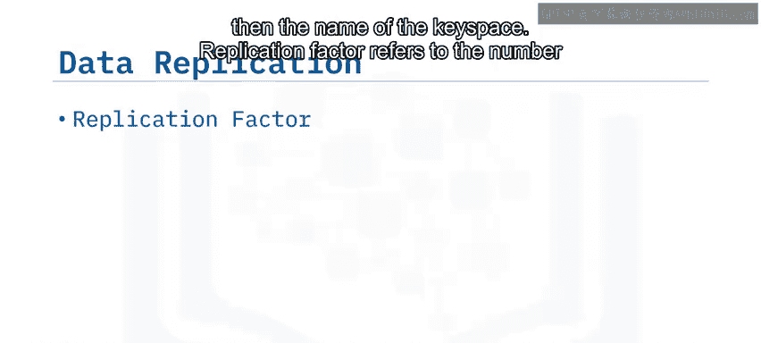

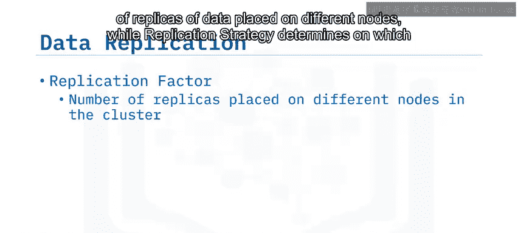

Before we move on to some examples of replication factor and strategy。

 two important notes regarding the replicas in Apache Cassandra， all replicas are equally important。

 There are no primary or secondary replicas。And as a general rule。

 the replication factor should not exceed the number of nodes in the cluster。

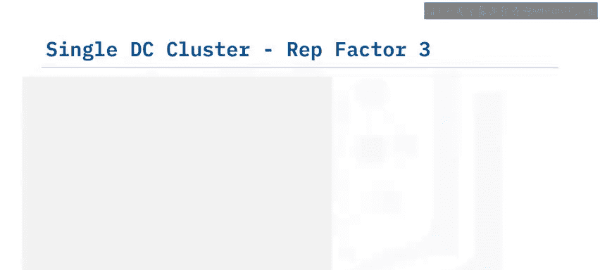

Let's take a simple example of a four node Cassandra cluster with one data center and a keyspace called Intro underscore Cassandra defined with replication factor 3 in CQL when we create a key space。

 We need to specify the class as being network topology strategy。

 the only option recommended for production systems and specify the replication at data center level in this case。

3 cluster topology indicates that nodes 1 and two are in the same rack。

 while3 and 4 share another rack as well。 We assume that our partition named P in the diagram has been initially allocated to node 1。

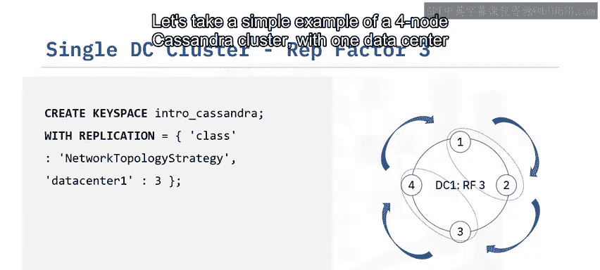

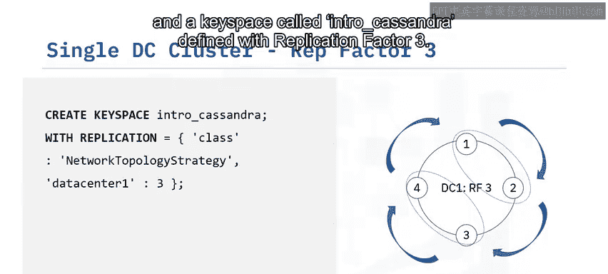

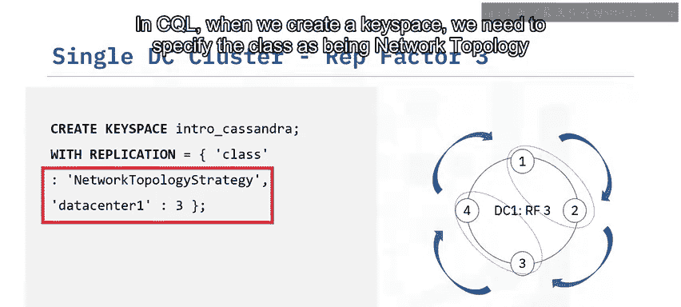

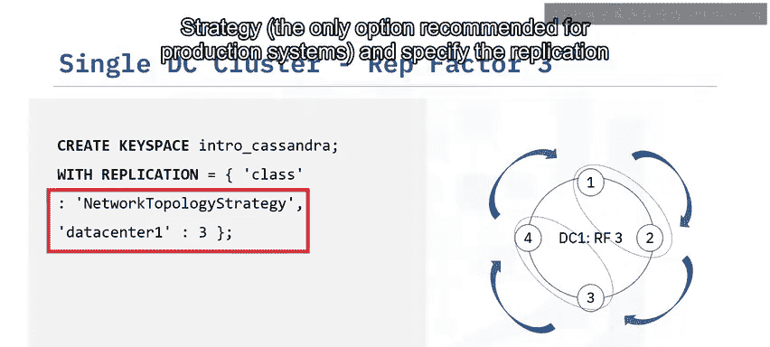

We have a replication factor of three， meaning we need to replicate data into two more nodes in order to reach the replication factor of three data replication is done clockwise in the cluster while taking into consideration the rack allocation of the servers。

Since nodes 1 and two are in the same rack， Cassandra will try to place the next replica on a node from a different rack。

 in this case， node 3。And the last replica will be placed on node4。

Since two replicas are placed in different racks， the fact that nodes 3 and4 are in the same rack will not be an issue。

Let's now take an example in which the cluster is deployed in a multi data center environment here we have two data centers and our key space has a replication factor of5。

Just like in the previous example， we need to use CQL to create a keyspace， and again。

 we specify the class as B Network topology strategy。

 and we specify the replication factor at the data center level as being3 for data center 1 and two for data center 2。

We assume that our partition named P in the diagram has been initially allocated to node1 in data center 1 and node 5 in data center 2。

 just like in the previous example， in data center 1。

 two more replicas are going to be placed clockwise according to the rack placements of the servers。

 thus nodes 3 and4 will get the replicas of partition P。In our case， we have two data centers。

 so after completing the first data center replica placement。

 Cassandra will go to the next data center in order to place the other two replicas。

 since the partition P has already been allocated initially to node 5 in data center 2。

 we need to now place only one more replica in data center 2。

Taking into consideration the rack placement of the nodes。

 node 7 is chosen to hold the fifth replica of our data。

 and this is how our five replicas ended up in the Cassandra cluster nodes。

We have already seen in this video examples of using createate keyspace。

 but now let's see how we can modify or delete a keyspace。

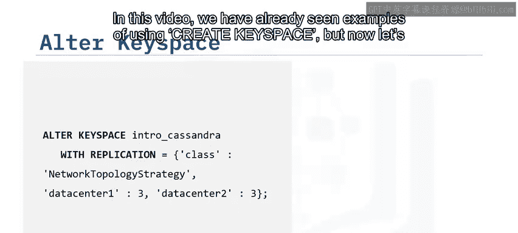

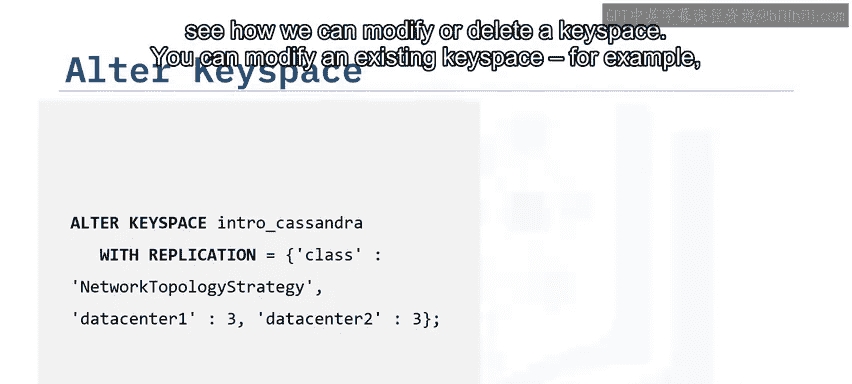

You can modify an existing keyspace， for example， modify the replication factor of a keyspace by using the CQL Alter keyspace command。

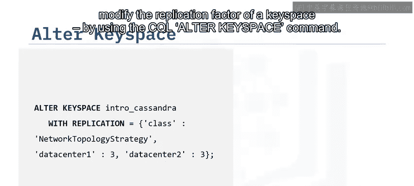

An example， you can increase the overall key space replication factor from five to6 by increasing the replication factor in data center2 from  two to3。

You can also delete or drop a keyspace by using the D keyspace command in CQL。

 which will lead to the removal of all the keyspace tables and the data those contain to protect the system against an unwanted drop Cassandra will by default。

 take a snapshot of the keyspace prior to executing the drop This means that you will be able to recover your data in case you need to。

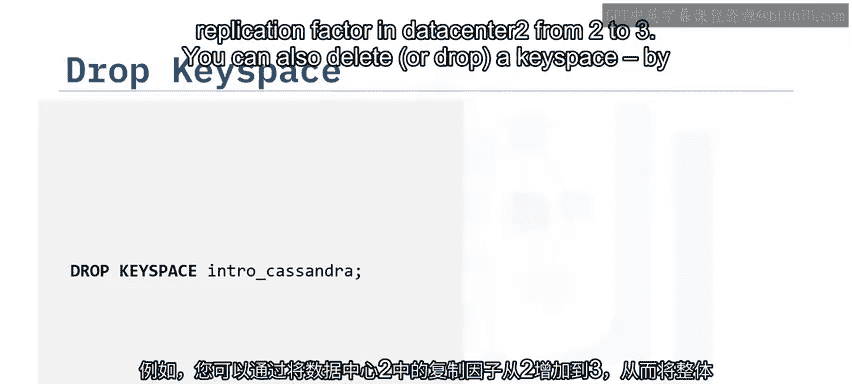

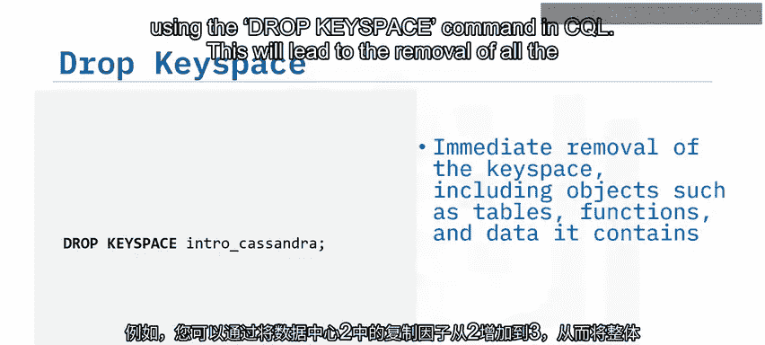

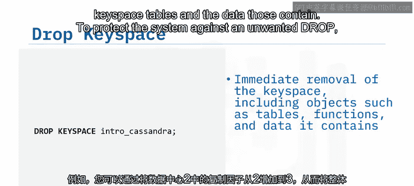

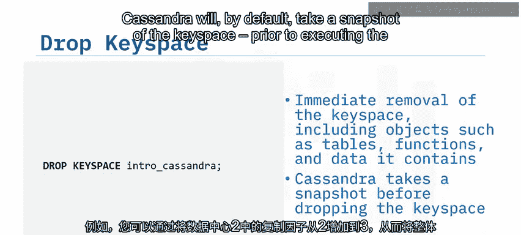

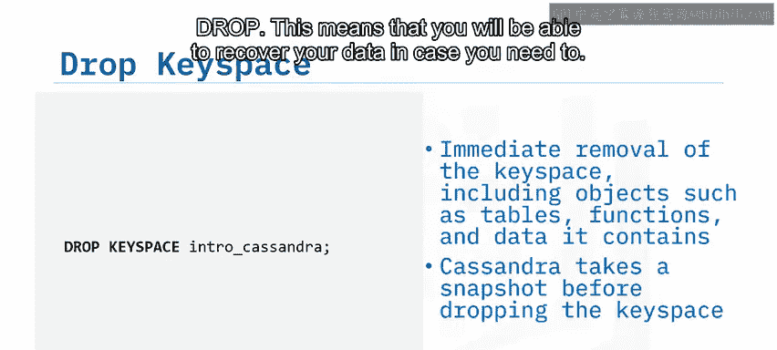

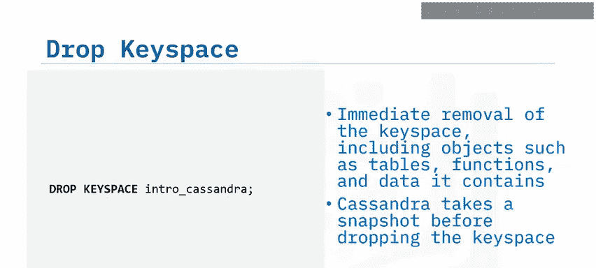

In this video， you have learned that keyspaces are defined before creating tables and a keyspace can contain any number of tables。

 Replication is specified at the keyspace level data replication depends on a replication factor and a replication strategy。

 both set at the keyspace level Replication factor sets the number of replicas Replication strategy determines on which cluster nodes the replicas are going to be located and common keyspace operations are create keyspace alter keyspace and drop keyspace。

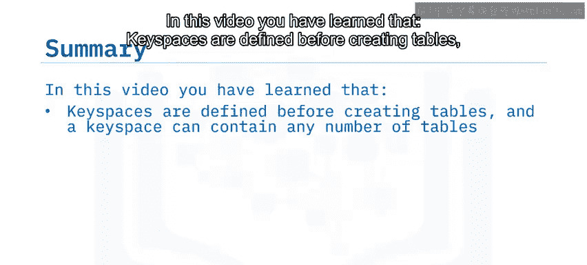

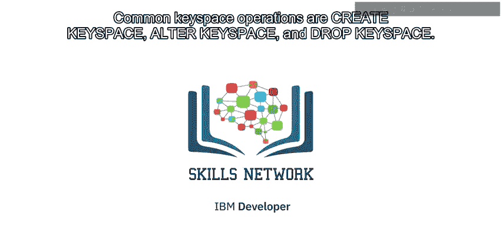