# IBM数据工程专业证书课程10：《NoSQL数据库导论》｜introduction-to-nosql-databases｜ - P26：25_表操作.zh_en - GPT中英字幕课程资源 - BV1UN41187Zz

Welcome to Apache Cassandra T operations After watching this video。

 you will be able to explain the role of Cassandra tables。

 describe some of the properties of Cassandra tables。

 and create Alter and delete a table In the previous video we learned about keyspaces and possible operations at the keyspace level remember that in Cassandra prior to declaring a table you first need to create a keyspace a table will always be created in an existing keyspace。

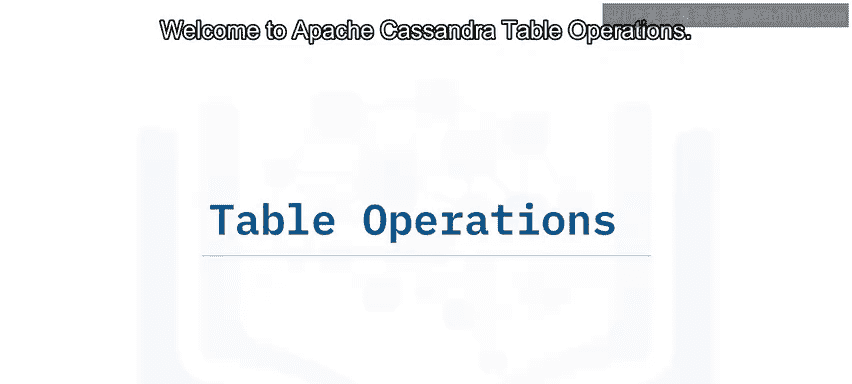

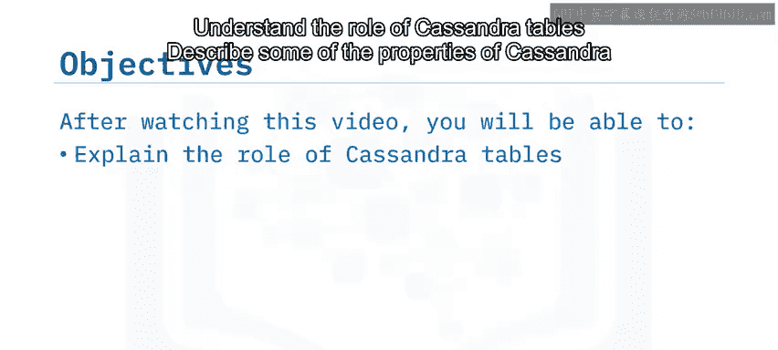

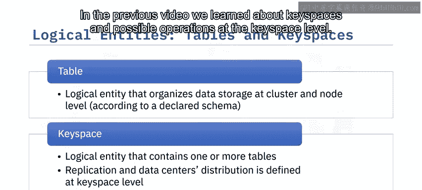

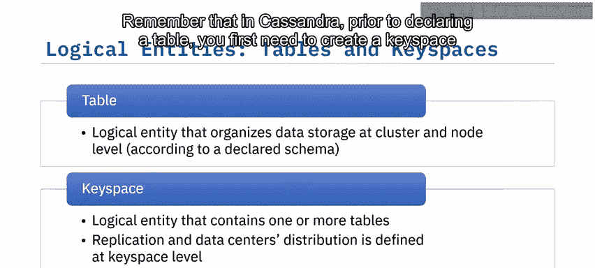

Cassandra stores data in tables whose schema defines the storage of the data at the cluster and node level。

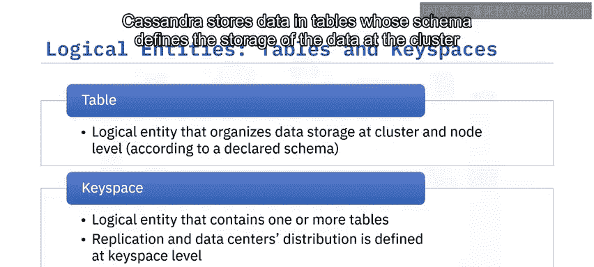

The generic create table syntax looks like this。 Cate table with the optional。

 if not exists parameter， followed by the keyspace name。

 If it has not been already stated by use keyspace。 and then the table name。

 This command creates a new table under the specified keyspace。

 The if not exists keywords may be used in creating a table。

 attempting to create an existing table returns an error unless the if not exists option is used。

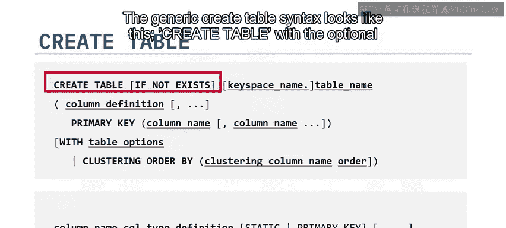

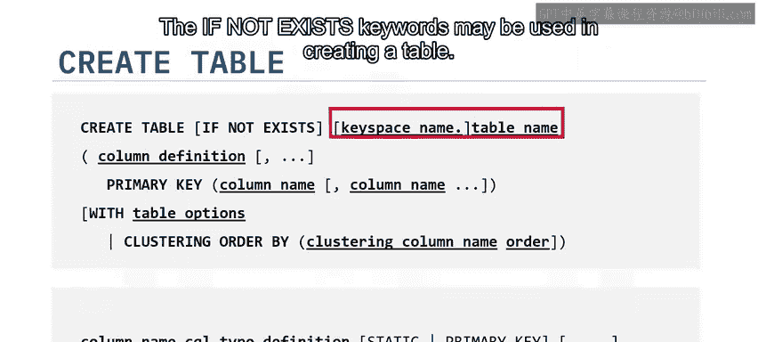

If the option is used and the table already exists。

 then the error message is suppressed and no table is created columnns are defined inclosed in parentheses after the table name。

 using a comma separated list to define multiple columns in the column definition。

 you can also specify optionally the primary key parameter。

 which is used to indicate that the column is the only primary key for the table。

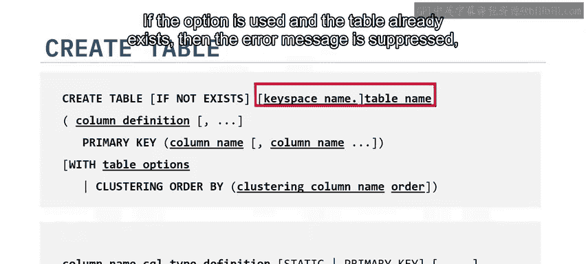

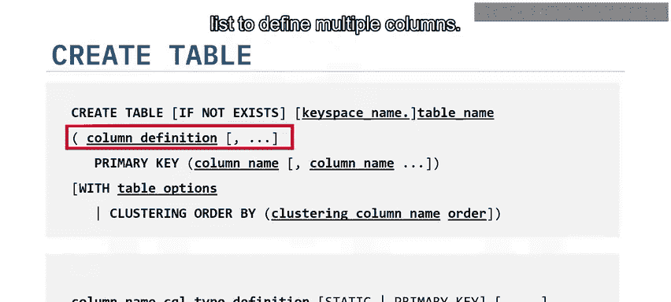

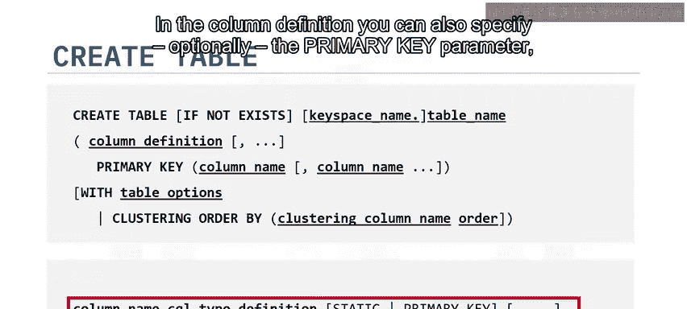

In a case where you have a primary key formed of multiple columns。

 then you declare it at the end of the table。

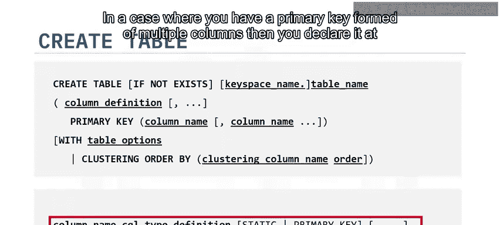

Let's take an example。 Remember the users' table from earlier in the course。

 Let's now explain the createreate table statement based on what we just learned。

 Our table is static， meaning the primary key contains only one column partition key， user name。

In this case， we can signal the primary key in two ways， just by adding it to the column definition。

But the same table would be created if we declared the primary key just like this。

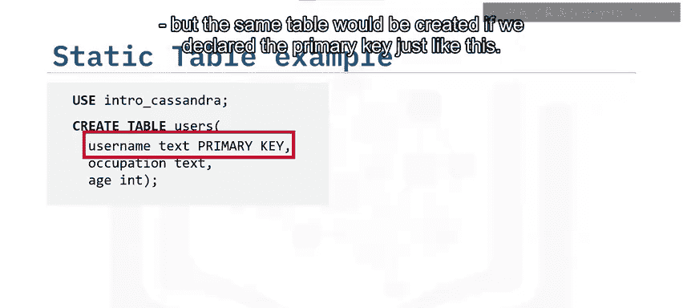

Once we've created the table， we can use a select statement， but since we have not inserted any data。

 the select result will be empty。

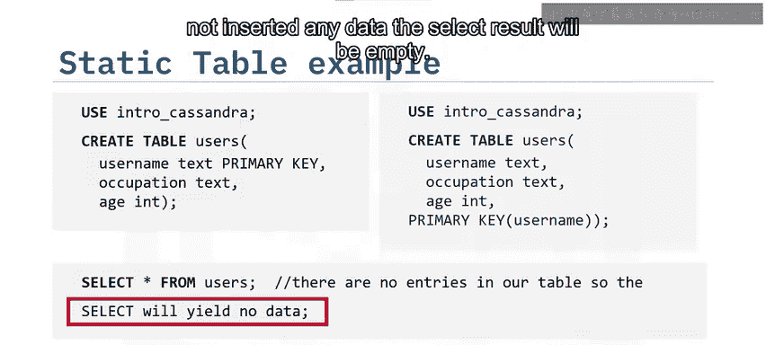

Now， let's create a dynamic table as well。 Remember the groupss table from earlier in the course。

 a dynamic table means that our primary key is composed of both a partition key and a clustering key。

 In our case， the partition key is the column group I D and the clustering key is the column user name。

 You probably have mentioned the static in the group underscore name column definition。

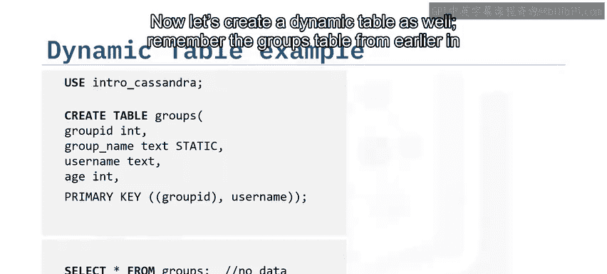

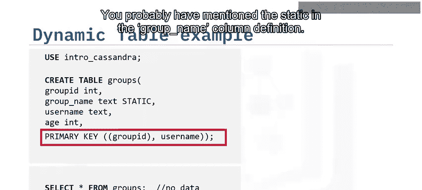

The static clause is used for special single value columns that are shared by all partition rows。

 A static column is also called a descriptive column of the partition key。

 Sta columns cannot be used as a primary key。 when using a select statement。

 the same applies for groups as it did for the users' table。

 a select on the groups table would yield no result， since we have not yet inserted any data。

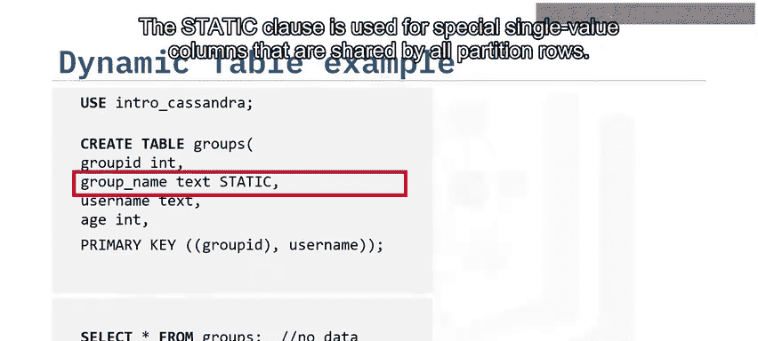

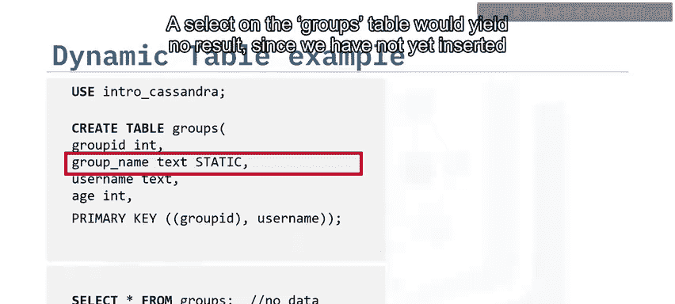

If we describe the table， then we can see the table's definition and properties。

 Let's explain some of the new things you can see on this screen。 First， by default。

 data inside the partition is ordered by the clustering key username in ascending order。

 the with clustering order by parameter can be used to order the data inside the partition。

 The default time to live means that you can set an expiration time for the data in the table。

 For example， an offer that is valid only for five minutes， After five minutes， the data is deleted。

 time to live or T T L can also be set at the operation level。 For example， with an insert。

 meaning that only that row will be expired after the T TL。

 We will come back to this in our next video when talking about inserting data into Cassandra tables。

 write data such as inserts， updates。

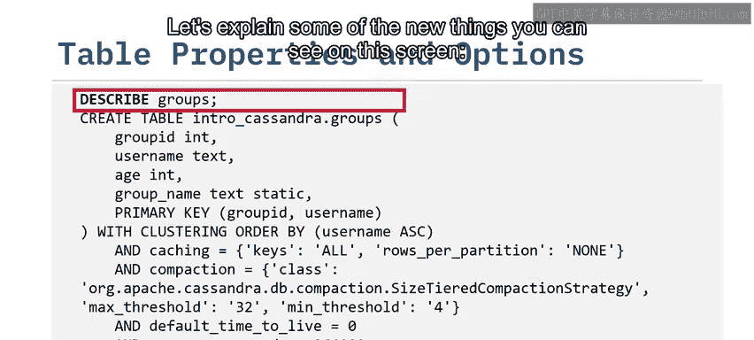

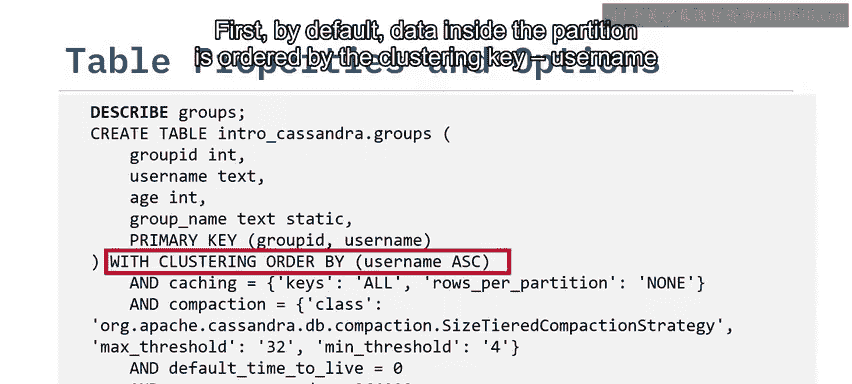

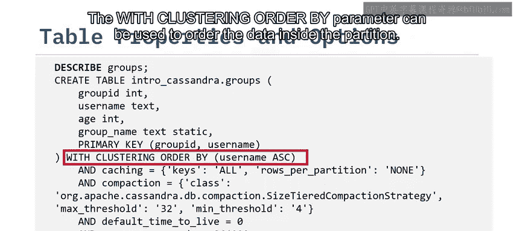

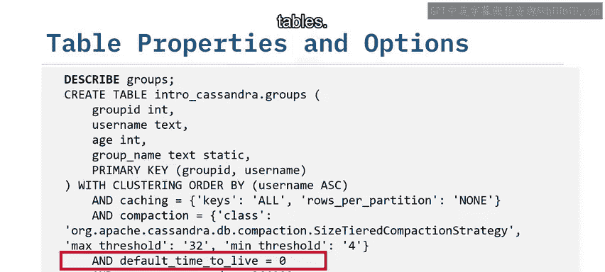

Delettes is flushed from memory on disk in three situations。

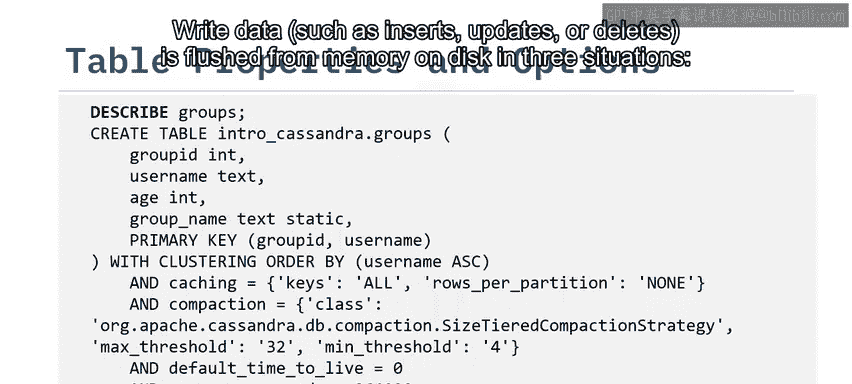

When the MEM table is full， when the commit log is full， or at a specific interval。

This setting refers to the per table setting， specific interval of flushing data to disk。 By default。

 this is 0， meaning not activated。What you can see in this slide are only a few of the Cassandra table properties and options。

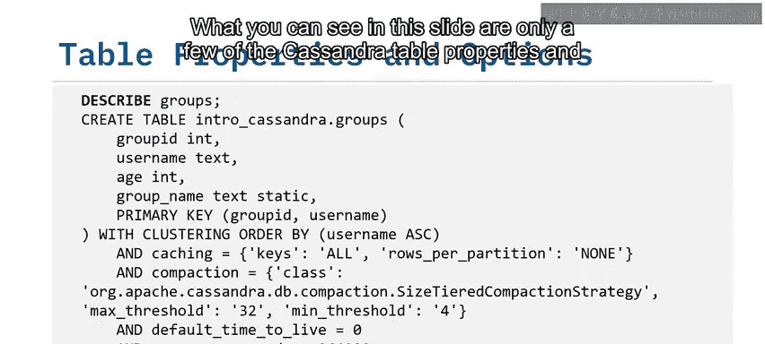

Some of them like GC_ grace underscore seconds and compaction。

 we will come back to in the next video after discussing how data is persisted on disk and how deletes are implemented in Cassandra as in the case with keyspaces earlier tables can also be altered。

 you can add new columns to the table schema drop columns from the table schema， rename columns。

 but be aware that it works for regular columns and clustering keys。

 but is not supported for partition keys and change table properties。

 please note that while we are mentioning adding and deleting columns。

 these operations can be applied only to regular columns not to primary key columns。

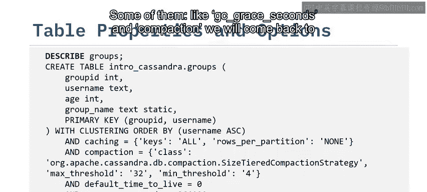

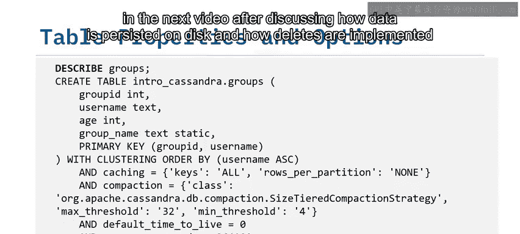

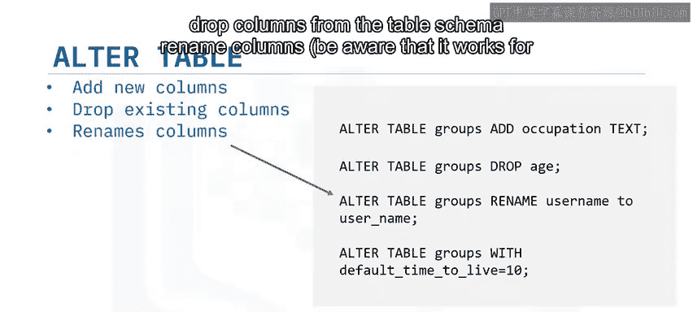

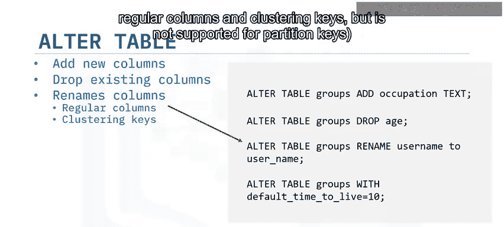

In Cassandra， the primary key once defined， can be changed since it determines the way the data is stored at cluster and node level。

If you do want to change it， you will need to create a new table and reimport the data。

Changing the data type for an existing column is not supported。

You can delete a table using either the trunccate or drop commands。

 Trunccate removes all the data from the specified table， but not the tables defined schema。

 One thing to be aware of with the trunccate command is that it requires an all consistency。

 Thus all replicas need to be available。 The drop command removes all data and the tables defined schema before truncating or dropping the data。

 Cassandra takes a snapshot of the data as a backup。

 In this video you have learned that data in Cassandra is organized logically in tables。

 A table's metadata specifies the primary key。 Instructing Cassandra how to distribute the table data at the cluster level and at node level。

 you can add the time to live parameter at the table level。

 meaning that you can expire or delete all data that has surpassed the TtL。

 you can modify the columns and column names。

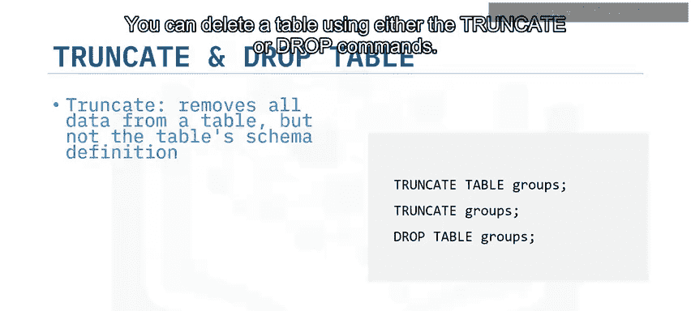

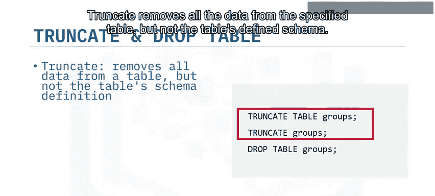

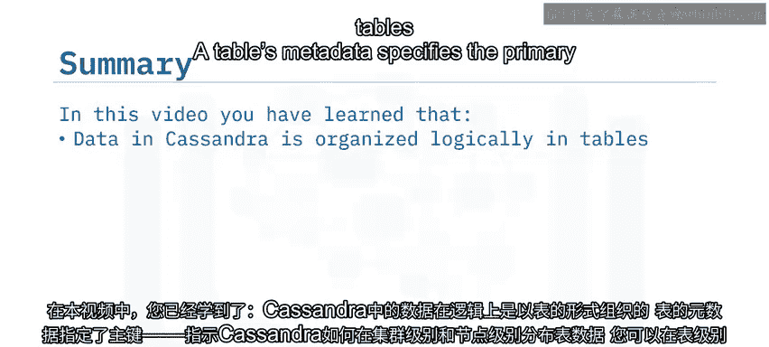

But only for regular columns， a primary key once defined at table creation cannot be modified。

 and you can either drop a table or truncate its data。

