# IBM数据工程专业证书课程10：《NoSQL数据库导论》｜introduction-to-nosql-databases｜ - P27：26_crud 操作 第 1 部分.zh_en - GPT中英字幕课程资源 - BV1UN41187Zz

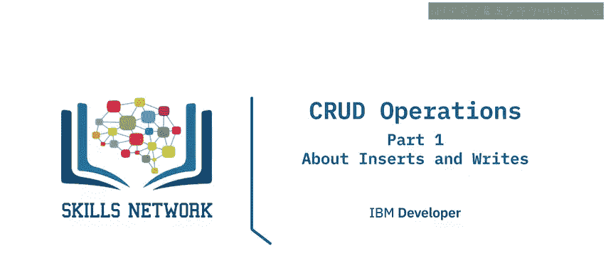

Welcome to Apache Cassandra Crud operations， Part1。

 focused on how we can insert and update data in Cassandra， The Crud acronym stands for Cate， Read。

 update and Dele。

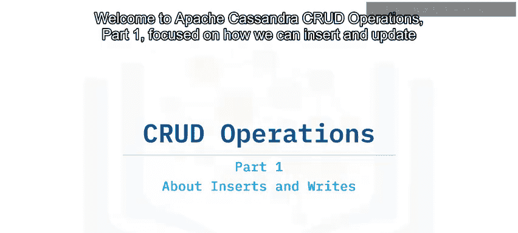

After watching this video， you will be able to describe the right process in Cassandra。

 explain the insert and update operations， and explain the role of lightweight transactions。

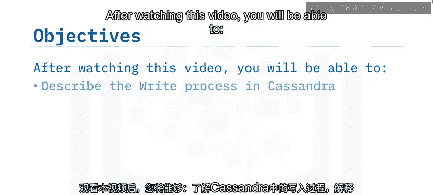

Before we actually look at the syntax of rights in Cassandra。

 let us see how a right is done at the cluster and node level。

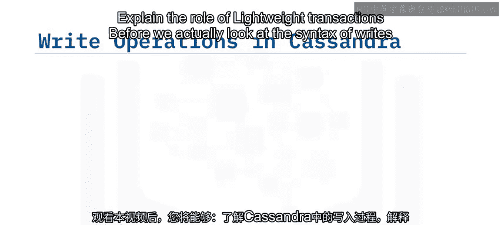

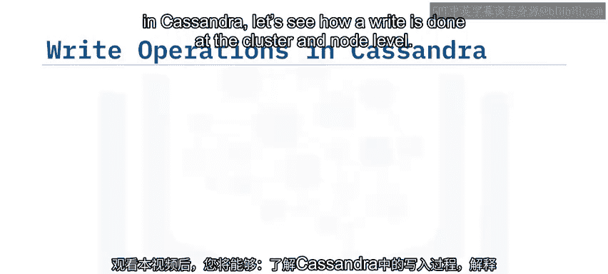

At cluster level when a write occurs， the node receiving the right becomes the coordinator of the operation。

 this means that it will make sure to complete the operation and send the result of the right back to the user。

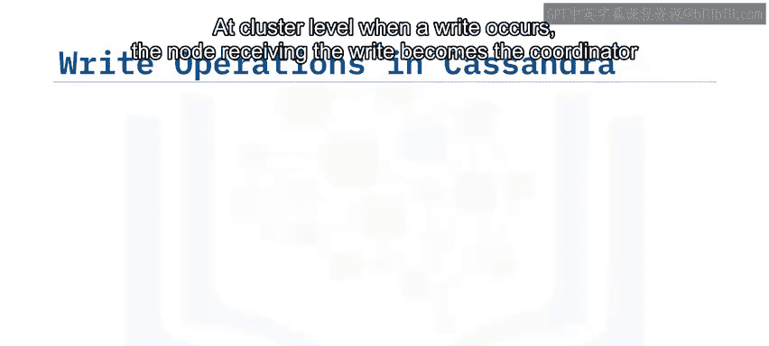

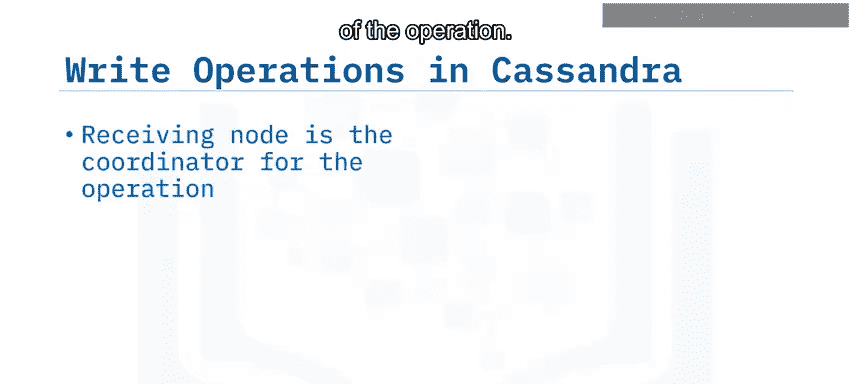

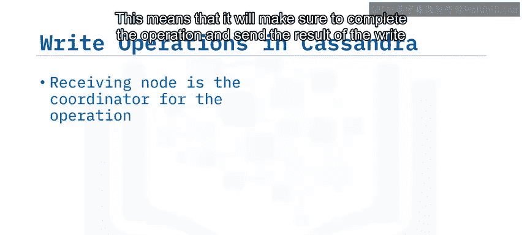

Right operations are directed towards all replicas of the partition into which they are writing。

 But for the operation to be successful， Acknowledment is expected from at least the minimum number of nodes specified for consistency。

 Let us take the example of a key space with replication factor 3。

 and a right operation with consistency set to 2。 We assume our partition is located in nodes 1。

2 and 3。 In this case， the right operation arrives in node 4 and node 4 sends the right to nodes 1。

2 and 3， according to the replication factor。 However， node 2 is not available。

 so the right acknowledgeknowment is sent only by nodes 1 and 3。

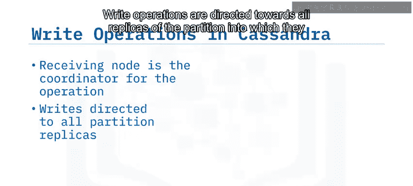

Coordinator nodede 4 checks the number of answers and compares it to the expected consistency value and then returns an OK。

At the node level， there are a few important facts to remember。

 One important reminder regarding rights in Cassandra， by default。

 there's no read before the right operation。

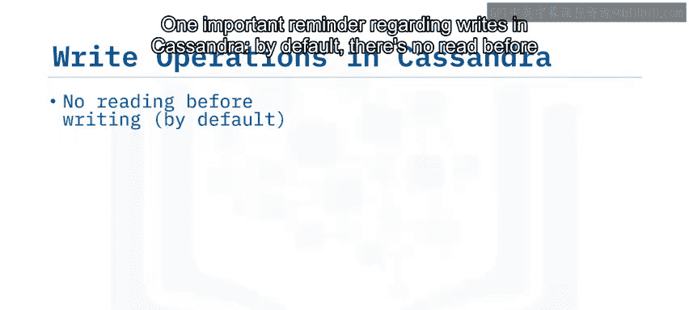

At the node level， rights are stored in memory， then flushed on disk in files called S tables。

 The more write we perform， the faster the Mem table gets filled and flushes the data on disk。

 Every flush operation creates a new file called SS table。

On diskC data is appended in subsequent SS tables， Later on the data will be optimized on disk through a process called compaction。

 and Cassandra attaches a timestamp to every right operation。

Timetamps are used for data reconciliation， the most recent data wins。

Let's go through a few basic facts about inserts in Cassandra insertsert operations require the full primary key to be specified。

 This means inserts can only be done record by record Since Cassandra by default doesn't perform a read before the right operation。

 and insert operation behaves both as an insert and an up operation If we insert data on an existing entry。

 then data will be updated。 insert operations require a value for all the primary key columns。

 but not for the other regular columns specified in the table definition only the specified columns will be provisioned with data you can insert data with a specific time to live just like we have done at the table level。

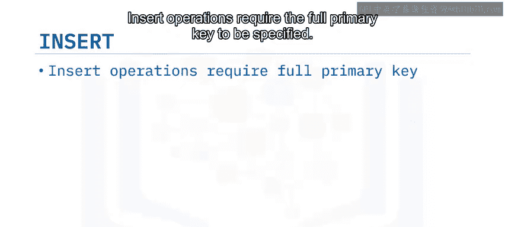

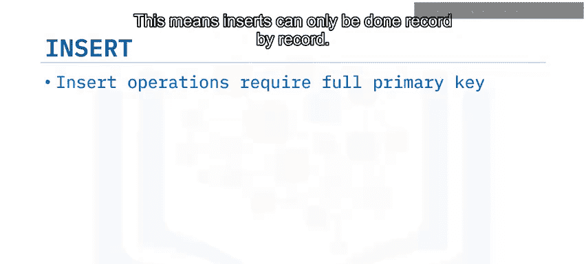

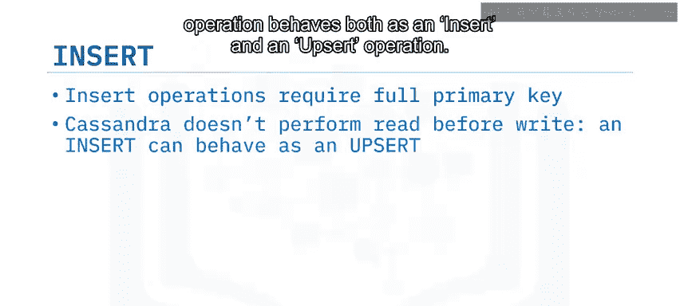

Now we can do this at record level， this means that the data will be visible only for a defined time。

Let's see a few examples based on our data in bold， you can see the columns of the primary key。

 We can insert new data in our table As you can see。

 we have specified all the tables columns In this example， we have inserted two users in Group 12。

 the baking group。

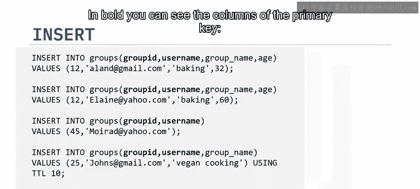

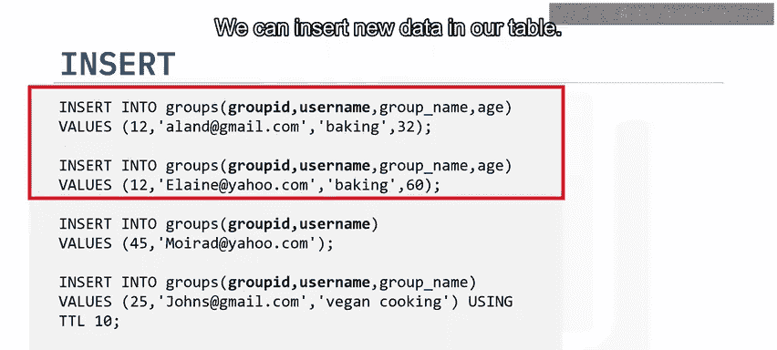

When inserting data， the primary key is mandatory， you cannot insert data without fully specifying it。

 As you can see in this example， where we insert a new user in group 45。

 we only added the mandatory information。 Neither the group name nor the user's age have been added。

We can also insert data with a time to live or TTL In this case。

 we added a new user to Group 25 vegan cooking with a TTL of 10 seconds This means that in 10 seconds from insertion。

 the data will not be available for query anymore。We can use an insert as an update when the insert is done on existing data。

 and in this case， the age of the user in group 12 will be updated to 45。

If we do a select on our table， this is what it is going to look like after all the inserts。

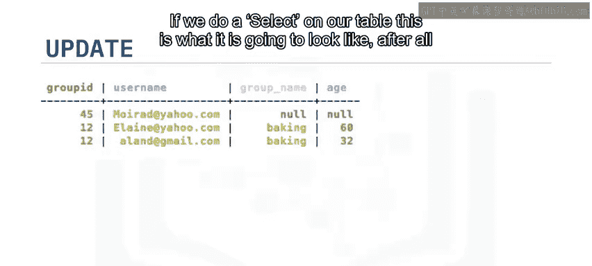

This is a CQ L S H view of the data。 so don't be misled by the null value。 In this case。

 it means that these cells have no data。 Let's do two updates to our data。

 Let's update the name of group 45， because it is a static column。

 We can update it using only the partition key。 This is the only situation in which the update command does not require a full primary key to be mentioned。

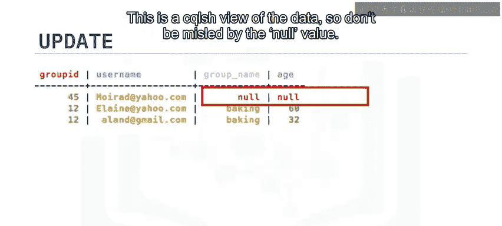

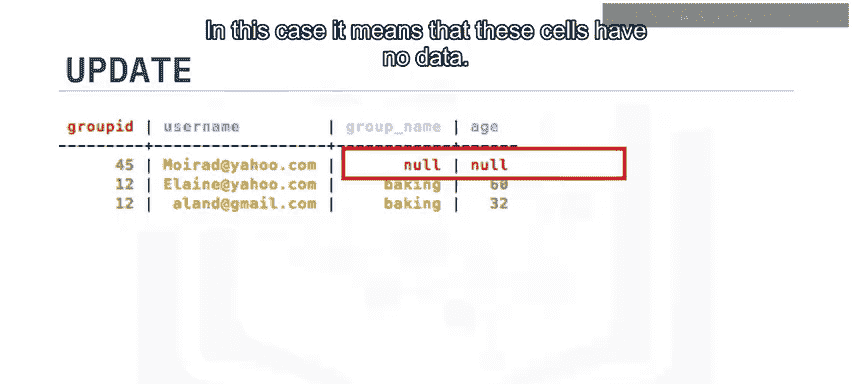

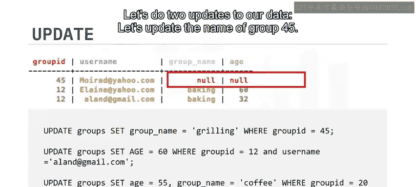

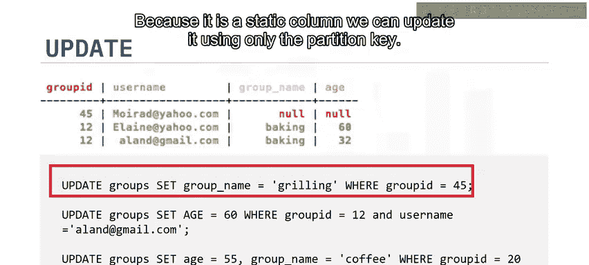

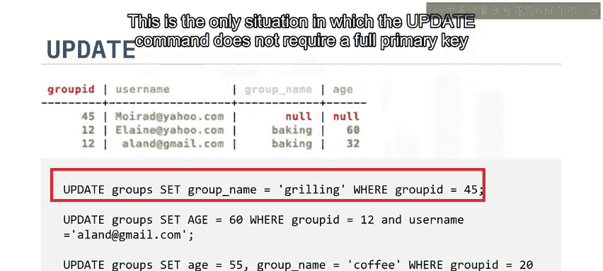

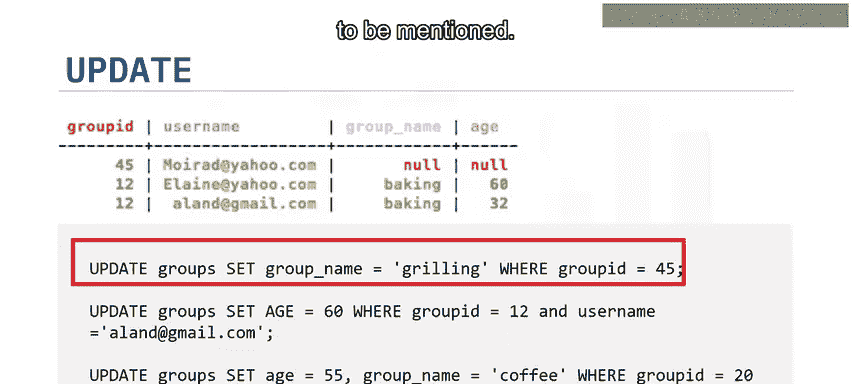

We can also update an existing record in this case， we will update the age of a user in group 12。

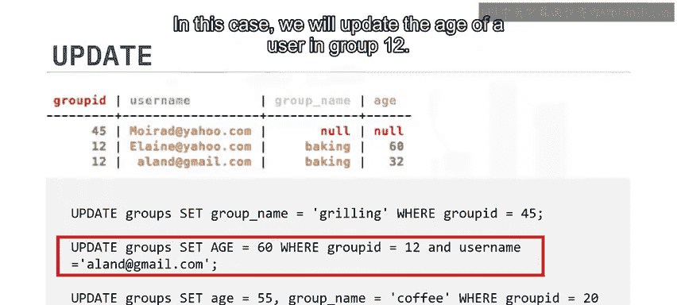

We can call the update command on a non existing entry， and in this case。

 updatedate will behave as an insert。

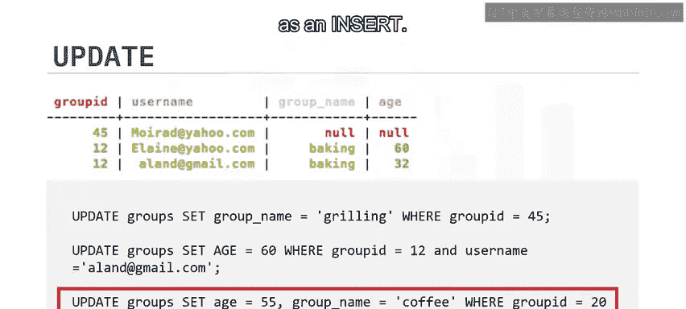

Let us see what a select on our table would yield at this moment。

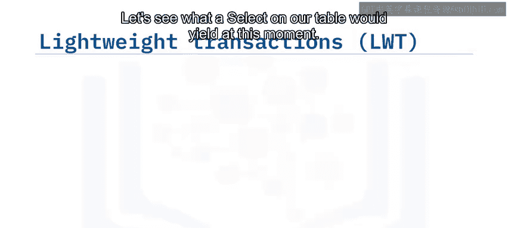

As you have seen， insert and update can behave in a fairly similar manner， given that by default。

 Cassandra doesn't locate and read data before executing a right， however。

 it is possible to instruct Cassandra to look for the data。

 read it and only then perform a given operation， this is possible through lightweight transactions。

 syntax wise， lightweight transactions are supported by introducing if in In and update statements。

Let's see some examples we can update the age of a user in a group only if that record exists。

 we can update the age of a user in a group only if the record exists and the age has been a certain value。

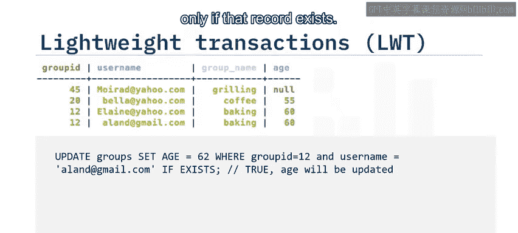

We can insert data into a Cassandra table only if the data does not exist in our case。

 the record exists， and in this case， no insert will be performed。

Light weight transactions are at least four times slower than the normal insert and update in Cassandra。

 you need to use them sparingly in your application。

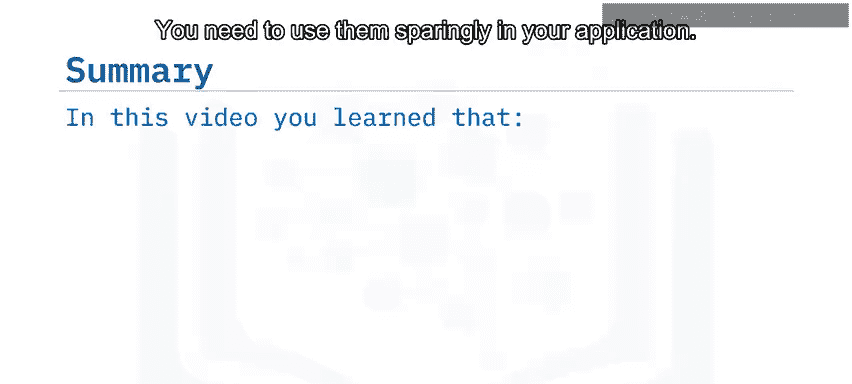

In this video， you have learned by default Cassandra does not perform a read before writes。

 therefore insert and update operations behave similarly。

Lightweight transactions can be used in order to enforce a read before write。

 but should be used sparingly due to the performance degradation。

And cluster level rights are sent to all partitions replicas。

 irrespective of the consistency factor for an operation to be successful。

 Acknowledment is expected from at least the minimum number of nodes specified for consistency。

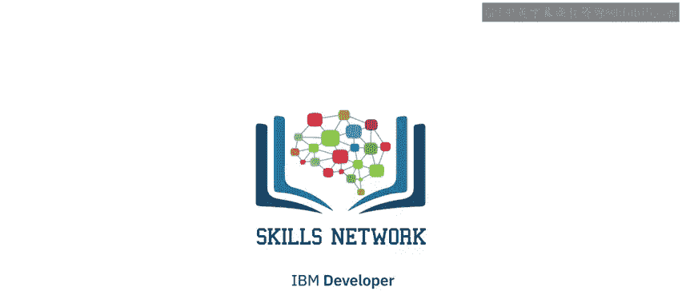