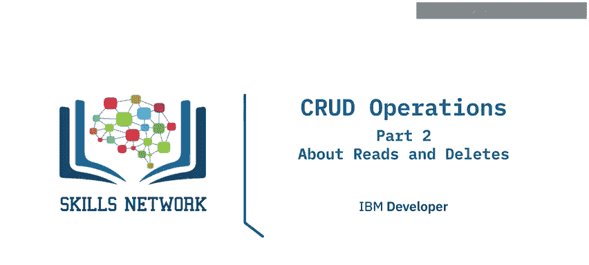
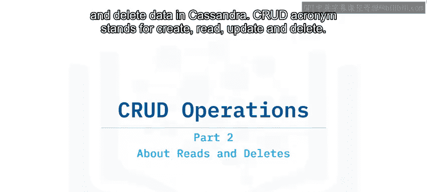
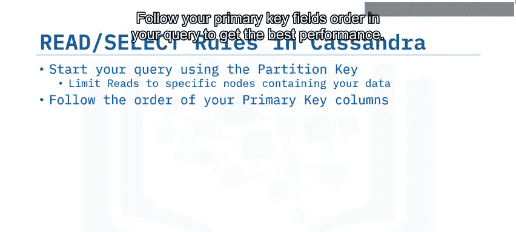
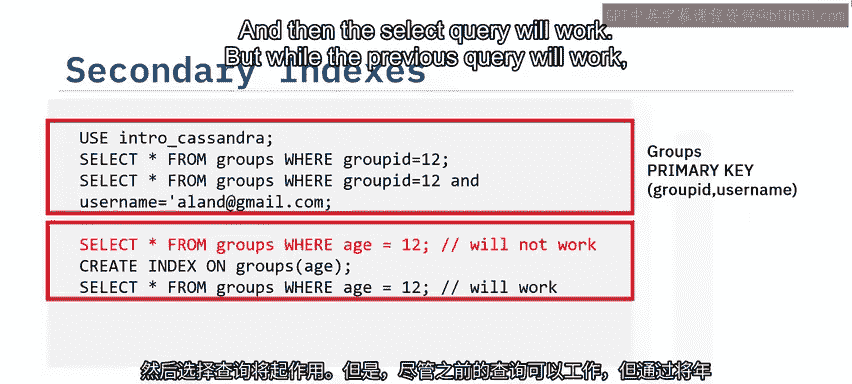
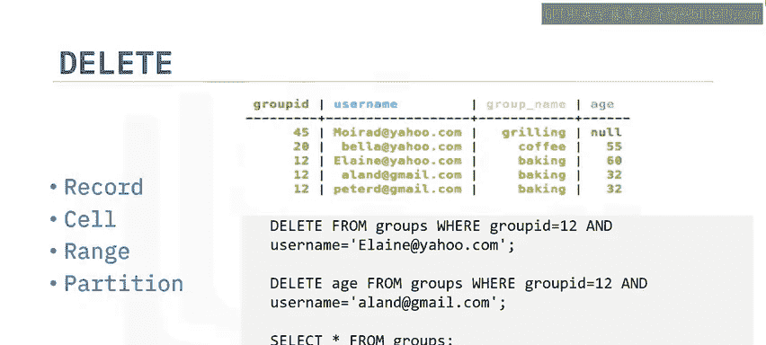
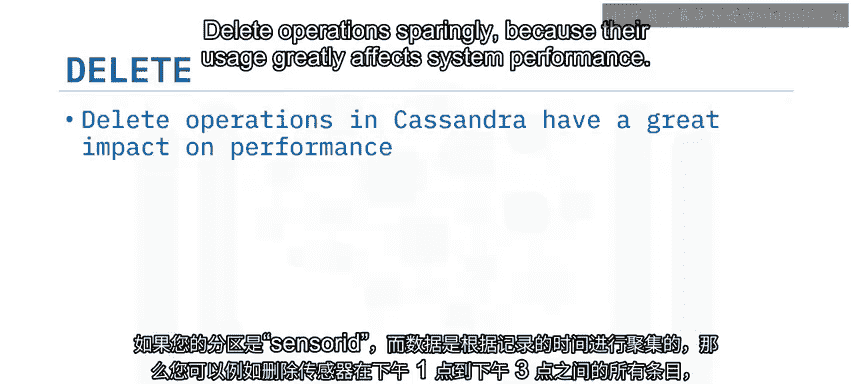
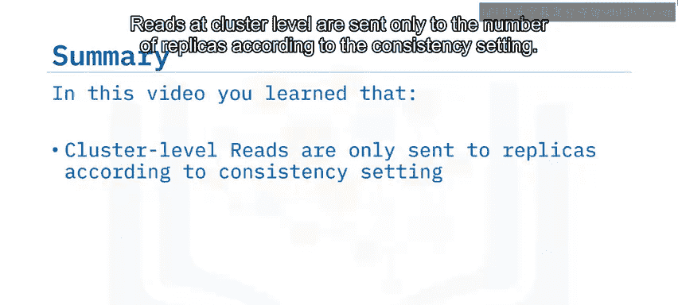
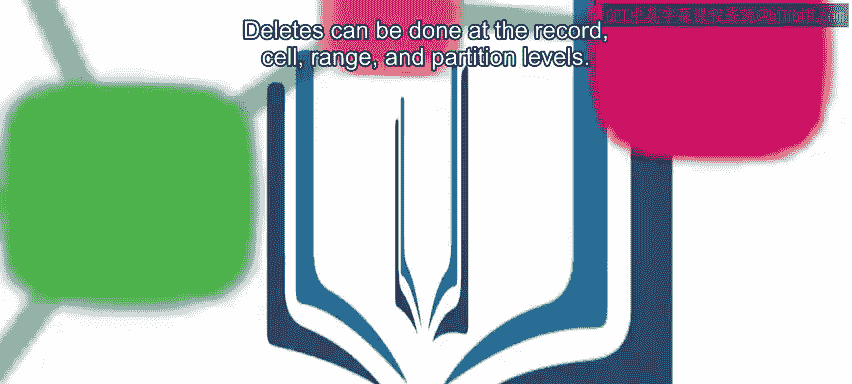

# IBM数据工程专业证书课程10：《NoSQL数据库导论》｜introduction-to-nosql-databases｜ - P28：27_crud 操作第 2 部分.zh_en - GPT中英字幕课程资源 - BV1UN41187Zz

Welcome to Apache Cassandra Crud Operations Part two focused on how we can read and delete data in Cassandra。

The CrD acronym stands for Cate， Read， updateate， and Delete。

After watching this video， you will be able to describe the read process in Cassandra clusters。

 explain the do's and don'ts of select statements， and describe how to delete data in Cassandra now that we have learned about how to insert data let's see how to read the data。

When a read operation is directed to a node in the cluster。

 that node becomes the coordinator of the read operation and is responsible for its completion。

 In our example， node 4 is the coordinator for this read。

Reads are sent only to the number of replicas specified by the consistency setting。 for example。

 a consistency of two means that only two nodes of the three replicas will be contacted。

The coordinator will reconcile the responses received from the contacted notess。

 If there are any inconsistencies， they will be resolved based on the operations time stamps。

 Then the result will be sent back。Syntax wise in Cassandra， just like in many databases。

 reads are performed using the select operation。There are a few rules when it comes to select operations in Cassandra。

 Always start your query with the partition key to limit your read to only the replicas for your partition。

 Follow your primary key fieldss order in your query to get the best performance。

For example， if you have a primary key formed of one partition key and two clustering keys。

 filtering a specific value of the partition key is okay。

Note that partition key supports only equal and in operations。

Filtering a list of possible values for the partition key is also okay。

 filtering the partition key and the first clustering key is okay。

Filtering the partition key and the first and second clustering keys will just read one record。

 which is okay。 However， selecting all data from your table is not okay in production systems。

 because this will send the request to all nodes in the cluster。

 Imagine having1 thousand node cluster。 Would you be happy with the performance of your query。

 your query will work， but the performance will be really bad， even if no timeout occurs。

Filtering a regular column is not okay and will not work。And finally。

 filtering the clustering keys without the partition key is not okay and will not work。

Let's look at some examples based on our groupss table where the primary key is composed of group ID and username columns。

Filtering the group ID or group ID and username will work and yield a very good performance。

Filtering the age column， which is a regular one， will not work。 Cassandra will return an error。

 What you could do in this case is either remodel your table or create an index on column age。

 and then the select query will work。

But while the previous query will work， optimal performance will be obtained by filtering the age column together with a specific partition key group ID When you do this。

 you limit your query to only the notes that host that part partition key。

 and this brings us again to this very important Cassandra rule。

 always start your queries with the partition key。

We are starting off with some data to demonstrate some deletes。In Cassandra。

 you can delete an entry identified by the full primary key and a cell in an entry identified by the full primary key。

 If we perform a select from our table， you can see that we do not have the user called Elaine any more。

 and the age cell has been deleted for the user called Allen。

Delettes can also be done at the partition level。 you can delete a continuous range in a partition if your partition is sensor ID and your data is clustered by the time of the recording。

 you can， for example， delete all entries on a sensor between 1 pm and 3 pm。

 or you can delete a whole partition， which is identified by a partition key。

We've seen the syntax of deleting data， but in Cassandra。

 you should use Delete operations sparingly because their usage greatly affects system performance。

Deleting distributed and replicated data from a system such as Apache Cassandra is far trickier than in a relational database。

 especially if we remember that Cassandra is a peer to peer architecture where reads and writes can be directed to any node in the cluster。

 so there's no primary node for writes or reads。In such a system。

 to record the fact that a delete happened， a special value called a tombstone needs to be written as an indicator that previous values are to be considered deleted。

From the Moton item has been marked with a tombstone， its data is not visible any longer to queries。

 However， the actual data will still reside on disk for a period of time。What are tombstones？

In Cassandra， a delete is just a right operation that also has a special value appended to indicate that the data has been deleted and the time of the delete。

 This value is called a tombstone。 here， as you can see in the diagram。

 Our delete was acknowledged by nodes 1 and 3。 And now we have a tombstone indicating that our specific primary key data was deleted at T 1。

 node2 data is the initial one。 The insert done at T 0。

 Since the delete operation did not succeed on node 2。 Now， when a read operation arrives。

 the data will be returned by nodes 1 and 2。 node 1 will return no data with time T 1。

 and node 2 will return requested data with time T 0。😊，T1 is more recent than T0。

 so the coordinator node node 1 will decide that the newest data is the one from node 1 and return no data as part of the read。

One other thing to remember is that tombstones are deleted only when a configurable period has elapsed。

 This is called G C Grace seconds， which is set to 10 days by default and is set at the table level。

In this video， you learned that reads at cluster level are sent only to the number of replicas according to the consistency setting。

 reads should follow the primary key columns order for best performance。

 and deletes can be done at the record， cell， range and partition levels。

