# IBM数据工程专业证书课程10：《NoSQL数据库导论》｜introduction-to-nosql-databases｜ - P29：28_cloudant 概述.zh_en - GPT中英字幕课程资源 - BV1UN41187Zz

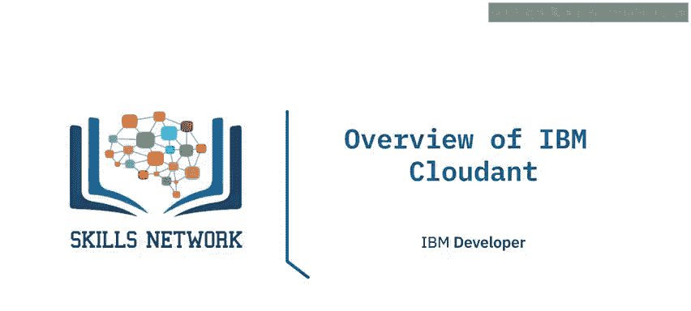

Welcome to overview of IBM Cloudant After watching this video。

 you will be able to describe what IBM Cloudant is and its key characteristics Describe Cloudon's replication capabilities。

 list key capabilities provided by Cloudant and describe how to access IBM Cloudant。

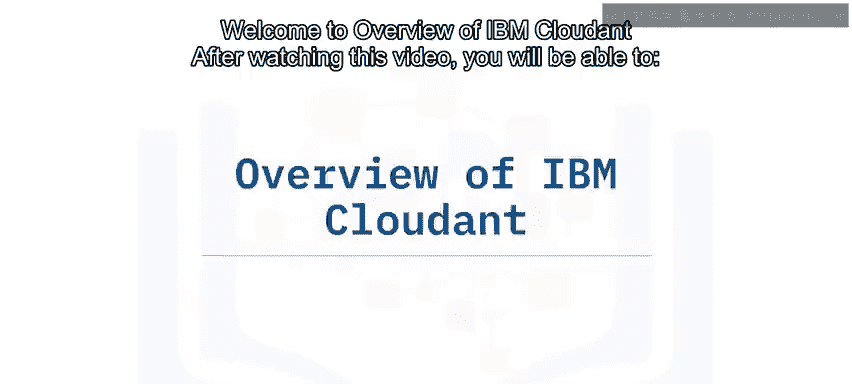

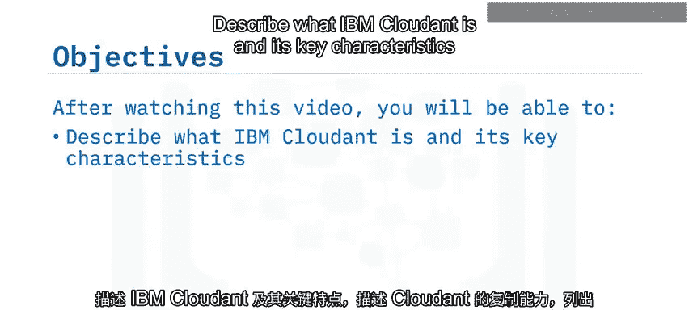

IBM Cloudend is a fully managed database service or database as a service DBS for hybrid multicloud applications。

 it is built on open source Apache couch DB and offers a fully compatible HTTP API without the need for proprietary drivers。

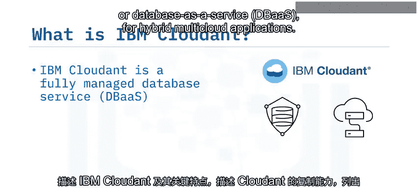

It also utilizes a J document store， so development is simplified for modern web applications by dealing with J objects on all layers of the stack。

Cloudend aims to be the data layer for all your web and mobile applications。

 and it is simple to use and yet still rich in features。

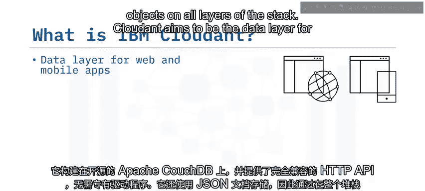

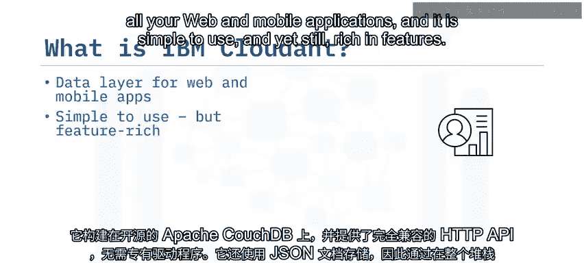

Cloudant has fully integrated capabilities for online analytics， full text search。

 advanced geospatial querying， and replication without the need for third party integrations。

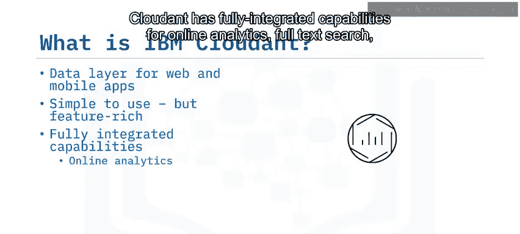

Clouddent uses a flexible schema， which means you can iterate on new features for fast and agile development。

Cloudant is a distributed database and is optimized for processing the substantial workloads that are characteristic of sizable。

 fast growing web， mobile， IoT， and serverless applications。

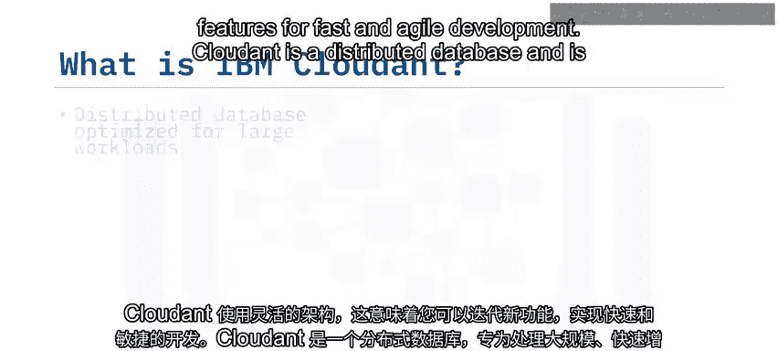

Because it is offered as a service level agreement backed database as a service。

 there are no administrative overheads。 Cloudant offers white glove service from big data experts to help you build your applications。

Your cloud and database is securely hosted in the cloud and globally controlled by big data specialists on a 24。

7 basis。 Engineers at IBM handle all the day to day database monitoring and infrastructure maintenance。

 so you can focus on building your applications。Cloud and data replication technology provides options engineer to reduce scalability risks。

 costs and distractions。 These capabilities enable developers to focus on the business' applications the powerful replication protocol and API are compatible with open source ecosystems such as Apache Couch Db and Puch Db and are also compatible with the open source libraries for the most prevalent mobile and web development stacks。

As Cloudant and CouchDB share a common replication protocol。

 this allows developers to synchronize copies of their cloud data to a remote couchDB instance at the push of a button。

CloudIn Search implements Apache Lucing for search speed and simplicity。

 and Cloudon Gepatial geoJO St supports the encoded geographic data structures for built in spatial querying and map visualization tasks。

Offline first capabilities built with cloud and sync enable mobile data synchronization。

 which enables application users to work offline and mobile using stored local data and then synchronize their data to the cloud databases you can develop your own applications using language specific libraries Rapers that help you work with an API。

To access Cloudon's managed service， simply log in to the IBM Cloud。

 click Ca in the top navigation bar menu， choose services。

 and then choose databases from the categoriesgories list。

 and then selectCon from the database Services list。

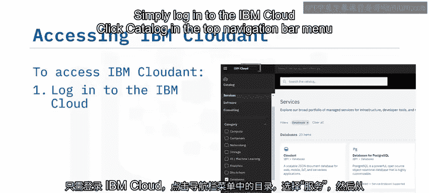

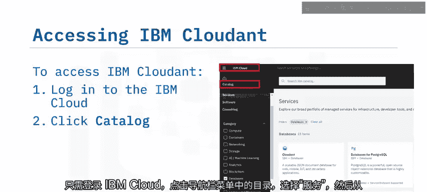

Alternatively， go to IBM。com/clo/cloudant and sign up for the free trial。

 You can also download cloudant as an on premises installation。

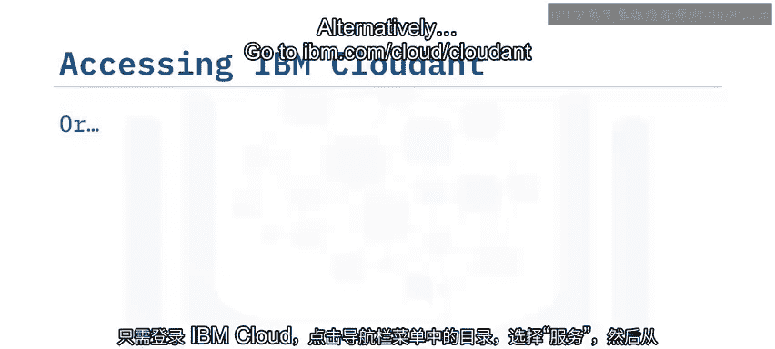

In this video you learned that IBM Cloudant is a fully managed database as a service that is built on Apache couchuch D。

 and it uses a J Do store Cloudant is a distributed database optimized for large workloads such as web。

 mobile， IoT and serverless applications。

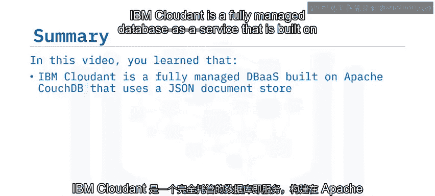

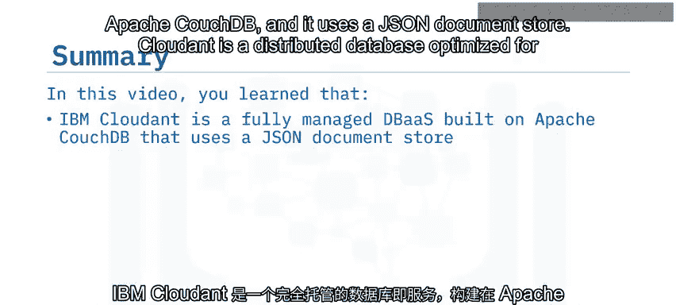

As Cloudant is a service level agreement backed DBAS。

 it means there are no admin overheads and your cloud databases are securely hosted in the cloud。

Cloant offers a powerful replication protocol and API and is compatible with many open source ecosystems and libraries。

 Cloudant provides search， geospatial querying， offline and mobile access and language specific library capabilities。

 and finally， it is simple to get access to IBM Cloudant。😊。

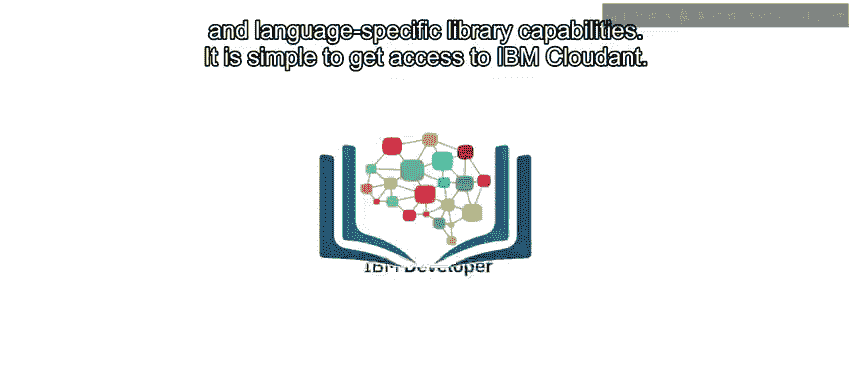