# IBM数据工程专业证书课程10：《NoSQL数据库导论》｜introduction-to-nosql-databases｜ - P30：29_cloudant 架构和关键技术.zh_en - GPT中英字幕课程资源 - BV1UN41187Zz

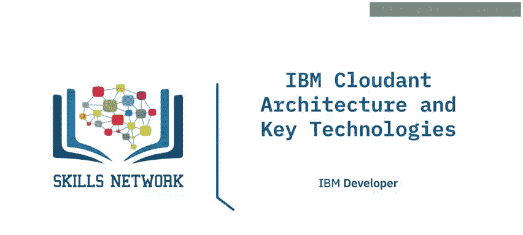

Welcome to IBM Cloudant Architecture and Key Technologies。

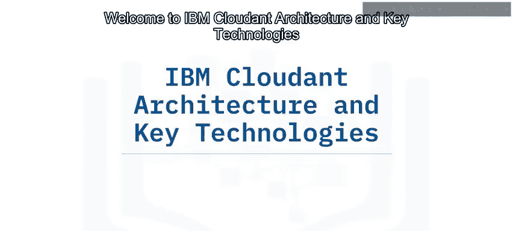

After watching this video， you will be able to describe the cloud architecture behind IBM Cloudant and describe the key technology components that IBM Cloudant provides。

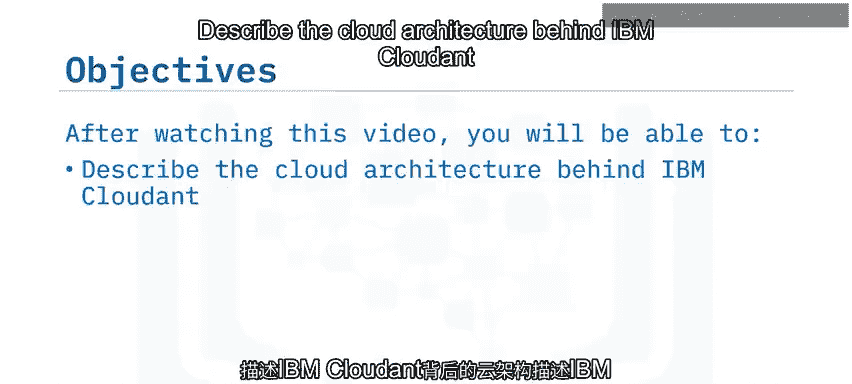

You can host your data in more than 55 different data centers distributed all over the world。

 so IBM Cloudant offers a global data presence。 IBM Cloud is supported on IBM Cloud and IBM infrastructure as a service offering Raspace Microsoft Azure and Amazon web services。

 so it's cloud agnostic Cloudant has the most robust and easy to use replication protocol。

 never corrupting the data thereby providing the best of any available data layer Cloudant replicates from one data center to another making the data available throughout the world。

 thus providing geographic loadbalan for your data。

 all cloud and instances are deployed on clusters that span regional availability zones where supported for added durability at no further charge to an organization。

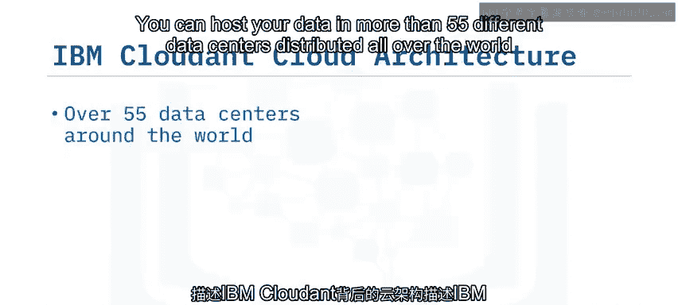

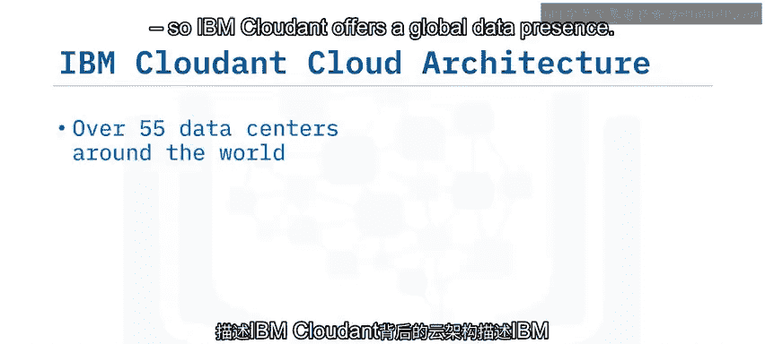

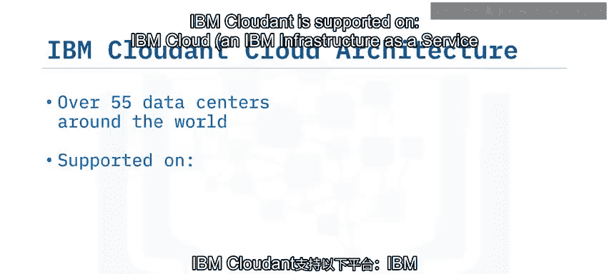

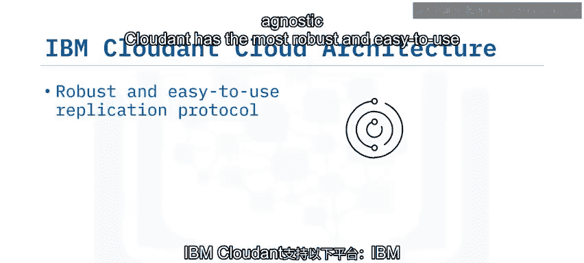

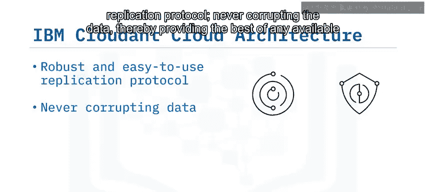

If one data center goes offline， the requests will get routed to another active data center。

 providing high availability and disaster recovery as well as optimal performance Use get routed to the data center closest to them or more accurately by using ping timing。

 users actually get routed to the data center fastest to them that is closest in terms of time not distance。

For web and mobile applications that require offline sync。

 such as completing an expense report or filling out a sales order form offline。

 CloudIt uses a replication protocol that is compatible with common libraries that exist in your browser or with the Cloudantt provided libraries。

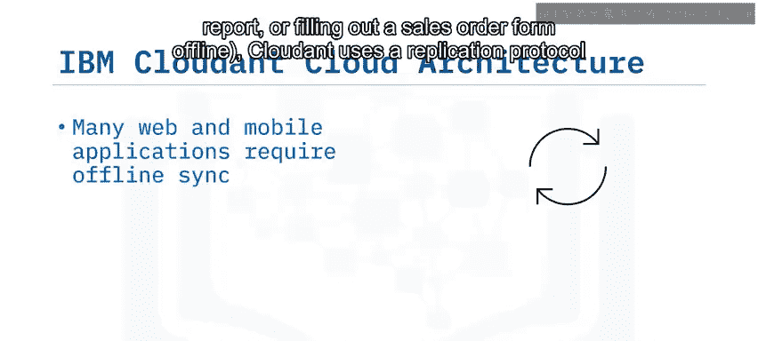

Offline sync technology enables developers to build iOS and Android applications that allow users to connect to the internet and replicate data for offline use。

 update data when offline， and then sync the data when they are back online again。

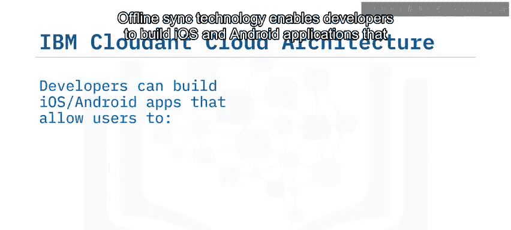

In terms of security， IBM Cloudant is ISO 27001 SoC2 Type2 compliant and HIPAA ready All data is encrypted。

 whether the data is at rest or being transported across a network there is also optional user definedfined encryption key management on offer through IBM key protectect the service integrates with IBM identity and access management for granular access control at the API level。

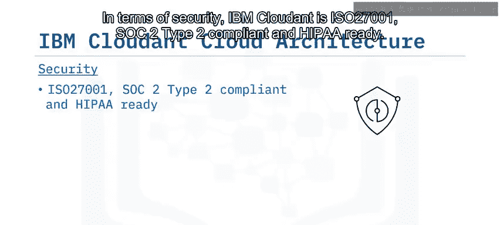

IBM Cloudant is offered as a fully managed service as an on premise version。

 or as a hybrid cloud deployment。

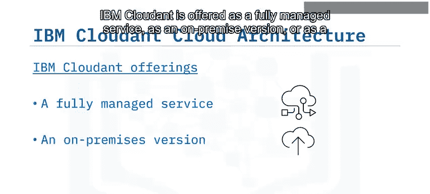

IBM Cloudant provides several key technology components as an operational data store Cloudant is a good fit for any web or mobile application。

 Cloudant is a documentbased nosQL database It is not a data warehouse like Hadoop is Cloudant uses a simple yet welldefined HTTP API so it's a lot like working with a restful web service It's intended to fit into a modern architecture and fits seamlessly into a serviceoriented architecture without needing to build the abstracted layer so you can deploy your database in the cloud of your choosing the HtTP API lets you interact with a data through a browser or curl returning in the JO format。

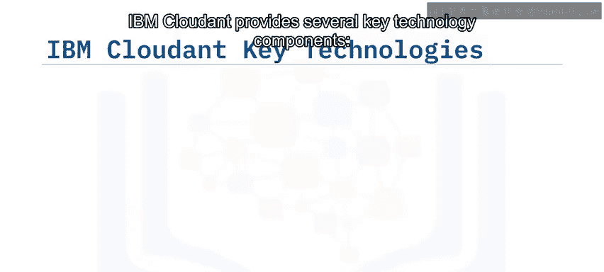

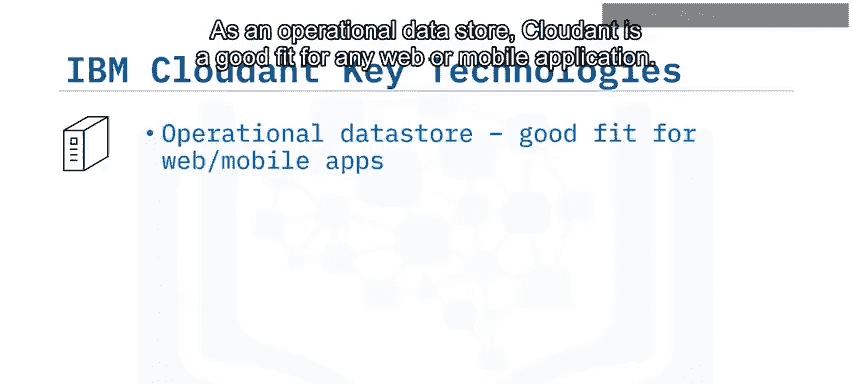

Cloudant has fully integrated replication and sync。

 There are a number of different ways to index and slice and dice the data mapp produceuce is a highly efficient way of crunching data in large data sets and really good for doing realtime analytics search engines are very popular with web and mobile application developers。

 Many applications make as synchronous calls under the covers for doing full text ad hoc search of your data。

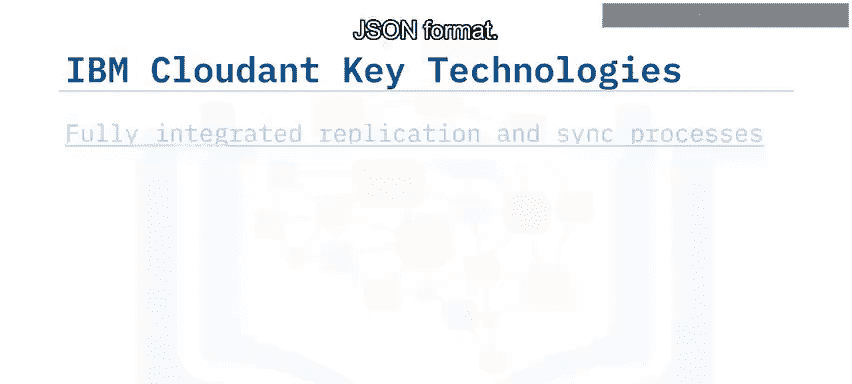

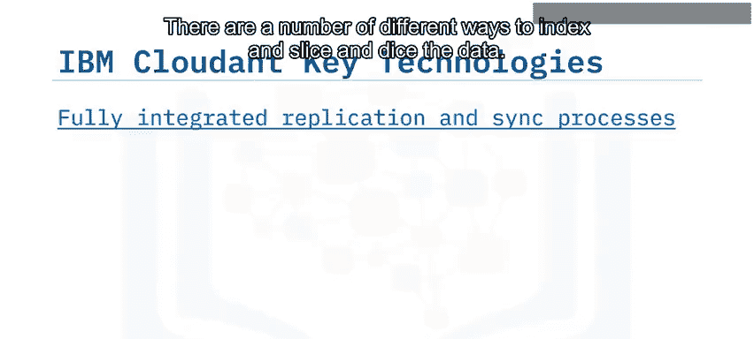

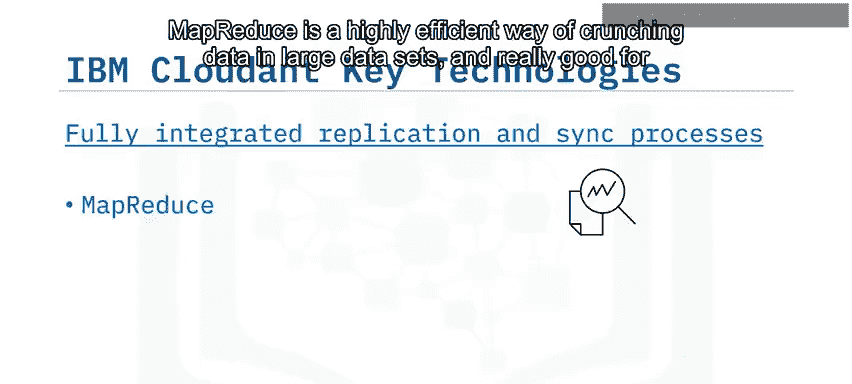

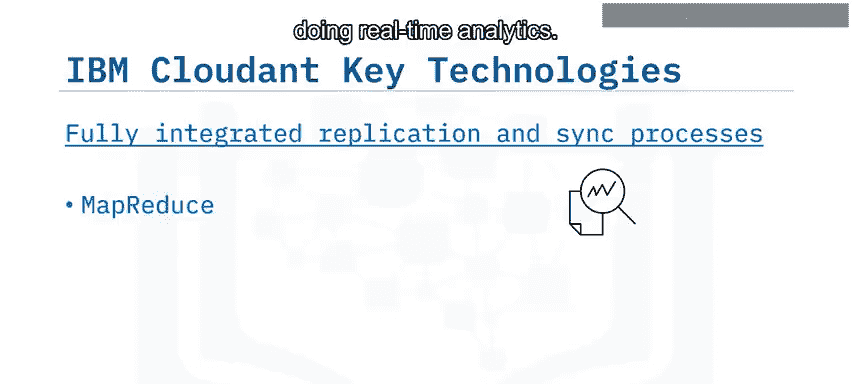

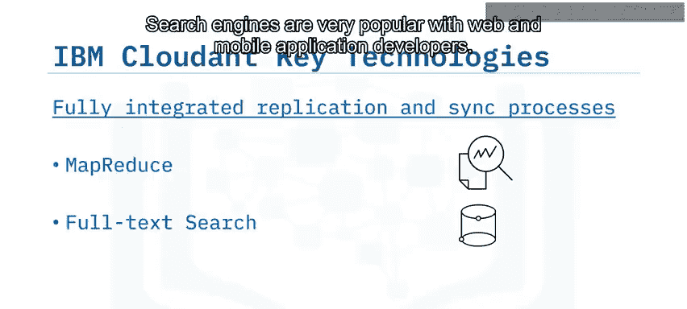

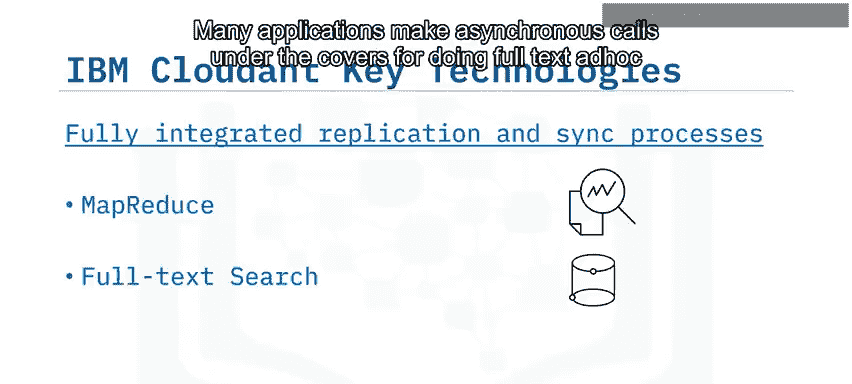

Other database as a service offerings require you to integrate with a third party search engine。

 such as Elasticse or Apache So， which are both built on Lucne。

 whereas Cloudant has full text search fully built in to both the database as a service and local offerings。

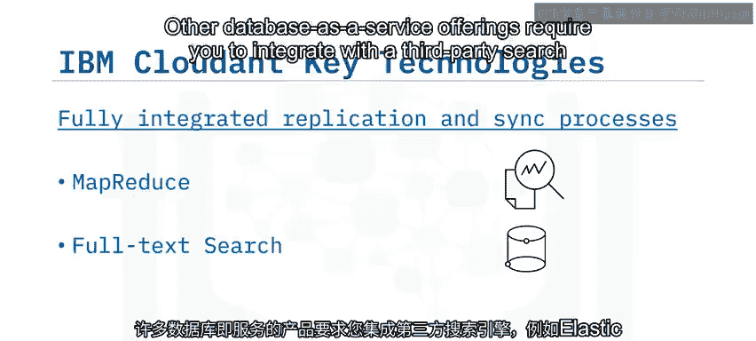

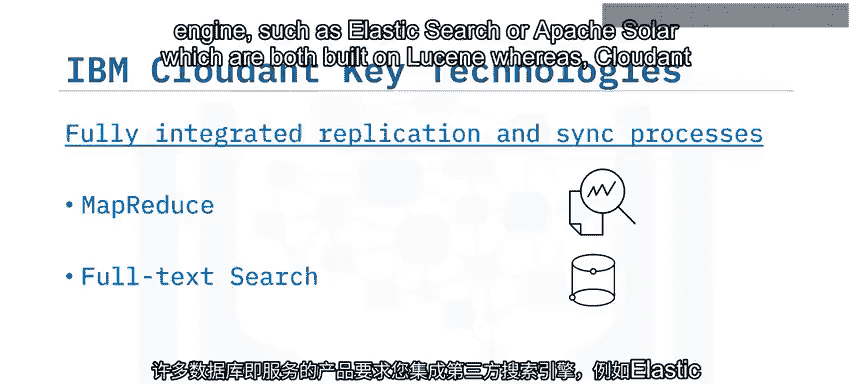

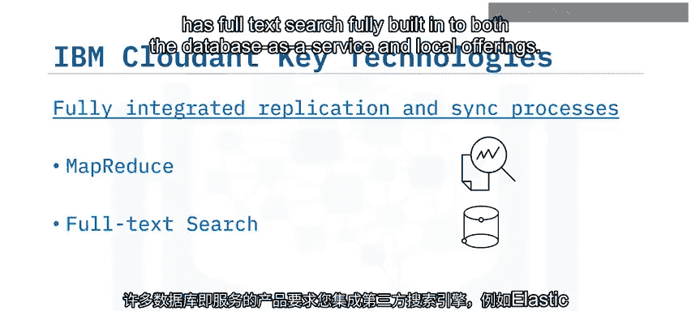

Gopatial is ideal for applications involving oil， gas or transportation， for example。

 satellites and transportation vehicles。

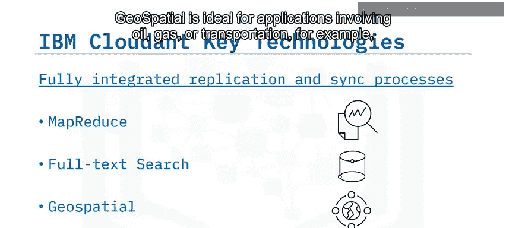

The IBM CloudIn dashashboard provides an easy way to monitor， manage， and develop your databases。

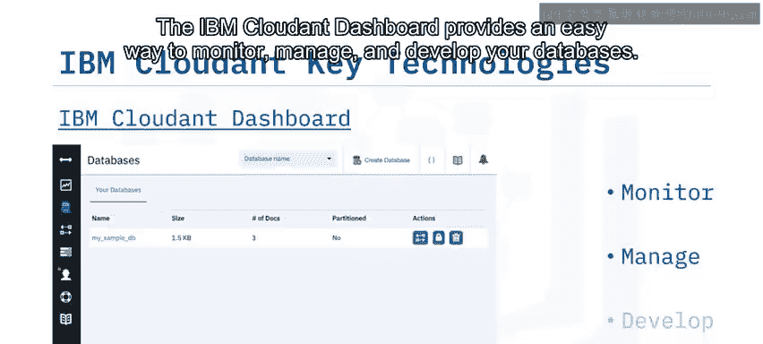

In this video you learned that IBM Cloudant provides over 55 data centers distributed around the world Cloudant is supported on several cloud platforms。

 Cloudant's cloud architecture provides high availability， disaster recovery and optimal performance。

 Cloudant provides offline sync capabilities for web and mobile applications。

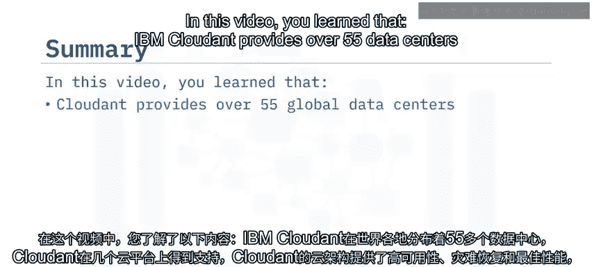

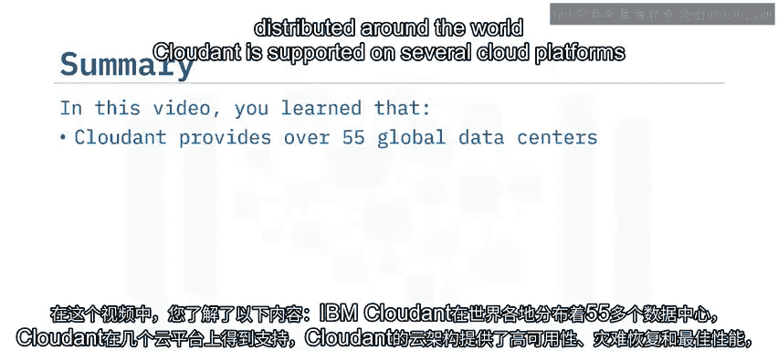

Cloudant can be offered as a fully managed service as an on premisem deployment or as a hybrid cloud deployment。

 and Clouding consists of several key technology components。

 such as a welldefined HTTP API mapR full text search， and geospatial capabilities。

 plus an integrated dashboard to monitor， manage and develop your noSQL databases。

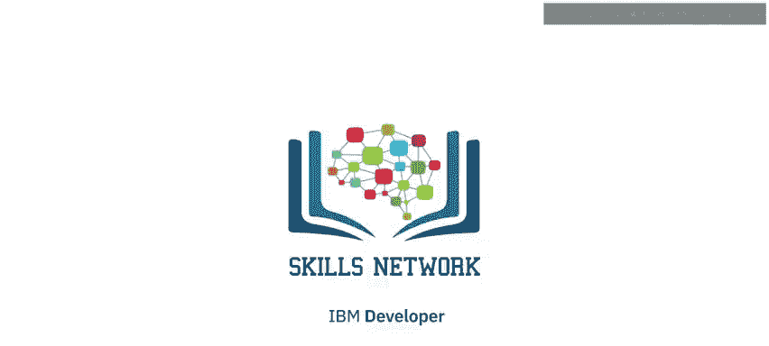