# IBM数据工程专业证书课程10：《NoSQL数据库导论》｜introduction-to-nosql-databases｜ - P31：30_cloudant 优势和解决方案.zh_en - GPT中英字幕课程资源 - BV1UN41187Zz

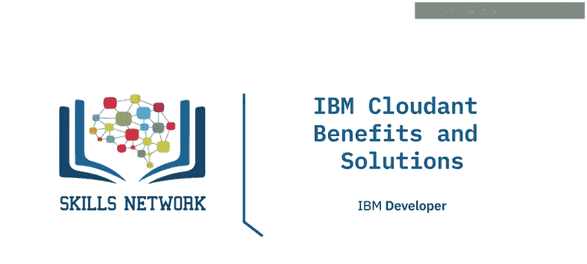

Welcome to IBM Cloudent Benefs and Solutions。

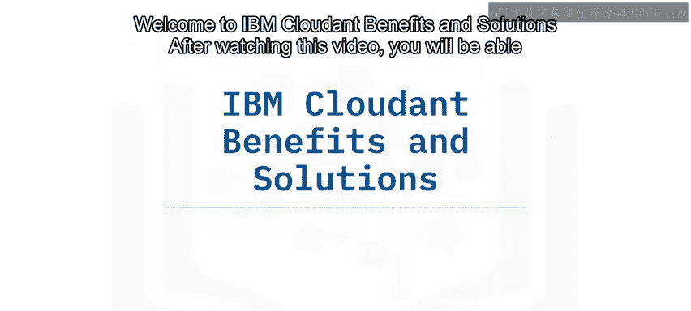

After watching this video， you will be able to describe the key benefits of IBM Cloudant。

 explain the challenges that IBM Cloudant can provide a solution to。

 and describe common use cases for IBM Cloudant。

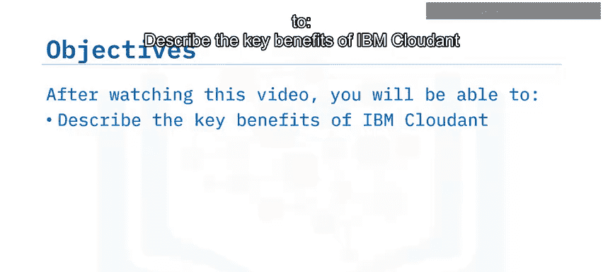

Cloudin scales to an enormous degree， It scales both in terms of data size and number of concurrent users supported。

 Cloudant can be appropriate for either a startup company who is building an application handling 1 GB of data and 10 concurrent users。

 but it can also be an appropriate solution for an enterprise organization with multiple apps storing petabytes of data and 20 million concurrent active users。

 Cloudant allows for scaling up or down as required。

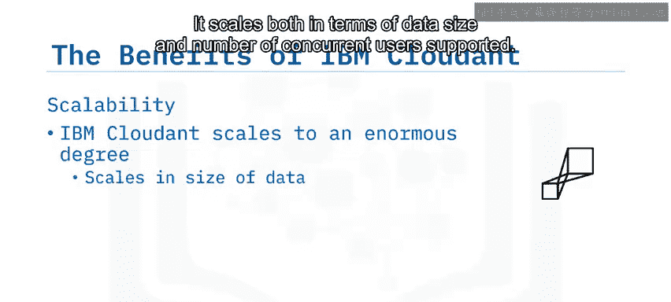

CloudEn is always available， it's an operational data store for online applications。

 so building a service that aims to be available 247365 is a must。

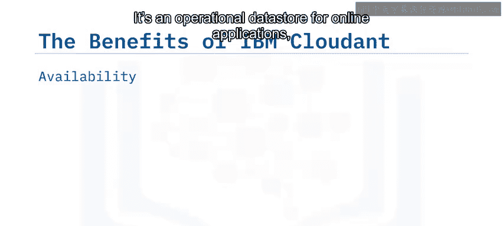

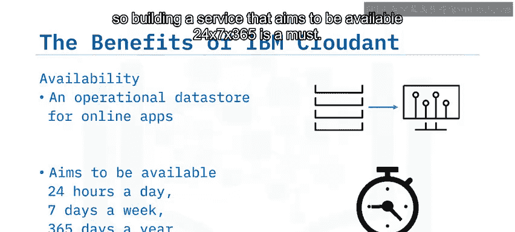

Cloudant is durable， aiming to never lose data， which it achieves by storing multiple copies of all data across separate physical nodes。

Cloudant is partition tolerant in order to meet the most stringent high availability disaster recovery requirements。

 whether handling node failures in a cluster or even full data center outages。

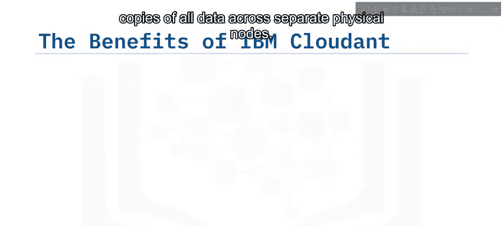

Cuddent provides online upgrades。 It is uniquely engineered to patch or upgrade on the fly。

 No outage necessary。 Clusters can be upgraded without taking a customer's database offline。

 It provides online and offline access， which is ideal when you have scenarios with spotty connectivity。

 for example， in remote areas and airplanes。

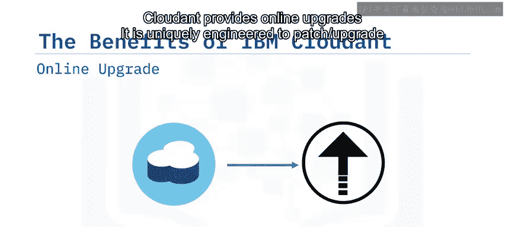

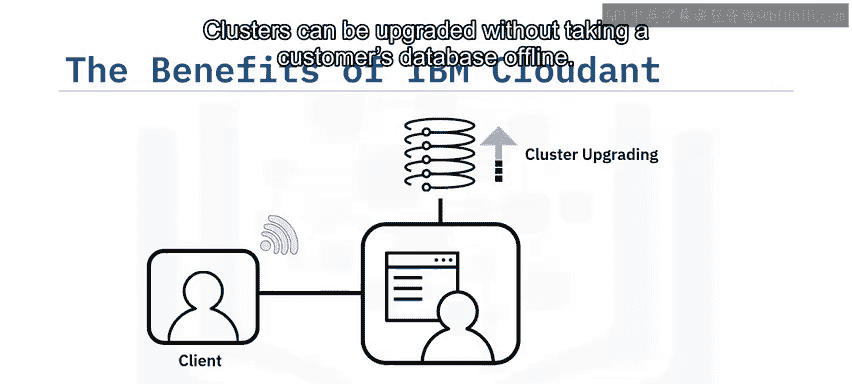

Cloudant customers rely on Cloudant to solve many data layer challenges。

 If your relational database isn't scaling the way you'd like。

 Cloudin scales easily for an exponentially growing user base。

Develop and hosting your own databases has proven to be a challenge with limited budgets。

 time and skill set for administration。 Cloudant can help reduce those costs。

 Sometimes you might be building an application from scratch without fully knowing the capacity requirements。

 Cloudend provides a simple and fast way to develop your applications。

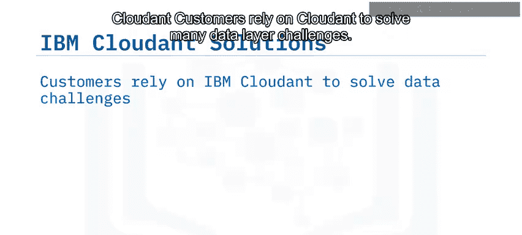

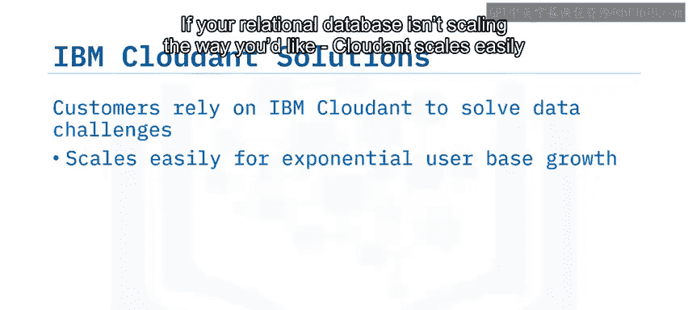

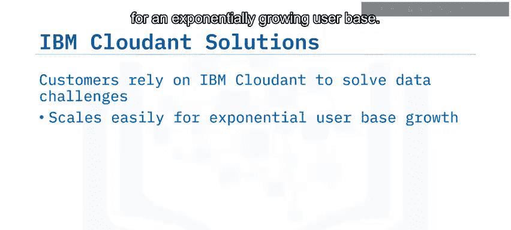

A document database is a logical collection of documents with a single set of access permissions with cloudant documents are stored in the popular JO format with a flexible schema。

 documentsments are organized into databases for two primary reasons。

 The first is for security access reasons。 as you can apply access roles， read， write， admin。

 replicate at the database level。 The second is for querying as you can't index or query within a single API call across databases。

 your cluster can hold any number of databases。

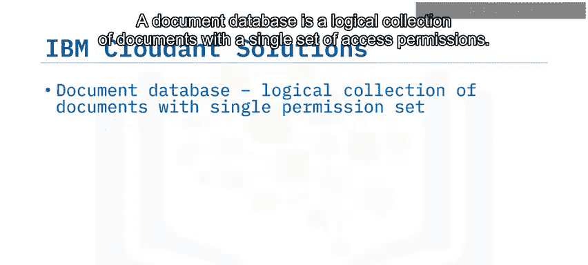

When you sign up for a Cloudend account， there are actual physical servers set up that do the work for you。

 Cloudend runs on a cluster of servers consisting of load balancers and database nodes on the appropriate hardware。

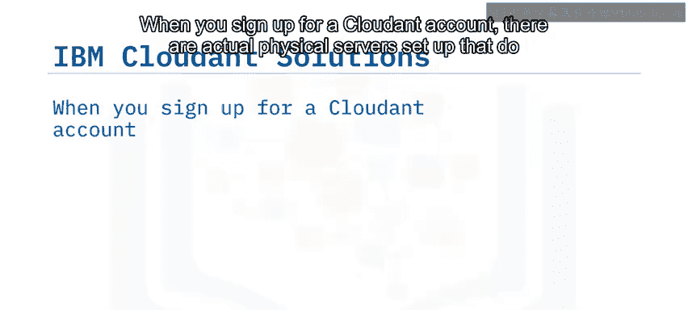

Cloudant is horizontally scalable， meaning you can distribute your database across a cluster。

 Cloudant autoshaardds data across a cluster， meaning that it autopartitions the data evenly across clusters。

 so you don't need to manually distribute the data as you would with a relational data store。

 You can start with a small number of nodes and let cloudant run scripts to manage your data as it grows to keep your data available。

 This means you don't have to do much capacity planning upfront。

 because Cloudant can easily adapt as your data needs increase and maintain performance。

 The data is replicated between servers within the cluster to keep them synchronized without any administrative intervention。

If a node fails and then is brought back online， it will automatically be brought up to date using replication to sync the data。

To replicate across geos or clusters， you can configure when and how that replication will happen if you're storing data across a cluster。

 it doesn't really do you any good to store one copy on one node because if the node fails。

 then you'll lose the data and it will become unavailable to your applications。

 Cloudant employs a quorum style clustering， which stores every Json document in triplicate across three separate physical nodes。

 When your application reads and writes data。 Cloudant uses a load balancer that distributes the reads and writes evenly across the cluster。

 So the workload is distributed。 Thus， if one node fails。

 the data is still available on another node。

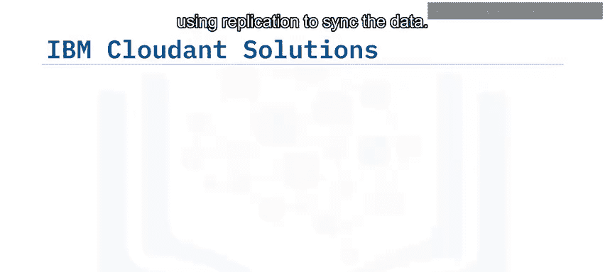

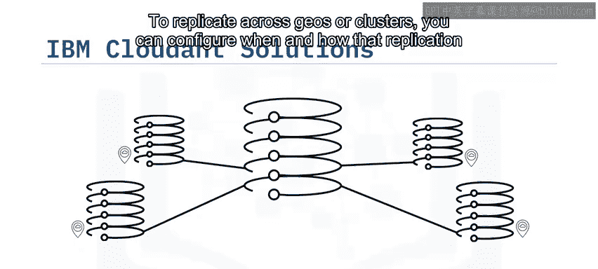

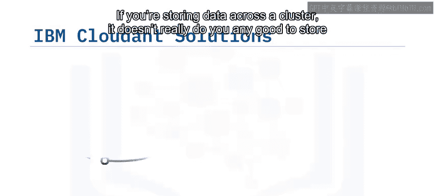

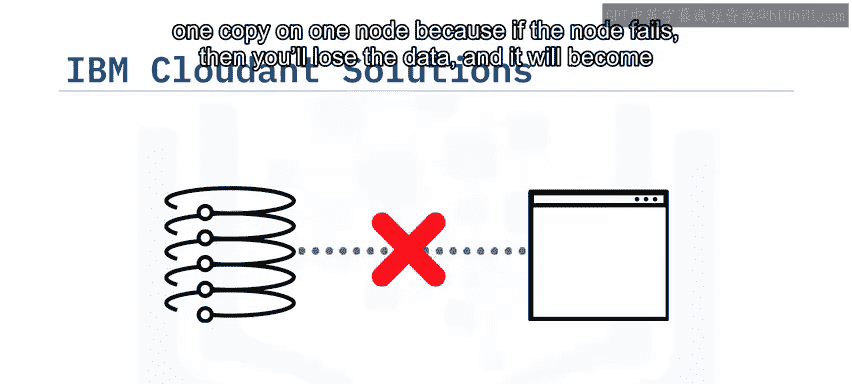

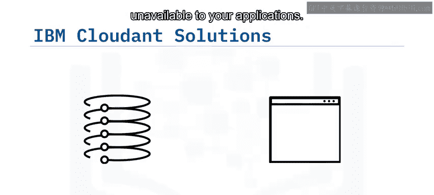

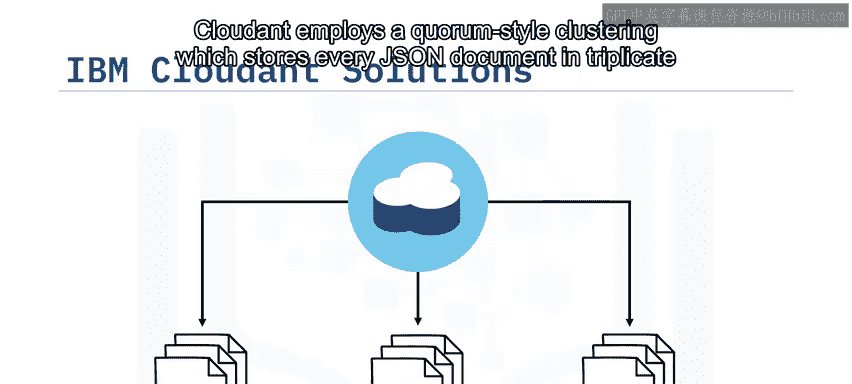

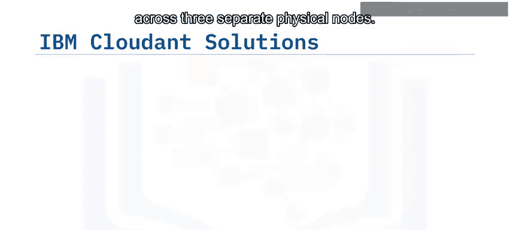

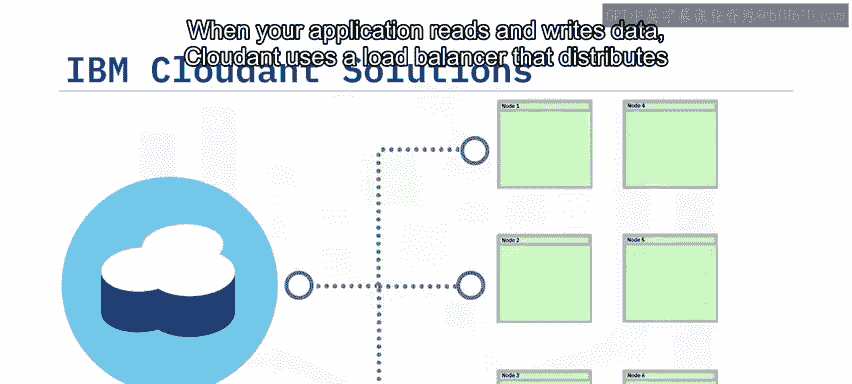

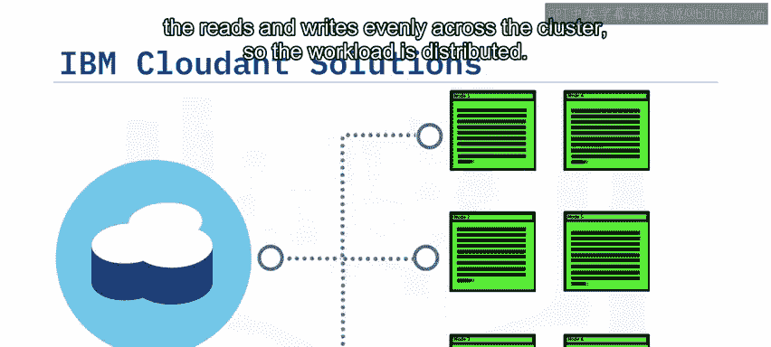

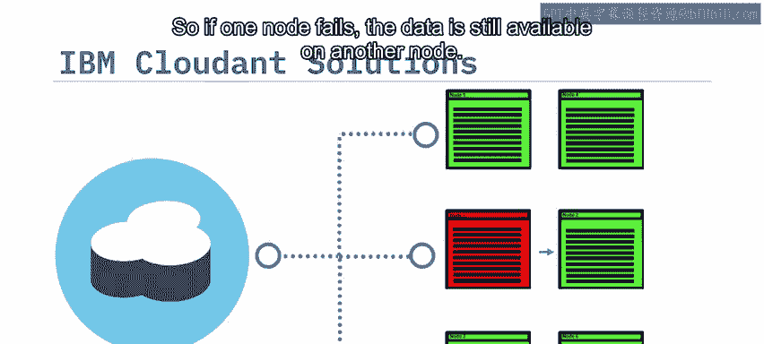

Cloudant can be used to build web and mobile apps， for example。

 you can build point of sale mobile applications using analytics to personalize shopping experiences For more information。

 see the Ketzel case study at the URL listed on this page。

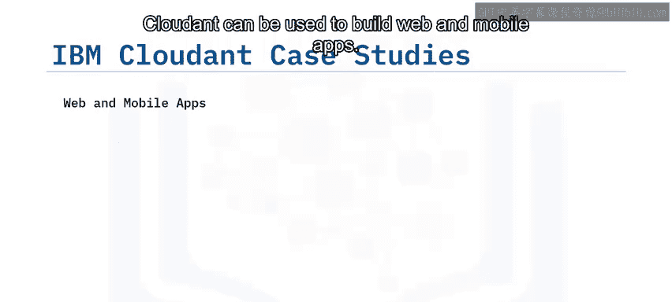

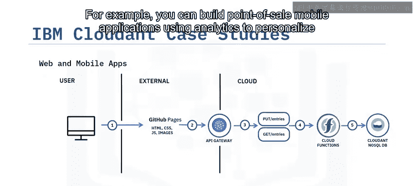

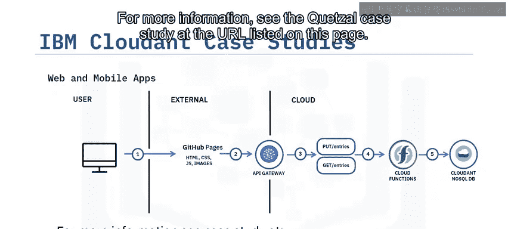

With Cloudant， you can create powerful cognitive AI applications by connecting IBM Watson machine learning to data stored in Cloudant。

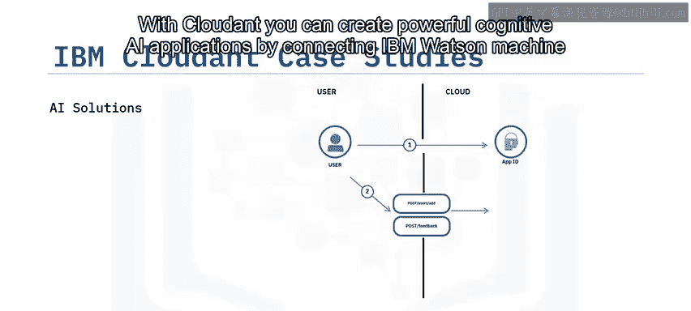

For more information， see the Advent Health Partners case study at the URL listed on this page。

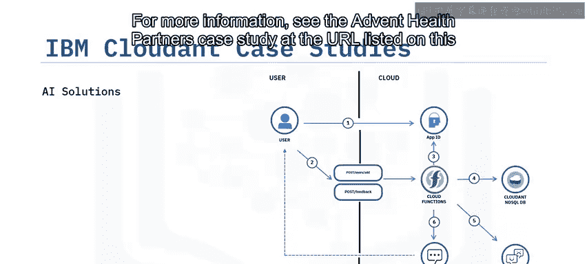

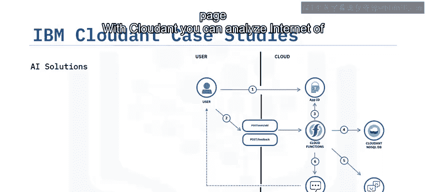

Also with Cloudant， you can analyze IoT or Internet of Things sensor data stored in flexible cloudant schemas to trace end to end shipments and detect anomalies。

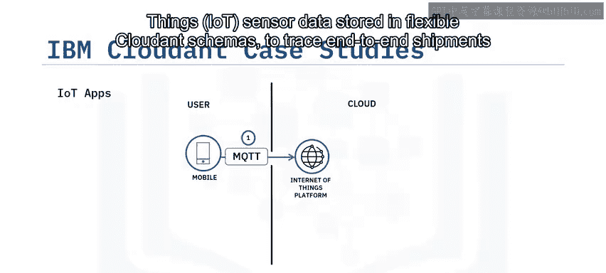

For more information， see the PLM Indust's case study at the URL listed on this page。

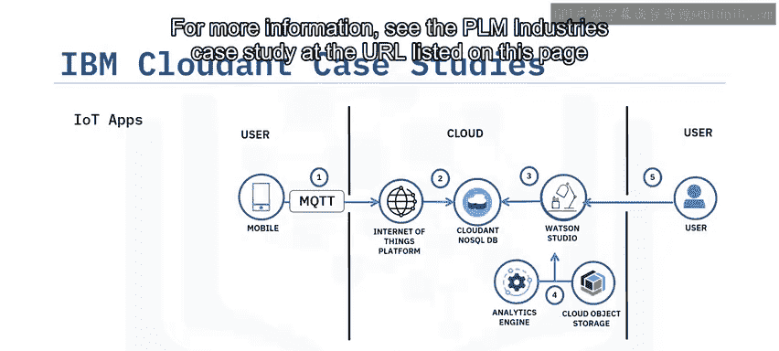

In this video you learned that the key benefits of IBM Cloudant are its scalability。

 availabilityability， durability， partition tolerance。

 and online upgrade and patching IBM Cloudant solves several data challenges such as exponential user growth。

 increasing cost， and time and skills required to develop host and administer a database in house。

 Cloudant uses a document database for improved security and querying。

 Cloudant runs on clustered servers in the cloud and typical use cases for Cloudant include building web and mobile apps。

 AI solutions and analysis of IoT sensor data。

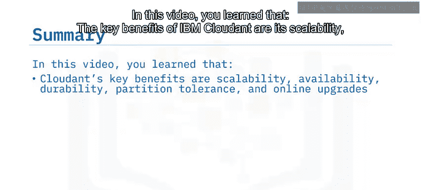

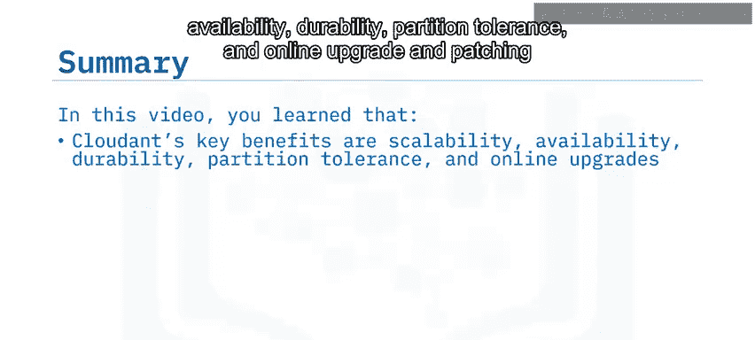