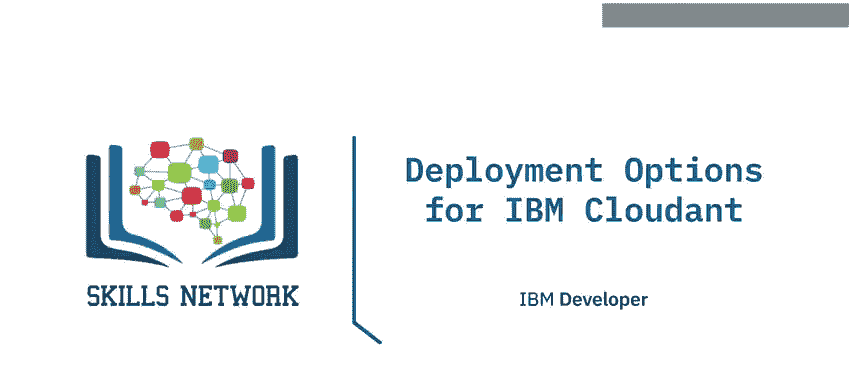
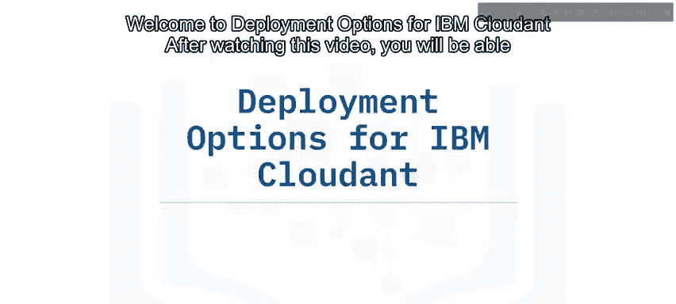
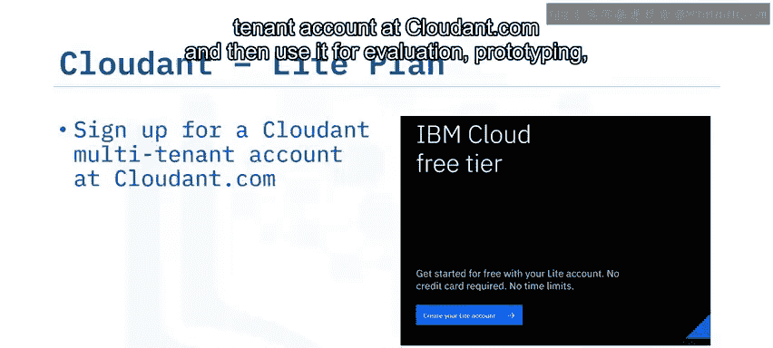
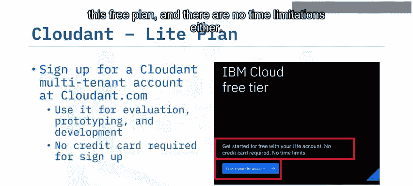
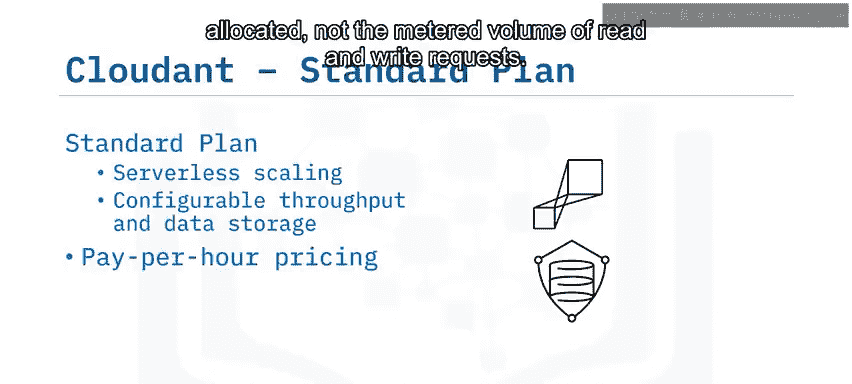
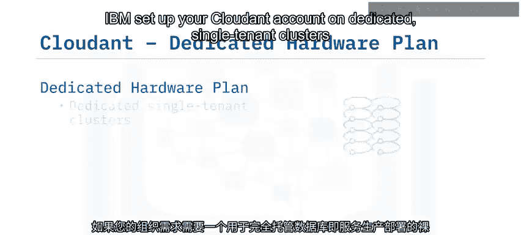
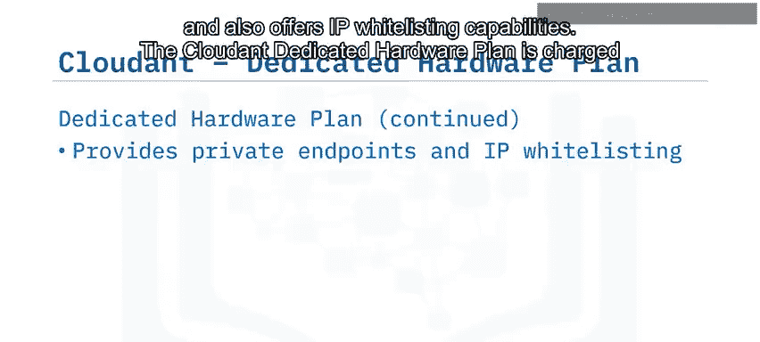
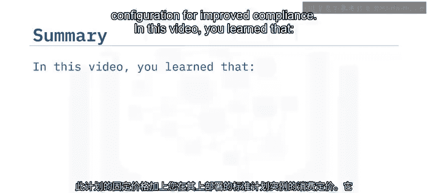
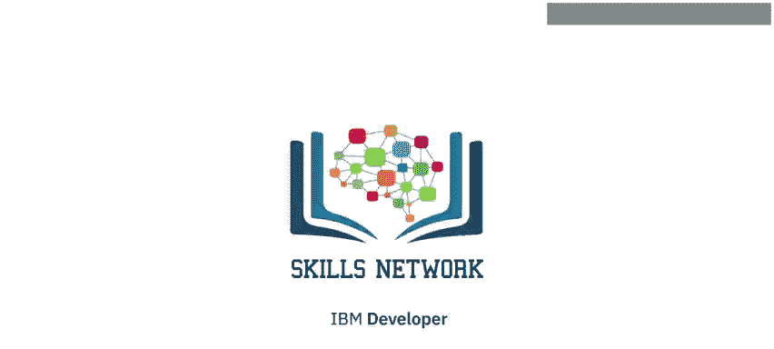

# IBM数据工程专业证书课程10：《NoSQL数据库导论》｜introduction-to-nosql-databases｜ - P32：31_cloudant 的部署选项.zh_en - GPT中英字幕课程资源 - BV1UN41187Zz

Welcome to deployment options for IBM Cloudant After watching this video。

 you will be able to describe the different deployment plans for IBM Cloudant。

 describe the free plan for Cloudant， describe the standard plan for Cloudant。

 and describe the dedicated hardware plan for Cloudant。

There are several IBM cloudant versions or plans you can deploy， and they are the light plan。

 the standard plan and the dedicated hardware plan。

 We will now take a look at each of these plans in a bit more detail。

You can sign up for a free cloudant multitenant account at cloudent。

com and then use it for evaluation， prototyping and development。

 no credit card is required to sign up for this free plan and there are no time limitations either。

This free deployment version is called the Light plan You can use the light plan to take advantage of a perpetually free clouded offering for evaluation and development。

The free light plan has a fixed， limited amount of provisioned throughput capacity and storage。

 For example， the provisioned throughput capacity is fixed at 20 reads per second。

10 writes per second and 5 global queries per second。

 and there is also a maximum size limit of1 MBby for a single Json document in this plan。 However。

 the light plan does provide access to the full functionality of IBM cloudant for evaluation and development purposes。

 If you are inactive in your light plan environment for a period of over 30 days。

 the services are deleted。If your organization wants a fully managed but configurable database as a service production deployment。

 you can opt for the cloud and standard plan With the cloud and standard plan。

 you get serverless scaling of throughput and data storage。

 which you can configure as your app needs change。 you can add blocks of 100 reads per second。

50 rights per second and 5 global queries per second。

 The standard plan offers pay per hour pricing so you can control your costs。

 The hourly rate is charged on the throughput capacity allowed。

 not the metered volume of read and write requests。

 included in the standard plan is 20 gigs free data storage with any additional storage usage being metered at a defined cost per gig per hour。

 If your organizational needs warrant a bare metal dedicated environment for your fully managed database as a service production deployment。

 then you should opt for the cloud and dedicated hardware plan。

With the cloud and dedicated hardware plan， IBM sets up your cloudant account on dedicated single tenant clusters in the IBM Cloud。

 Raspace， Amazon or Azure data center of your choice。

 The cloud and dedicated hardware plan is an optional add on to run one or more of your standard plan instances on。

 and it provides a dedicated environment that benefits from hardware isolation。

 greater security and better compliance。

The Cloud and dedicated Hard plan includes private endpoints in addition to public endpoints and also offers IP whitelisting capabilities。

The cloud and dedicated hardware plan is charged as a reoccurring monthly fee based on how many servers are in your cluster。

 The fixed price of this plan is， in addition to the consumption pricing of the standard plan instances that you have deployed on it。

 It uses daily prorated billing and has a one month minimum duration charge。

 The plan is available in any IBM cloud location and any customers based in the United States can also take advantage of an optional HIPAA compliant configuration for improved compliance。

In this video， you learned that IBM Cloudant can be deployed in the cloud using the free plan。

 the standard plan or the dedicated hardware plan。 The free plan can be used for evaluation and development environments。

 but it has a limited amount of provisioned throughput capacity and data storage The standard plan provides serverless scaling of throughput and data storage on a paper hour basis pricing is based on both the provisioned throughput capacity that is allocated and the amount of data that is stored and the dedicated hardware plan is set up on dedicated single tenant clusters and is an optional addon provided to run one or more of your standard plan instances on offering an isolated and secured dedicated environment。

