# IBM数据工程专业证书课程10：《NoSQL数据库导论》｜introduction-to-nosql-databases｜ - P3：2_nosql 数据库类别 键值.zh_en - GPT中英字幕课程资源 - BV1UN41187Zz

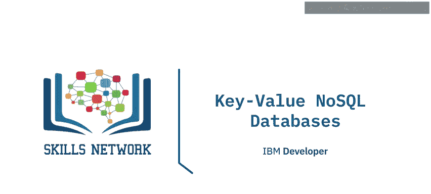

Welcome to Key Val No SQL databases This video lists the four main categories of no SQL databases available and describes the key value No SQL database category。

 including its architecture and primary use cases。

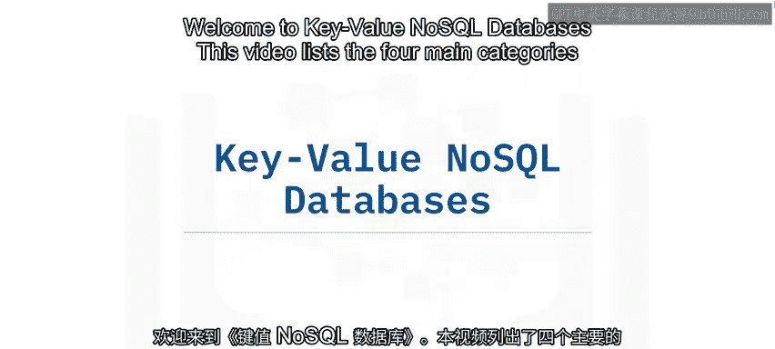

We have already learned that there are four major categories of no SQL databases， key value。

 document， column and graph all have unique characteristics that make them great fits for different types of applications or parts of applications。

 So let us look at each of these no SQL database types in a bit more depth。

 discussing both the architecture and use cases for each one in turn。

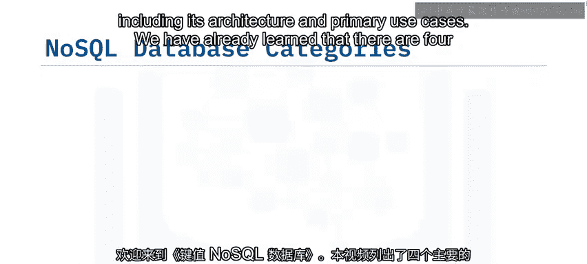

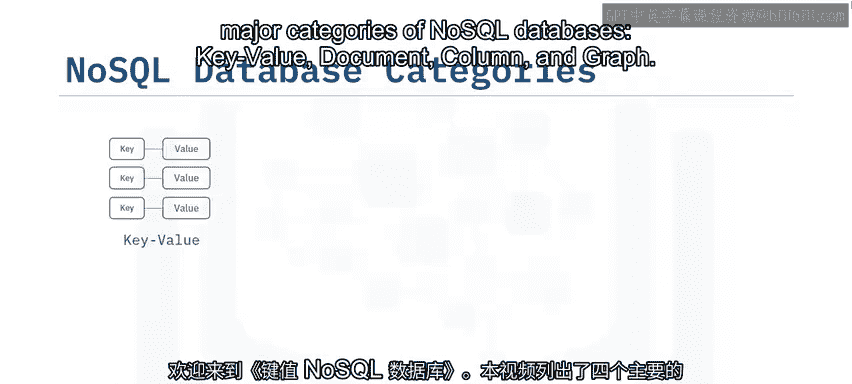

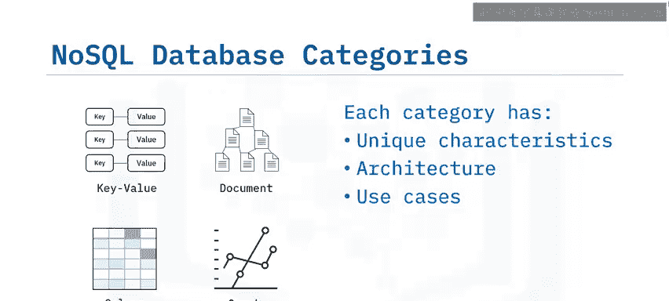

We will start with key value databases in key value databases。

 All data is stored with a key and an associated value blob。

 They are the least complex of the no SQL databases， architecturally speaking。

 because key value stores are represented as a hash mapap。 They're powerful for basic create， read。

 update， delete operations。 and key value databases typically scale quite well。

 and shard easily across X number of nodes。 Each shard would contain a range of keys and their associated values。

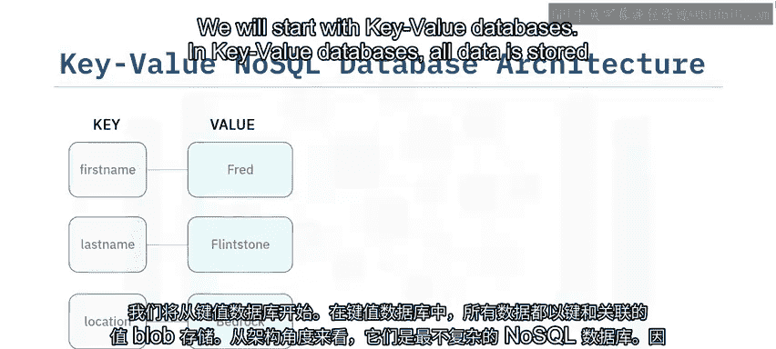

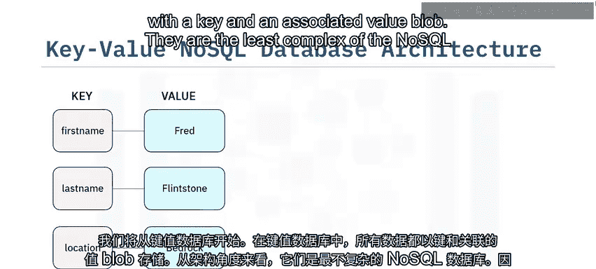

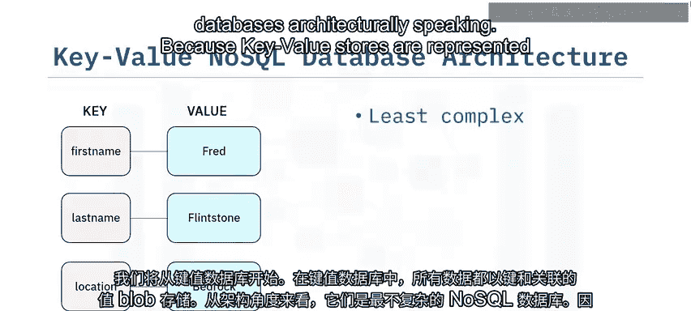

However， these databases are usually not meant for complex queries attempting to connect multiple pieces of data and are atomic for single key operations only the value blob is opaque and therefore typically will have less flexibility when it comes to indexing and querying the data than other database types。

 So what are some typical use cases for a key value type no SQL database Well。

 any time you need quick performance for basic create， read。

 update delete operations and your data is not interconnected。 For example。

 storing and retrieving session information for a web application Each user session would receive some sort of unique key and all data would be stored together in the opaque value blob plus there would be no need to query based on the information in the value blob。

 All transactions would be based on the unique key similar use cases would be for storing user profiles and preferences。

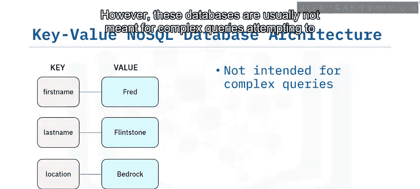

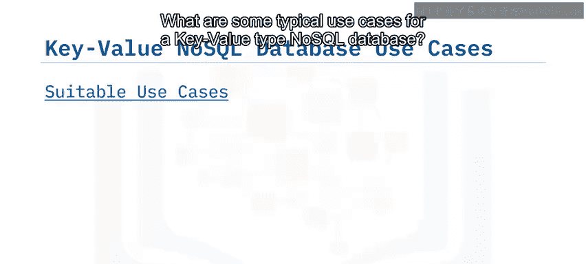

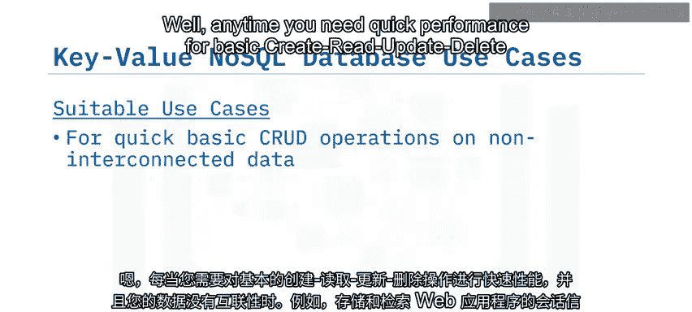

Within an application or even storing shopping cart data for online stores or marketplaces In these cases。

 complex queries or handling relationships between different keys would be few and far between。

Key value type no SQl databases would not be suitable for use cases that require just the opposite when your data is interconnected with a number of many to many relationships in the data。

 such as social networking or recommendation engine scenarios。

 a key value No SQL database is likely to exhibit poor performance。 Also。

 if your use case requires a high level of consistency for multiop transactions。

 involving multiple keys， you may want to look more towards databases that provide atomicity。

 consistency， isolation and durability or acid transactions。

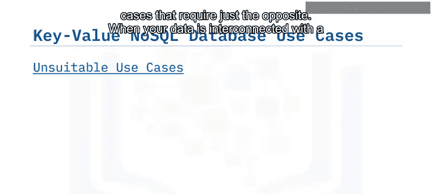

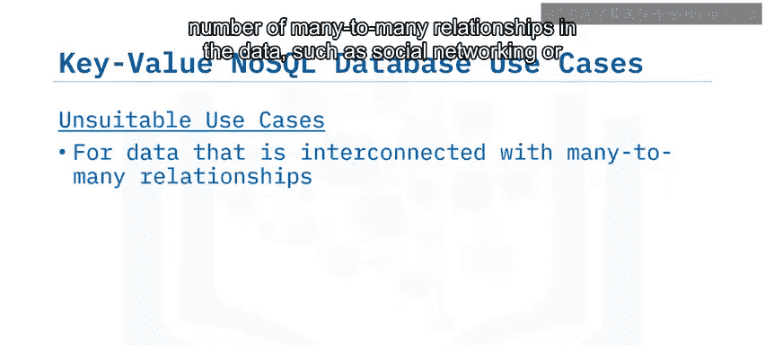

Lastly， if you expect the need to query based on value versus key。

 it may be wise to consider the document category of no SQL databases， which we will cover shortly。

Some examples of the more popular implementations of key value No SQL databases are Amazon Dynamo DB。

 Oracle No SQL database， Redis， Aerospike， RiAC KV， MeCash and Project Volemort。

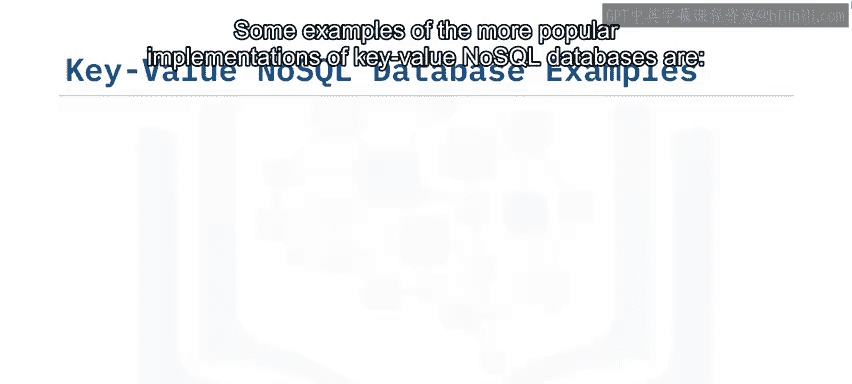

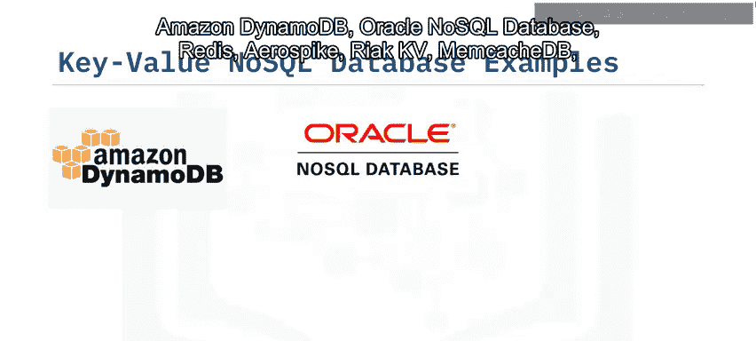

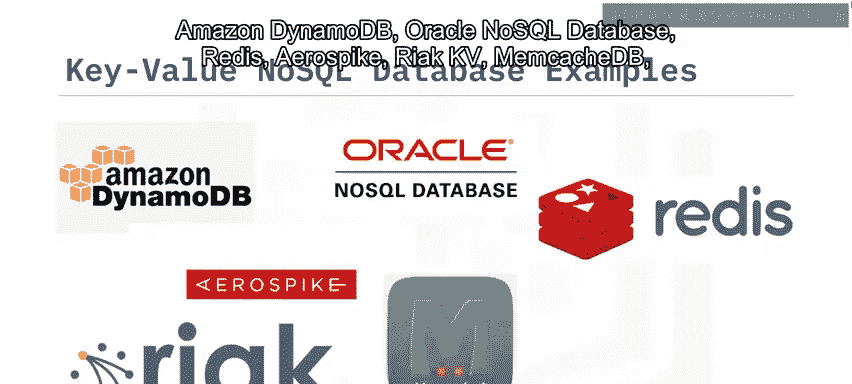

In this video， you learned that the four main categories of No SQL database are key value， document。

 column and graph。

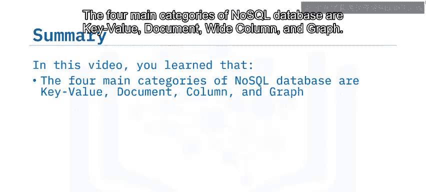

Key value no SQL databases are the least complex architecturally speaking。

 The data is stored with a key and corresponding value blob and is represented by a hash mapap。

And the primary use cases for the key value No SQL database category are for quick crud operations。

 For example， storing and retrieving session information。

 storing in app user profiles and storing shopping cart data in online stores。

