# IBM数据工程专业证书课程10：《NoSQL数据库导论》｜introduction-to-nosql-databases｜ - P4：3_nosql 数据库类别 文档.zh_en - GPT中英字幕课程资源 - BV1UN41187Zz

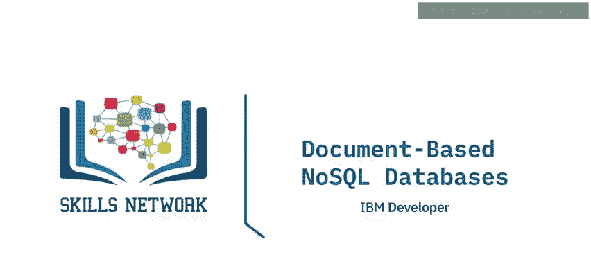

Welcome to documentcu based No SQL databases This video describes the document based No SQL database category。

 including its architecture and primary use cases。

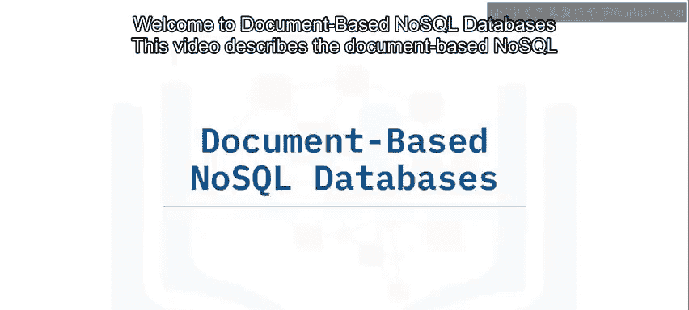

Document databases build off the key value model by making the value visible and able to be queried Each piece of data is considered a document and typically stored in either JSO or XML format。

 one of the benefits of document databases is that each document truly offers a flexible schema。

 where no two documents need to be the same or contain the same information。

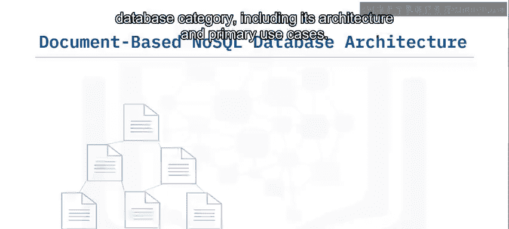

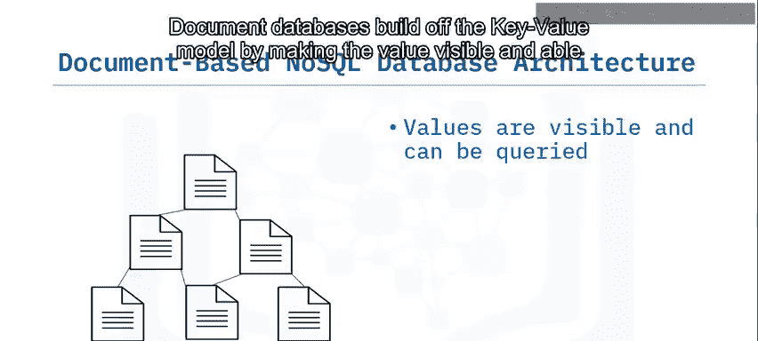

Document databases typically offer the ability to index and query the contents of the documents。

 offering key and value range lookups and searchability。

 or perhaps analytical queries via paradigms like map produceduce document databases are horizontally scalable and allow for sharding across multiple nodes typically sharded by some unique key in the document documentment stores also typically only guarantee atomic transactions on single document operations。

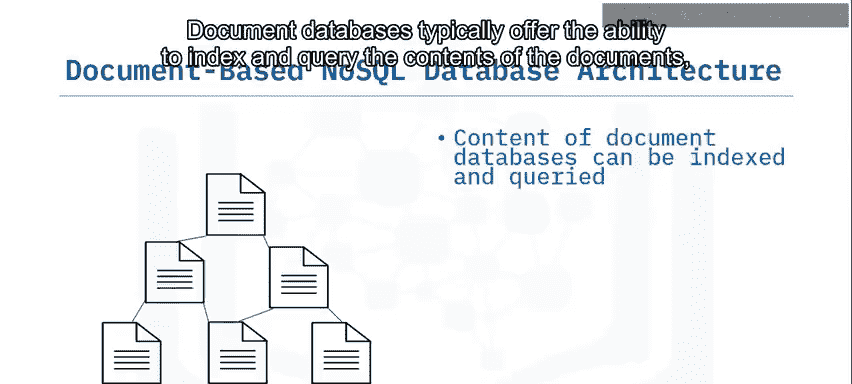

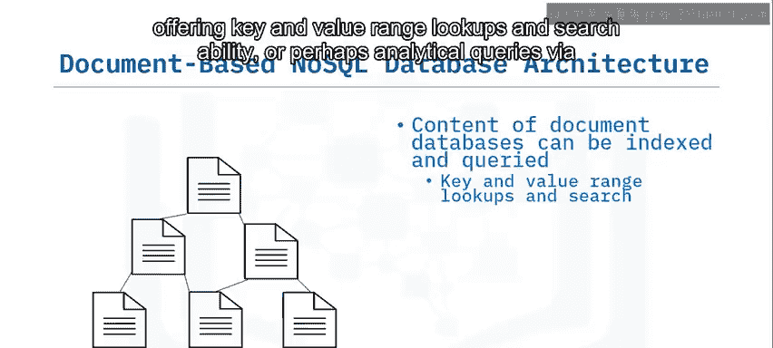

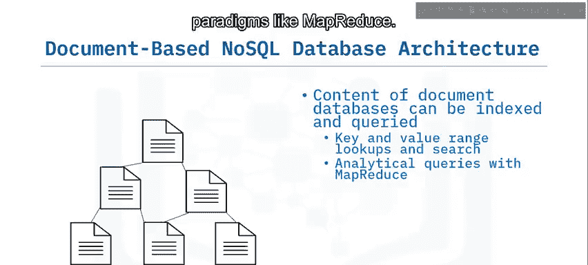

So what are some use cases for a document type no SQL database The first example would be for event logging for an application or process。

 Each instance would constitute a new document or aggregate containing all of the information corresponding to the event another use case would be online blogging。

 Each user would be represented as a document。 Each post a document。

 and each comment like or action would be a document。

 All documents would contain information pertaining to the type of data， such as username。

 post content or timesstamp when the document was created， More generally speaking。

 document stores work well with operational data sets for web and mobile applications。

 They were designed with the Internet in mind， thinking Jason， restful API and unstructured data。

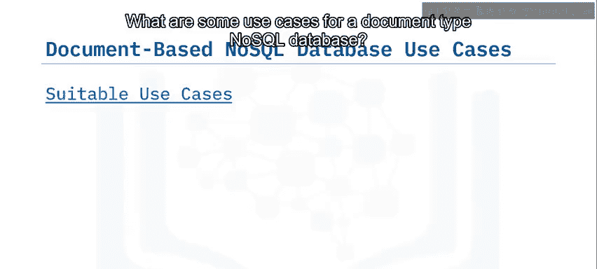

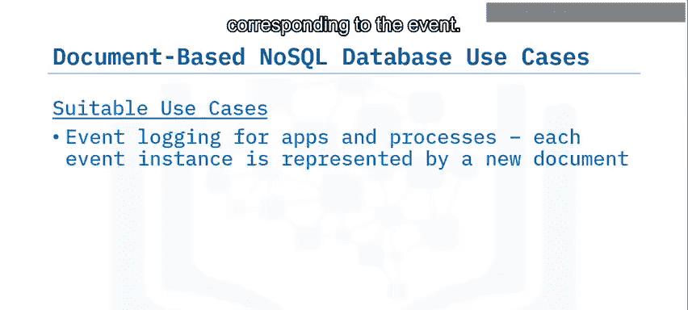

Document type no SQL databases would not be suitable for use cases that require acid transactions。

 It is not possible for a document store to handle a transaction that operates over multiple documents and a relational database may be a better choice in this instance。

 Secondly， document databases may not be the right choice if you find yourself forcing your data into an aggregate oriented design。

 if it naturally falls into a normalized tabular model。

 this would be another time to research relational databases instead。

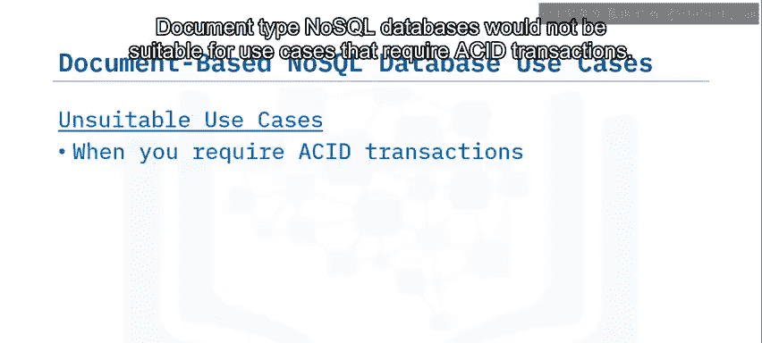

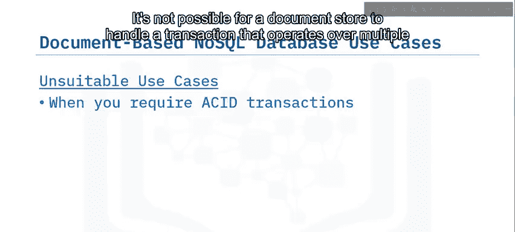

Document databases are currently the most widespread of the NoSQL database categories in use today。

 and some examples of the more popular implementations of document NoSQL databases are IBM Cloudant。

 Mongo DB， Apache CoDb， Terrastore， Orient D， Cobase and Raven DB In this video you learned that document-based NoSQL databases。

 use documents to make values visible and able to be queried Each piece of data is considered a document and typically stored in either JSO or XML format Each document offers a flexible schema and the primary use cases for document-based NoSQL databases are event logging for apps and processes。

 online logging and operational databases or metadata for web and mobile apps。

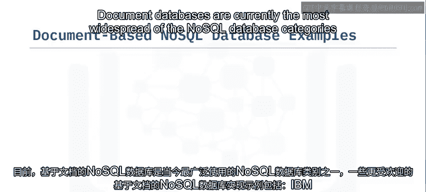

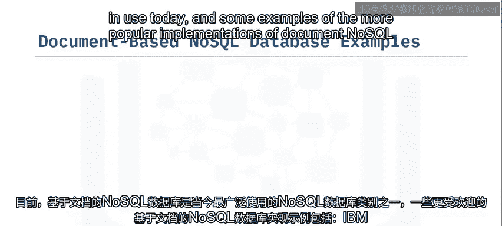

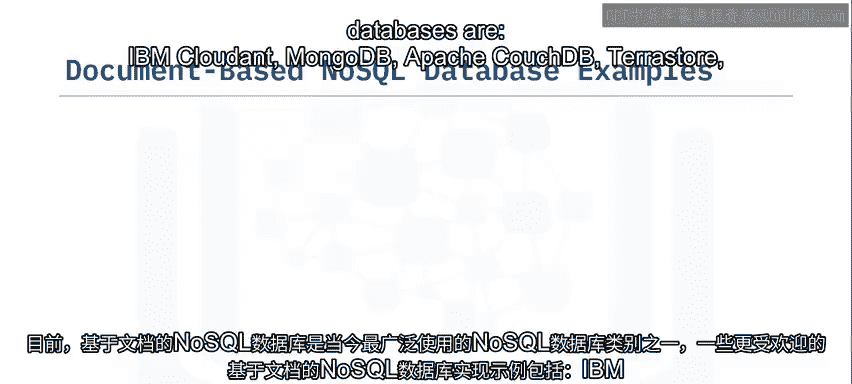

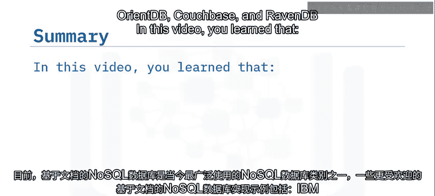