# IBM数据工程专业证书课程10：《NoSQL数据库导论》｜introduction-to-nosql-databases｜ - P5：4_nosql 数据库类别 列.zh_en - GPT中英字幕课程资源 - BV1UN41187Zz

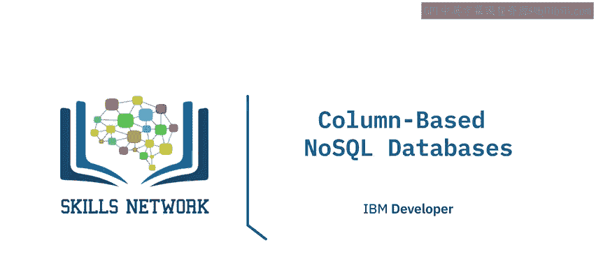

Welcome to column based No SQL databases This video describes the column based no SQL database category。

 including its architecture and primary use cases。

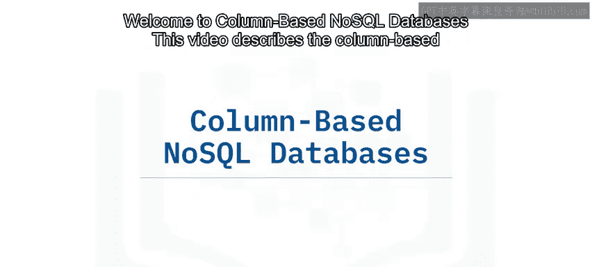

Column based databases spawned from an architecture that Google created called Big Table。

 These databases are therefore also commonly referred to as big table clones or columnar databases or wide column databases。

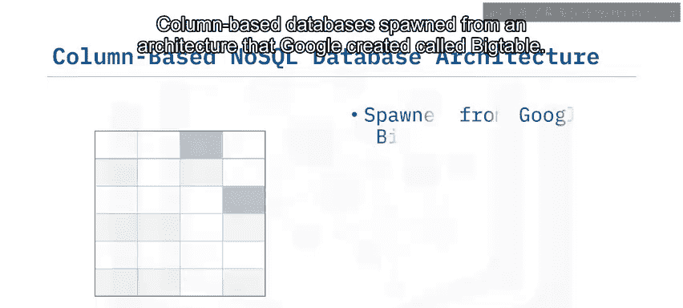

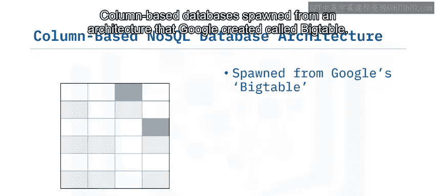

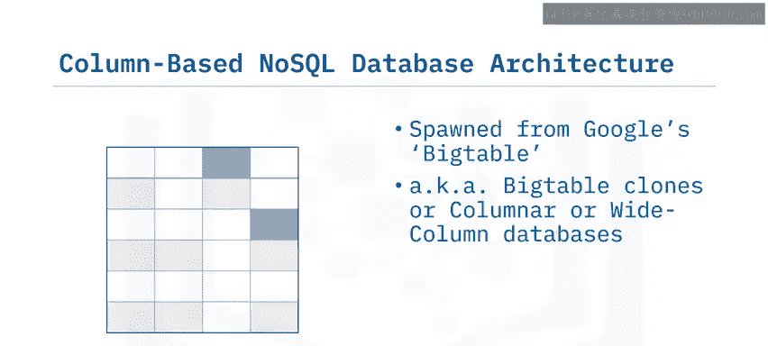

As you can tell from the name， these databases focus on columns and groups of columns when storing and accessing data。

 column families are several rows， each with a unique key or identifier that belong to one or more columns。

 These columns are grouped together in families because they are often accessed together。

 It is also important to point out that rows in a column family are not required to share any of the same columns。

 They can share all a subset or none of the columns。

 and columns can be added to any number of rows and not to others。

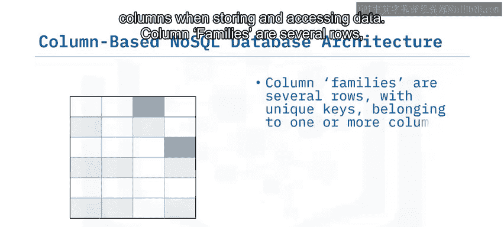

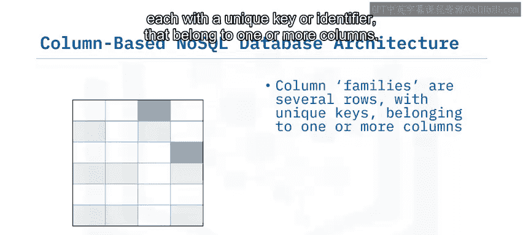

Let us look at some typical use cases for a column based no SQL database。

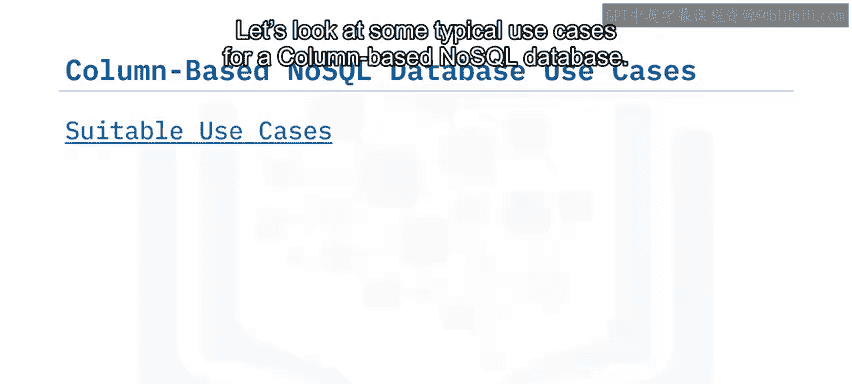

Column based databases are great for when you are dealing with large amounts of sparse data when compared to row oriented databases。

 column based databases can better compress data and save storage space。 In addition。

 these databases continue the trend of horizontal scalability。

 As with key value and document databases。 column based databases can handle being deployed across clusters of nodes。

😊。

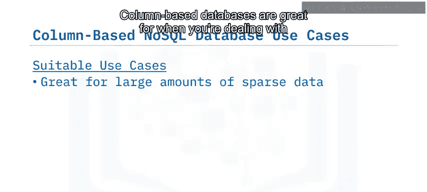

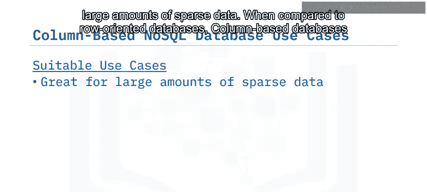

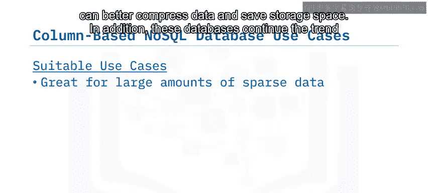

Similar to document databases， a column based no SQL database could be used for event logging and blogs。

 but the data would be stored in a different fashion。For enterprise logging。

 every application can write to its own set of columns and have each row key formatted in such a way to promote easy lookup based on application and timestamp。

Counters are a unique use case for column based databases。

 You may come across applications that need an easy way to count or increment as events occur。

 Some column based databases like Cassandra have special column types that allow for simple counters。

 In addition， columns can have a time to live parameter。

 making them useful for data with an expiration date or time like trial periods or add timing。

On the other hand， column based databases should be avoided if you require traditional acid transactions provided by relational databases。

 reads and writes are only atomic at the row level and early into development Queery patterns may change and require numerous changes to the column based designs。

 This can be costly and slow down the production timeline。

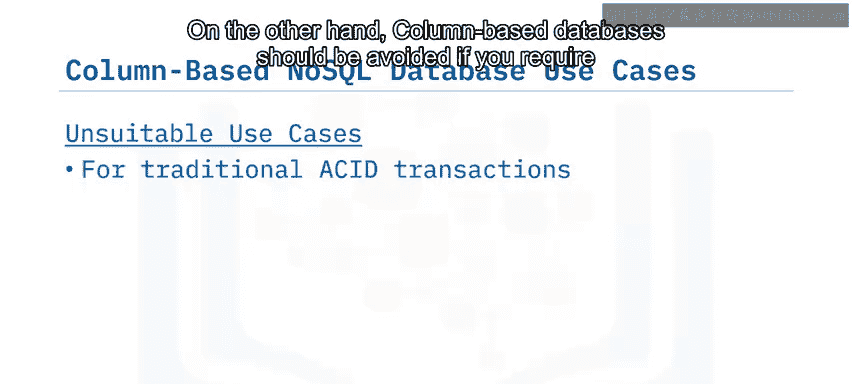

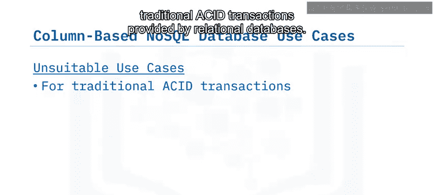

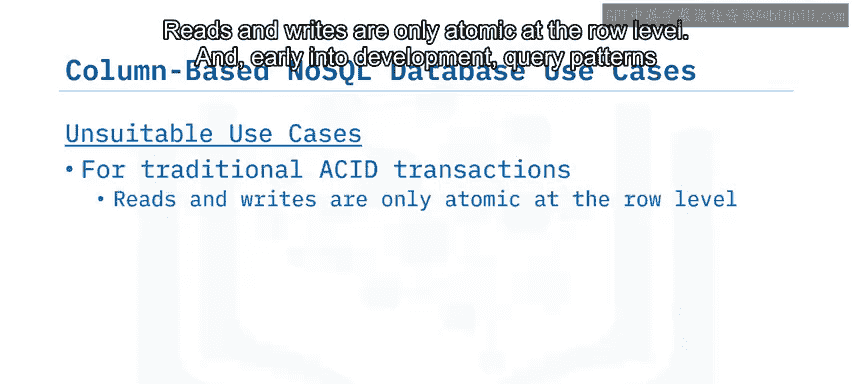

Some examples of the more popular implementations of column based NoSQL databases are Cassandra。

 HBase， HyTable， and acumullo。

In this video， you learned that column based databases spawned from the architecture of Google's big table storage system column based databases store data in columns or groups of columns。

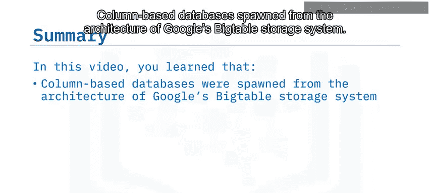

Column families are several rows with unique keys belonging to one or more columns。

And the primary use cases for column based No SQL databases are event logging and blogs， counters。

 and data with expiration values。

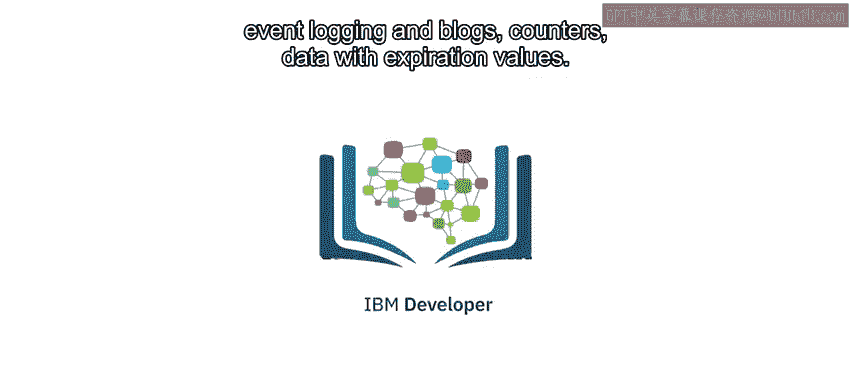