# IBM数据工程专业证书课程10：《NoSQL数据库导论》｜introduction-to-nosql-databases｜ - P6：5_nosql 数据库类别 图形.zh_en - GPT中英字幕课程资源 - BV1UN41187Zz

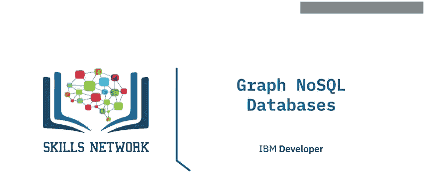

Welcome to Graph No SQL databases。 This video describes the Graph No SQL database category。

 including its architecture and primary use cases。 Graph databases are the last no SQL category variation we will discuss this database category stands apart from the previous three types covered because it doesn't follow a few of the common traits previously seen from a high level graph databases store information in entities or nodes and relationships or edges Gra databases are impressive when your data set resembles a graphlike data structure Traversing all of the relationships is quick and efficient。

 but these databases tend not to scale as well horizontally。

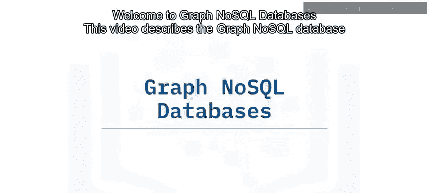

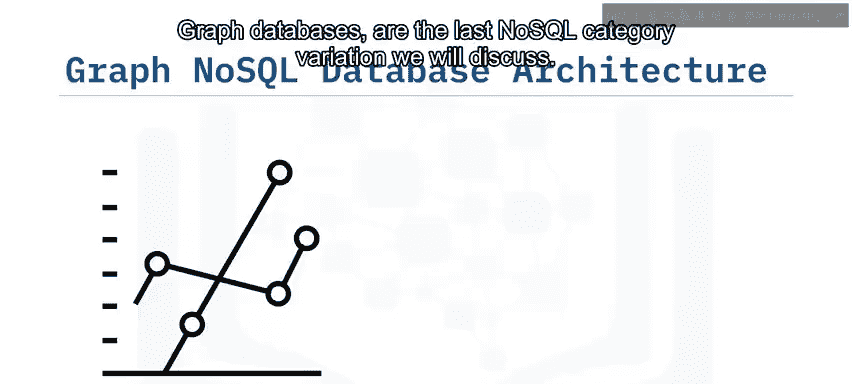

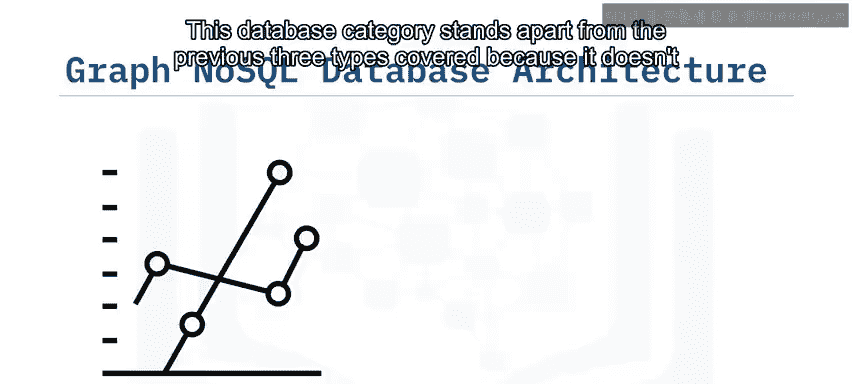

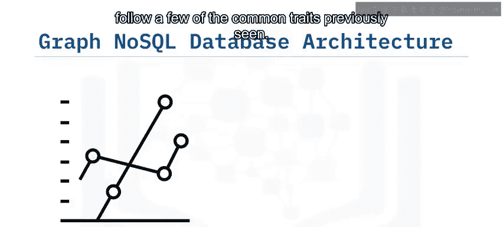

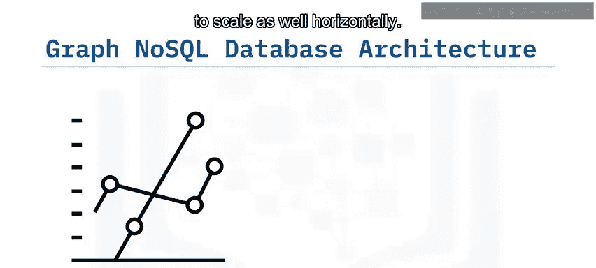

Shararding a graph database is not recommended， since traversing a graph with nodes split across multiple servers can become difficult and hurt performance。

Graph databases are also acid transaction compliant。

 very much unlike the other no SQL databases previously discussed。

 This prevents any dangling relationships between nodes that do not exist。

Now let's look at some typical use cases for a GraphnoSQl database Graph databases can be very powerful when your data is highly connected and related in some way Social networking sites can benefit by quickly locating friends。

 friends of friends， likes and so on and routing spatial and map applications may use graphs to easily model their data for finding close locations or building shortest routes for directions。

 Lastly， recommendation engines can leverage the close relationships and links between products to easily provide other options to their customers。

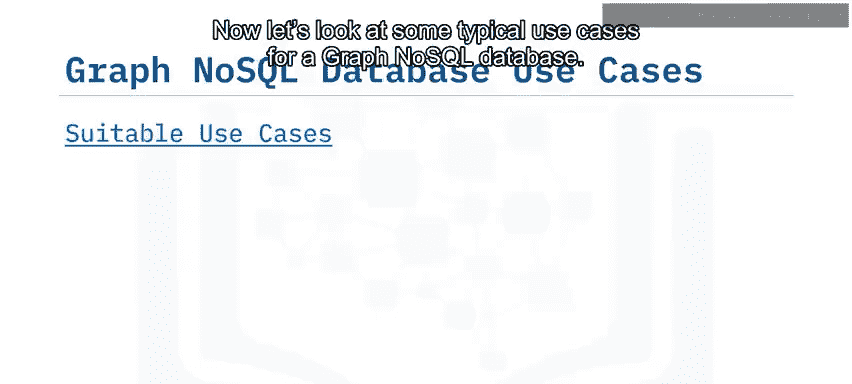

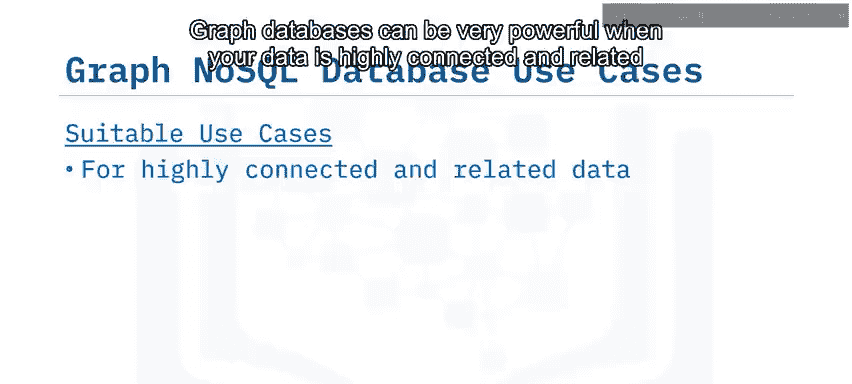

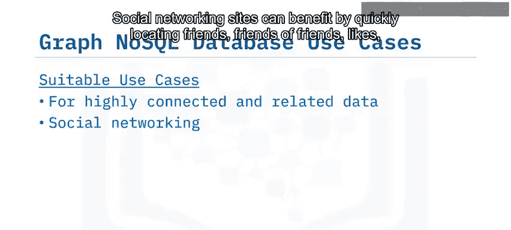

As far as unsuitable use cases for a graph database is concerned。

 graph databases are not a good fit when you're looking for some of the advantages offered by the other no SQL database categories。

 when an application needs to scale horizontally， you are going to quickly reach the limitations associated with these types of data stores。

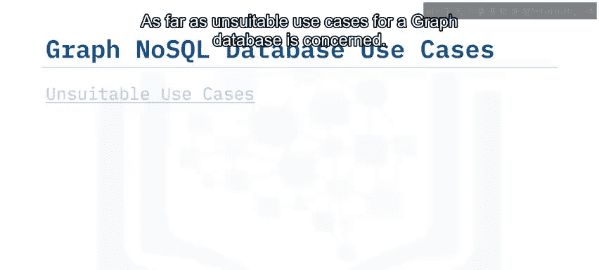

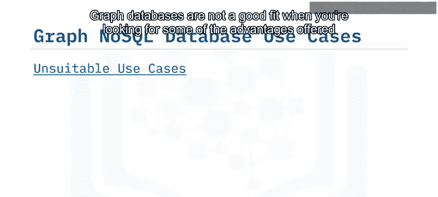

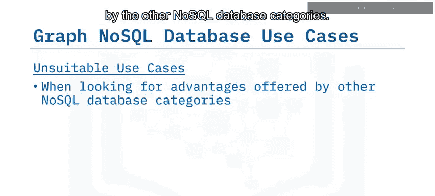

Another general negative surface when trying to update all or a subset of nodes with a given parameter。

 these types of operations can prove to be difficult and nontrivial。

 Some examples of the more popular implementations of graphph No SQL databases are Neo4 J， Orient DB。

 Orrongo DB， Amazon Neptune， part of Amazon Web services， Apache giraffe and Janisgraphra。

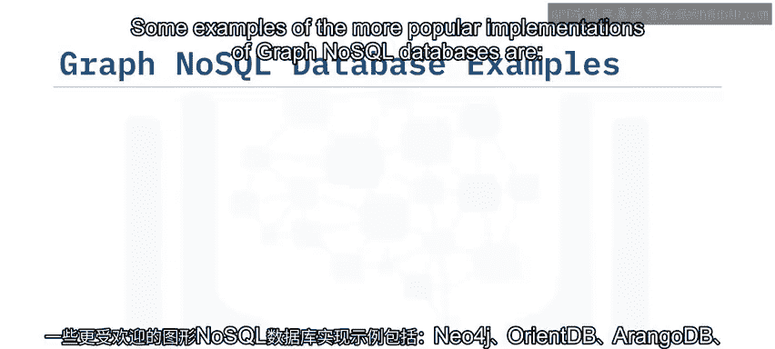

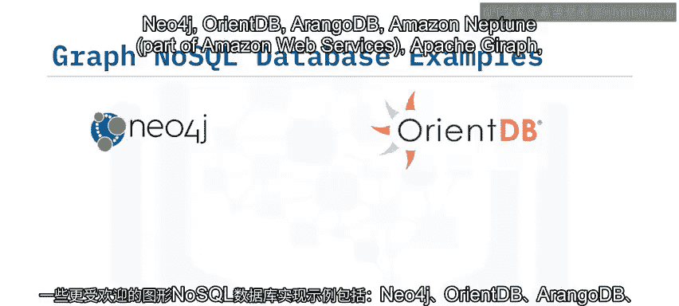

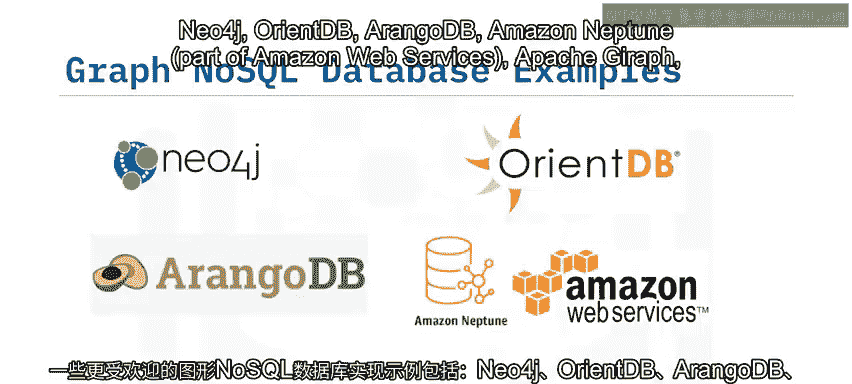

In this video， you learned that graph databases store information in entities or nodes and relationships or edges Graph databases are impressive when your data resembles a graphlike data structure。

 G databases do not shard well， but our acid transaction compliant。

 and the primary use cases for the G noSQL database category are for highly connected and related data for social networking sites for routing。

 spatial and map applications and for recommendation engines。

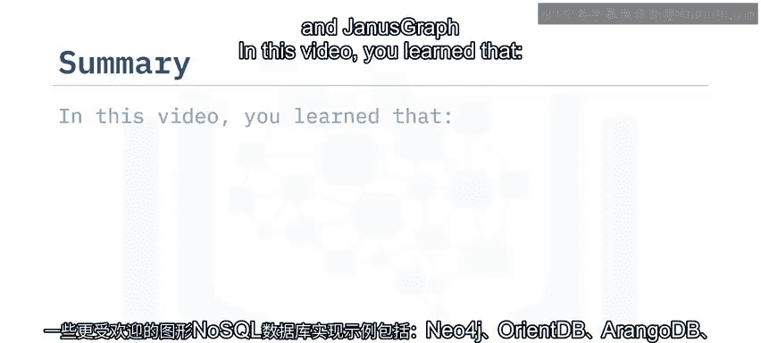

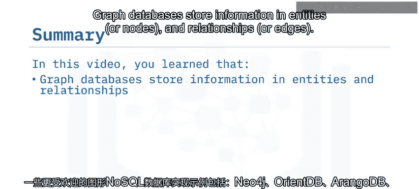