# IBM数据工程专业证书课程10：《NoSQL数据库导论》｜introduction-to-nosql-databases｜ - P8：7_分布式数据库.zh_en - GPT中英字幕课程资源 - BV1UN41187Zz

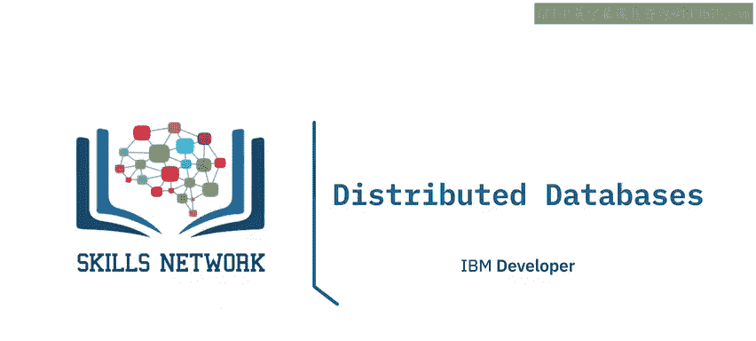

Welcome to Dis databases After watching this video。

 you will be able to describe the concepts of distributed databases。

 define fragmentation and replication of data， and describe the advantages and challenges of distributed systems。

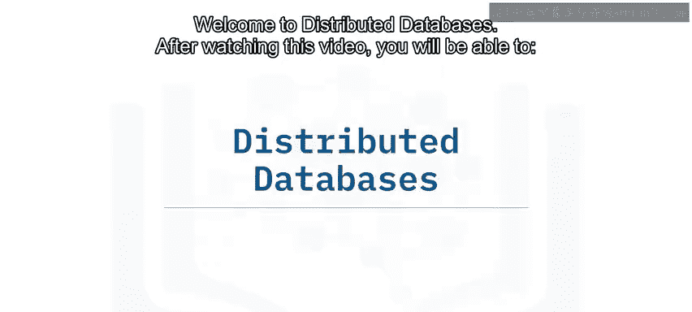

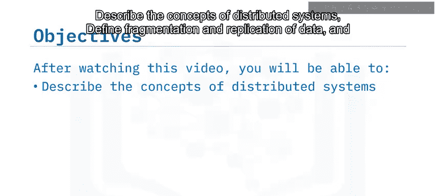

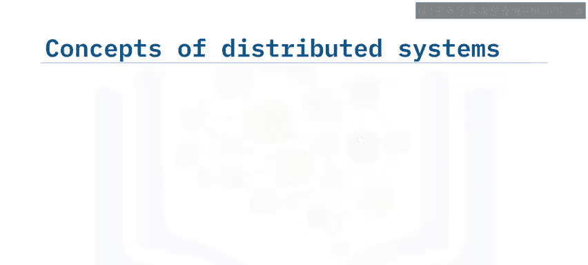

A distributed database is a collection of multiple interconnected databases。

 which are spread physically across various locations that communicate via a computer network。

 A distributed database is physically distributed across the data sites by fragmenting and replicating the data and a distributed database follows the base consistency model to store a large piece of data on all servers of a distributed system。

 you need to break your data into smaller pieces。 This process also known as fragmentation of data is also called partitioning of data or sharding of data by some no SQl databases。

 no matter the name， all distributed systems need to expose a way to store a large chunk of data。

 This process is usually done by the key of the key value record in two ways。

 by either grouping all keys lexically。 For example， all keys that。

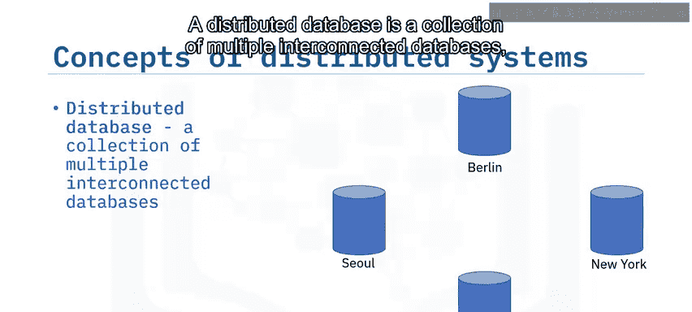

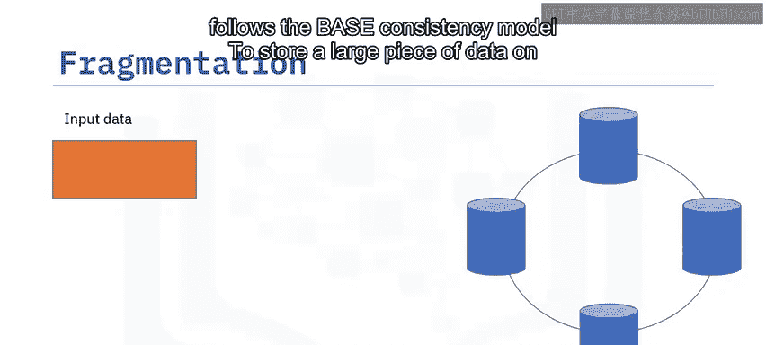

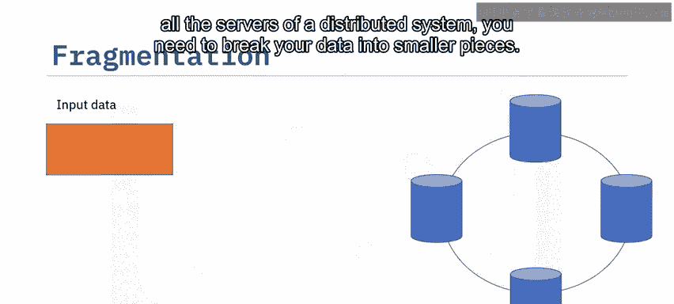

Start with A or between A and C can be found on a specific server。

 or by grouping all records that have the same key and placing them on the same server。 For example。

 all transactions from a store where store Id is the key of the records in this way。

 with a query like give me all sales from a store， all records will be on a single server。

 Data is now distributed to all the cluster's nodes。 But how do we make sure that if a node fails。

 we don't lose all of the data in that node。 This is done through replication where all fragments or partitions or shards of your data are stored redundantly in two or more sites。

 Hence， in replication systems maintain copies of data。

 Replication increases the availability of data in different sites。 If one node fails。

 that piece of data can be retrieved from another node。

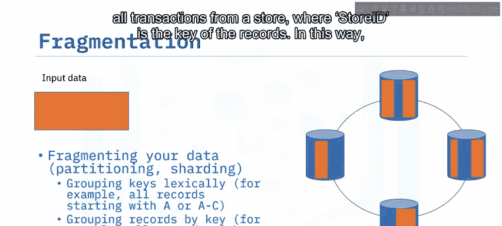

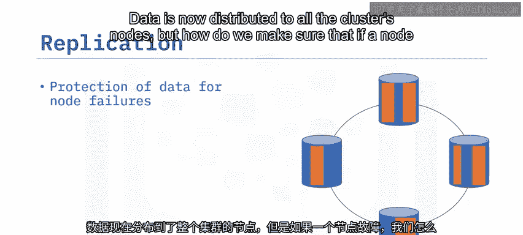

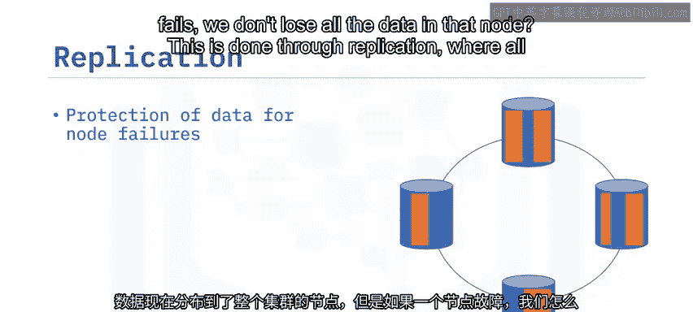

However， it has certain disadvantages as well。 Data needs to be consistently synchronized。

 Any change made at one site needs to be replicated to every site where that related data is stored or else it will lead to inconsistency。

 Distributed systems have numerous advantages。 They allow more reliability and available。

 The data is replicated at multiple sites。 If the local server is unavailable。

 the data can be retrieved from another available server。

 Another advantage of distributed databases is improved performance。

 especially for high volumes of data。 Queery processing time is reduced。

 which also helps improve performance。 You can easily grow or scale to increase your system capacity。

 just by adding new servers to the cluster。 Disbuted systems also provide continuous operation with no more reliance on the central site。

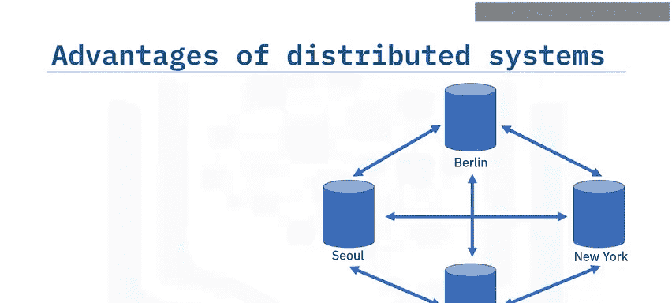

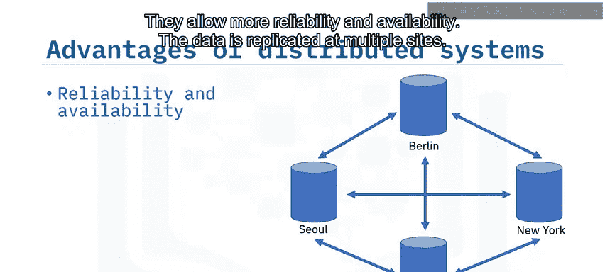

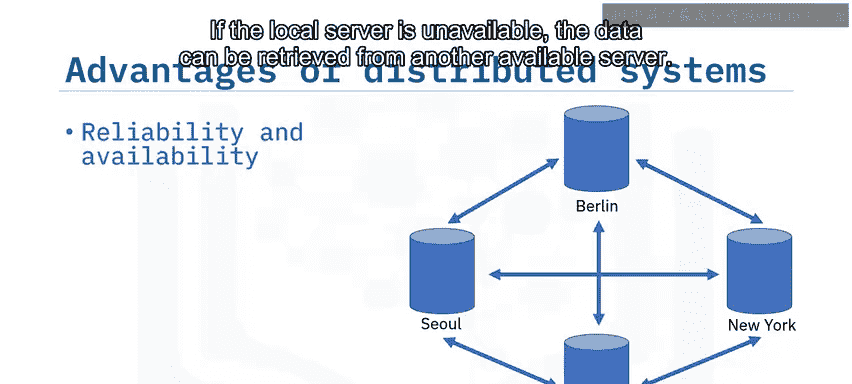

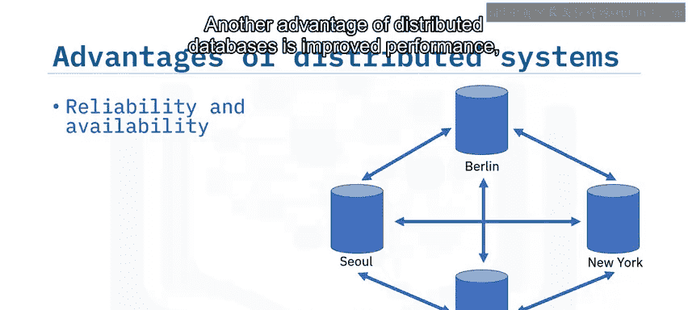

Distributed databases solve a lot of the technological issues for today's application services。

 like availability， fast scaling and global reach。 But their architecture also introduces some challenges。

 One is concurrency control。 because the same piece of data is stored in multiple locations。

 if you modify update or delete your data。 How can data synchronization be secured to solve this issue。

 some distributed databases， direct operations for a certain fragment of data to only one node。

 leaving the cluster to synchronize with the other nodes。

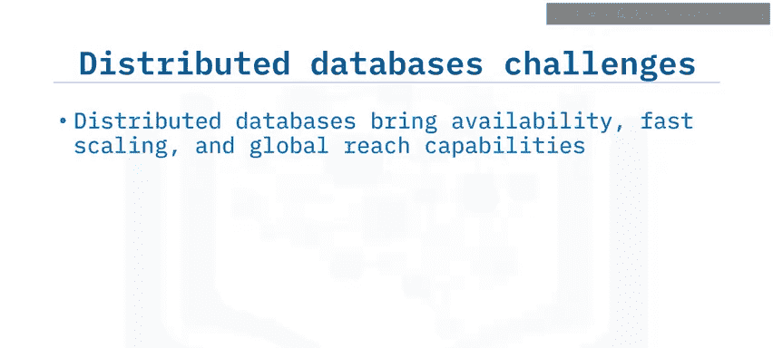

Others write to all nodes holding that particular fragment of data and read from as many nodes as required per consistency In both cases。

 the developer can control the consistency of the operation or how many nodes need to answer for a certain operation to be considered successful due to concurrency control issues。

 Dis databases by design don't really support transactions or provide a very limited version of them。

 Remember the base model from the previous video。 Dis databases follow the base model。

 Always available systems。 data might be inconsistent at times。

 but eventually consistency can be achieved。

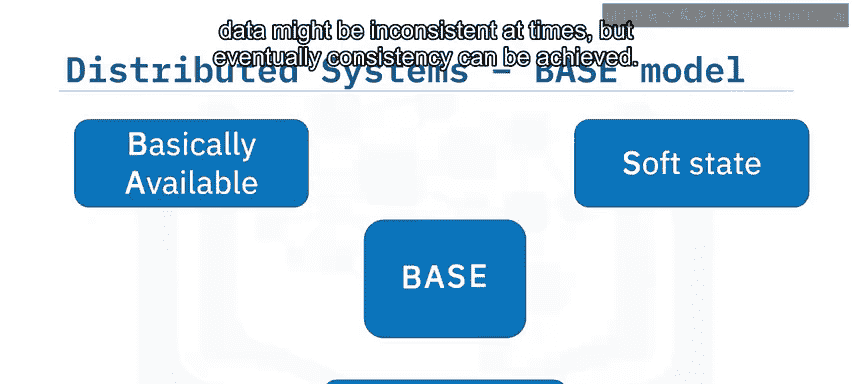

In this video， you learned that distributed databases are physically distributed across data sites by fragmentmenting and replicating the data。

 Frmentation enables an organization to store a large piece of data across all the servers of a distributed system by breaking the data into smaller pieces Replication means that all partitions of your data are stored redundantly in two or more sites with replication if one node fails that piece of data can be retrieved from another node Dis databases provide several advantages but also have their disadvantages and distributed databases followed the base consistency model。

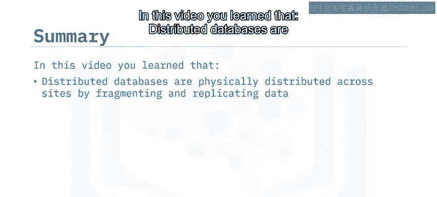

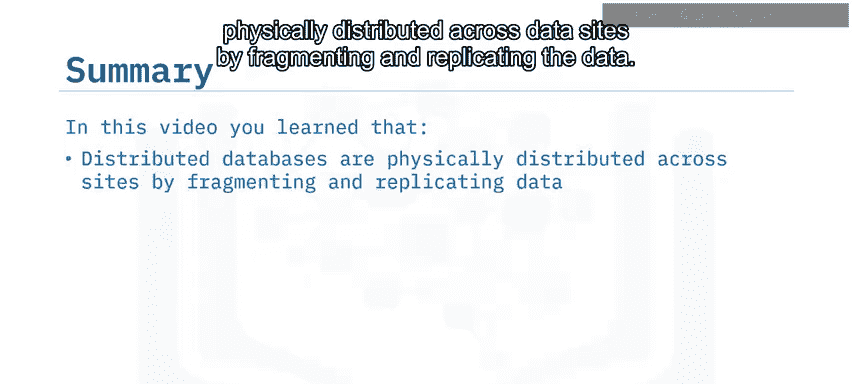

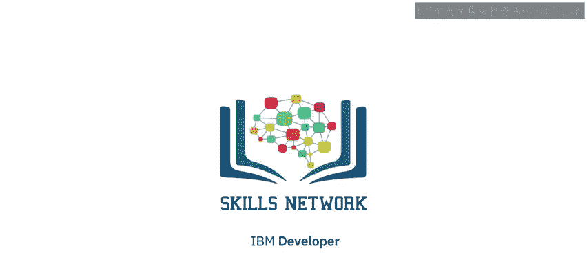