# IBM数据工程专业证书课程10：《NoSQL数据库导论》｜introduction-to-nosql-databases｜ - P9：8_cap 定理.zh_en - GPT中英字幕课程资源 - BV1UN41187Zz

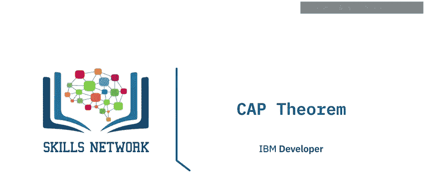

Welcome to CapP Theorem。After watching this video， you will be able to define the CA theorem。

 describe the characteristics of cap theorem， and describe the history and the relevance of CA theorem。

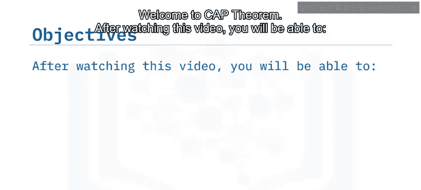

In the early 2000s， Big data Hadoop architecture was being created as the first open source distributed architecture that can store and process high volumes of data at this time。

 more and more services were developed that required databases to be distributed as well。

 actually these businesses required not only their services were active and accessible in most parts of the world。

 but also that their services were always available。

For relational databases that rely so much on the consistency of data。

 the new concept of availability while having a distributed system seemed impossible。

 And this was proven by the cap theorem。 The cap theorem is also called Brewer's theorem。

 because it was first advanced by Professor Eric A Brewer during a talk he gave on distributed computing in the year 2000。

 Two years later， it was revised by Mit professorfesors Seth Gilbert and Nancy Lynch。

 and there have been many other contributeds since The theorem states that there are three essential system requirements necessary for the successful design。

 implementation and deployment of applications in distributed systems。

 These are consistency A and partition tolerance or cap。

 A distributed system can guarantee delivery of only two of these three desired characteristics。Now。

 let's see what these three characteristics mean consistency refers to whether a system operates fully or not。

 do all nodes within a cluster see all the data they are supposed to。

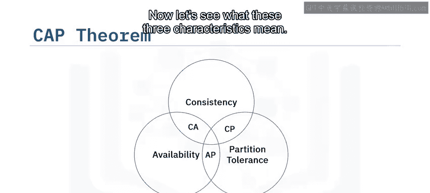

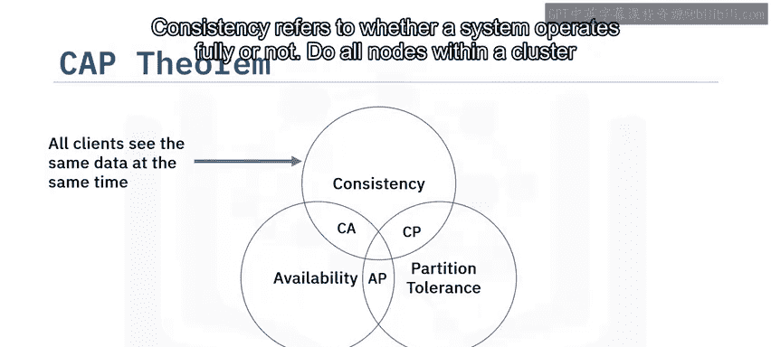

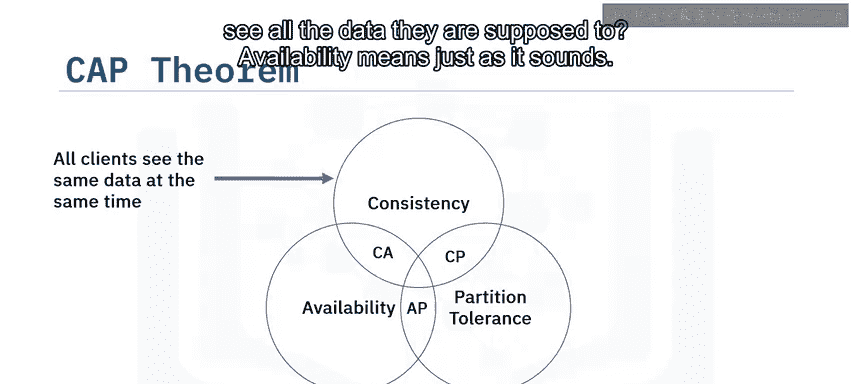

Availability means just as it sounds， does each request get a response outside of failure or success？

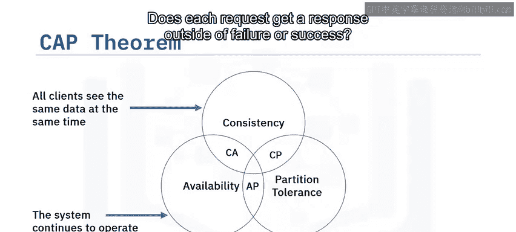

Partition tolerance represents the fact that a given system continues to operate even under circumstances of data loss or network failure。

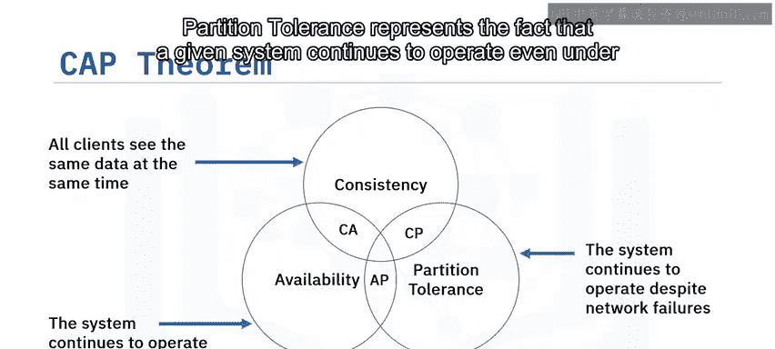

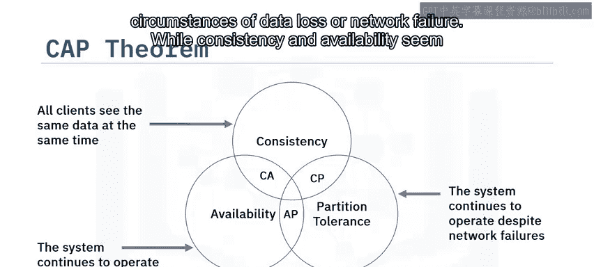

While consistency and availability seem straightforward。

 let's see what partition tolerance refers to。 A partition is a communications break within a distributed system。

 a lost or temporarily delayed connection between nodes。

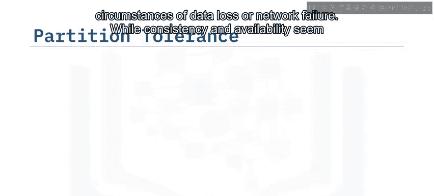

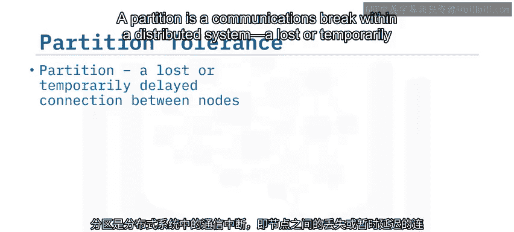

Partition tolerance means that the cluster must continue to work despite any number of communication breakdowns between nodes in the system。

In distributed systems， partitions can't be avoided。 Therefore。

 partition tolerance becomes a basic feature of native distributed systems， such as no SQL。

In a cluster with eight distributed nodes， a network partition could occur。

 and communication will be broken between all the nodes。In our case， instead of one8 node cluster。

 we will have two smaller four node clusters available。

 Con between the two clusters will be achieved when network communication is reestablished Partition tolerance has become more of a necessity than an option in distributed systems。

 It is made possible by sufficiently replicating records across combinations of nodes and networks for such systems as no SQL。

 since partition tolerance is mandatory a system can either be consistent and partition tolerant C or available and partition tolerant A existing no SQL systems like Mongo Db or Cassandra can be classified using CA theorem。

 For example， Mongo Db chooses consistency as the primary design driver of the solution。

 and Apache Cassandra chooses availability。 This doesn't mean that Mongo Db cannot be available。

Or that Cassandra cannot become fully consistent， it means that these solutions first ensure that they are consistent in the case of MongoDb or available in the case of Cassandra。

 and the rest is tuable。In this video， you have learned that CA theorem can be used to classify no SQL databases。

 No SQL databases choose between availability and consistency。

 and partition tolerance is a basic feature of no SQL databases。

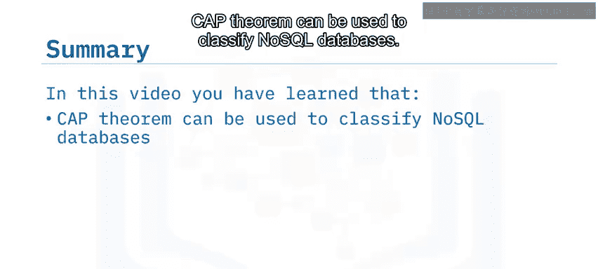

。

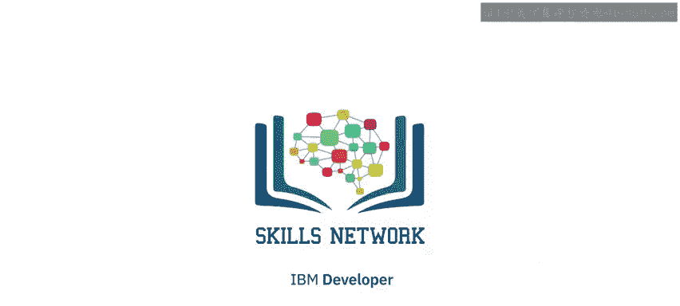