# IBM数据工程专业证书课程4：《关系数据库导论（RDBMS）》｜introduction-to-relational-databases｜ - P10：9_关系数据库产品简介.zh_en - GPT中英字幕课程资源 - BV1Mj4116716

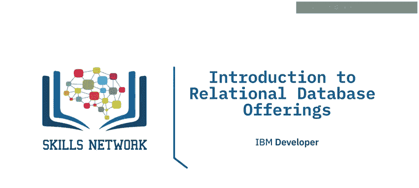

Welcome to Introduction to Relational Data Off。

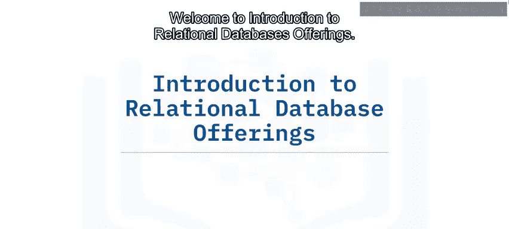

After watching this video， you will be able to summarize the history of relational databases。

 list popular commercial and open source databases。

 discuss the popularity of open source and commercial databases in the past decade。

 and discuss the rise in popularity of cloud databases。

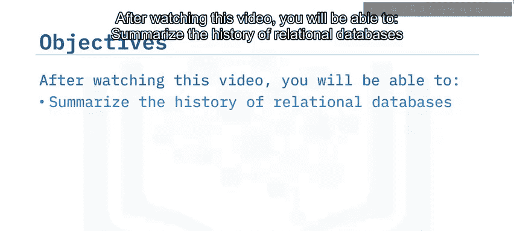

The first product recognizable as a relational database was in use during the 1960s。

 the IBM Saber Seat reservationserv system used by American Airlines。In the early 70s。

 Edgar FCOd listed 12 rules to define relational databases。In the late 70s。

 Ingress developed at the University of California， Berkeley， UCB。

 and system R created at IBM San Jose were in use。In 1976， Peter P。

 Chen proposed a new database model called Enity Relationship or ER。

The 1980s saw relational database systems become a commercial success。

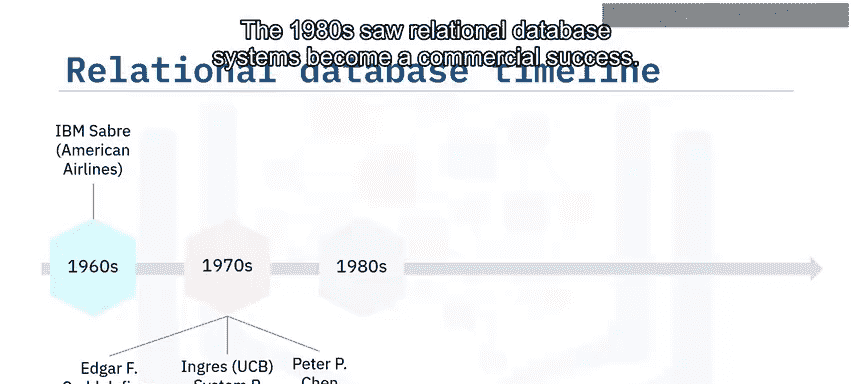

DB2 became the flagship database product for IBM and structured Que language or SQL became the standard query language。

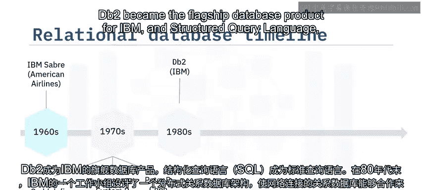

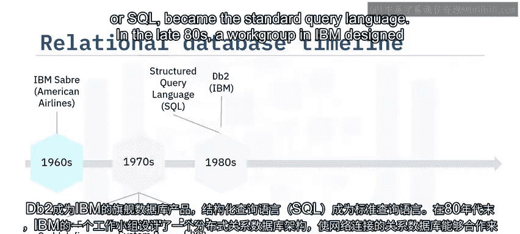

In the late 80s， a workgroup in IBM designed a distributed relational database architecture enabling network connected relational databases to cooperate to fulfill SQL requests By the early 1990s。

 new client tools for application development including Oracle developer power builder and VB along with tools for personal productivity like ODBC。

 Excel and access were becoming popular in the late 1990s there was exponential growth of the database industry Aver desktop users began to use client server database systems to access computer systems that contain legacy data。

 some of the most popular relational databases included giants such as Oracle。

 Microsoft SQL server and IBMDB2 and in the 200s open source DBs started to gain mainstream traction and started replacing many commercial databases。

My SQL， PostgresQL and other systems brought open source solutions to the Internet。

 The 2010s saw the popularity of cloud databases soOA。

 with main players in the industry being Amazon RDS， IBMDB2 on cloud。

 Microsoft SQL Ser and Oracle Cloud for many years。

 the most popular relational database systems were those from large corporations。

 which had the resources and talent to develop sophisticated。

 fully featured systems that supported the needs of industry at that time。

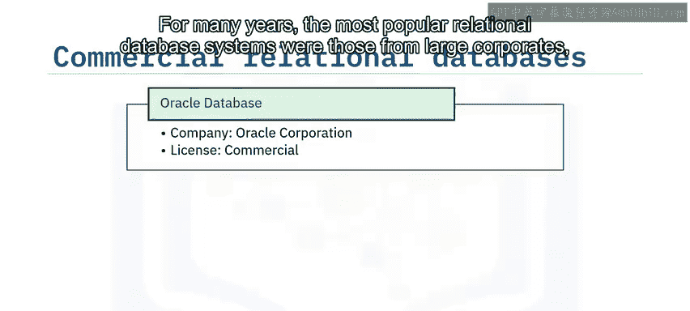

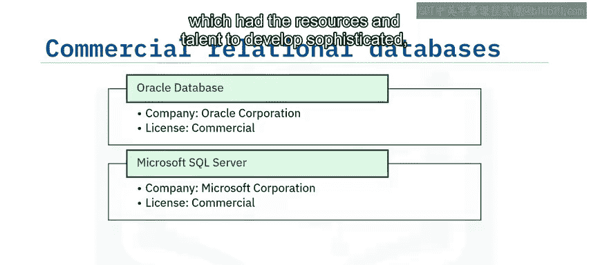

These relational databases sold under commercial licenses and are still popular with Oracle。

 Microsoft SQL Ser and IBM DB2， the market leaders。

 most large corporations offer both on premise and cloud based versions of their products。

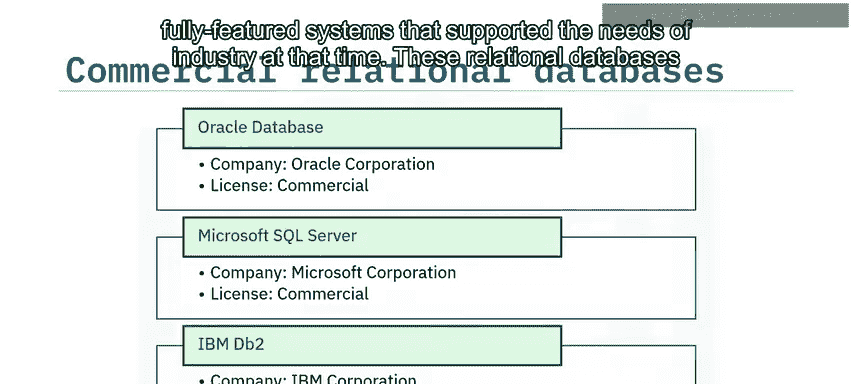

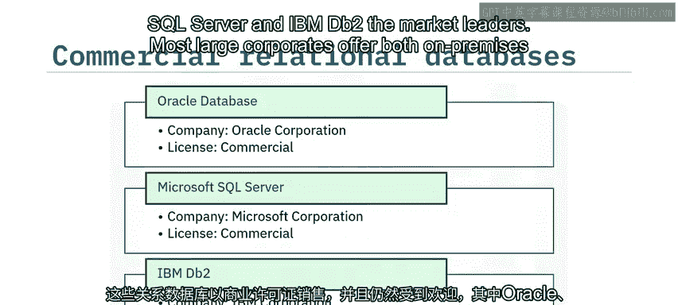

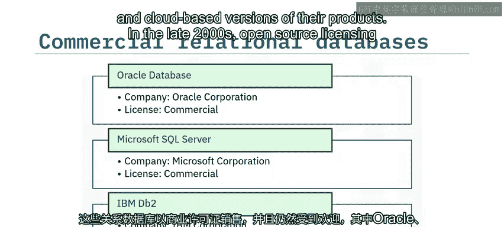

In the late 2000s， open source licensing for relational database systems like MySQL Postgresql and SQL L surged in popularity。

 Open source databases operate under a variety of license types。

 some examples of popular open source databases are My SQL produced by Oracle and offered under the general public license version 2 license。

 Postgresql， produced by the Postgresql global development group and offered under a Postgresql license。

 which is free and open source Permissive， and SQL Li。

 produced by Dwayane Richard Hip and offered under a public domain license The popularity of different kinds of database products is assessed monthly by industry analyst Db engines。

 This list shows the 10 most popular relational database systems as of February 2021 Oracle。

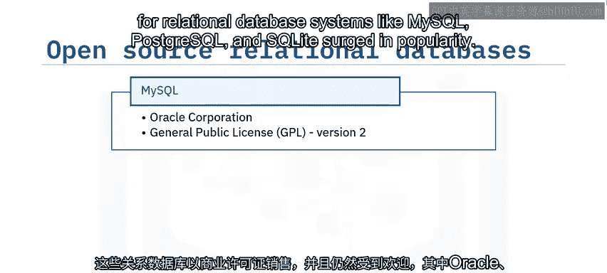

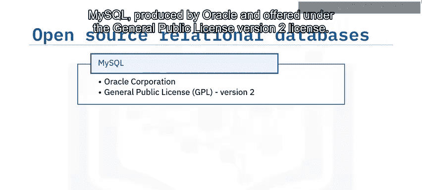

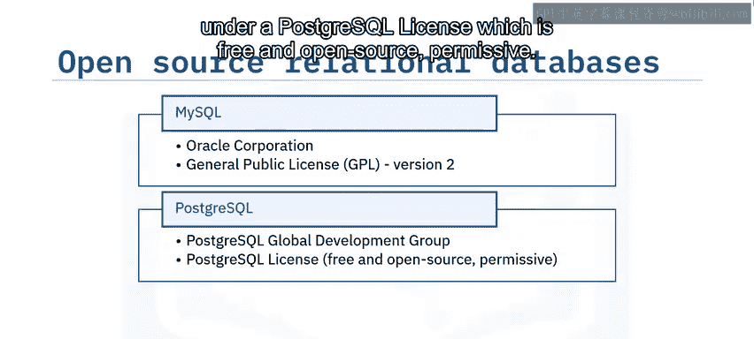

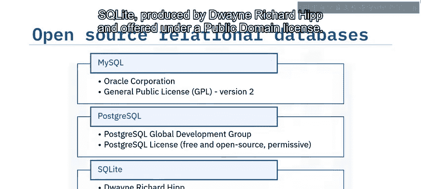

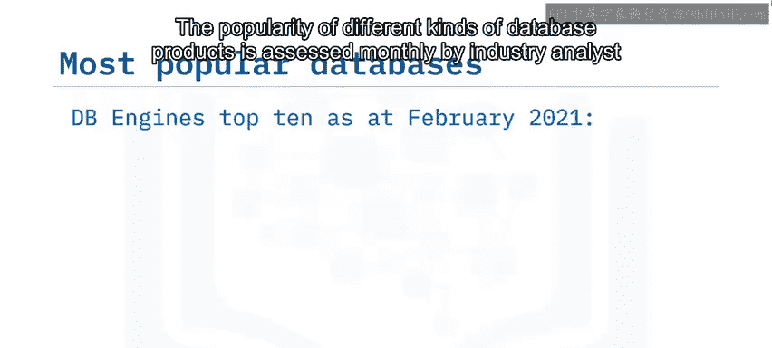

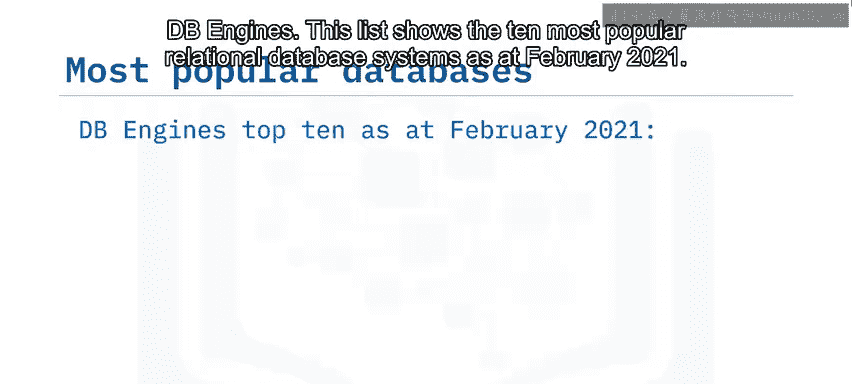

My SQL， Microsoft SQL Ser， PostgresQL， IBM DB2， SQL Li， Microsoft Access， Maria DB。

 Hive and Microsoft Azure SQL database。

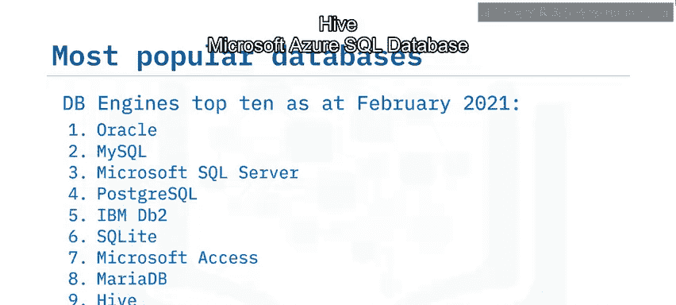

This DB engine's ranking is based on mentions on websites， Google and Bing， general interest。

 Google Trends， frequency of technical discussions， Sta overflow and DBA Sta Exchange。

Number of mentions in job offers indeed and simply hired。

 mentions in LinkedIn profiles and other social media mentions over the past decade。

 there has been a dramatic change in the popularity of commercial versus open source licensing across all types of software。

 including relational databases。

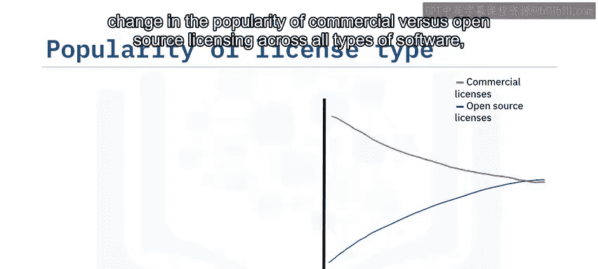

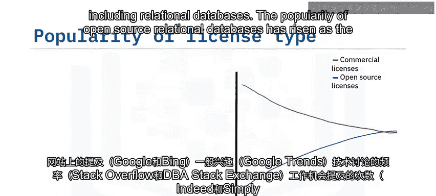

The popularity of open source relational databases has risen as the popularity of commercial databases has fallen。

A 2021 DB engine study found that open source systems account for 50。

1% of the total DB engine's popularity scores， up from 35。5 in 2013。

A cloud database is a database service built and accessed through a cloud platform。

 It serves many of the same functions as a traditional database with the added flexibility of cloud computing。

 The popularity of cloud databases has increased steadily over the past decade。

 The trend is driven by organizations moving to the software as a service or SaS model to take advantage of cloud benefits like increased scalability。

 Cloud databases are highly scalable， enabling organizations to process the vast amounts of data needed for data analytics。

 The popularity of cloud databases has more than doubled in the past decade。

 and this growth is set to continue。 According to Gartner by 2022。

75% of all databases will be deployed or migrated to a cloud platform。😊。

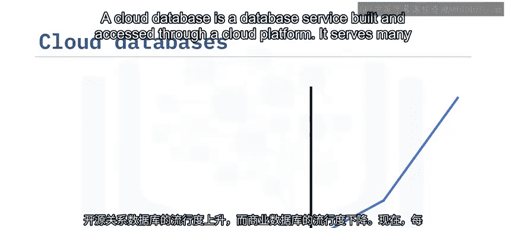

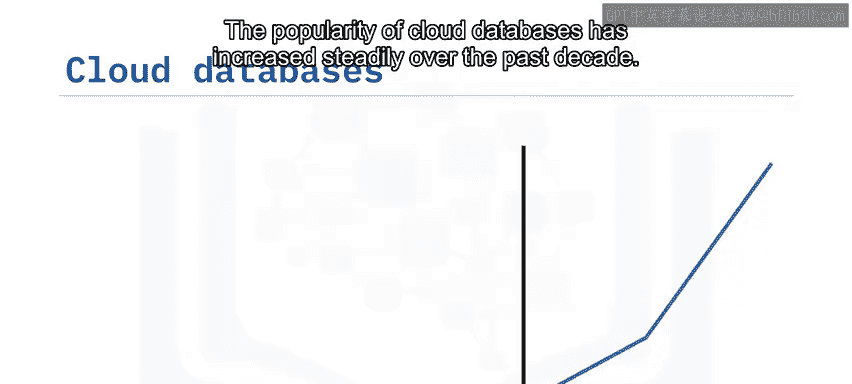

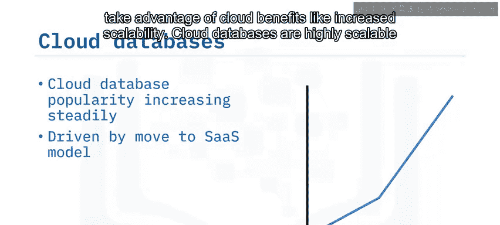

Leading cloud databases include Amazon Dynamo DB， Microsoft Azure Cosmos DB， Microsoft Azure SQL DB。

 Google BigQury and Amazon Redshift。

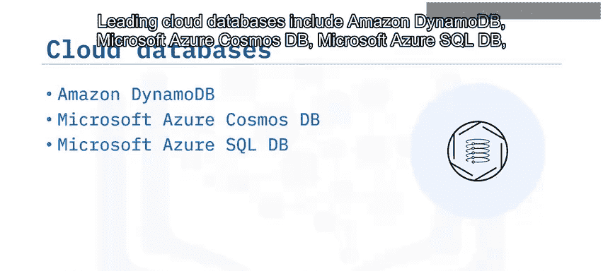

In this video you learned that relational databases are available with commercial licenses from companies like IBM。

 Oracle and Microsoft， open source relational databases are offered with a variety of licenses that make them free to the user the popularity of open source relational databases has risen to approximately 50% in the past decade。

 and the popularity of cloudown databases has more than doubled in the past decade。

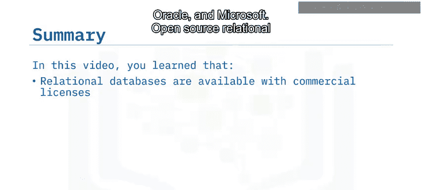

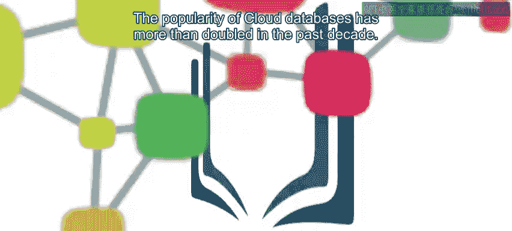