# IBM数据工程专业证书课程4：《关系数据库导论（RDBMS）》｜introduction-to-relational-databases｜ - P11：10_db2.zh_en - GPT中英字幕课程资源 - BV1Mj4116716

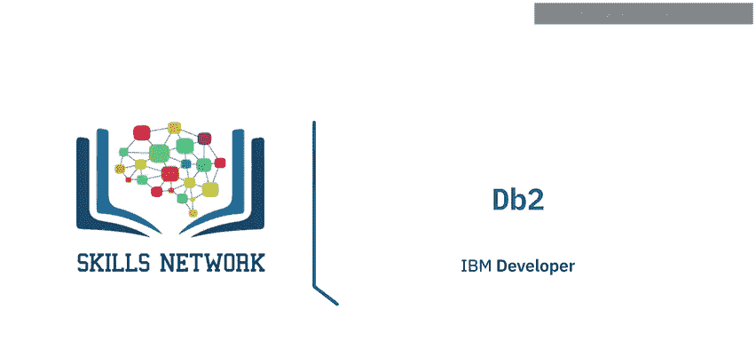

Welcome to DB2。After watching this video， you will be able to describe DB2 its histories and features list various DB2 products and deployment options Describe DB2 on cloud and its plans Ex how you can work with DB2 on cloud。

 describe DB2 highava options and describe DB2 scalability with partitioning databasease 2 or DB2 was first released by IBM in 1983 and was an early example of a relational database management system This first release ran on IBM mainframe computers。

 but over the years different versions were developed to run on many other platforms including OS2 Unix。

 Linux and Windows。

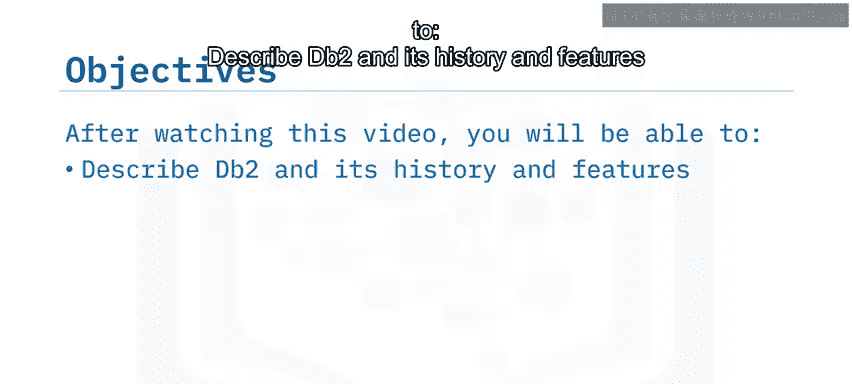

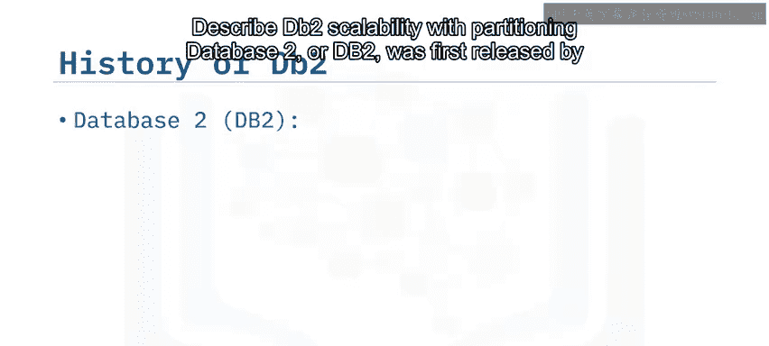

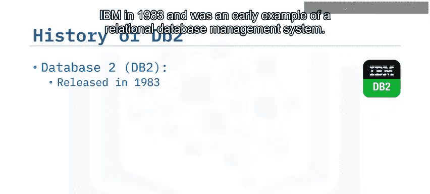

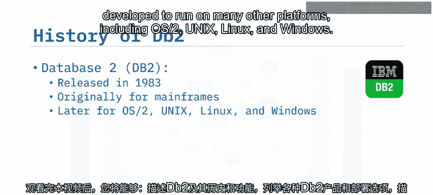

After some time the product was rewritten to use the same codeb across the multiple operating systems so that you can easily port applications accessing DB2 data from one operating system to another After many iterations of the offering across many platforms and with enhanced functionality Today DB2 is a whole suite of database management products。

 including DB2 database， DB2 warehouse， DB2 onC DB2 warehousehouse on cloud DB2 Big SQL DB2 Even store and DB2 for ZOS。

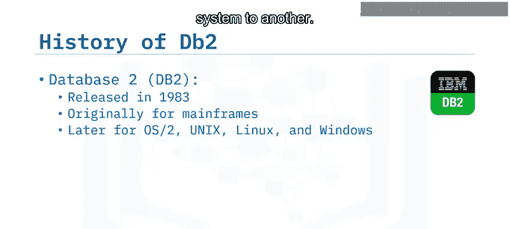

There are many ways to evaluate these products。 You can use DB2 database community license for free with a 100 gigabyte data limit。

 or you can download a free Docker image of DB2 database You can also use the free light plan of DB2 on cloud for development and evaluation purposes on IBM Cloud DB2 warehousehouse Enprise edition and DB2 Big SQL are available in no cost trial editions You can use DB2 warehouse on cloud for free up to one gigabyte of data。

 and you can download a free version of DB2 event store developer Ed。

The DB2 products all use AI powered functionality to simplify the management and querying of your data。

 both on premises and in cloud environments。You can use machine learning algorithms to improve the efficiency and performance of queries。

 the column store feature to improve performance and reduce overheads for analytic workloads by directing queries to specific columns rather than processing an entire data table and the data skipping feature to reduce overheads by automatically avoiding processing data that is not required in a particular query。

The common SQL engine across all the DB2 family means that you can write a query once and be sure it will work with other products in the family This simplifies migration of applications between products and platforms。

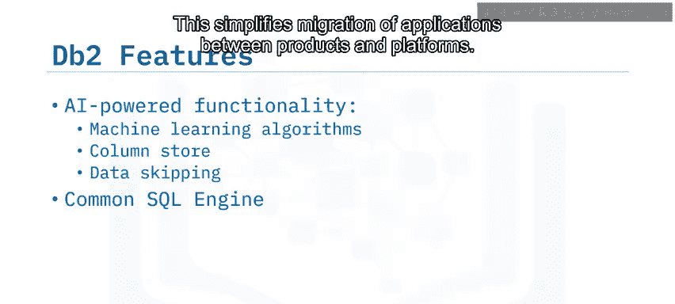

The support for all data types， relational， structured。

 and unstructured means you can access all of your corporate data to make better business decisions。

 and the DB2 replication functionality enables you to implement high availability and disaster recovery solutions。

DB2 provides scalability in a number of ways for short peaks。

 you can extend on-pres storage and power levels onto hosted cloud deployments。

 and you can independently scale power and storage in a managed cloud deployment to only use and pay for extra resources when you need them。

 or in DB2 warehouse， you can use the database partitioning feature to transparently split data across partitions and servers to maximize the compute power available and enable massively parallel processing。

The DB2 family provides you with a range of data management products to work with data on premises or in the cloud。

DB2 database is a powerful enterprise ready on premises RDBMS optimized for OLTP。

 it is supported on Linux， Mux and Windows and provides performance， high availability。

 scalability and resilience。DB2 warehouse is an on premiseesis data warehouse that provides advanced data analytics。

 massively parallel processing， and machine learning。

DB2 onC is a fully managed cloud based SQL database which provides similar features to DB2 database。

 performance， high availability， scalability and resilience。

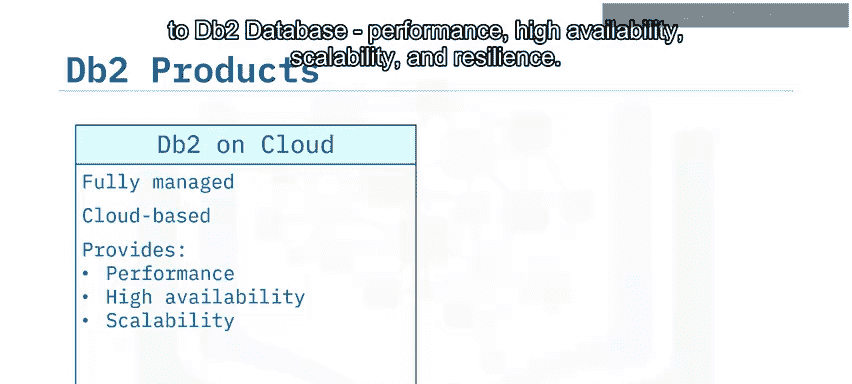

And DB2 warehouse on Cloud is a fully managed elastic cloud based data warehouse that provides similar features to the onpres DB2 warehouse。

 You can deploy both of the cloud based products on IBM Cloud and Amazon Web services。

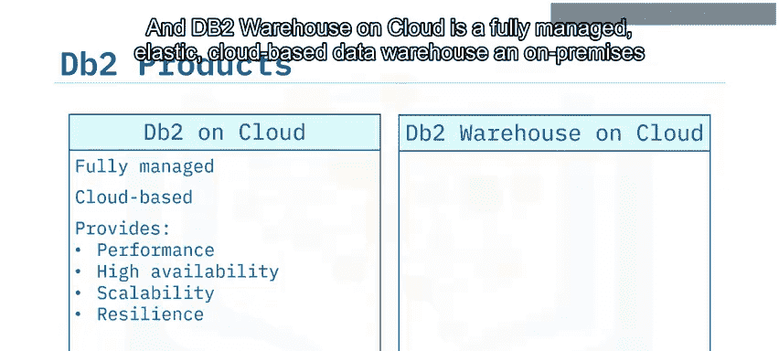

DB2 Big SQL is an SQL on Hadoop engine that provides massively parallel processing and advanced querying functionality you can use it to query a range of data sources including Hadoop HDFS。

 and Web HDFS， RDBMS， No SQL and other object stores。

 you can integrate it with CloudEa data platform or use a service on IBM Cloudpack for data。

And DB2 Even store is a memory optimized database that you can use to ingest and analyze streamed data for event drivenve applications。

 It includes IBM Watson Studio which provides you with a development environment for machine learning models。

 and finally， DB2 for ZOS an enterprise data server for IBMZ。

 It provides a mission critical data solution with integration for analytics。

 Mobi and Cloud that supports thousands of customers and millions of users。

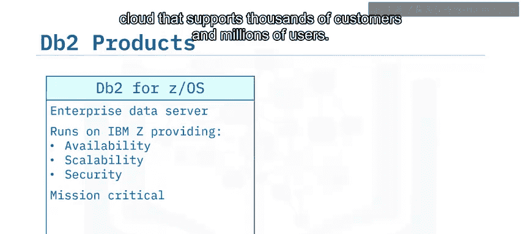

CloudpackC for data is a fully integrated data and AI platform that you can use to work with and manage all of your data It runs on Red Hat Openshift in a container so you can deploy it on any private public or hybrid cloud。

Using CloudPC for data， you can connect to DB2 or any other data source wherever it may be stored。

 use the Watson Knowledge catalog to organize your data。

 work with a range of analytics services to gain insight on your data。

 and use Watson and other services to infuse AI into your systems。

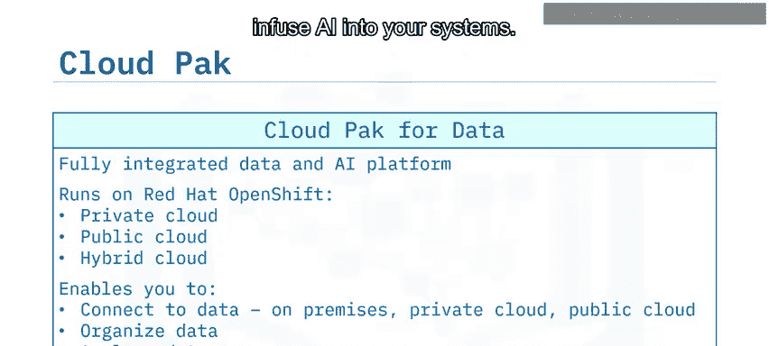

DB2 on cloud is a great way to get started with DB2 it offers three plans for you， light。

 standard and enterprise。The light plan is free and time unlimited。

 meaning that you can use it in your projects without worrying about a time limited trial period coming to an end。

 the plan is limited to 200 mebytes of data and 15 simultaneous connections。

The standard plan provides flexible scaling of compute capability and storage。

 as well as built in three nodeode high availability clustering。

 and the enterprisepri plan provides you with a dedicated database instance again。

 with flexible scaling of compute capability and storage and built in three nodeode high availability clustering。

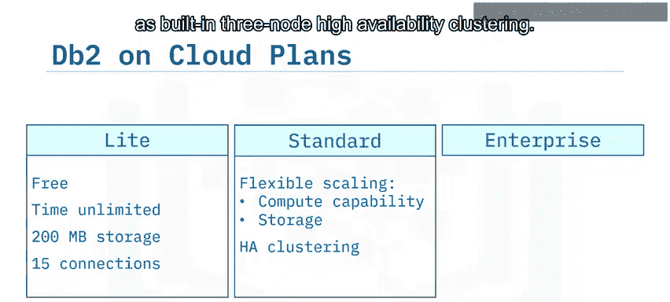

You can deploy DB2 on cloud on the IBM Cloud platform or on Amazon Web services Once running。

 you can access your DB2 on cloud databases by using the CLP+ command line interface。

 the DB2 on Cloud GoUI console or standard APIs such as ODBC， JDBC， and RE。

 you can also easily load data from Excel， CSV and text files from Amazon S3 Object storage using the GoUI consoles and you can programmatically load data from IBM Cloud Object St。

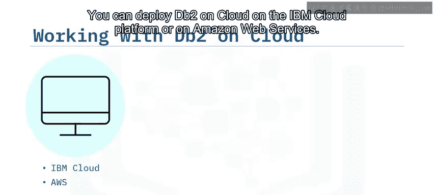

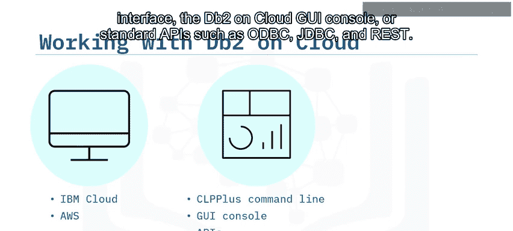

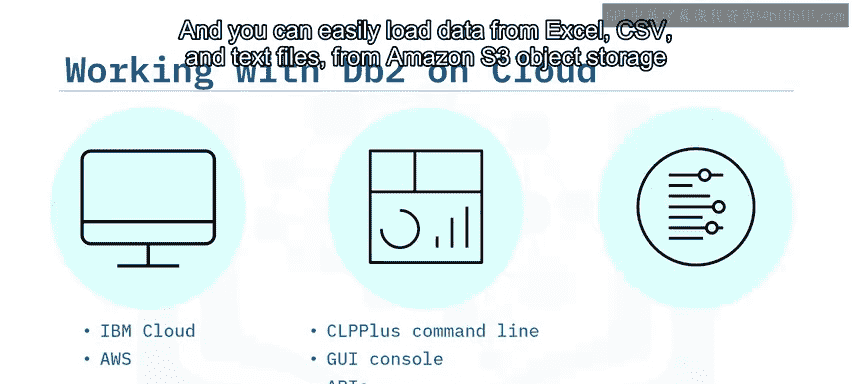

DB2 provides high availability disaster recovery or HDR functionality to support high availability systems HDR replicates changes made at a primary database to multiple standby servers。

If the primary database fails for any reason， hardware， software or network issues。

 you can automatically promote one of the standby databases to be the primary database。

 redirect client applications to this new primary database。

 and continue to replicate to the other standby servers in the group。

When the original primary database comes back online。

 it can either take the place of a standby server or be promoted back to the primary position。

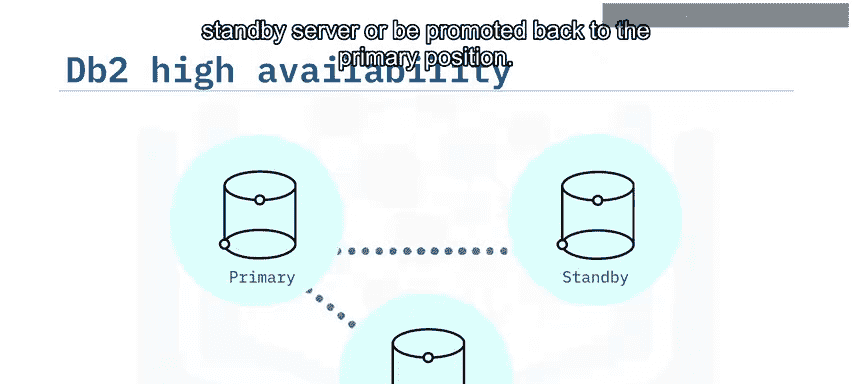

DB2 warehouse offers massively parallel processing and data analytics for BI workloads At times you may need to scale the storage capabilities of your system to meet peak demand or to reduce costs when demand is low Data in DB2 warehouse is stored in data nodes to scale up your storage capacity you just need to add a node to your deployment。

 The partitions and their workloads are then automatically rebalanced across the new node setup up。

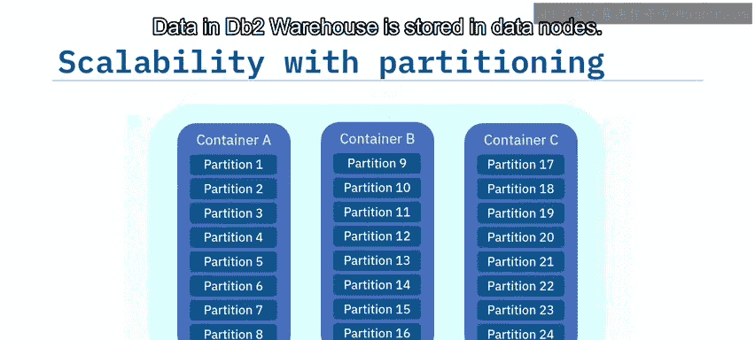

Similarly， to scale down， you just remove a node to return to your original state。In this video。

 you learned that DB2 is a family of products that you can use to work with and manage your data in whatever way you need。

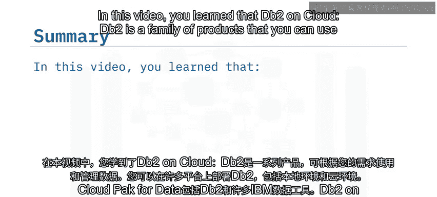

You can deploy DB2 across many platforms， both on premises and in the cloud CloudpackC for data includes DB2 and many IBM tools for data。

DB2 on Cloud is a fully managed cloud based SQL database that can run on IBM Cloud or AWS。

 and DB2 provides high availability， disaster recovery and scalability functionality。

