# IBM数据工程专业证书课程4：《关系数据库导论（RDBMS）》｜introduction-to-relational-databases｜ - P12：11_mysql.zh_en - GPT中英字幕课程资源 - BV1Mj4116716

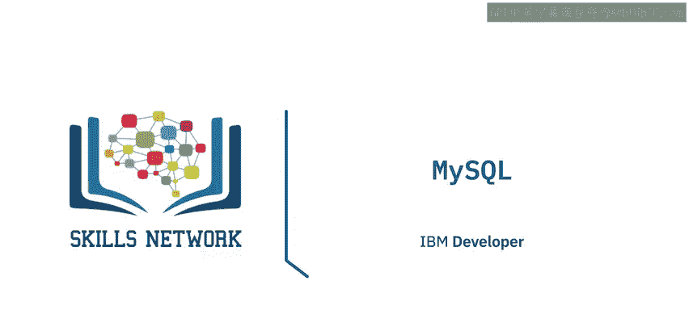

Welcome to My SQL After watching this video， you will be able to describe MySQL。

 explain how you can work with mySQL， list some of the MySQL storage engines。

 and understand my SQL high availability and scalability options。

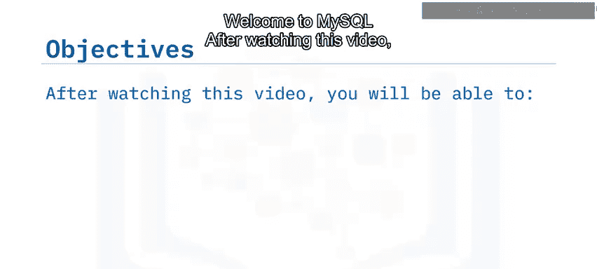

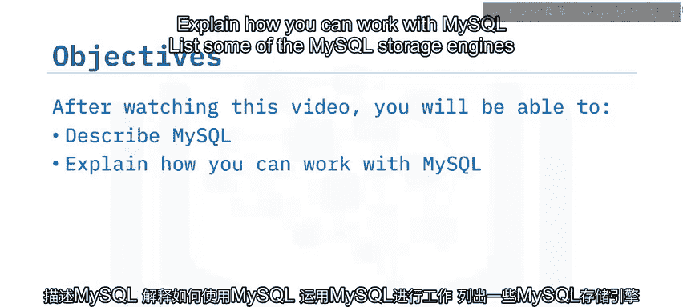

My SQL was first developed by a Swedish company， My SQL AB and named after my。

 the daughter of one of the cofounders of my SQL A， Monte Wa Denniius。

 the company was later acquired by Sun Microsystems which in turn was acquired by Oracle Corporation。

 The dolphin in the My SQL logo is named Squila， which was chosen from a list of suggestions made in a name the dolphin Conest。

 My SQL sort in P in the late 1990s and early 2000s。

 partly because it was a key component in the lamp Linux operating system Apache Web server。

 My SQL database and PhP scripting language Sta which was being used to build many popular websites at the time My SQL is available under dual license。

 the open source GnuU GL and a commercial license for applications and solutions that embed my SQL because the GnuU GPL。

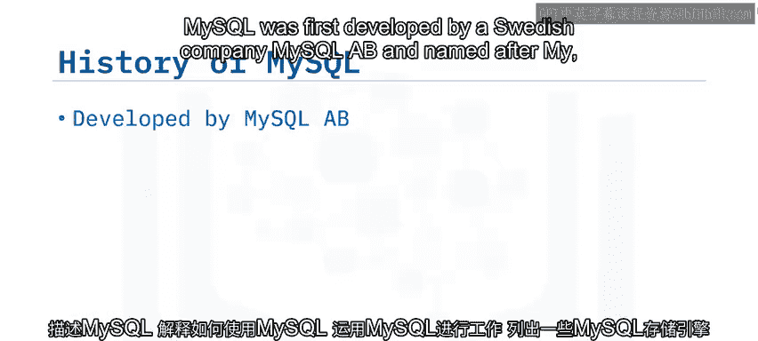

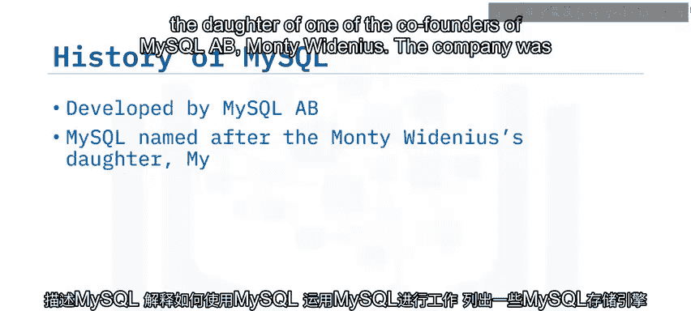

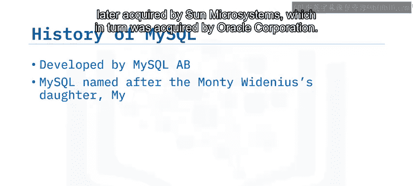

Is open source There have been various forks of MySQL the most prominent being Maria DB。

 which is led by some of the original developers of MySQL MySQL is an objectreal database management system it is a popular low maintenance database and is available in various flavors and additions including a clustered version for demanding workloads you can run MySQL on many versions of Unix as well as Microsoft Windows and Linux and you can write client applications for it using most modern programming languages MySQL uses standard SQL syntax as well as its own extensions for additional functionality such as the low data statement that very quickly reads rows from a text file into a database table MySQL works primarily with relational data。

 but also supports Jason like many other RDBMS MySQL supports multiple storage engines。

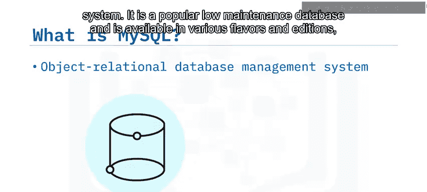

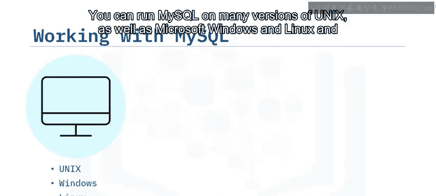

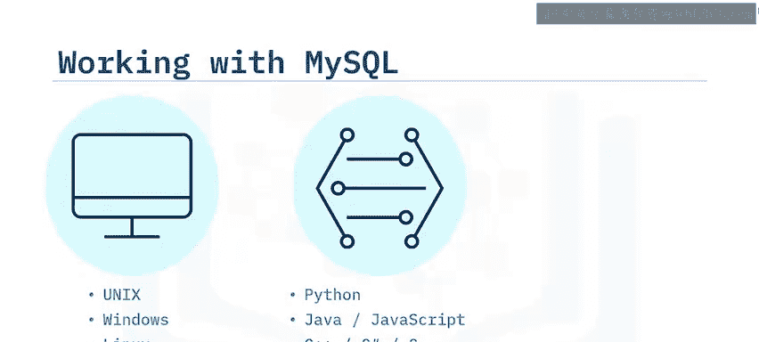

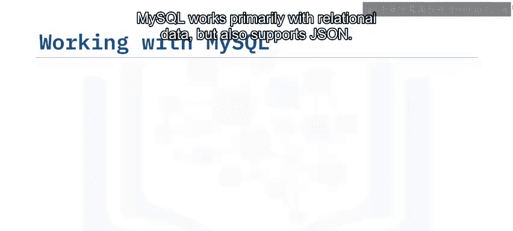

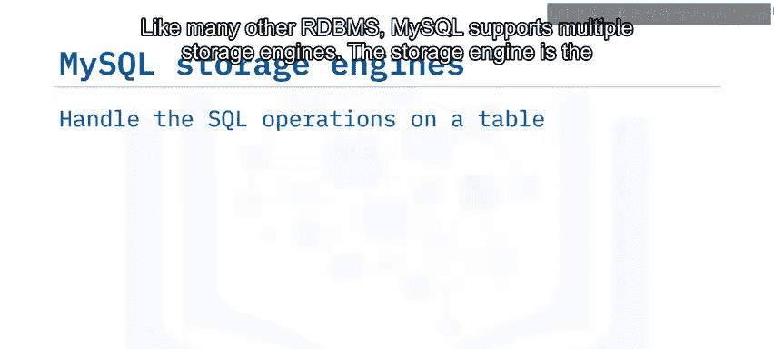

The storage engine is the component that handles the SQL operations on a table and defines what features that table can use。

 so you base your choice of engine for a particular table on the expected workload and needs of that table。

 For example， the default MySQL storage engine is in ODB which supports transactions to ensure the consistency of your data rowlel locking to improve multi-user performance。

 clustered indexes on primary keys to increase the performance of regularly executed queries and foreign key constraints to maintain data integrity This engine provides a balance of high performance and reliability。

 MysQL also supports the my ISM engine， which is good for workloads with mainly read operations and few updates such as data warehouse or web applications It uses tableleve locking which inhibits performance in a readr environment。

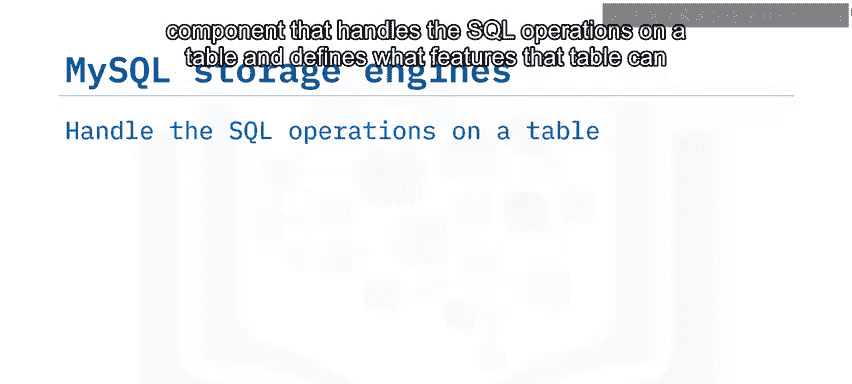

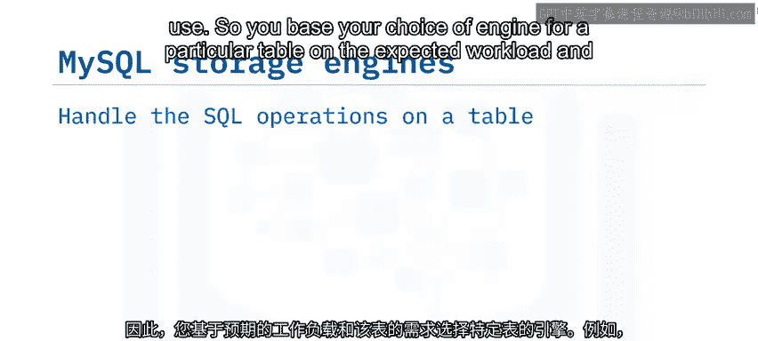

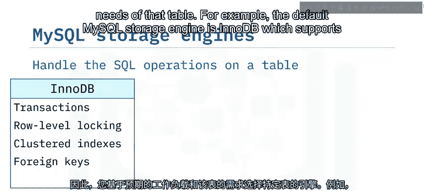

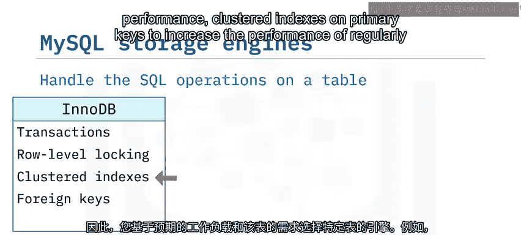

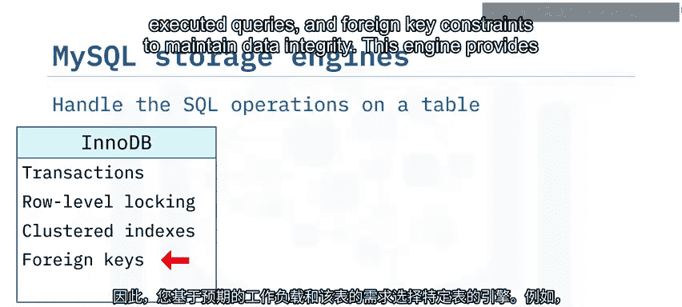

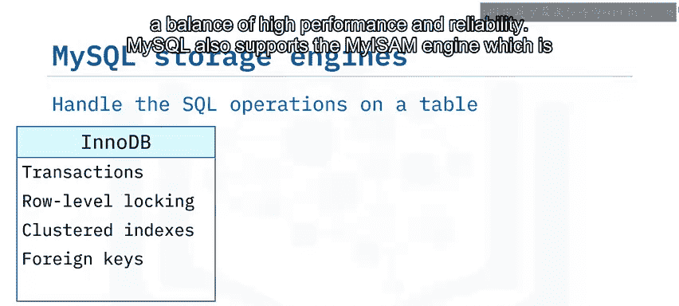

Another commonly used engine is the NDB engine， which supports multiple instances of my SQL servers running in a cluster This is primarily used for applications that require high levels of availability and redundancy。

MySQL supports high availability and scalability you can use replication to create a copy of your data on one or more replicas Data changes at the source database are then also performed at the replicas multiple copies of the same data means that you can share the read load for your data across the replica set improving scalability and replication also increases availability because if the source database fails。

 you can fail over to use one of the replicas instead。

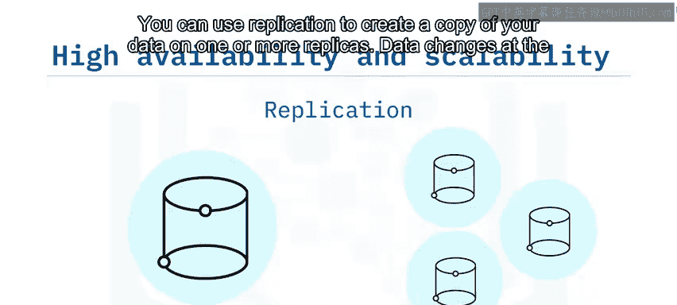

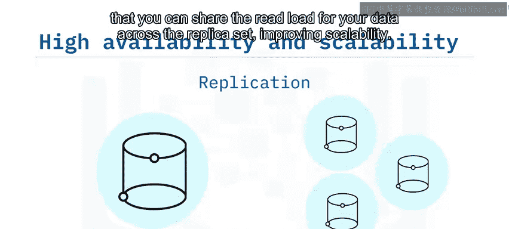

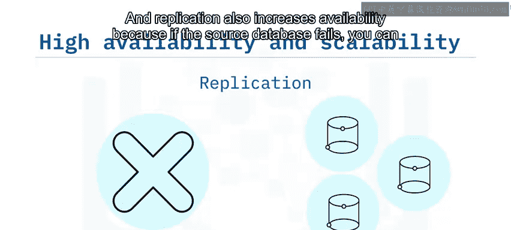

MySQL provides two clustering options The first uses the NODB storage engine with group replication and enables you to work with one ReadWrite primary server and multiple secondary servers you can then use mySQL router to loadbal client applications across the multiple server instances and in the event of unplanned downtime of any of the servers MySQL router will reconnect client applications to an available serverAlternatively。

 the MySQL cluster edition uses the NDB storage engine to provide a highly available and scalable solution multiple MySQL server nodes access a set of data nodes。

 usually stored in memory， running multiple data notess provides redundancy and hence increased availability in the event of failure and running multiple server nodes provides for scalability。

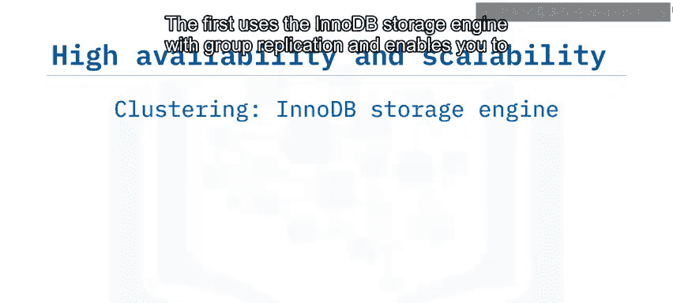

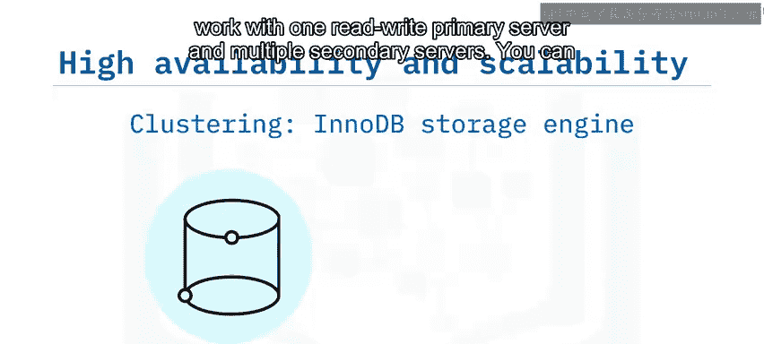

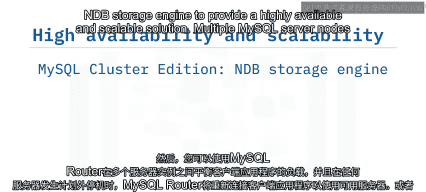

In this video， you learned that MySQL is an object relational database available in various editions。

 supports many operating systems， supports a range of languages for client application development。

 supports relational and JSO data， provides multiple storage engines for differing workloads。

 and provides high availability and scalability options。

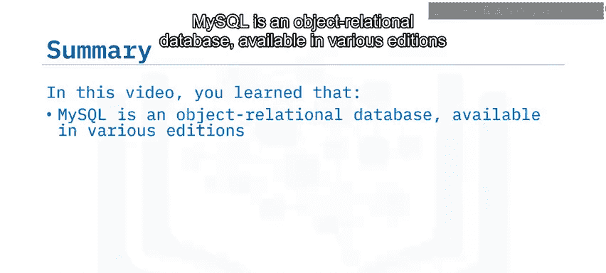

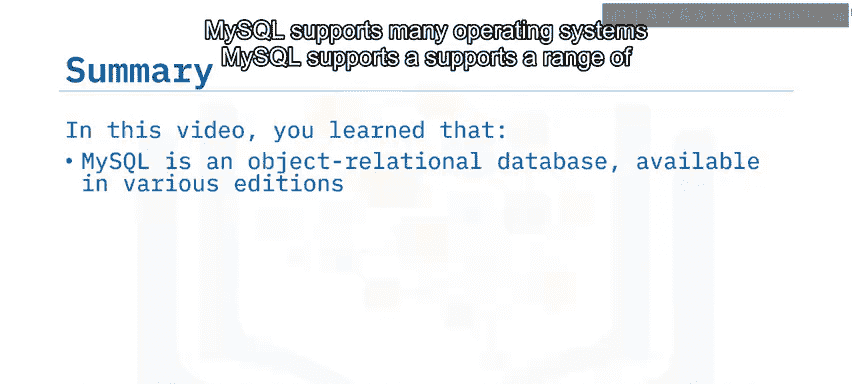

