# IBM数据工程专业证书课程4：《关系数据库导论（RDBMS）》｜introduction-to-relational-databases｜ - P13：12_postgresql.zh_en - GPT中英字幕课程资源 - BV1Mj4116716

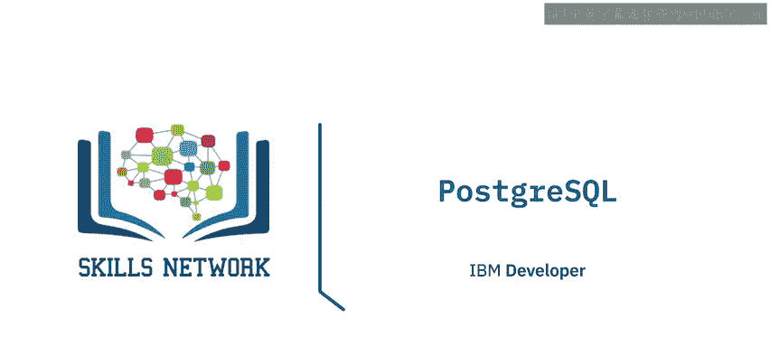

Welcome to PostgressQL After watching this video， you will be able to describe a PostgresqL。

 explain how you can work with PostgresqL， and describe a replication functionality in PostgresQL。

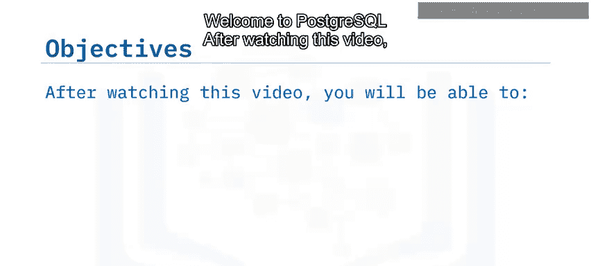

PostgresqL originates from the Postgres project at the University of California more than 30 years ago。

 Postgress was used for many research and production applications across a range of industries。

 including financial services， aviation and medicine in 1994。

 the open source Postgres 95 was released， which included an SQL language interpreter。

 This was soon renamed Postgresql， and is to date generally pronounced as simply Postgres。

 You can use it as part of the LAP Linux Apache Postgresql and PP stack for web applications and websites。

 and you can also use independently developed extensions for additional functionality。

 such as post Gs for geographic and spatial data handling。

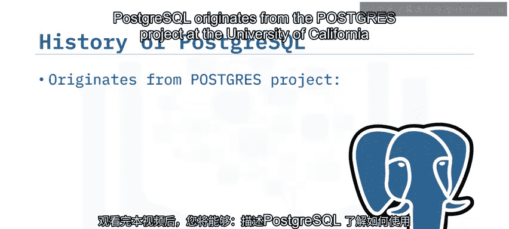

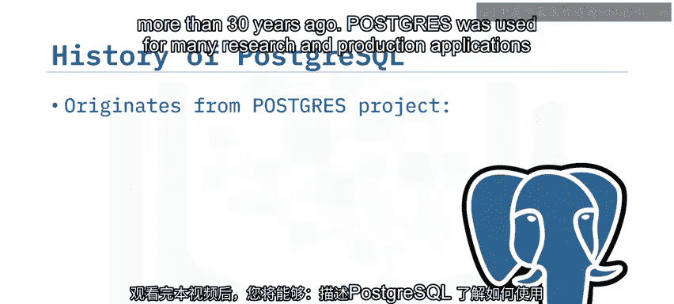

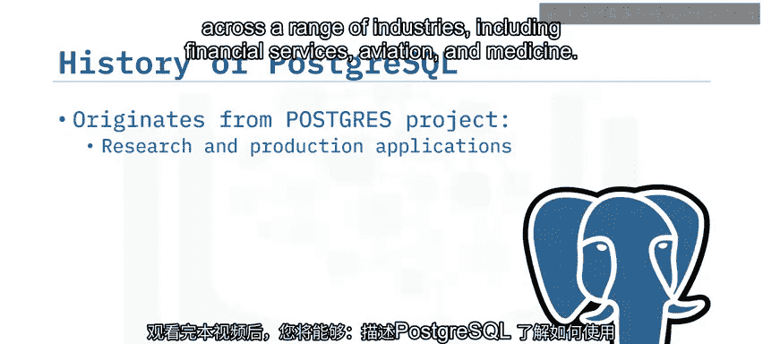

PostgresqL is a free open source object relational database management system。

 The open source part means that you can use， modify and distribute the Postgres source code to meet your business requirements。

 The object part describes that， like object oriented programming languages。

 It supports inheritance and overloading。 You can use these techniques to simplify your design and reuse database objects。

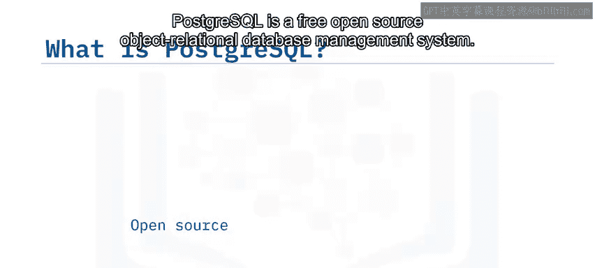

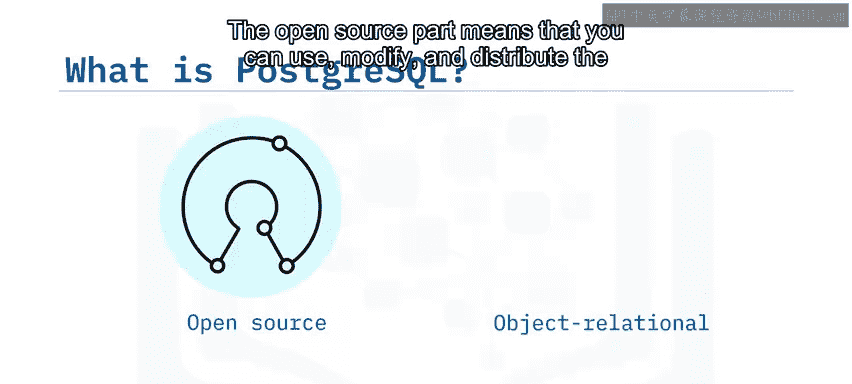

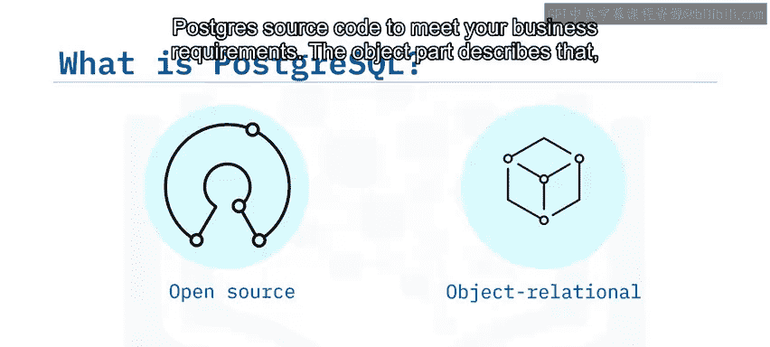

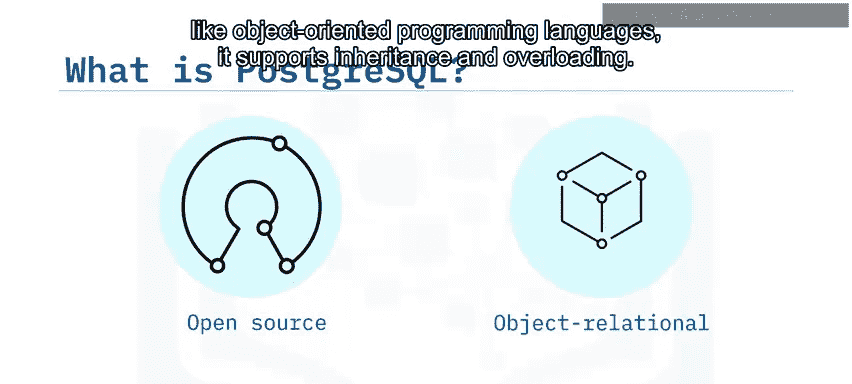

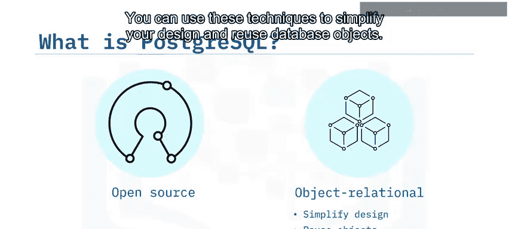

Postgres is compatible with most of today's commonly used operating systems。

 and its low maintenance threshold make it easy to implement in an organization。

 it supports many programming languages， enabling you to integrate it with your web applications and supports anSI SQL standards。

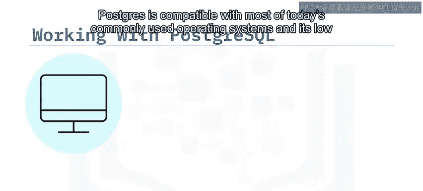

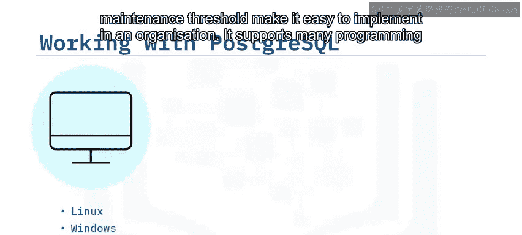

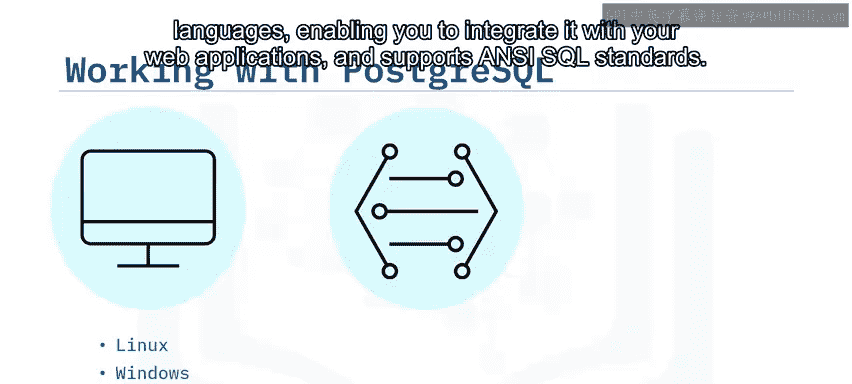

When using Postgres， you can use all the standard relational database constructs， such as keys。

 transactions， views， functions， and stored procedures。

 and you can also use some of the no SQL functionality such as JSON for structureucd data and H store for nonhierarchical data。

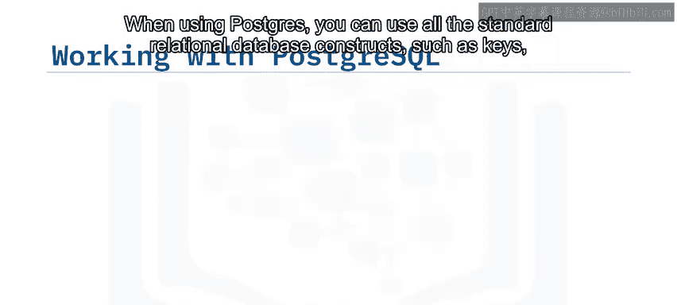

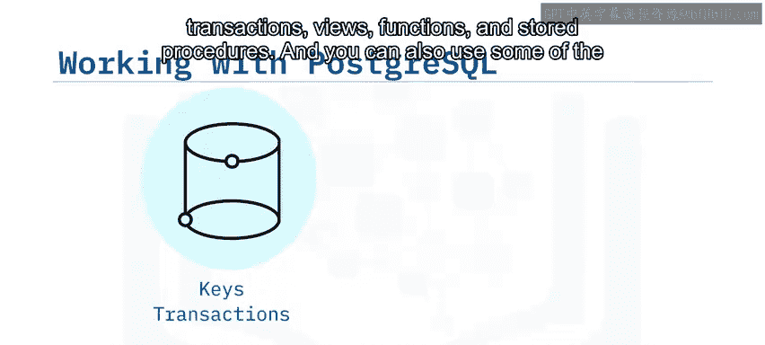

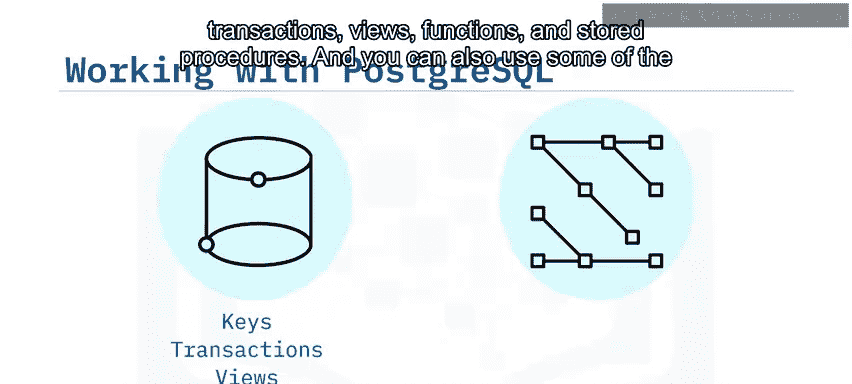

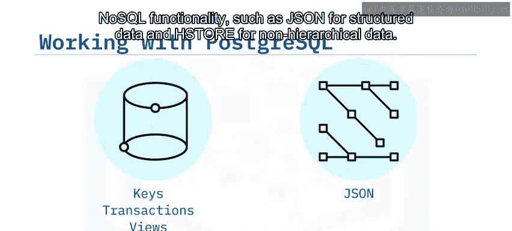

Postgres supports replication for high availability。 It supports two node synchronous replication。

 This stores a copy of your data on a second server and applies each change you make to node1 at node2。

 you can then share read loads across the two servers。 And if node one fails。

 you can enable node 2 to service all clients until node1 is running again。

 It also supports multinode asynchronous replication for high availability and scalability。 here。

 one master node distributes its changes to multiple read only replicas for scalability purposes。

 And again， if the read， write node fails， you can quickly replace it with one of the read only replicas。

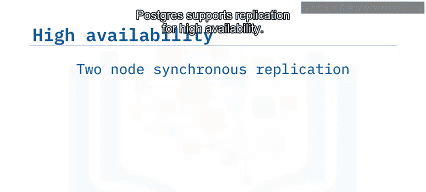

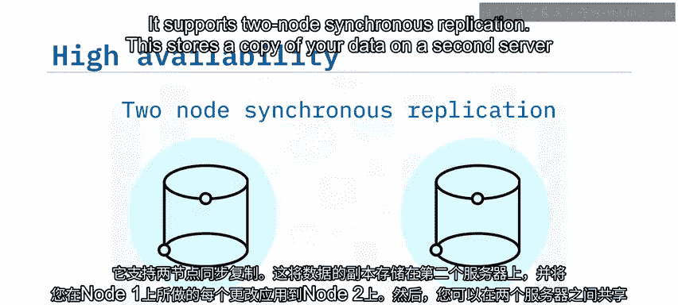

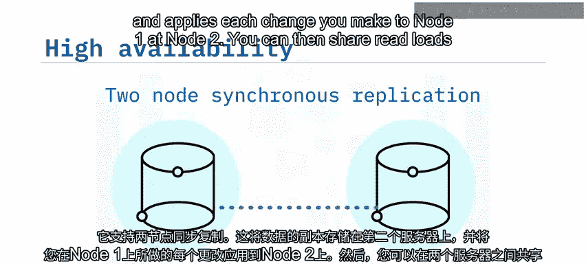

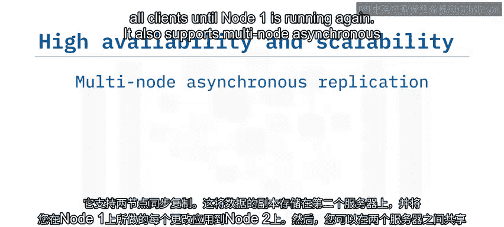

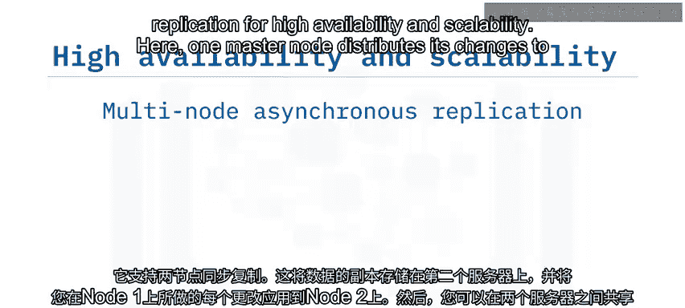

For even greater flexibility for scaling applications。

 you can use commercial editions such as EB PostgresqL replication server。

 which provide multimaster readrite replication。 This enables you to run multiple read writerite databases that all replicate changes with each other。

 If one fails， users can easily be redirected to another instance until it is available again。

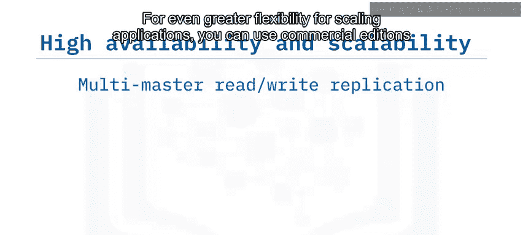

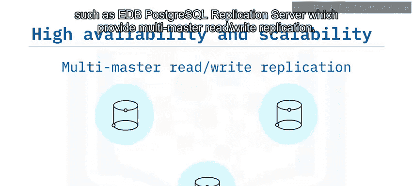

Other technologies that have been added to PostgresQL in recent releases to enhance scalability and working with larger data sets include partitioning。

 which enables you to split a large table into multiple smaller sections。

 or partitions to improve query performance， and sharding。

 which enables you to store horizontal partitions across multiple remote servers。

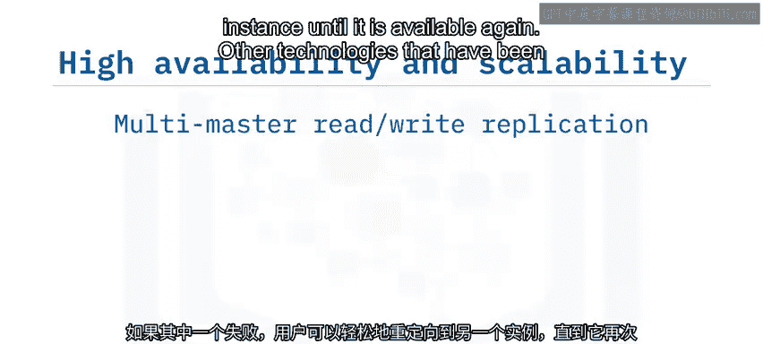

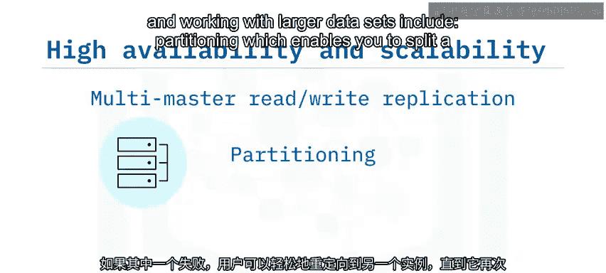

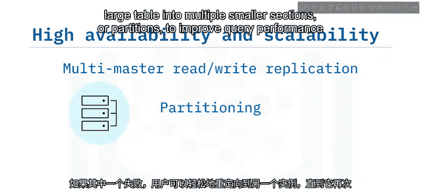

In this video you learned that PostgresQL is an open source object relational database。

 it supports a range of languages for client application development， it supports relational。

 structured and nonstructured data， and it supports replication and partitioning for high availability and scalability。

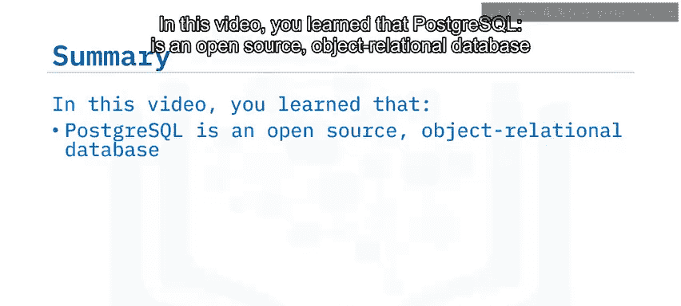