# IBM数据工程专业证书课程4：《关系数据库导论（RDBMS）》｜introduction-to-relational-databases｜ - P15：14_创建表.zh_en - GPT中英字幕课程资源 - BV1Mj4116716

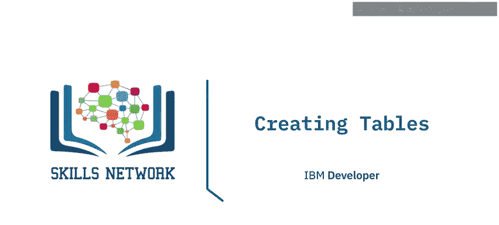

Welcome to C Ts After watching this video， you will be able to list considerations for creating tables。

 describe how to create a table in a graphical interface like DB2 on cloud。

 and explain how to alter table structure after creation。

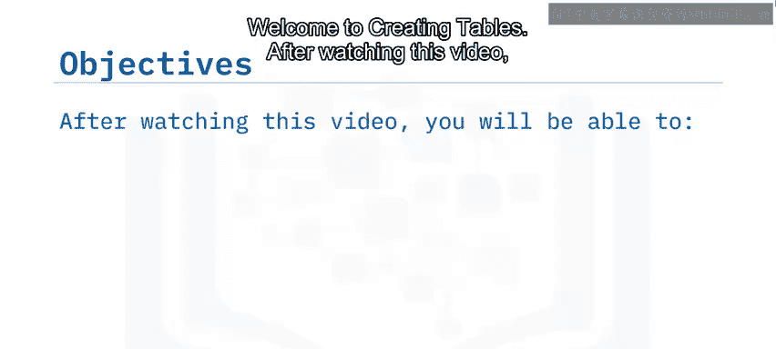

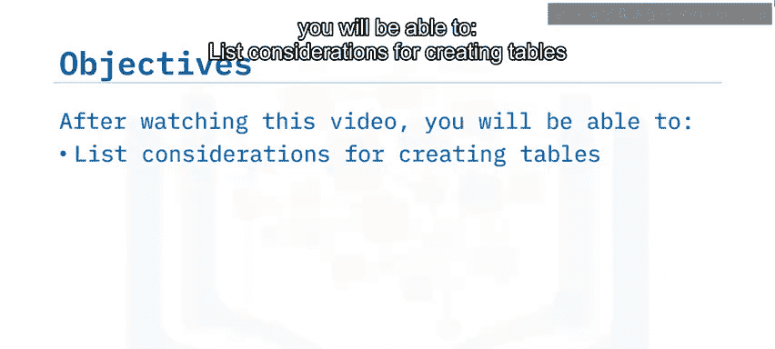

When creating a table， you will need some information at hand First。

 where will you create the table Many relational databases have schemas which provide a way of organizing database objects into logical groups。

 for example， in IBM DB2 on cloud， you will store tables， views。

 functions and other database objects in your own user schema Next。

 you must ensure you have all the information you need to create the table。

 including a name for the table and names and data types for each column you should also consider whether a column can contain duplicate values。

 or if a column will allow null values Use the entity relationship diagram you created as part of your database design to guide you。

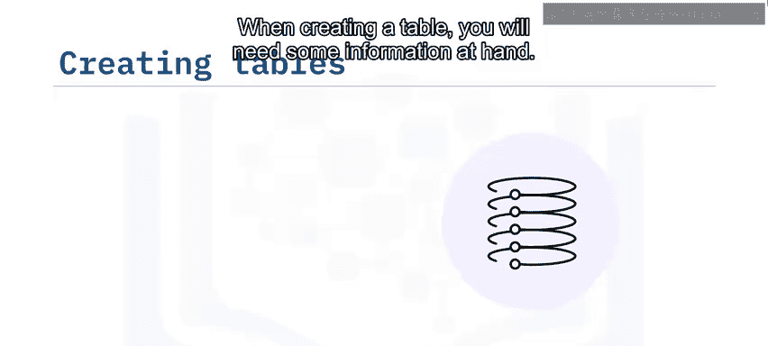

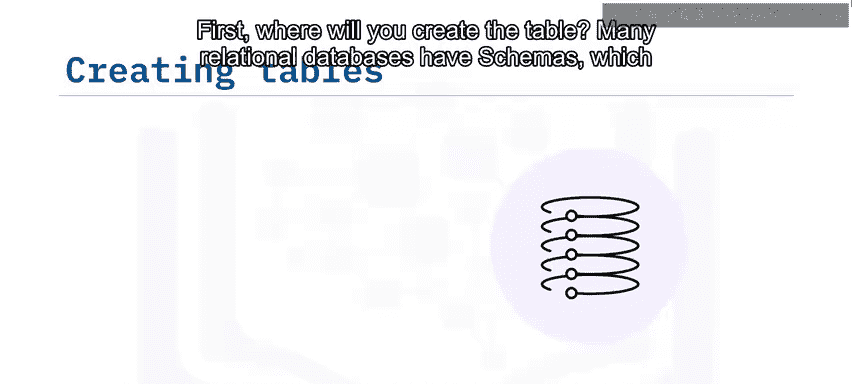

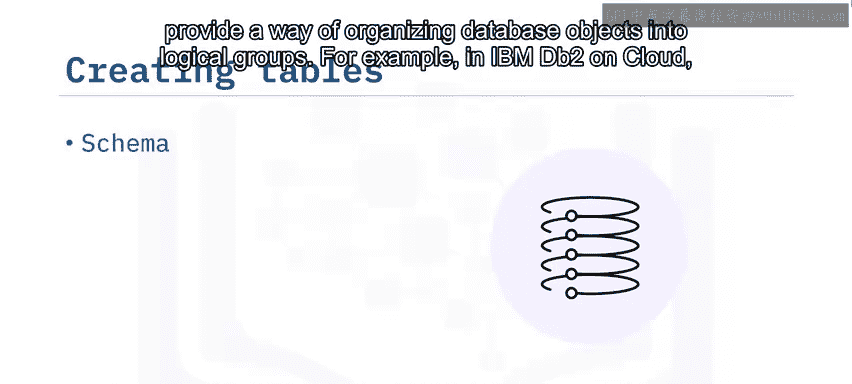

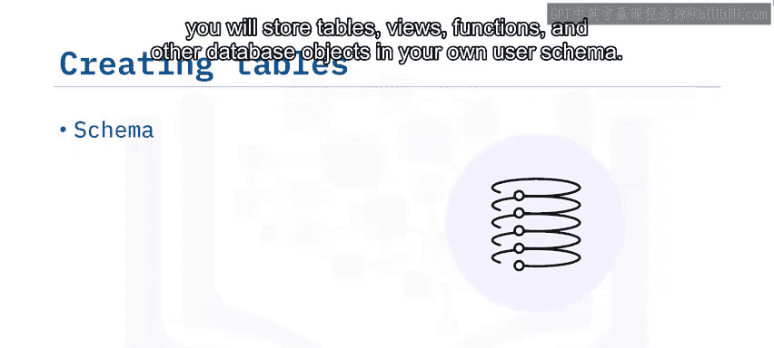

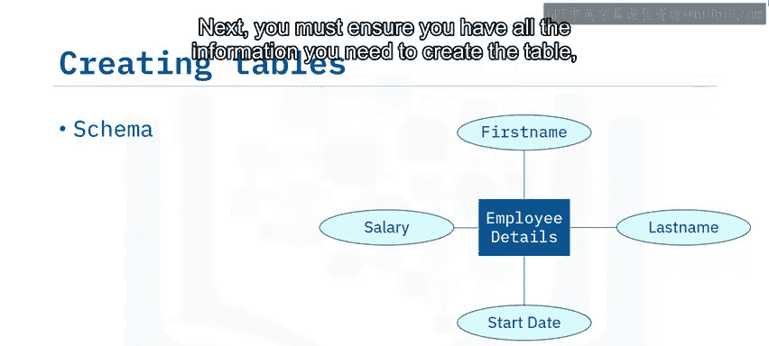

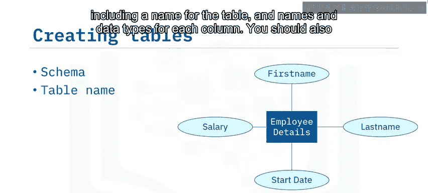

You can create tables in several different ways most databases have a visual or graphical interface that you can use to create and modify tables These are great for small occasional tasks but they don't scale well you can also create tables with the createate tableSQL statement which can be included in a script file to help you automate the creation process when you are creating multiple tables Finally。

 some databases have administrative APIs for creating and managing databases programmatically the illustrations provided in this video are based on DB2 on cloud console examples。

 similar concepts apply to other databases。

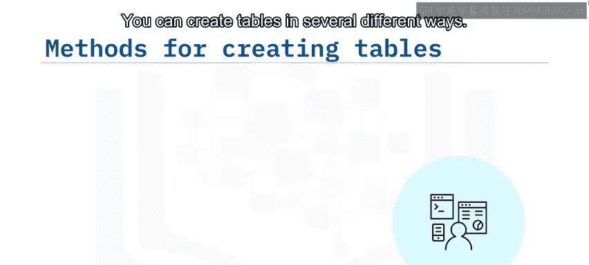

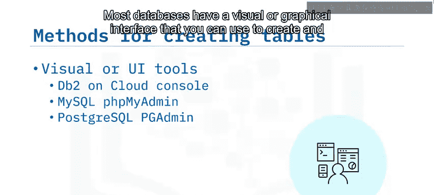

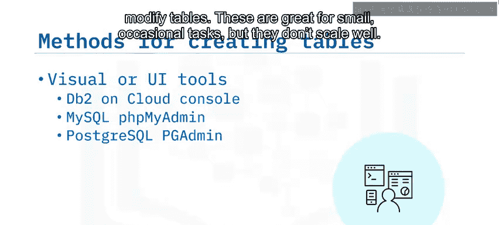

The first step in creating a table using the DB2 on cloud console is to choose a schema to hold the table。

 In this case， the user schema C QC 63405 is selected。

 in DB2 the default schema is the user name In this example you can see that the username is CQC 63405。

 Each user will have a different username So you will see a different username in your own DB2 database。

 You can create new schema to hold your tables， views and other database objects In this case。

 the user schema C QC 63405 is selected Select new table to create a new table Give your new table a name In this example。

 the table is named employee details。 because it exists within the CQC 63405 schema the fully qualified name for this table。

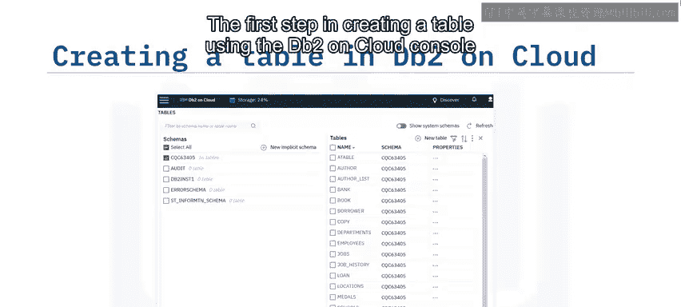

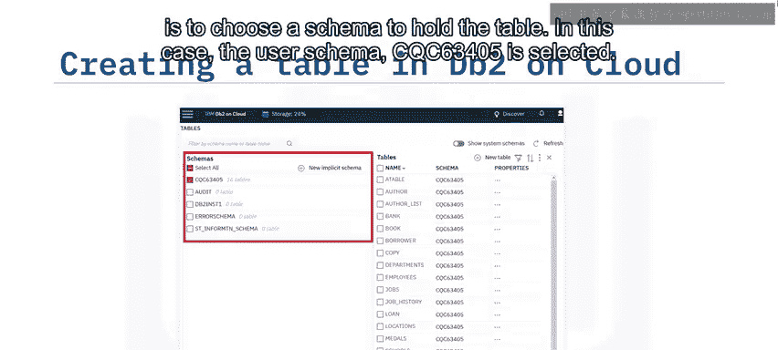

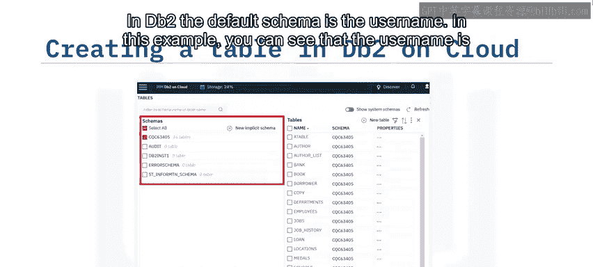

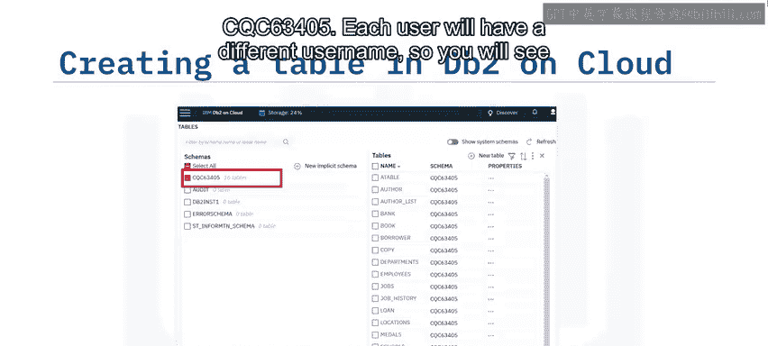

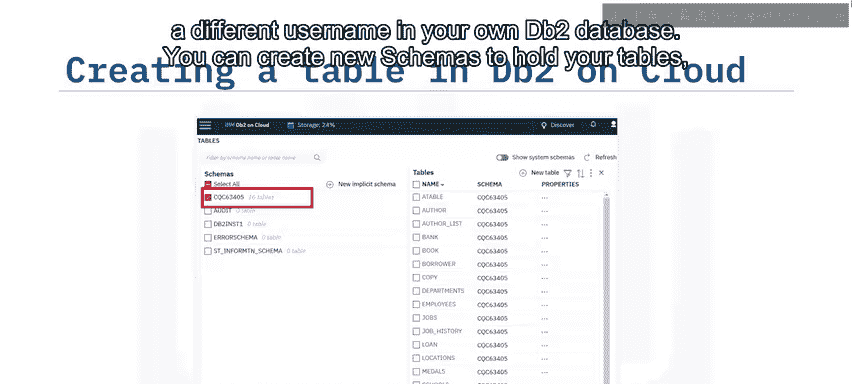

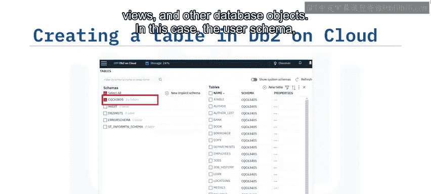

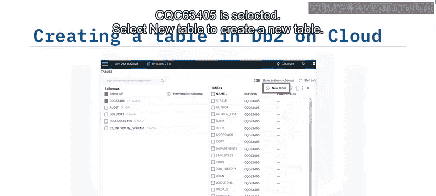

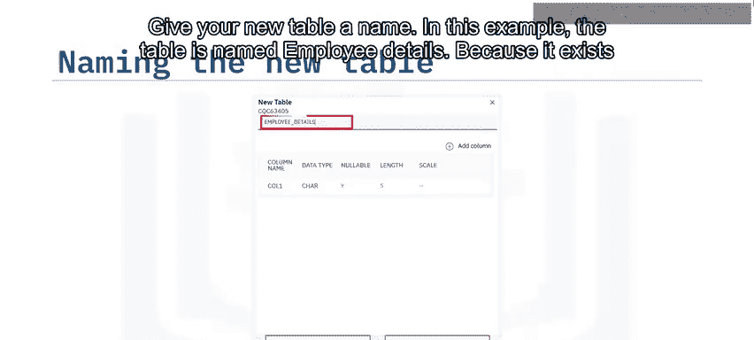

IsCQC63405。 employeeee details。

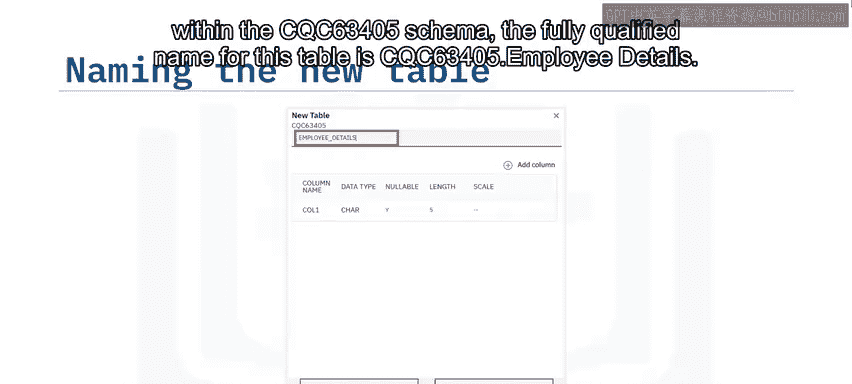

The new table has a single column by default， you can rename this column to fit your needs。

 set a data type for your column by selecting one from the list。

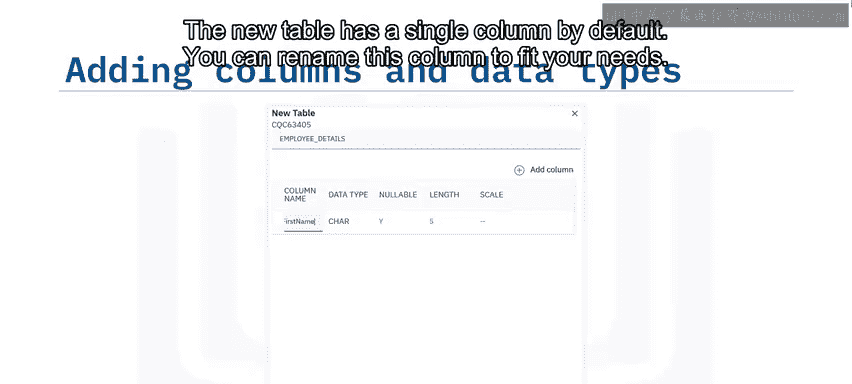

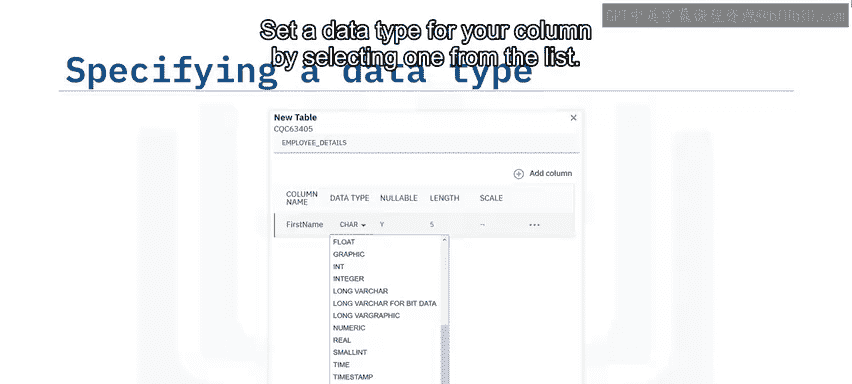

Use add column to continue to add columns until you have constructed the entire table。

 remember to specify the data type for each column。

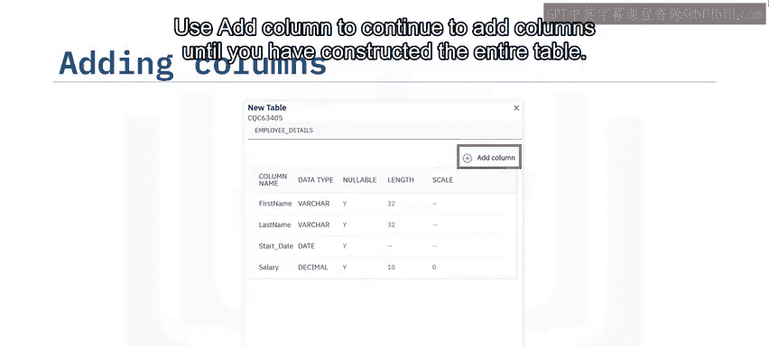

You can also specify whether the column accepts null values and specify length and scale depending on the data type。

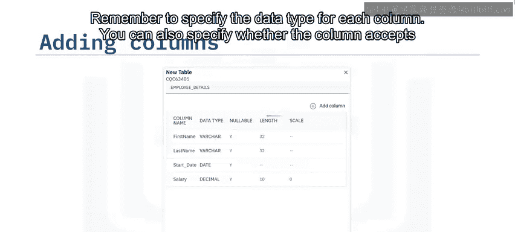

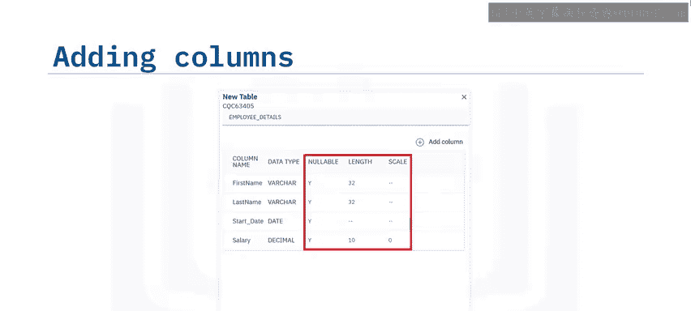

Lastly， click createreate There are many actions you can take once you have created the table。

 you can drop or delete the table。 you can generate SQL code to perform actions such as select。

 insert， update and delete。 You can alter the table to add a new column。

 set constraints or change the structure of the table in some other way。

 and you can see the database objects that the table depends on。

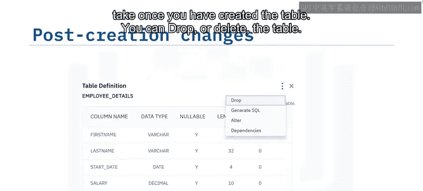

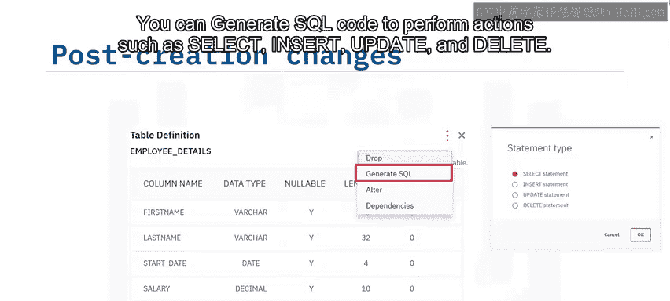

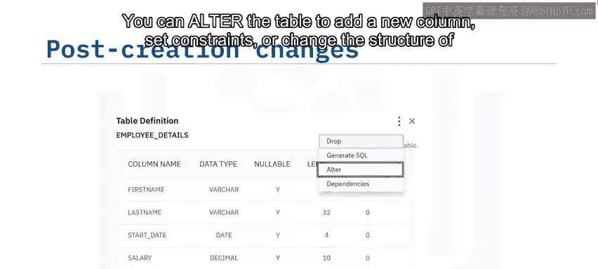

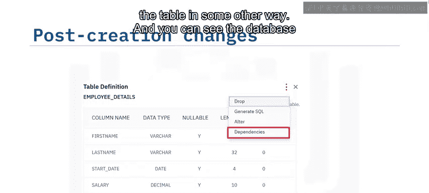

In this video you learned that many relational database management systems RDBMS have schemas which contain tables。

 views， functions and other database objects most RDBMS provide a GuUI which you can create tables through you can also use SQL statements to create tables。

And you can alter the structure of the table after it's created。 should you need to add a column。

 change a data type， or add a primary or foreign key。

