# IBM数据工程专业证书课程4：《关系数据库导论（RDBMS）》｜introduction-to-relational-databases｜ - P18：17_数据移动实用程序.zh_en - GPT中英字幕课程资源 - BV1Mj4116716

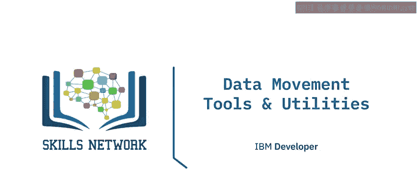

Welcome to data movement tools and utilities After watching this video。

 you will be able to indicate scenarios that necessitate data movement。

 list various tools and utilities used for data movement in relational databases。

 Ex the purpose of backup and restore utilities to move data into and out of a database。

 De import and export utilities and how they differ from backup and restore。

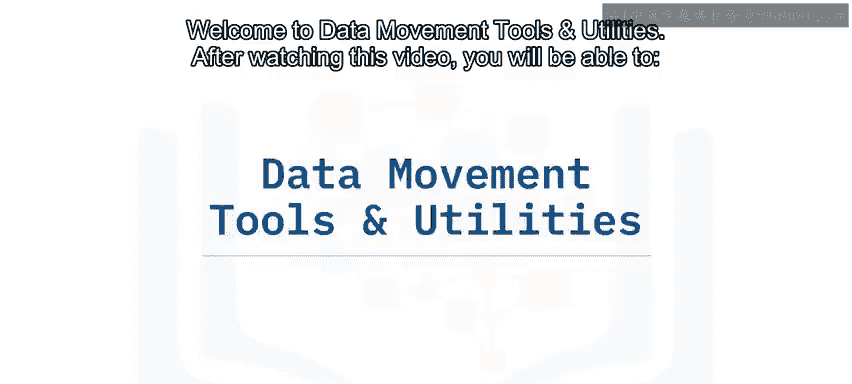

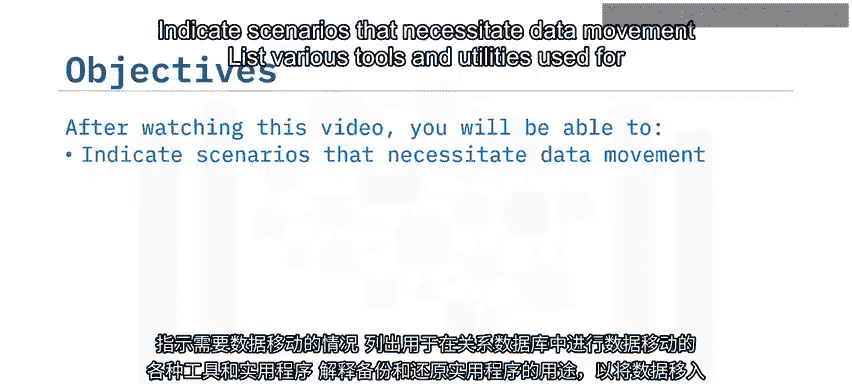

Recall how to export a table to a CSV file， explain the benefit of load utility and how it differs from import and indicate when to use which data movement tool or utility。

Data engineers and database administrators will often need to move data into and out of an existing database this could be for several reasons。

 such as initially populating the entire database and all objects with it， such as tables。

 creating a working copy of the database for development and testing purposes。

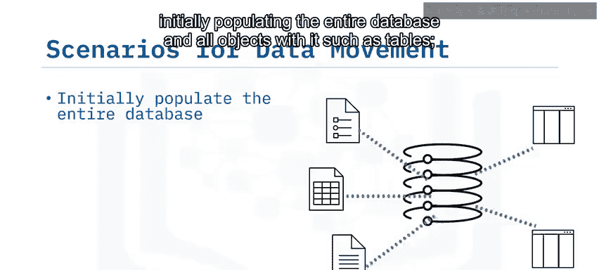

Creating a snapshot of the state of the database at a particular instance in time for the purposes of disaster recovery。

Creating a new table or a set of tables from data that has been extracted from external data sources or files and adding or appending data into one or more existing tables。

 most databases support many different ways to move data in and out of the database using multiple file formats。

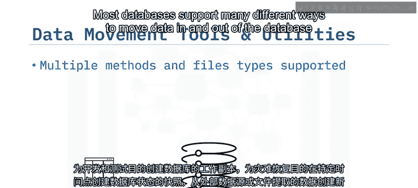

Each database has its own tools and utilities for data movement。

 but they can be broadly classified into three categories， backup and restore。

 import and export and load let us look at each of these。

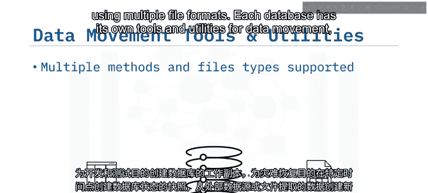

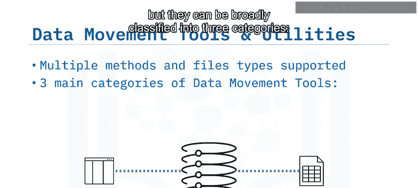

One method for moving data between databases is to perform a backup and restore The backup operation creates a file or a set of files that encapsulates all the database objects and their data the restore operation creates an exact copy of the original database from the backup files backup and restore operations preserve all objects in the database。

 including schemas， tables， views， user definedfined data types， functions， stored procedures。

 table constraints， triggers， security settings， relationship between objects。

 and of course the data in all tables。

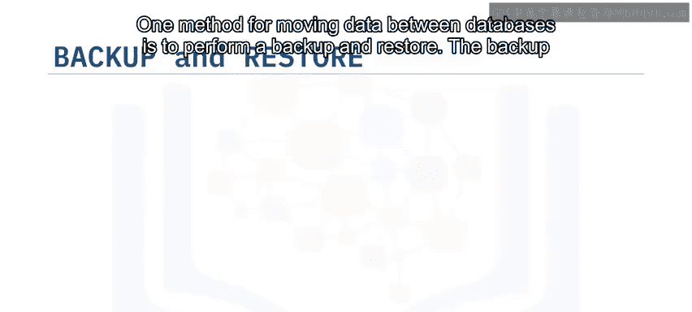

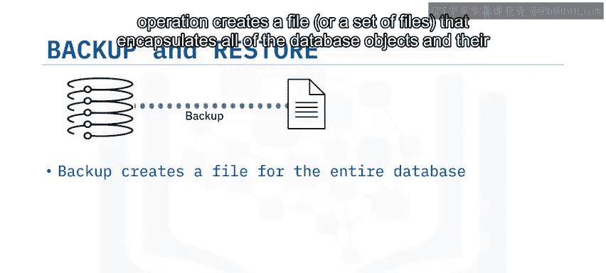

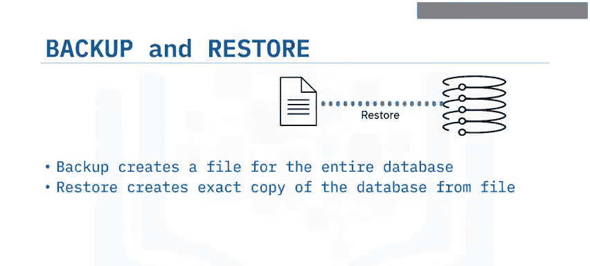

Backups are often taken on a periodic basis to preserve copies of a production database for disaster recovery purposes backup and restorestore operations can also be performed for creating additional copies of the database for development and test purposes。

The import operation reads data from a file and performs a series of insert statements against the target table。

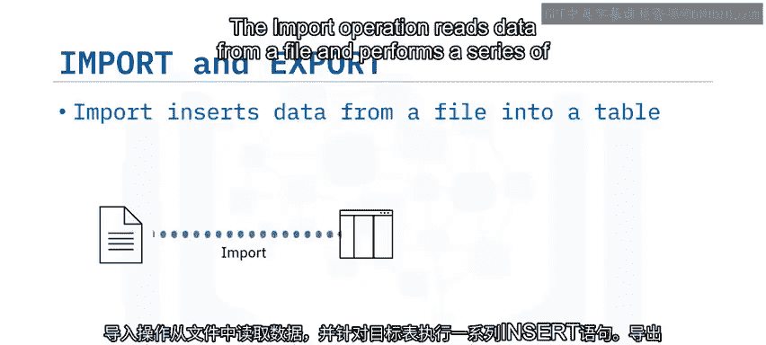

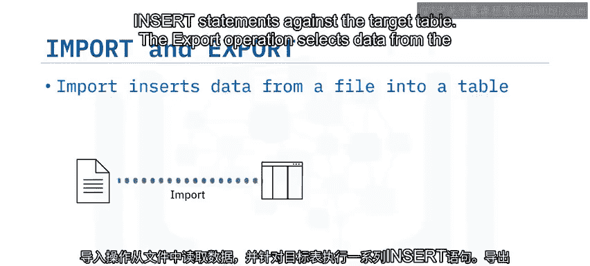

The export operation selects data from the specified table and saves it into a target file。

 depending on the database， import and export operations can be performed using multiple interfaces。

 Most databases provide at least a command line utility management As for some databases include support for import and export。

 In some cases， the graphical or web administration tools include a visual interface for these operations。

 and there is also thirdpart tools that allow these operations to be performed with many different DBMSss。

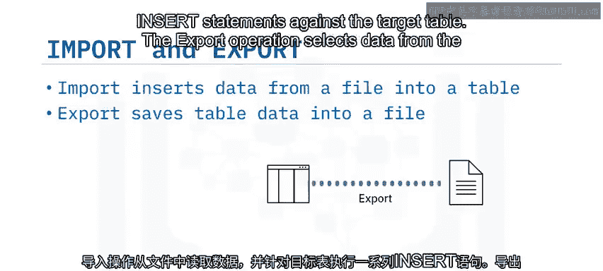

Most databases support multiple file formats for importing and exporting data。

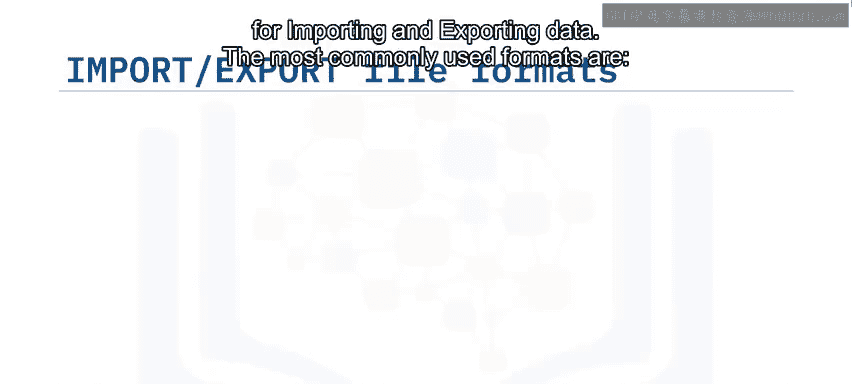

The most commonly used formats are D， EL or delimited ASII2 for data exchange among a wide variety of database managers and file managers。

 This common approach to storing data uses special character delimiters to separate column values。

 a wellknown example is comma separated variable or CSV files。

 ASC or nondlimited ASII2 for importing or loading data from other applications that create flat text files with aligned column data PC IXF PC version of the integration exchange format or IXF。

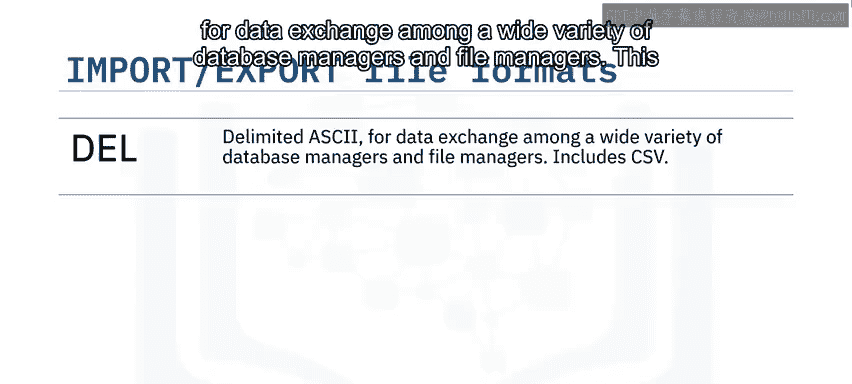

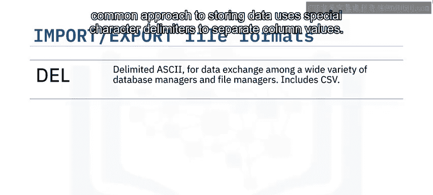

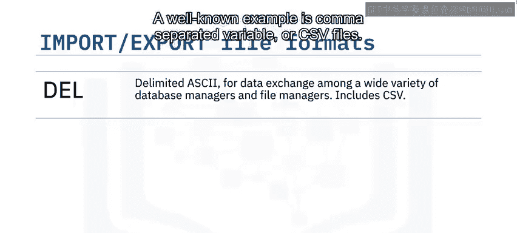

PCIXF is a structured description of a database table that contains an external representation of the internal table。

Jason with the popularity of Jasonson and RE web services。

 some databases and thirdpart tools have also started to support importing and exporting data to and from J files Let's look at some examples of performing import and export operations from different interfaces in DB2 the command line import and export utilities allow you to type the file names file formats。

 table names and optionally message files for importing and exporting data Note that the export utility in DB2 allows you to specify an SQL query allowing you to export just a subset of the data in a specified table if needed as an example of a simple export。

 let's look at how to export a table to a CSV file in the DB2 console in your schema。

 select the table you want to export select the table and then click view。

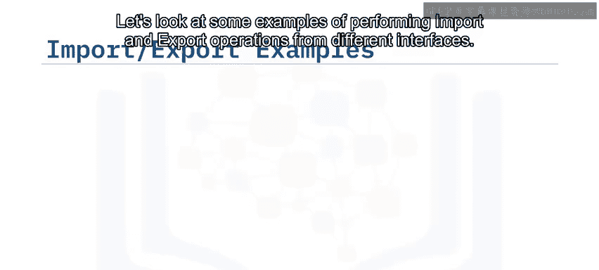

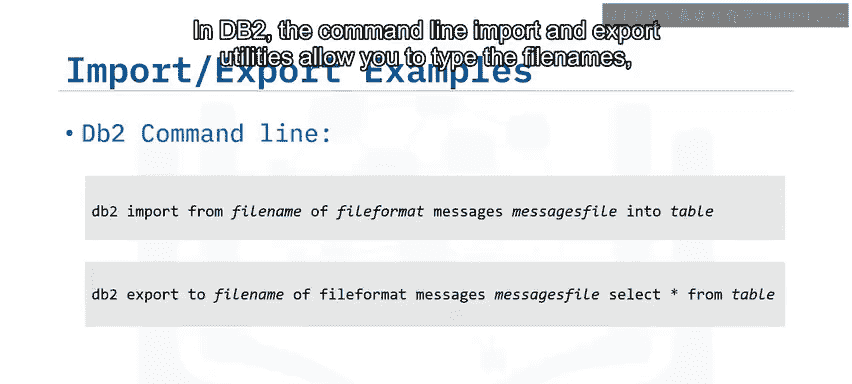

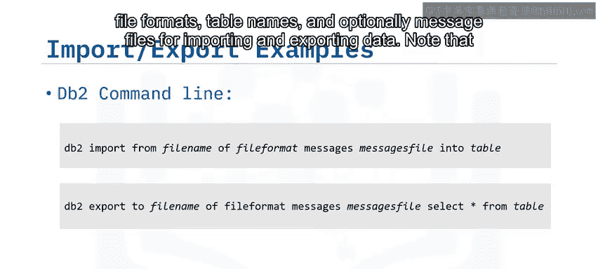

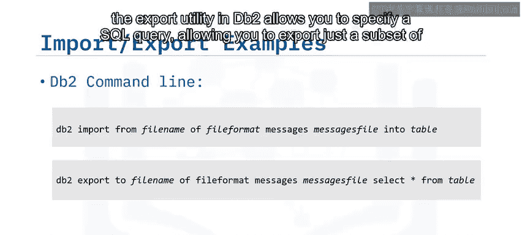

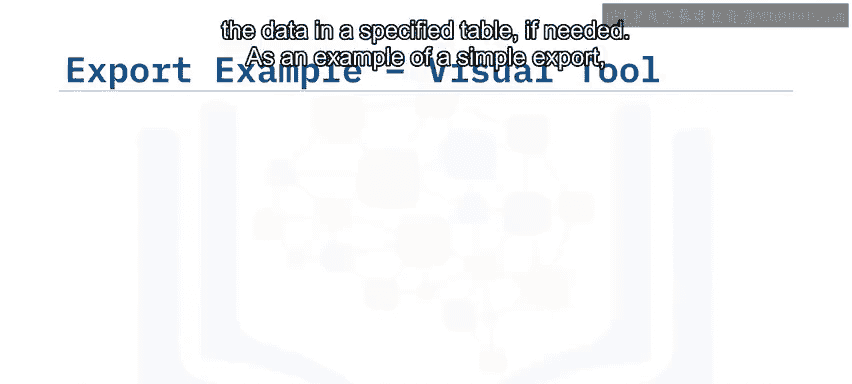

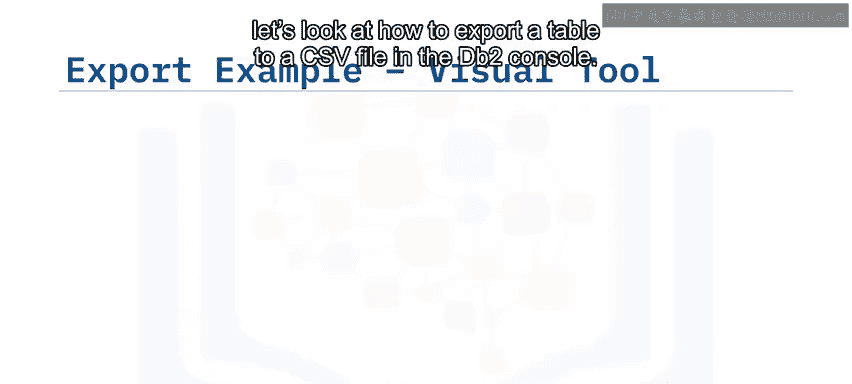

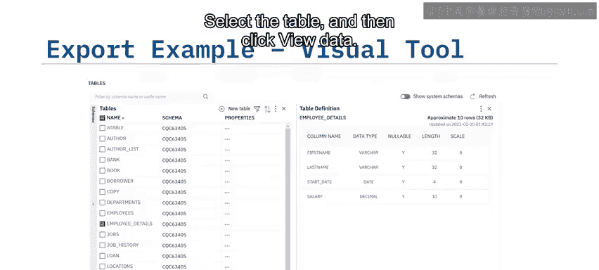

Data select the export button， click export to CSV。

 You can specify a name and location to save the CSV file as an alternative to the import utility。

 some databases provide load utilities the load utility is faster than the import utility because it writes formatted pages directly into the database while the import utility performs a series of SQl insert statements。

 However， it does not perform referential or table constraintss checking。

 so you may prefer to use the import utility if you need those extra checks the load utilities may also bypass database logging which also helps with higher performance while import may work well for smaller tables when it comes to very large volumes of data the load utilities are preferred you can activate the DB2 import utility from the command line or by calling its API through an application。

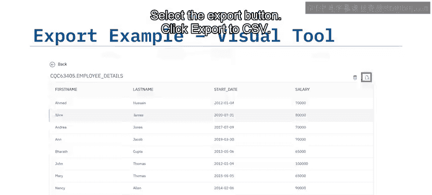

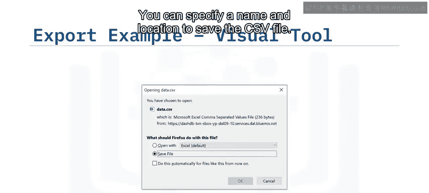

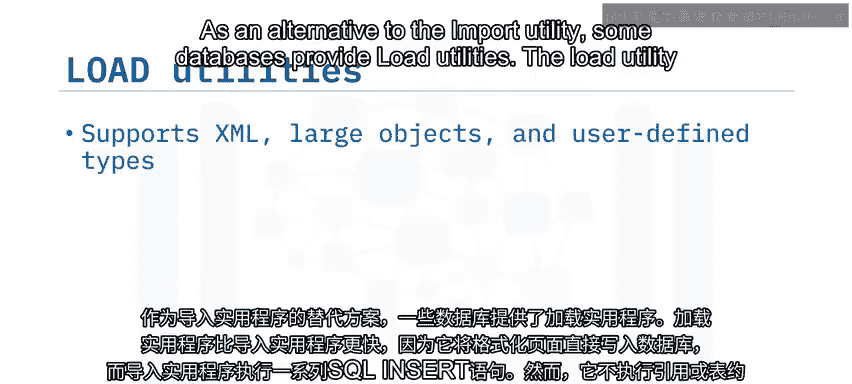

even using visual database management tools In this video。

 you learned that data movement is required for initially populating databases and tables。

 adding or appending data， and making copies for development tests or disaster recovery Back and restore utilities are used to create and recover copies of entire databases including all objects like tables。

 views， constraints and their data， I utility enables inserting data into a specific table from different formats such as DEL。

 CSV， ASI and IXF Export utility enables saving data from a specific table into various formats like CSV and load utilities enable high performance insertion of data into specified tables and is useful for large volumes。

