# IBM数据工程专业证书课程4：《关系数据库导论（RDBMS）》｜introduction-to-relational-databases｜ - P19：18_加载数据.zh_en - GPT中英字幕课程资源 - BV1Mj4116716

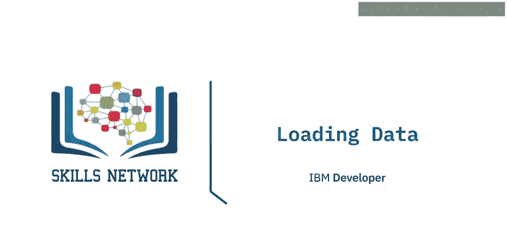

Welcome to loading data After watching this video， you will be able to explain when to use load data functionality list the types of data source you can load data from and describe the four steps in the load data process in the DB2 web console using SQL statements such as insert to add data into tables can work well for a few rows。

 or when you are developing and testing your database systems。 However。

 it is often not practical to use this method to load hundreds or thousands of rows of data The process of inputting the data for each row and then uploading it to the database is not very efficient。

 Instead， most relational database management systems or RDBMS。

 provide a method of directly loading large amounts of data into tables in a quick efficient and scalable manner。

 your data might originate from a range of different sources in a variety of formats。 For example。

 you might want to populate your table with。

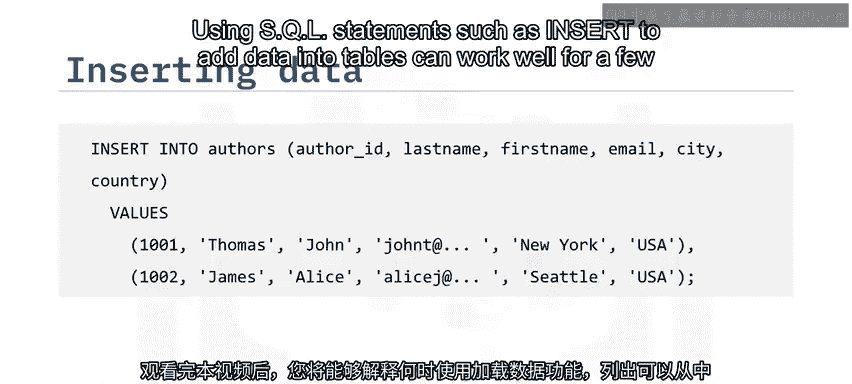

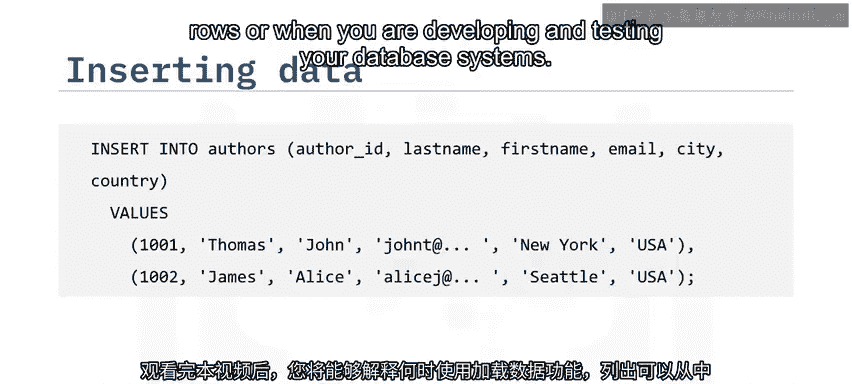

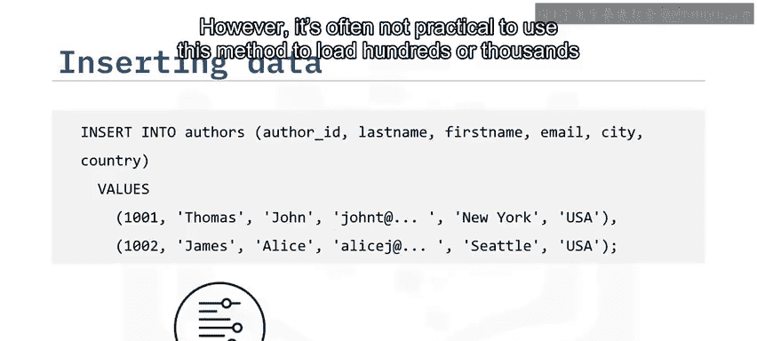

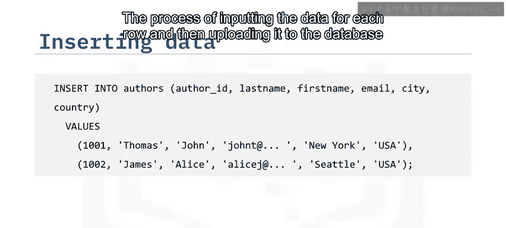

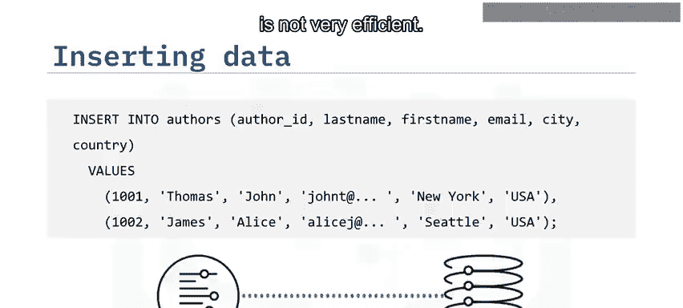

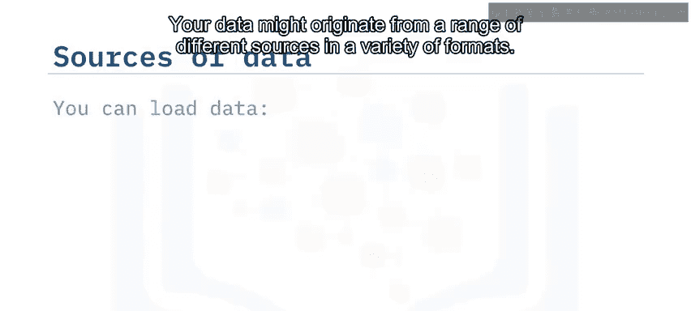

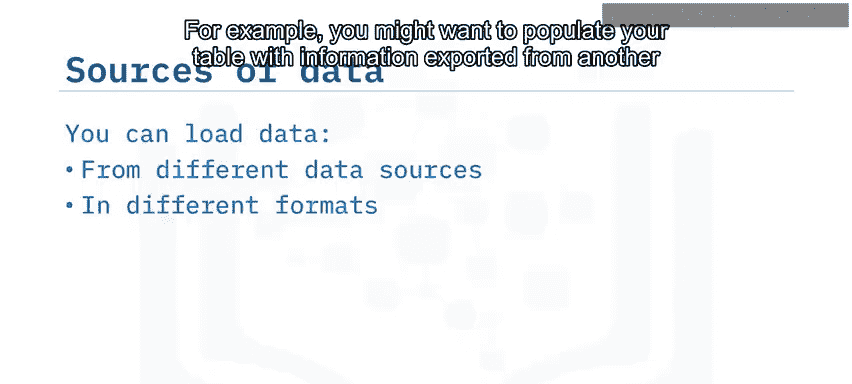

Information exported from another database into limited text files or object data output from a bespoke application in the DB2 web console。

 you can use the load data utility to load data stored intolim text files on your local computer in S3 objectject storage that is the storage service from Amazon web services or in cloud objectject storage that is the cloud storage service from IBM So let us take a look at an example of how to load data into a table from a CSv file using the DB2 web console to begin loading data in the web console。

 open the threebar menu and in the load section， click load data You then follow a series of four steps to define how to load your source data into your target tables first identify the type and location of your source data then select the target for the data Next define any configurable aspects of the data。

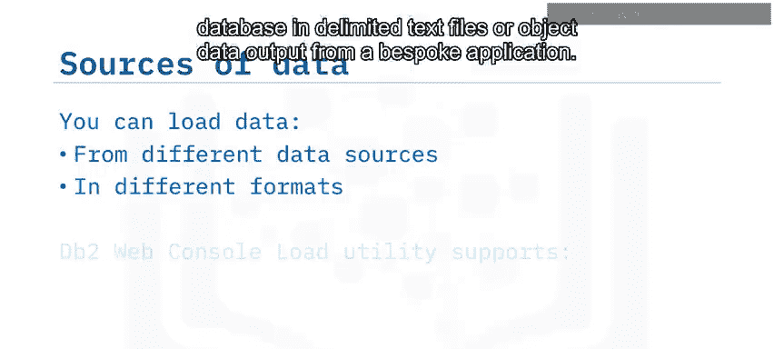

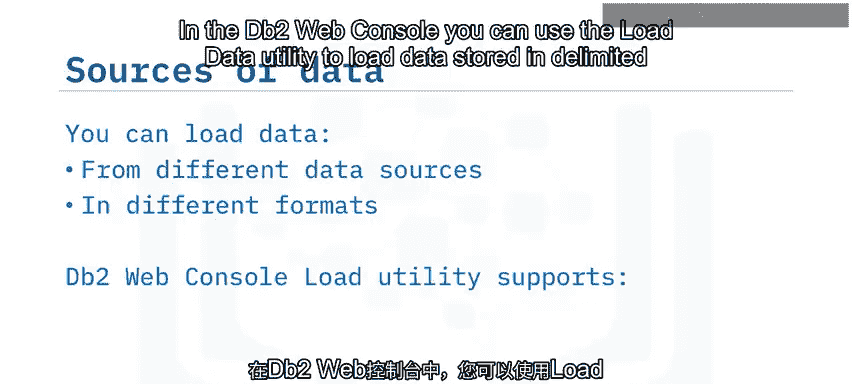

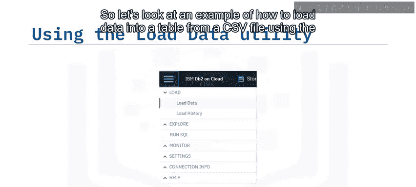

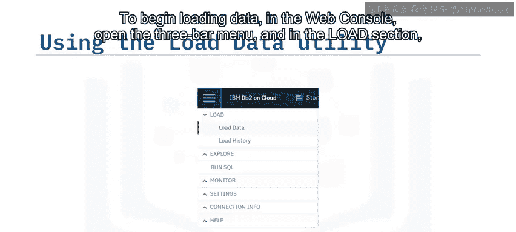

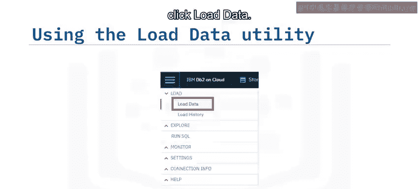

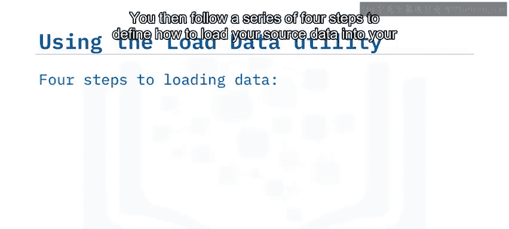

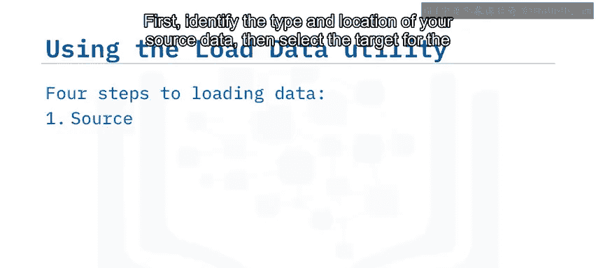

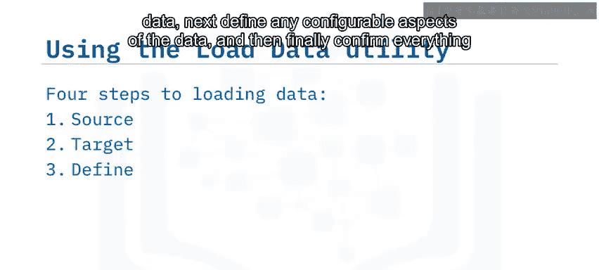

Then finally confirm everything before starting the load process。

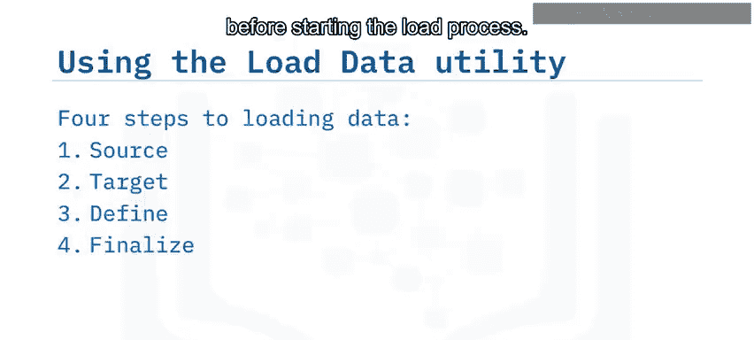

On the source page， select the location of the existing data and enter any authentication information which that storage type requires。

 For example， for data in IBM Cloud objectject storage。

 you provide the CO authentication endpoint access key and secret access key whereas for a locally stored Cv file。

 you simply identify the file to upload on the target page。

 select the target schema and table for the data location you can also specify here whether to append the new data to the end of the table or overwrite the existing data with the new data note that if you use the overwrite option even if your load fails you will still lose all of the existing data in that tableAlternativelyly you can click new table to load the data into an entirely new table using the format of the new data to define the data types for the columns On the defined page。

 you define the character encoding and。

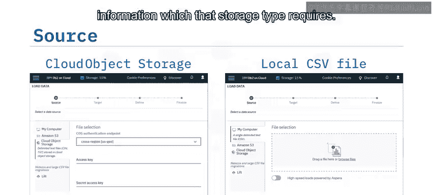

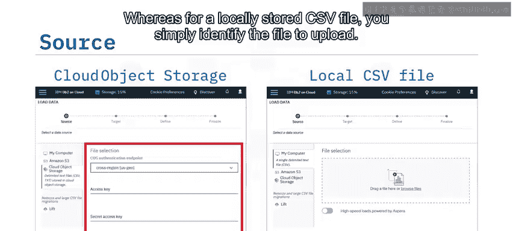

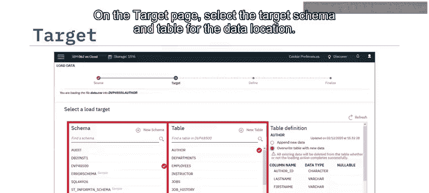

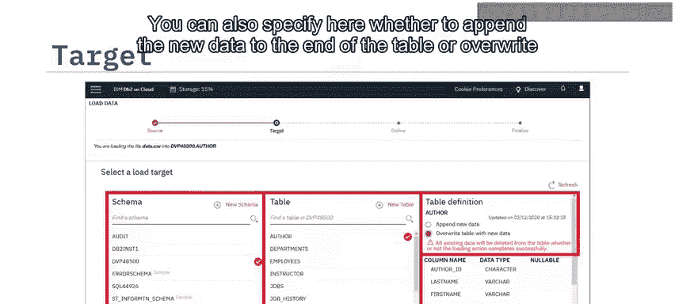

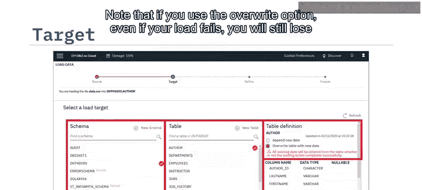

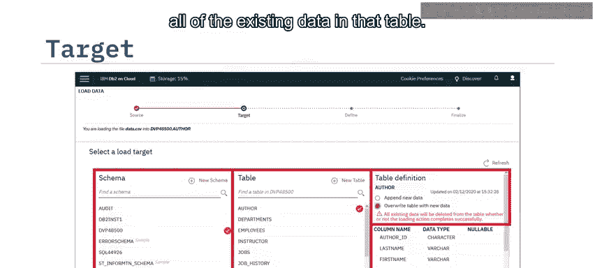

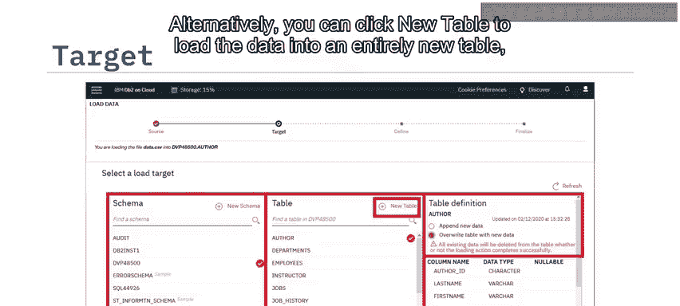

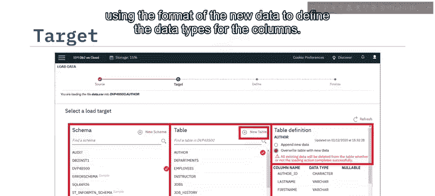

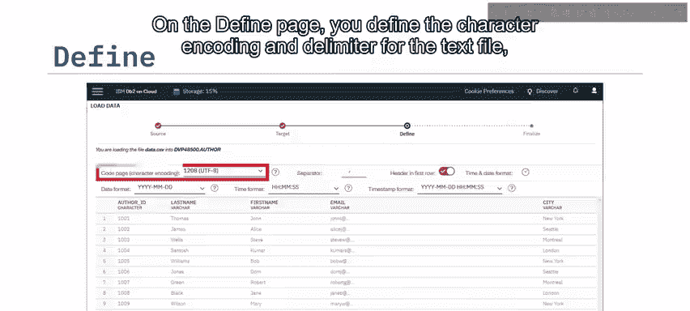

Liitter for the text file， whether there are column headings in the first row and what time and date formats to use and on the finalized page。

 you can review all of the settings before beginning to load the data When the load completes。

 the console displays the status of the process and also shows any errors or warnings that the load process has raised。

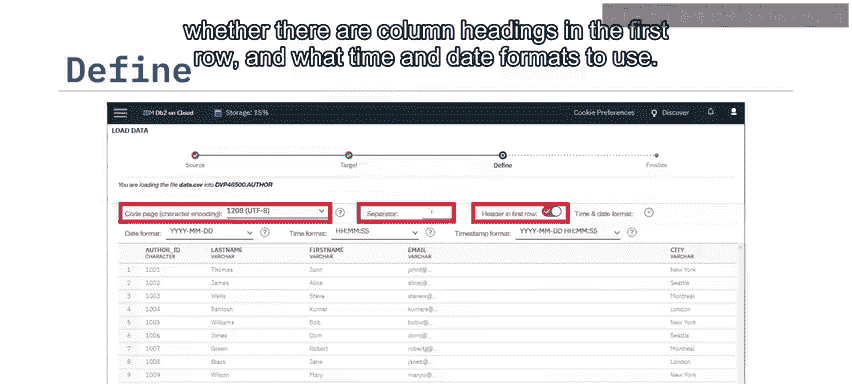

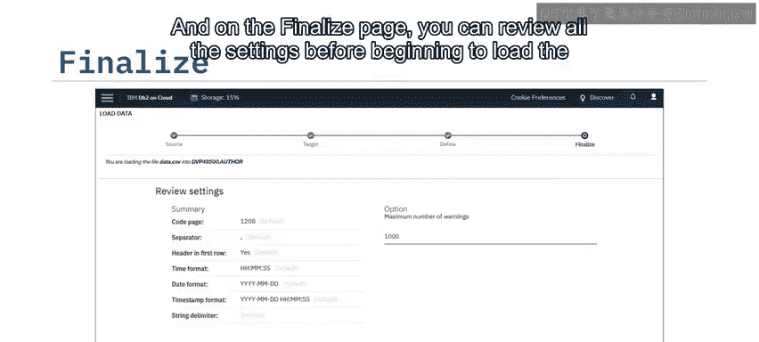

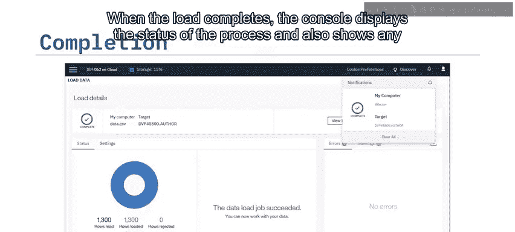

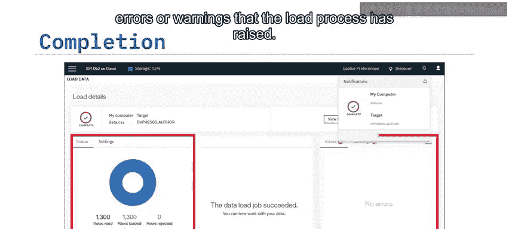

In this video you learned that loading data is quicker。

 more efficient and more scalable than using multiple insert statements。

 you can load data from a variety of data sources， including delimited text files and cloud object storage。

 and the load data utility is a simple to use interface in the DB2 web console。

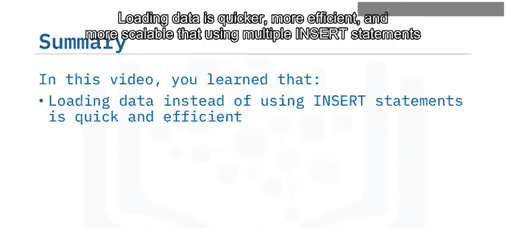