# IBM数据工程专业证书课程4：《关系数据库导论（RDBMS）》｜introduction-to-relational-databases｜ - P21：20_主键和外键.zh_en - GPT中英字幕课程资源 - BV1Mj4116716

Welcome to primary keys and foreign keys After watching this video。

 you will be able to describe primary and foreign keys and create primary and foreign keys。

 You can use a primary key to uniquely identify every row in a table In some tables。

 the choice of primary key is easy because it is a naturally occurring unique attribute of entity For example。

 the book ID of a book or the employee ID number of a staff member If your table does not have an existing unique attribute。

 you can add a column to the table to serve as the primary key or if a combination of two attributes uniquely identifies each row。

 you can create a primary key across the two columns For example。

 where employees have a unique identifier within their work site。

 you can use the combination of their site ID and employee ID Note that each table can only have one primary key you can create a primary key when you create the table by。

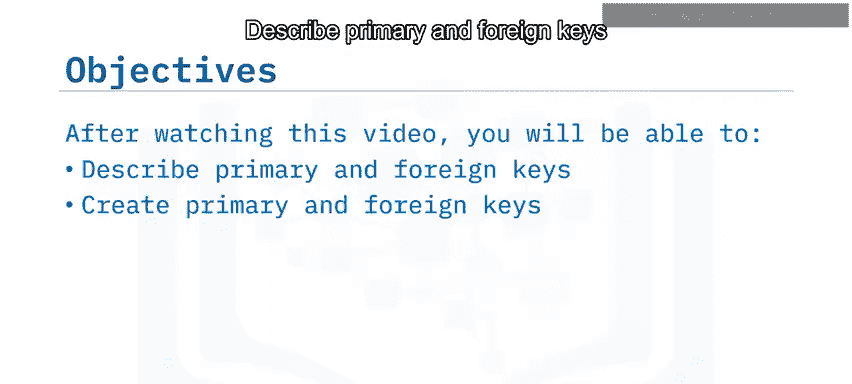

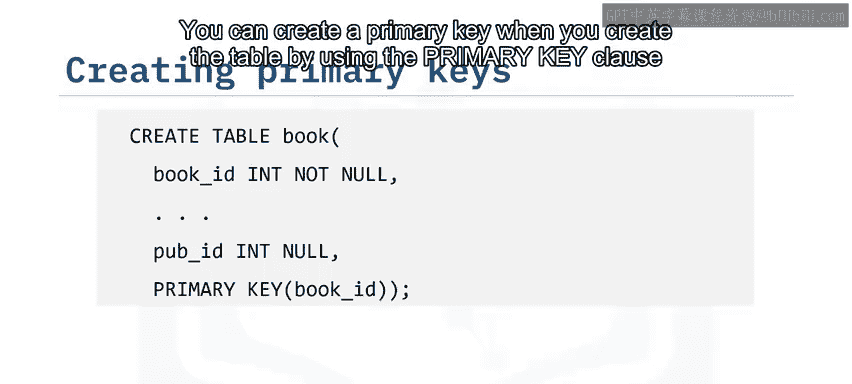

Using the primary key clause of the create table statement in the parenthesis for the primary key clause state the name of the column or columns that will be the primary keyAlternatively。

 you can create a primary key on an existing table by adding the add primary key clause of the al table statement and again。

 in the parenthesis state the name of the column or columns that will be the primary key You use primary and foreign keys to define the relationships between your tables。

 A foreign key is a column in a table which contains the same information as the primary key in another table。

 For example， the copy table might list all the books that the library owns therefore。

 the book underscore ID of a copy of an individual book must exist in the book table as a valid book where the library owns multiple copies of a popular book。

 the book underscore ID of that particular book will appear multiple times in the copy table。

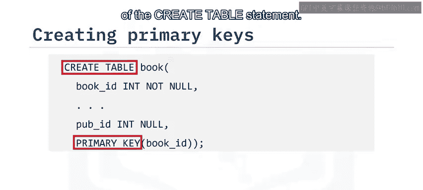

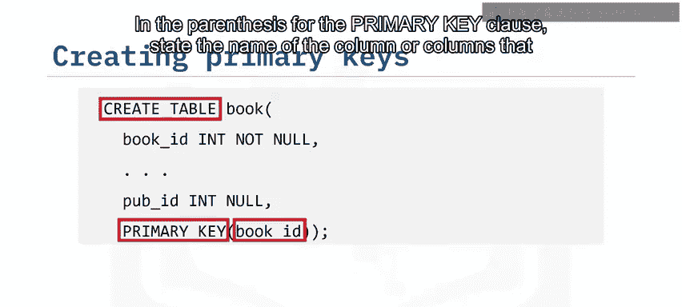

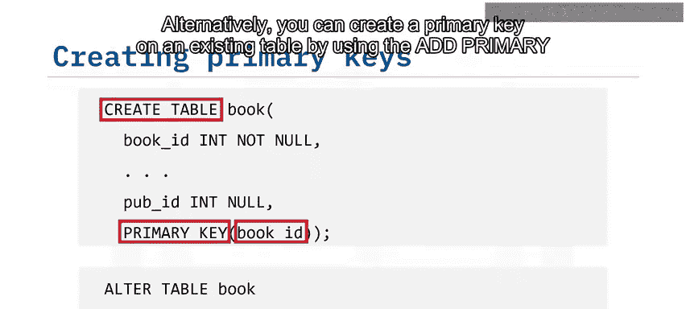

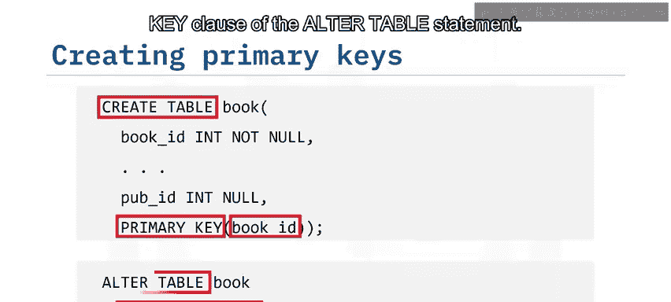

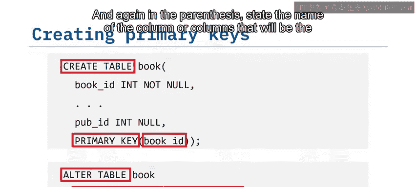

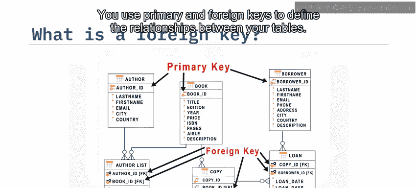

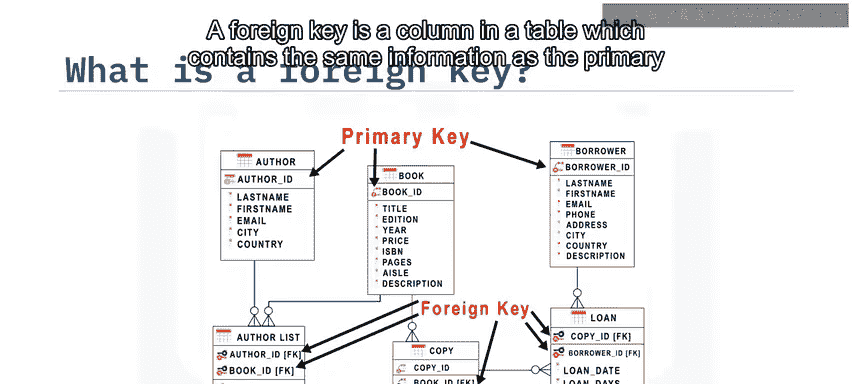

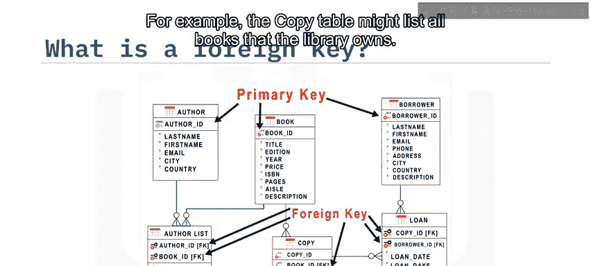

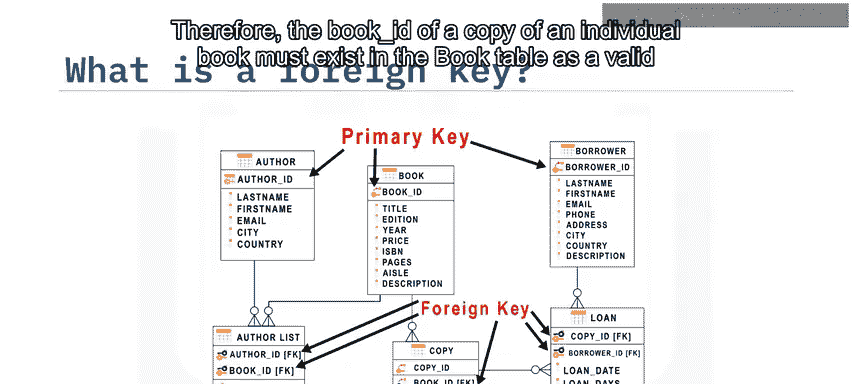

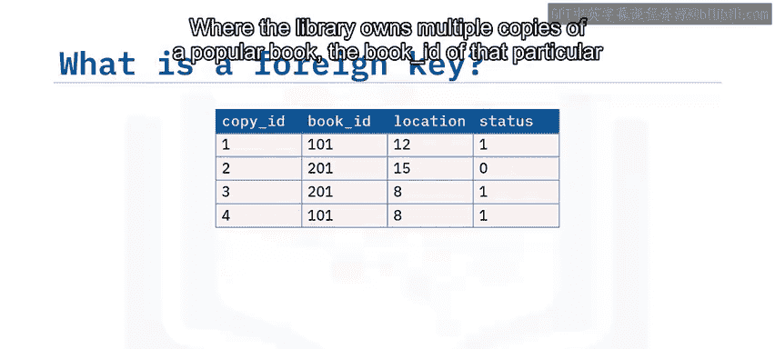

You can also specify that whenever you add a row to the copy table。

 the book underscore ID you use must already exist in the book table similar to primary keys。

 you can create a foreign key when you create the table by using the constraint constraint_ name foreign key clause of the create table statement In the parenthesis for the foreign key clause。

 state the name of the column or columns that will be the foreign key and then reference the table and primary key column that the foreign key links to you can also use the rule clause to define what action to take if a row in the parent table that is the table with the primary key is update or deleted for updates and deletes。

 you can specify to take no action in which case the update or delete operation on the parent table may fail for deletions。

 you can also specify to cascade the delete That is to delete the related child rows in the dependent table or to set the values in the。

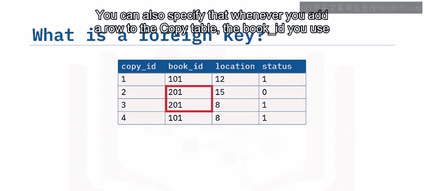

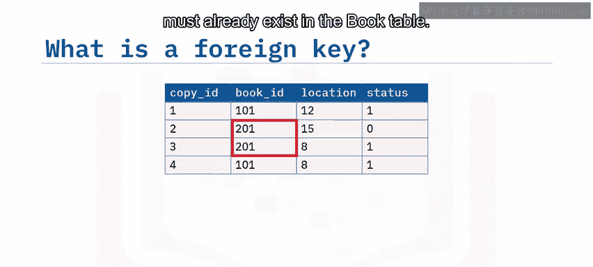

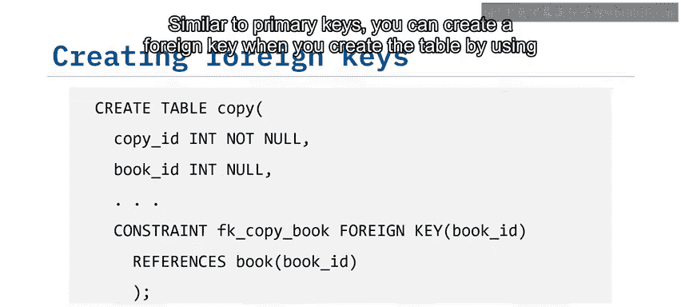

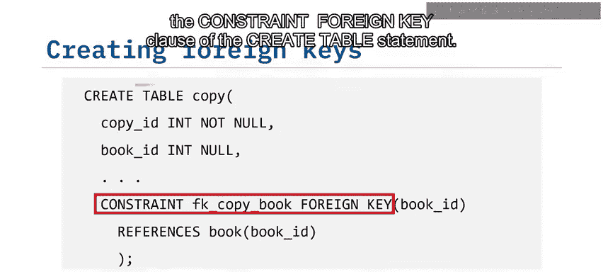

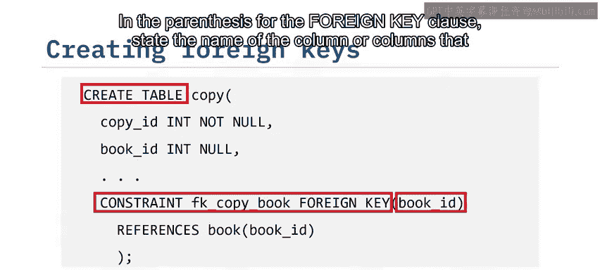

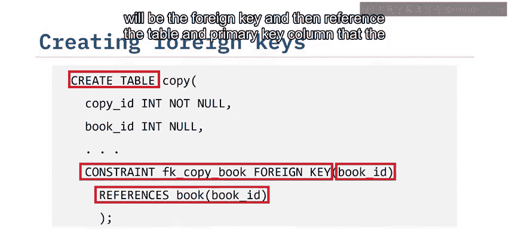

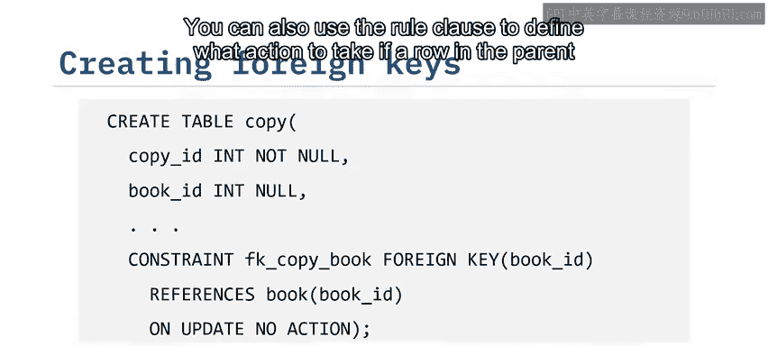

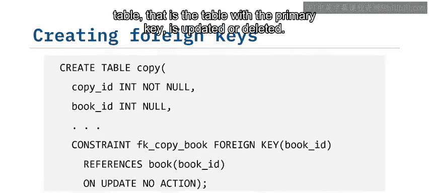

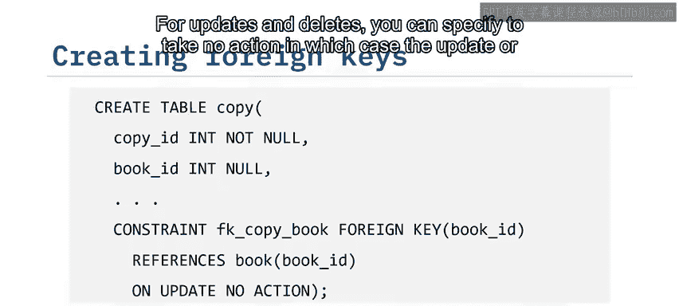

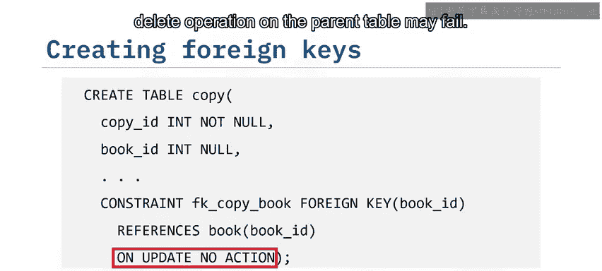

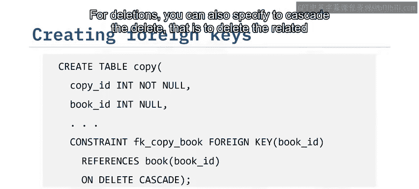

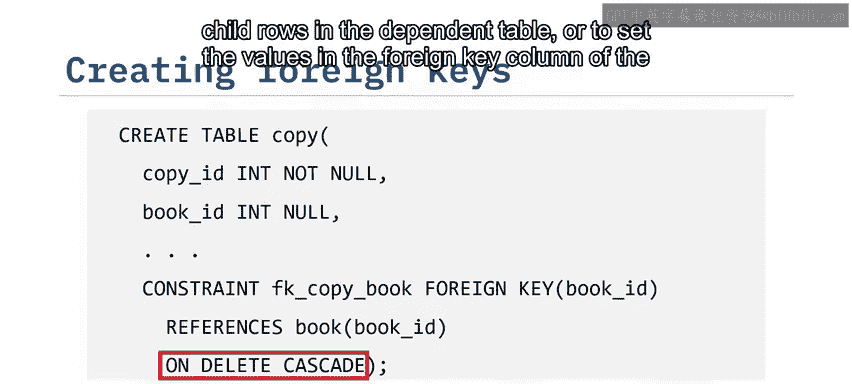

Foreign key column of the Ch tableable to know In this video。

 you learned that you can use primary keys to enforce uniqueness of rows in a table For keys are columns in a table which contain the same information as the primary key in another table and you can use primary and foreign keys to create relationships between tables。

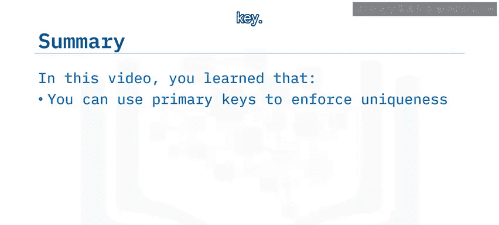

