# IBM数据工程专业证书课程4：《关系数据库导论（RDBMS）》｜introduction-to-relational-databases｜ - P22：21_索引概述.zh_en - GPT中英字幕课程资源 - BV1Mj4116716

Welcome to Indexes。After watching this video， you will be able to describe indexes， create indexes。

 and explain the advantages and disadvantages of using indexes。

Usually when you add data to a table， it is appended to the end of the table， however。

 there is no guarantee of this and there is no inherent order to the data。

So when you select a particular row from a table， the processor must check each row in turn until it finds the one that you want on a large table。

 this can become a very slow way of locating a row Also when you select multiple rows。

 unless you specify a sort order in your select statement。

 they may be returned in an unordered state， because you often want to return the rows in a particular order or select a subset of sequential rows。

 you can create an index on a table to easily locate the specific row or set of rows you require。

An index works by storing pointers to each row in the table， so when you request a particular row。

 the SQL processor can use the index to quickly locate the row。

 This is similar to how you use the index in a book to quickly find a particular section of the book The index is ordered by values within the unique key upon which it is based。

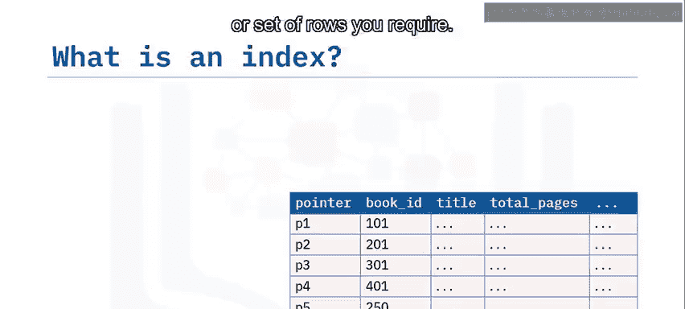

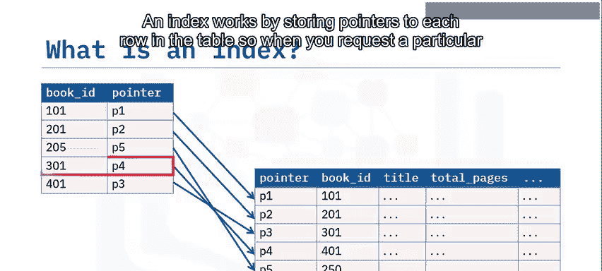

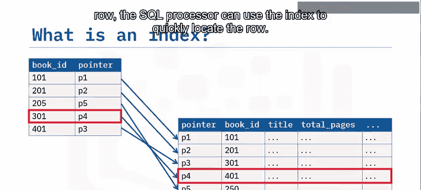

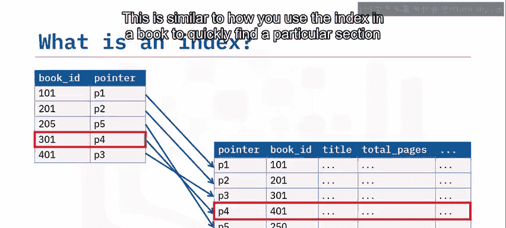

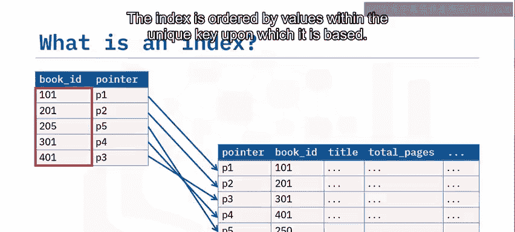

By default， when you create a primary key on a table， an index is automatically created on that key。

 but you can also create your own indexes on regularly searched columns。

 Use the Cate index statement to define the index， specifying the index name， its uniqueness。

 and the table and column on which to base it Ines provide the database user with many benefits including improved performance of select queries when searching on an indexed column because the index provides a quick route to locate rows matching the search term。

 the results are returned quicker than when it has to check every row in the table。

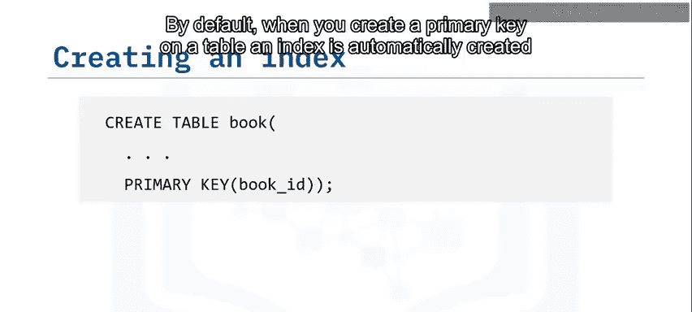

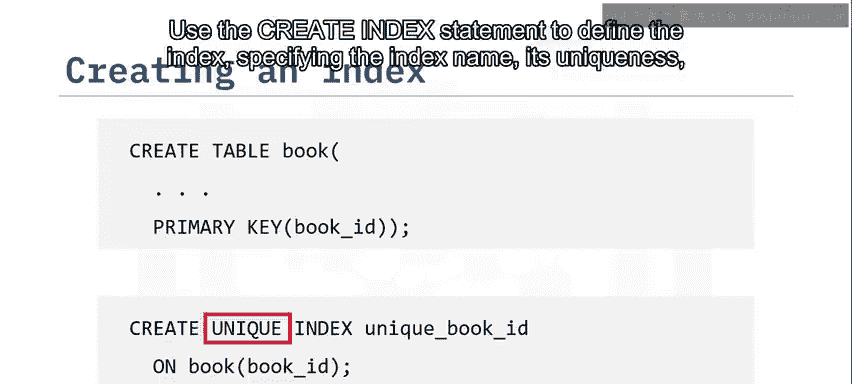

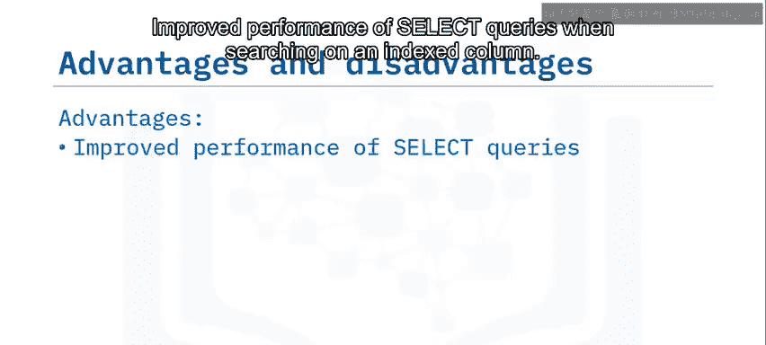

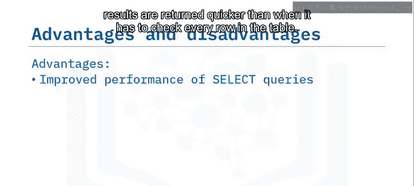

Reduced need to sort data if you regularly require rows in a specific order。

 using an index can eliminate the need for sorting the rows after they are located and guaranteed uniqueness of rows if you use the unique clause when you create the index you can be sure that updates and insertions will not create duplicate entries in that column while not vary the overhead of having to check this against each row in the table however。

 indexes do have a few disadvantages。 each index that you create uses disk space in the same way that adding indexes increases the number of pages in a book and decreased performance of insert。

 update and delete queries because the rows in an indexed table are sorted according to the index。

 adding or removing rows can take longer than in a non-indexed table。

 you should only create an index when you will gain more from the advantages than you lose from the disadvantages for example。

 on。

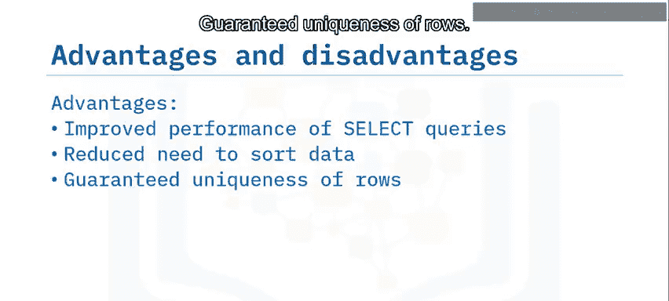

Table that rarely has rows inserted or updated， but is regularly used in select queries and where clauses If you create many indexes on a table。

 you can actually negate the performance benefits in the same way that indexing every word in a book would result in an unhelpful index。

In this video you learned that indexes provide ordered pointers to rows and tables。

 indexes can improve performance of select queries。

 and indexes can decrease the performance of insert， update and delete queries。

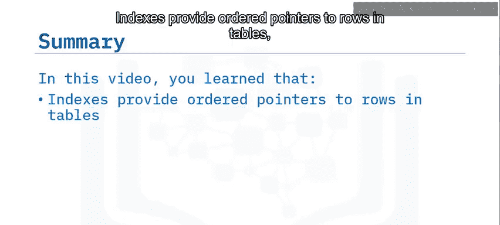

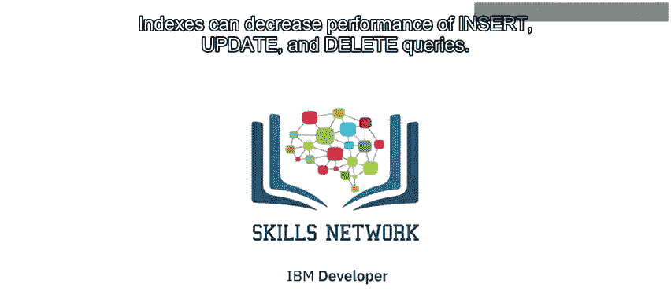