# IBM数据工程专业证书课程4：《关系数据库导论（RDBMS）》｜introduction-to-relational-databases｜ - P24：23_关系模型约束高级.zh_en - GPT中英字幕课程资源 - BV1Mj4116716

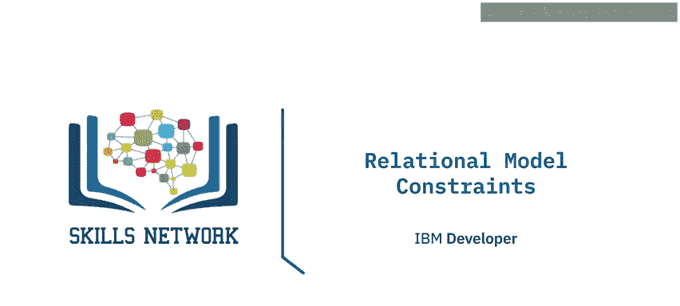

Welcome to Relational model Consts。

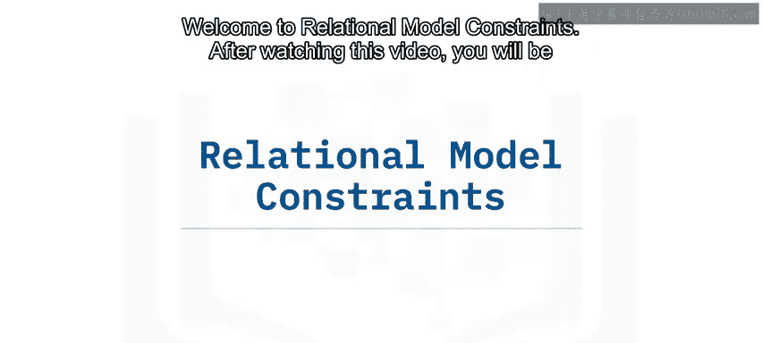

After watching this video， you will be able to describe the different types of relational model constraints。

Within any business， data must often adhere to certain restrictions or rules constraintst help implement the business rules in a relational data model。

 data integrity can be achieved using integrity rules or constraints。

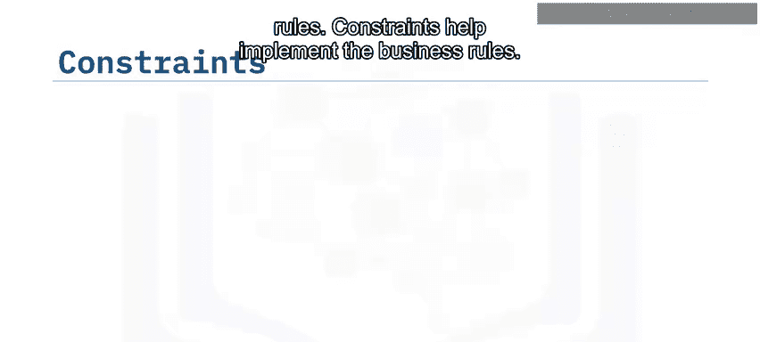

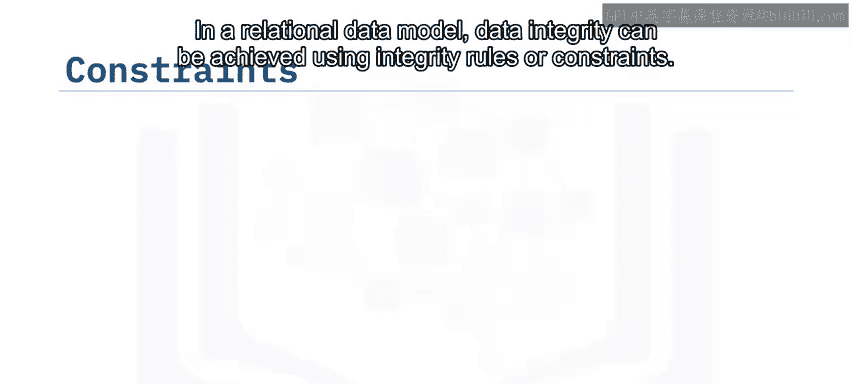

The following six constraints are defined in a relational database model。

 entity integrity constraint， Refential integrity constraint， semantic integrity constraint。

 domain constraint， MEL constraint， and check constraint。

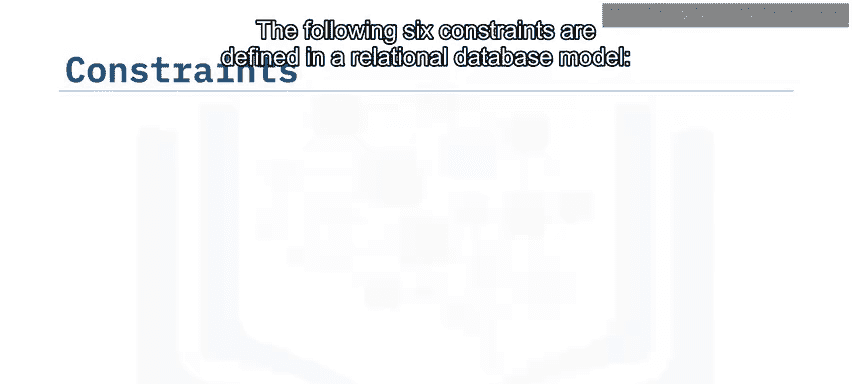

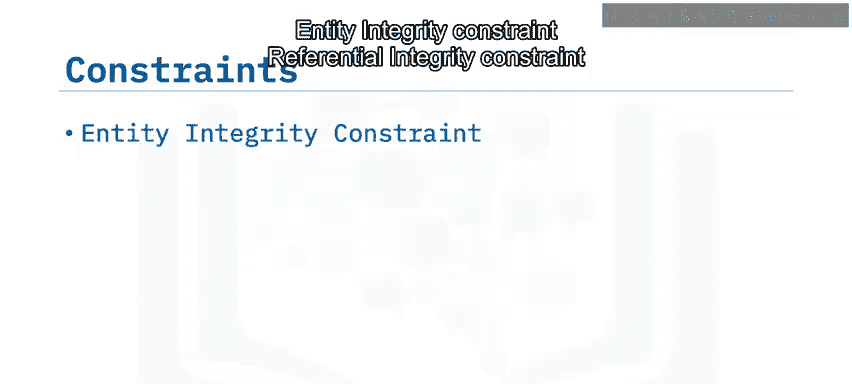

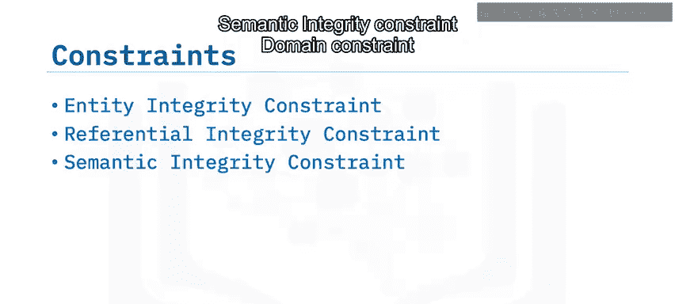

To identify each tuple in a relation， the relation must have a primary key。

 The primary key is a unique value that identifies each tu or row in a table。

 This is the entity integrity constraint。 the terms primary key constraint or unique constraint are also used。

 This constraint prevents duplicate values in a table。 to implement these cons。 indexes are used。

 The entity integrity constraint states that no attribute participating in the primary key of a relation is allowed to accept null values。

 The value null indicates that the value is unknown。 In the entity integrity constraint。

 The primary key cannot have an unknown value。 For example， in the relation， author。

 author underscore I D is the primary key。 The primary key identifies each tuple in the relation。

 the author。Underscore ID A1 points to author Raoul Chong from Toronto If you replace the value A1 with null。

 you can still identify the author as Raoul Chong。 However。

 if you also replace author_ ID A4 with null Now you do not know which null value identifies which tuple。

With the entity integrity constraint， no attribute participating in the primary key is allowed to accept null values。

Referential integrity constraint defines relationships between tables and ensures that these relationships remain valid。

 The validity of the data is enforced using a combination of primary keys and foreign keys。

 As mentioned previously for a book to exist， it has to be written by at least one author。

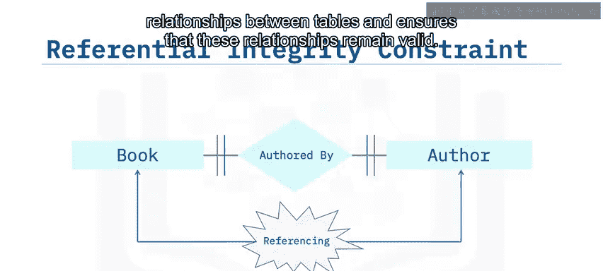

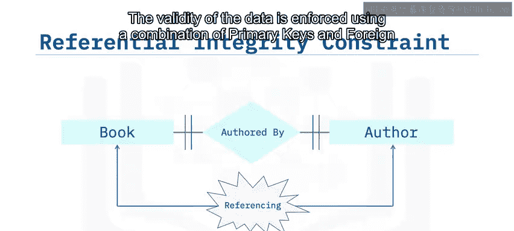

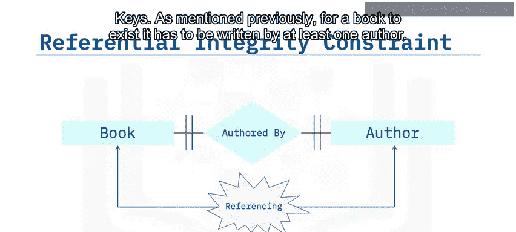

The semantic integrity constraint refers to the correctness of the meaning of the data， for example。

 in the relation author， if the attribute or column city contains a garbage value instead of Toronto。

 the garbage value does not have any meaning the semantic integrity constraint is related to the correctness of the data。

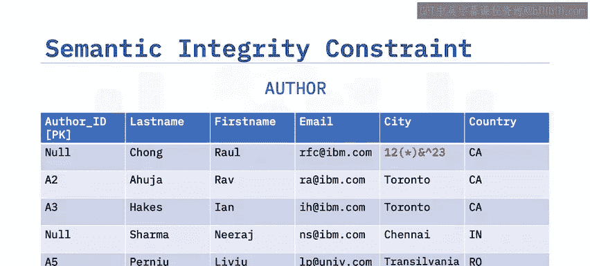

A domain constraint specifies the permissible values for a given attribute， For example。

 in the relation author， the attribute country must contain a two letter country code such as CA for Canada or IN for India If a number value of 34 is entered for the country attribute instead of a two letter country code。

 the value 34 does not have any meaning。

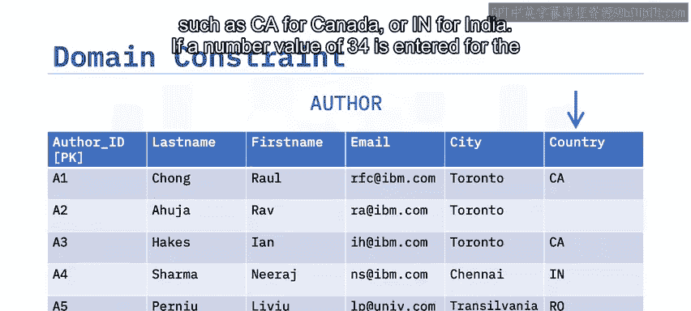

As you saw previously， the En integrity constraint states that no attribute participating in the primary key is allowed to accept null values；

 the null constraint specifies that attribute values cannot be null。

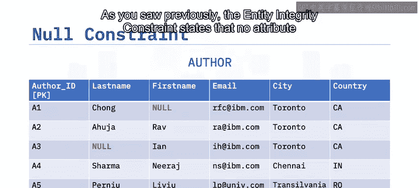

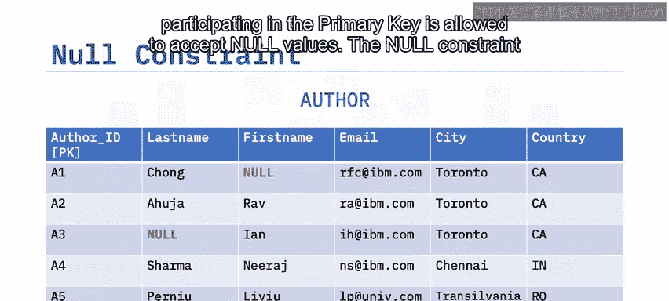

For example， in the relation author， if either last name or first name contains a null value。

 it could be difficult to identify the correct author In this example。

 first name and last name attribute values cannot be null， and author must have a name。

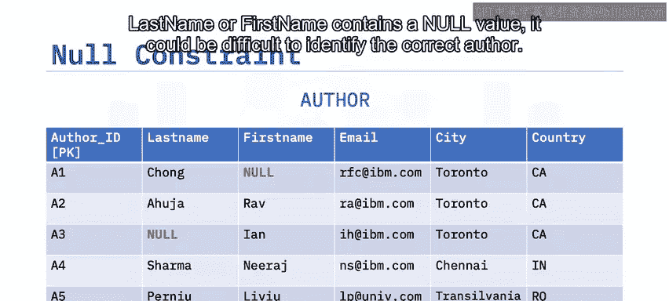

And finally， the check constraint enforces domain integrity by limiting the values that are accepted by an attribute in the relation book。

 the attribute year is the year in which a particular book is published。

 If this were still the year 2010。 It would not be meaningful to have a year greater than the current year。

 The check constraint would enforce the domain integrity by limiting the values that are accepted by the attribute year。

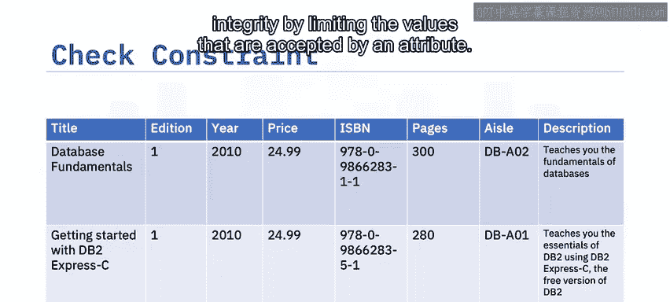

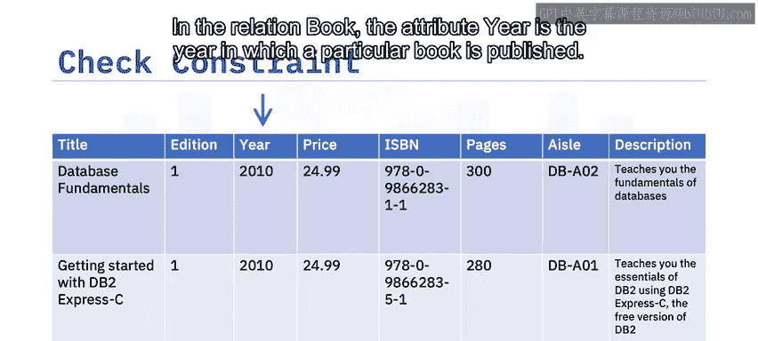

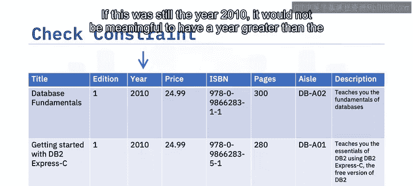

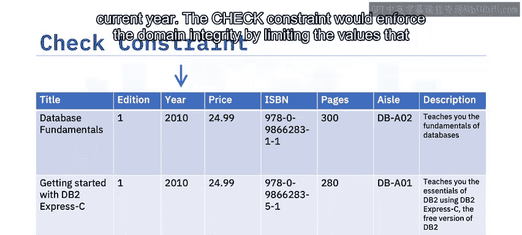

In this video， you learned that the entity integrity constraint ensures the primary key is a unique value that identifies each tuple or row。

 The referential integrity constraint defines relationships between tables。

 the semantic integrity constraint refers to the correctness of the meaning of the data。

 The domain constraint specifies the permissible values for a given attribute。

 The null constraint specifies that attribute values cannot be null。

 and the check constraint limits the values that are accepted by an attribute。

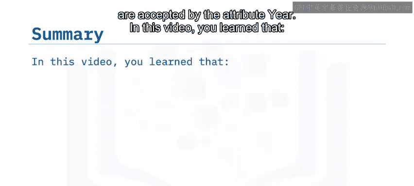

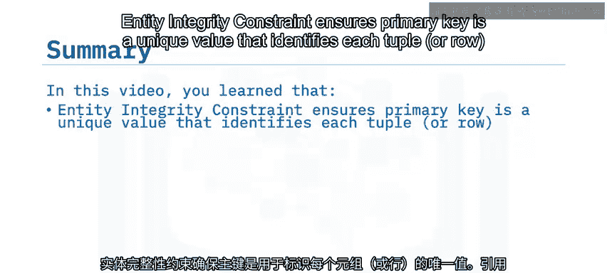

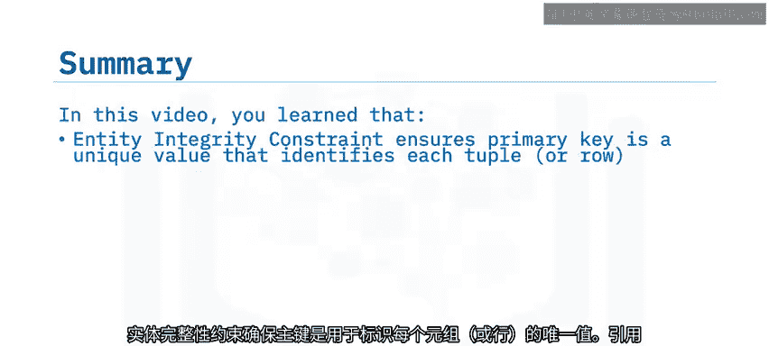

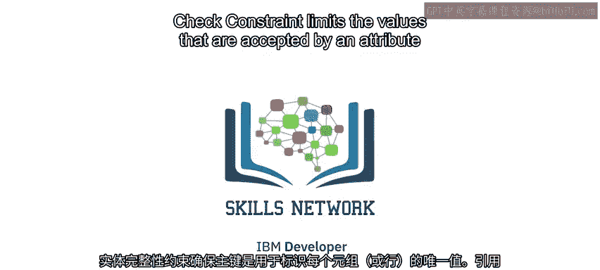