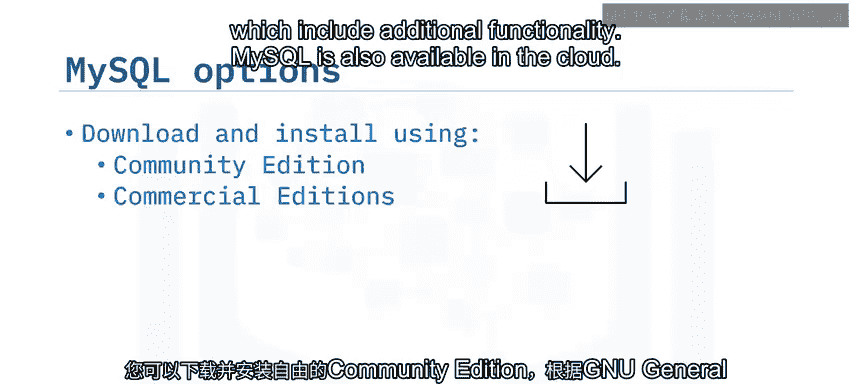
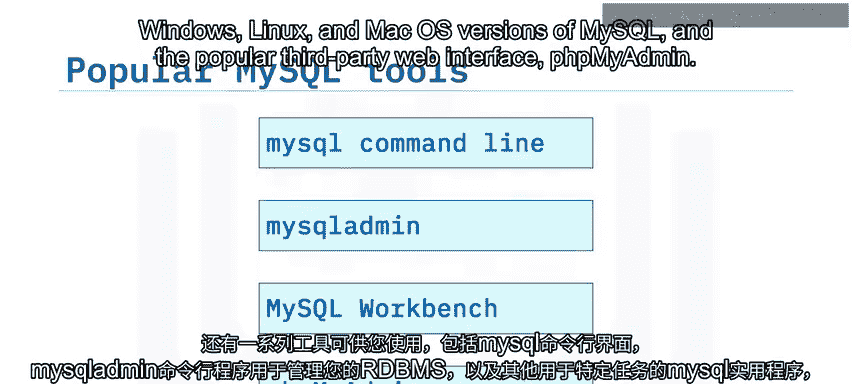
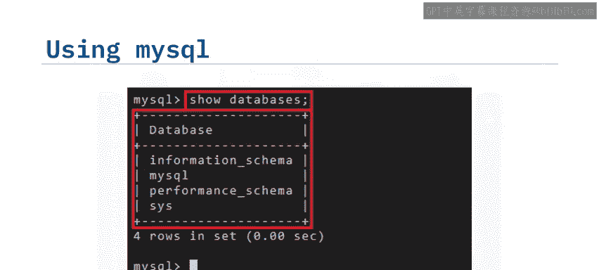
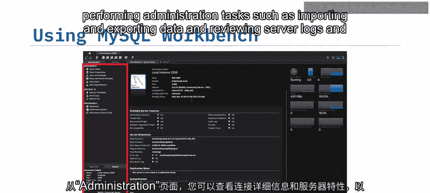
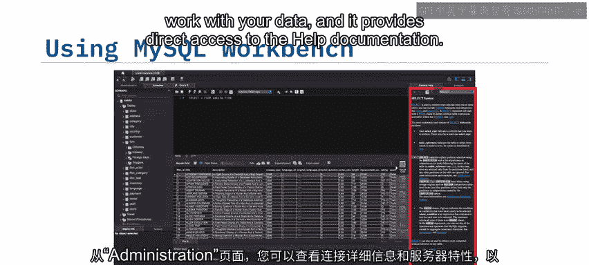
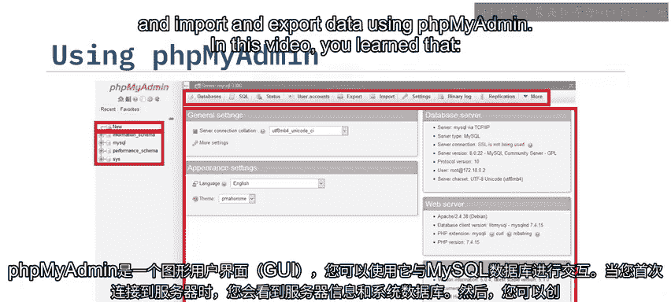
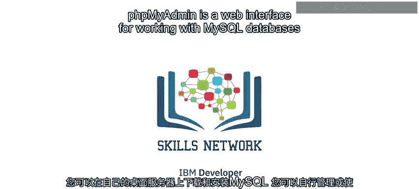

# IBM数据工程专业证书课程4：《关系数据库导论（RDBMS）》｜introduction-to-relational-databases｜ - P25：24_mysql 入门.zh_en - GPT中英字幕课程资源 - BV1Mj4116716

Welcome to Getting started with my SQL。After watching this video。

 you will be able to explain the ways you can use MySQL and describe some of the popular MySQL tools。

My SQL is a popular open source relational database management system or RDBMS。

Maria DB is a fork of the MySQL database by some of the original developers of MySQL。

It's available in a range of ways to suit your needs。

You can download and install the free Community Edition under GNU General Public license and you can embed this in your own applicationsAlternativelyly。

 you can purchase download and install commercial editions such as standard enterprise and cluster versions which include additional functionality My SQL is also available in the cloud you can selfmanage in virtual machine images or containers。

 or you can use a managed service such as IBM Cloud Amazon RDS for my SQL。

 Azure database for my SQL or Google Cloud SQL for my SQL。

There is a range of tools that you can use to work with your databases。

 including the MySQL command line interface。The MySQL amin command line program for administering your RDBMS。

 along with other MySQL utilities for specific tasks。

 the MySQL Workbench desktop application for Windows， Linux and Mac OS versions of MySQL。

 and the popular thirdpart web interface， PhP My admin。

The MySQL command line interface enables you to issue commands to interact with your MySQL server and data。

These commands can be typed directly at the prompt for interactive use or from a text file that you invoke from the command prompt。

This screenshot shows running the show databases command interactively to list the databases currently available。

When running in batch mode， you can specify a file to store any output messages for later use。

MySQL Workbench is a visual database design tool that integrates SQL development， administration。

 database design， creation and maintenance into a single development environment for the MySQL database system。

From the administration page， you can view connection details and server features as well as performing administration tasks such as importing and exporting data and reviewing server logs and performance reports。

The schemas page enables you to access the objects in your database， work with your data。

 and it provides direct access to the help documentation。

PHP MyAdmin is a graphical web interface that you can use to interact with your MySQL databases。

When you first connect to the server， you see the server information and the system databases。

You can then create your own user databases and use the different tabs to interact with them。

You can create databases and tables， load and query data。

 and import and export data using PHP MyAdmin。

In this video， you learned that you can download and install my SQL on your own desktop and the servers。

You can self manage or use managed services for my SQL in the cloud。

My SQL and My SQL admin are command line interfaces for database management。

My SQL Workbench is a desktop application for designing， developing。

 and administering my SQL databases。And PHP My admin is a web interface for working with my SQL databases。

