# IBM数据工程专业证书课程4：《关系数据库导论（RDBMS）》｜introduction-to-relational-databases｜ - P26：25_在 mysql 中创建数据库和表.zh_en - GPT中英字幕课程资源 - BV1Mj4116716

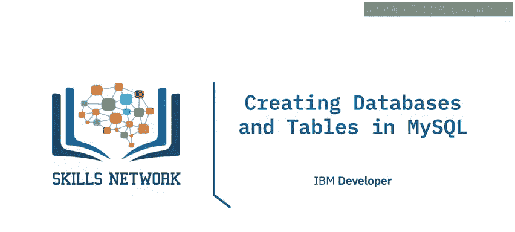

Welcome to Creating databases and tables in My SQL。

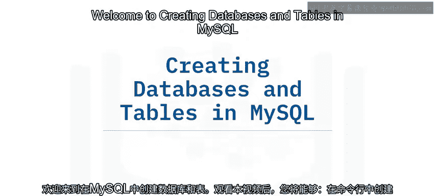

After watching this video， you will be able to create a database and table at the command line。

 create a database using PhHP My admin， create a table， define columns。

 and edit the table definition。

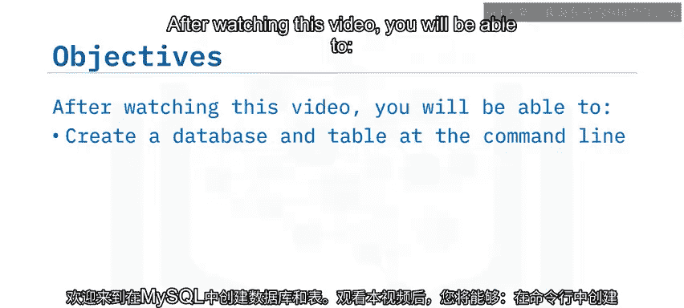

As with many RDBMs， you can create databases and tables in MySQL by using a command line interface。

 a graphical user interface or API calls in this video you will see how to perform these tasks using the command line and the PhP My admin user interface you will see how to create the database then the table and then how to define and edit the columns in that table you can issue commands at the MySQL command line to create database objects use the create database command to create the database and create table for tables specifying column names and data types you can use the describe command to show the structure of the newly created tableAlternativelyly you can use PhP My admin to create the same database and table。

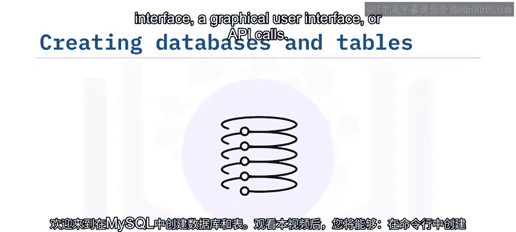

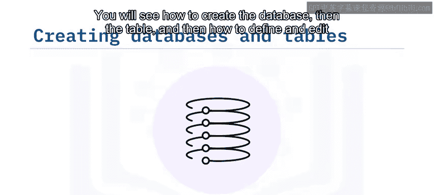

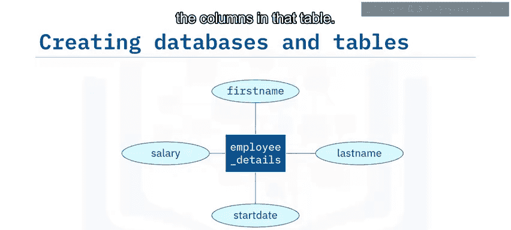

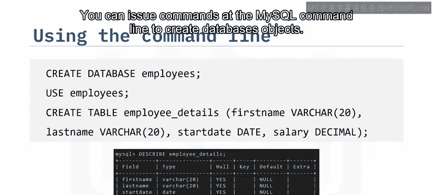

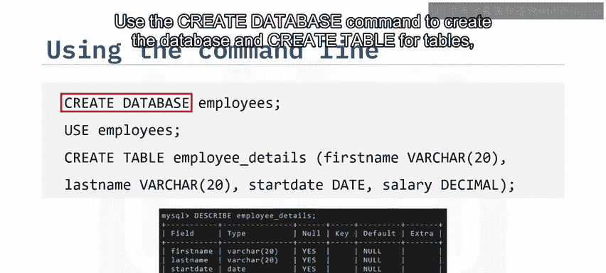

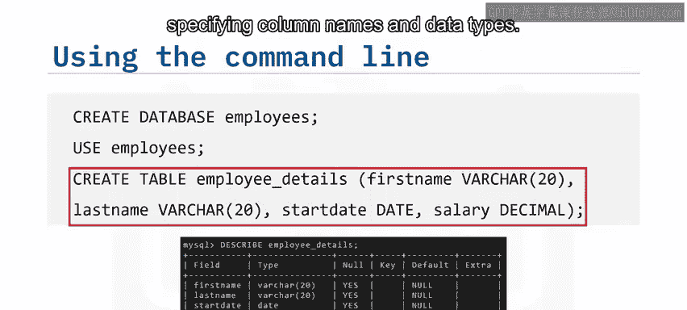

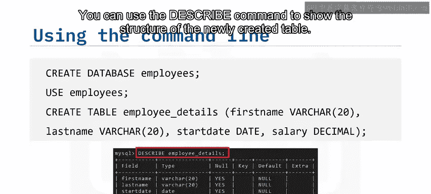

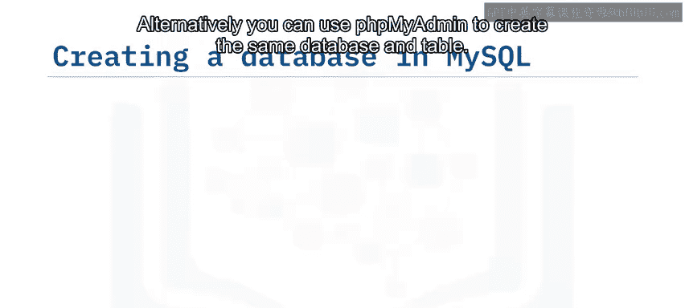

PHP MyAdmin is a popular visual tool with a web interface for working with My SQL to create the database in the tree View in the left hand pane。

 click New。On the databases tab， enter the name for the new database。

 optionally select the encoding for the data and then click Cate This creates the database which now shows in the database treeview on the left hand side of the window and opens the createate Table tab。

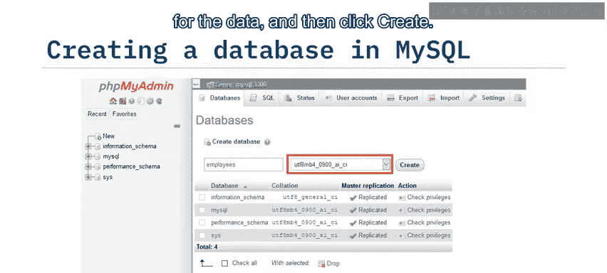

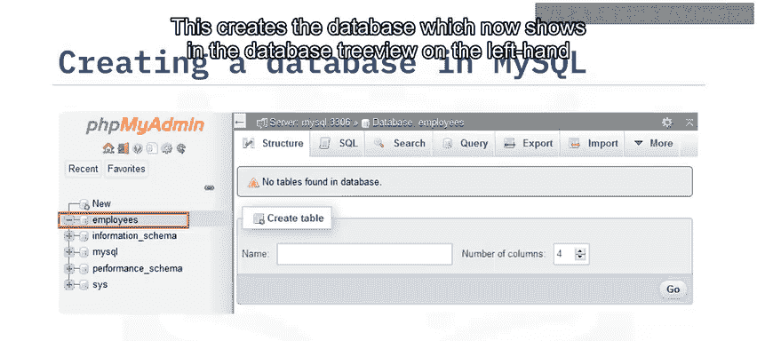

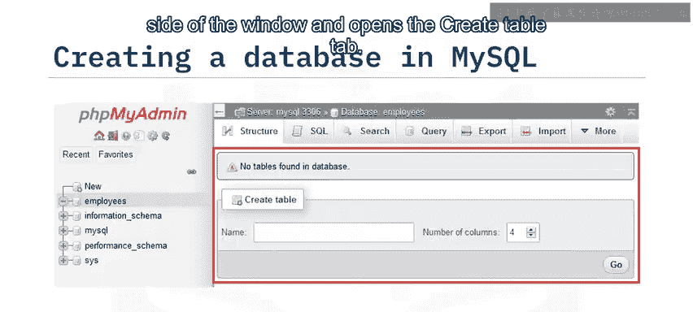

To create a table， enter the name of the table in this case， employee underscore details。

 select the number of columns for the table for and then click go In the next step you define the columns for your table。

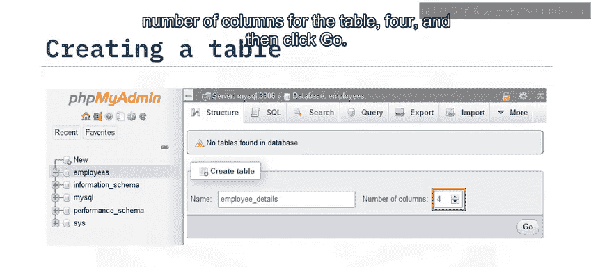

Enter the name， select the data type。Enter a length if relevant to that data type and then click saveve。

 You're then shown a summary of the structure of the new table in your database Here you can edit columns。

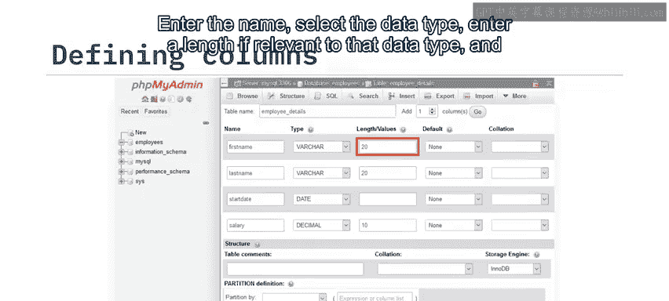

Drop columns， move them， or normalize the table， you can also add more columns if required。

In this video， you learned that you can use a command line interface， a graphical user interface。

 or API calls to create databases and tables in My SQL PhHP My admin provides an easy to use interface to create databases。

 tables and columns， and you can add and modify columns after you create a table。

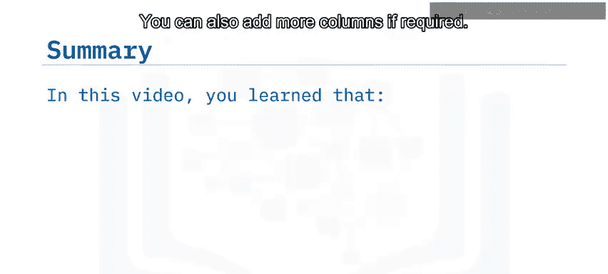

。

