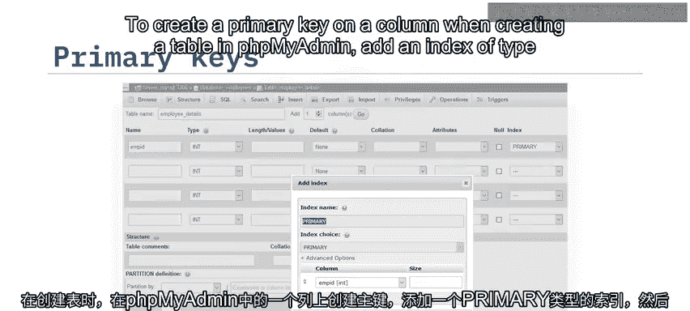
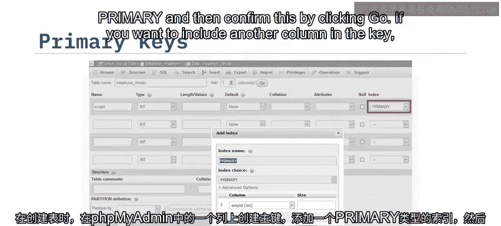
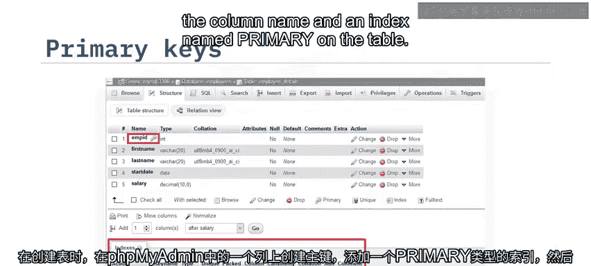
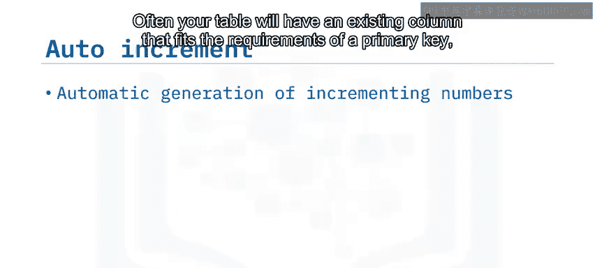
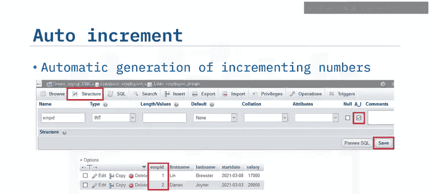
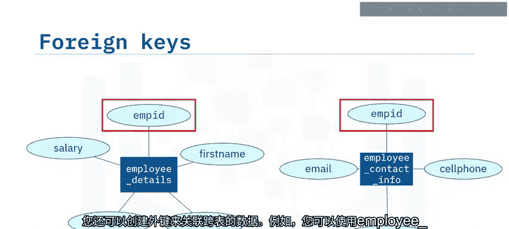
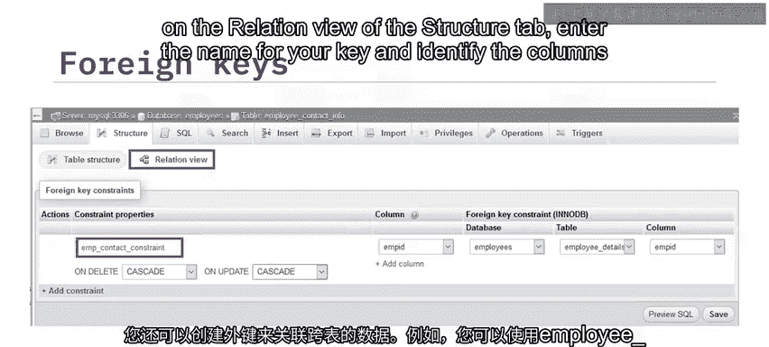
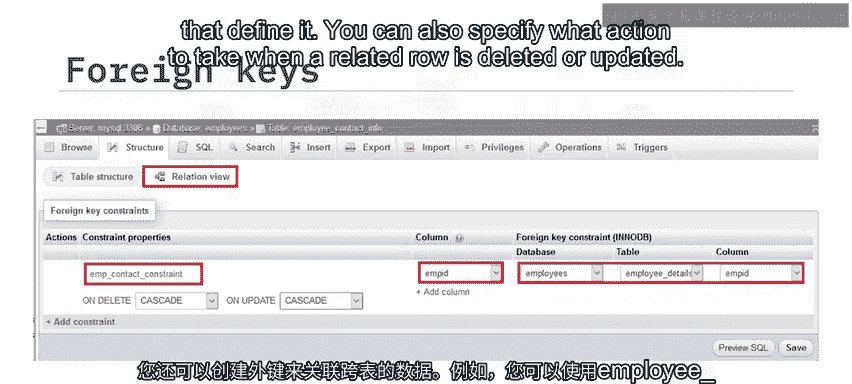
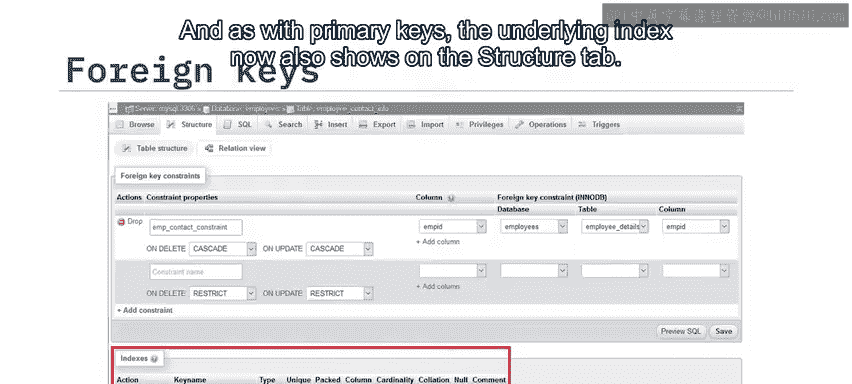

# IBM数据工程专业证书课程4：《关系数据库导论（RDBMS）》｜introduction-to-relational-databases｜ - P28：27_在 mysql 中使用键和约束.zh_en - GPT中英字幕课程资源 - BV1Mj4116716

Welcome to using keys and constraints in my SQL After watching this video。

 you will be able to create keys and use constraints。

Similarly to other relational databases， MySQL supports keys and constraints， including primary keys。

 foreign keys， unique constraints， and null constraints。

You can create these constraints either when creating your table or at a later time in this video。

 you will see how to create and use keys and constraints in PhHP My admin Web interface。

 a popular visual tool for interacting with my SQL。

You can create a primary key on one column or a combination of columns。

 Priary key columns cannot contain nulls， and the key definition enforces uniqueness on the column or combination of columns in the key。

 creating a primary key automatically creates an index on the column or columns that make up the primary key。

 to create a primary key on a column when creating a table in PhP My admin。

 Add an index of type primary， and then confirm this by clicking go If you want to include another column in the key。

 Just add a primary index to that column2。 you'll then find a primary key icon next to the column name and an index named primary on the table。

 Often your table will have an existing column that fits the requirements of a primary key such as the employee IDd for the employee's table。

However， in other scenarios， you may want to automatically generate an ID number for each row as it's added to the table。

The auto increment property of a column enables this functionality and as with keys。

 can be set when you create the table or at a later time on the create table or the structure tab。

 select the A_ I checkbox for your primary key row and then click save Now。

 when you add data to the table， the database engine automatically generates incrementing entries for the employee ID column you can also create foreign keys to relate data across tables For example。

 you can use the employee ID column in the employeeee_ details table to link to the employee ID column in the employee underscore Contact underscore In table by creating a foreign key。

To create a foreign key on the relation view of the structure tab。

 En the name of your key and identify the columns that define it。

 You can also specify what action to take when a related row is deleted or updated。

 And as with primary keys， the underlying index now also shows on the structure tab by default。

 when you create a My SQl table in PhP My admin， the columns are defined as not null。

You can change this either when you create the table or by changing the column definition。

For example， to enable null values to be entered in the start date and salary columns。

 select the null checkbox。Leaving the employee ID first name and last name null checkboxes blank ensures that those columns require data to ensure that the email address for each employee is unique。

 you can use the unique constraint on the structure tab。

 click the More link for the relevant column and then click unique in this video you learned that you create primary keys by defining a primary index on one or more columns you use auto increment to automatically generate sequential numeric data in a column。

When creating foreign keys， you can define on delete and on update actions。

 My SQL columns are not null by default， and you can configure a column to only accept unique values。

