# IBM数据工程专业证书课程4：《关系数据库导论（RDBMS）》｜introduction-to-relational-databases｜ - P29：28_postgresql 入门.zh_en - GPT中英字幕课程资源 - BV1Mj4116716

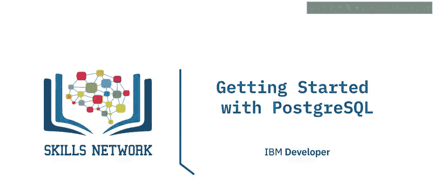

Welcome to getting started with PostgresQL After watching this video。

 you will be able to describe PostgresQL， explain how you can work with PostgresqL databases。

 describe PSQL， and describe PG admin， the query tool and the ERD tool。

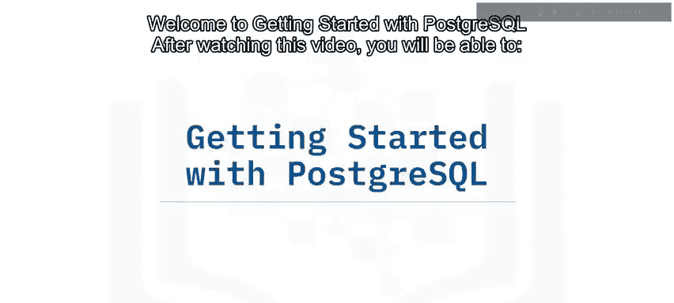

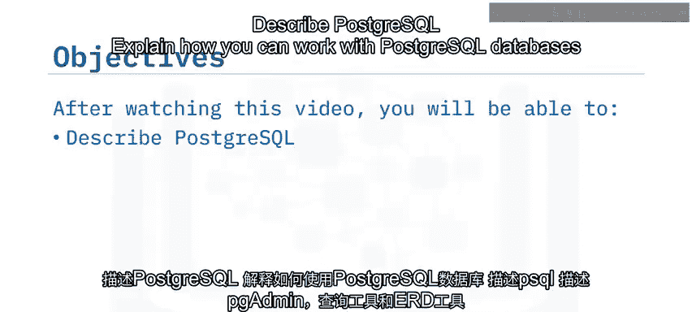

Postgress is an open source objectreal database management system with a strong reputation for reliability and flexibility and support for both relational and non-relational data types。

 Postgres is a popular database choice for OLTP Data analytics and Ge information systems。

 you can use Postgresql in a number of ways you can download and install on your own servers on a range of operating systems such as Mac OS Uniix or Windows。

 or you can install and self-manage Postgresql in virtual machine images or containers in the cloud or use managed services such as IBM Cloud databases for Postgresql。

 Amazon RDS， Google Cloud SQL for PostgresqL Enterprise Db Cloud， or Microsoft Azure for PostgresqL。

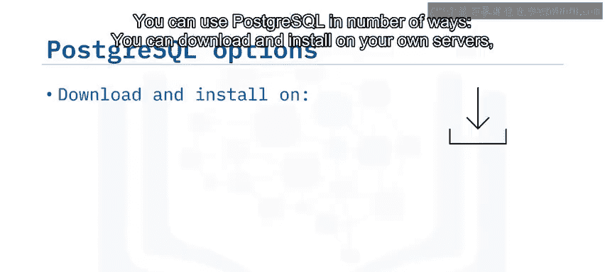

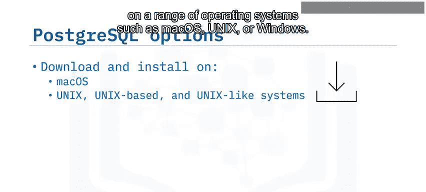

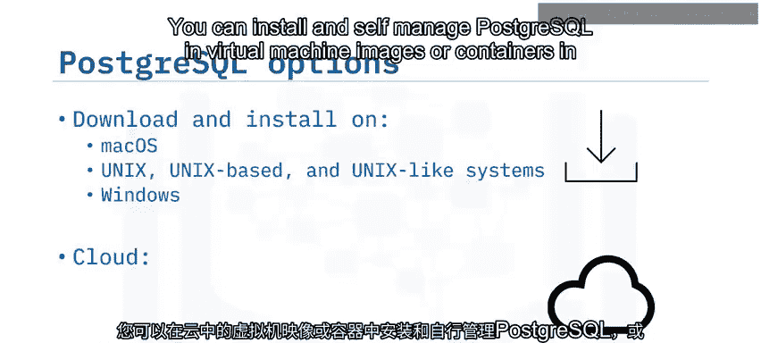

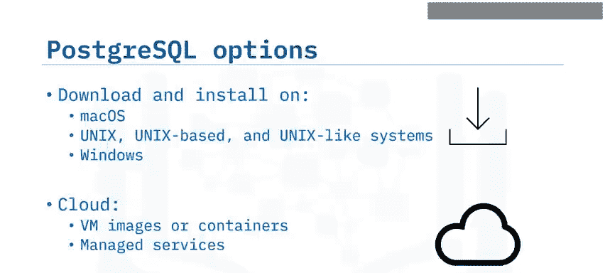

There are a variety of tools that you can use to connect to PostgresqL databases。

 PQL provides a command line interface for Postgresql Pg admin provides an open source graphicphal interface to the database server。

 which is available as a desktop application or as a web application that you can install on your web servers。

 Navicat and D Beaaver are commercial graphical interface options that you can use to access Postgres My Sql and other types of database。

 managed database and cloud service providers are other options for working with Postgresql。

 For example， Amazon RDS for Postgresql provides a web based management console and RDS As。

 PSql is an interactive command line tool that you can use to work with your Postgres databases。

 you can run interactive queries and。

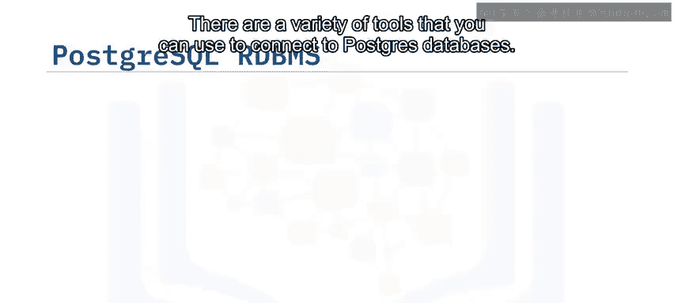

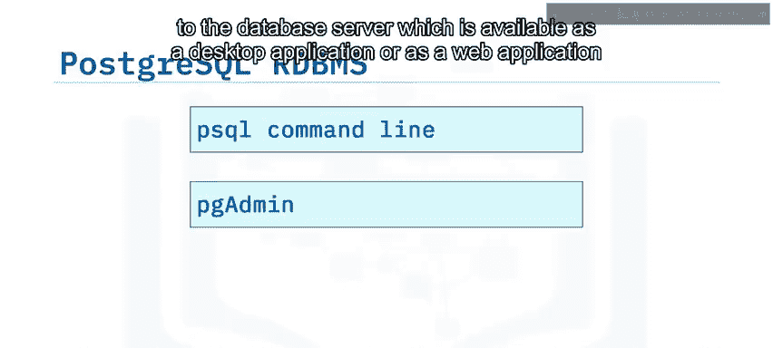

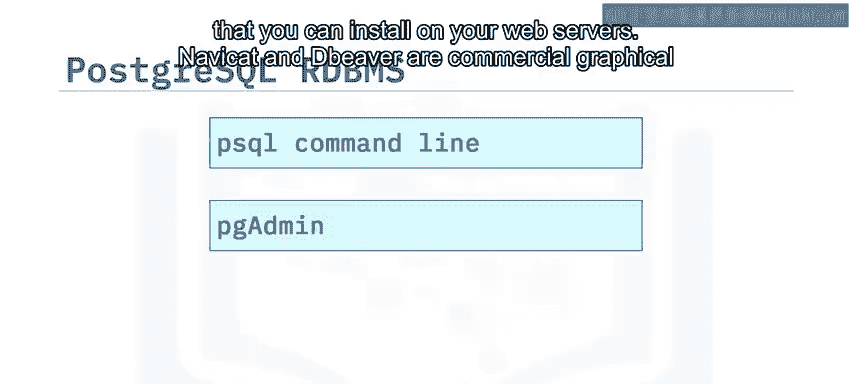

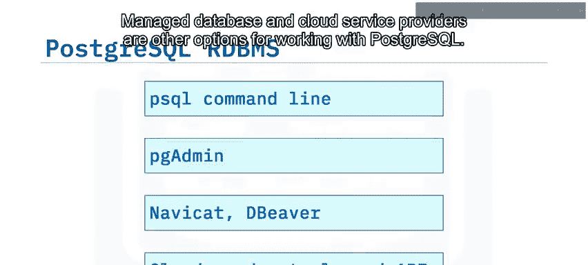

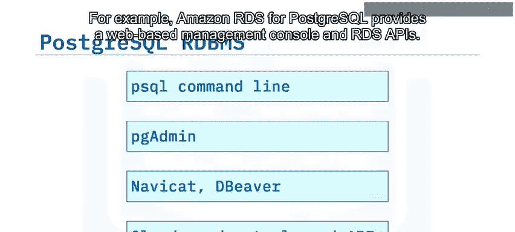

play information about the objects in your database。

 The screenshot here shows the library and Postgres user databases and the internal template0 and template1 databases which Postgres uses as templates when you create a new database you can also use PG admin to interact with your Postgresql databases When you first connect to the server。

 you will connect to the default Postgres database After you have created other databases。

 you can specify to connect directly to them。 you can use PG admin to complete all your development and administrative tasks。

 including creating databases and tables， loading data querying data。

 writing stored procedures and functions， managing database objects。

 managing security and monitoring usage。

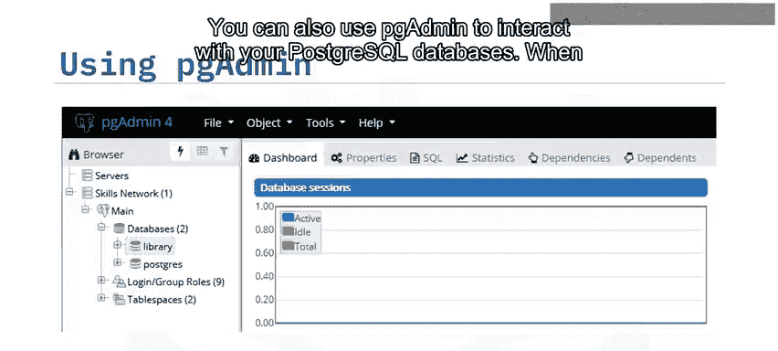

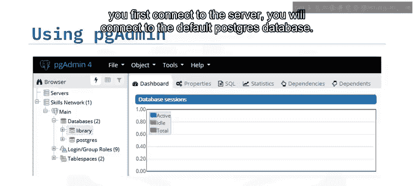

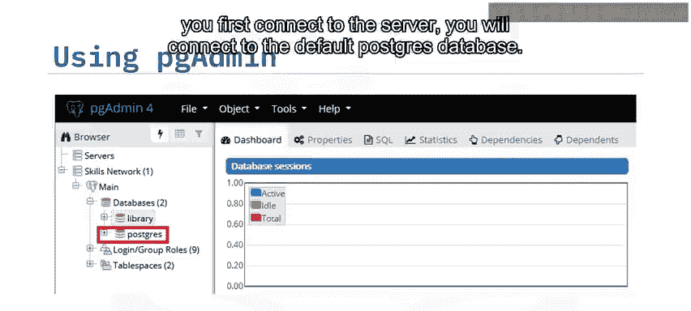

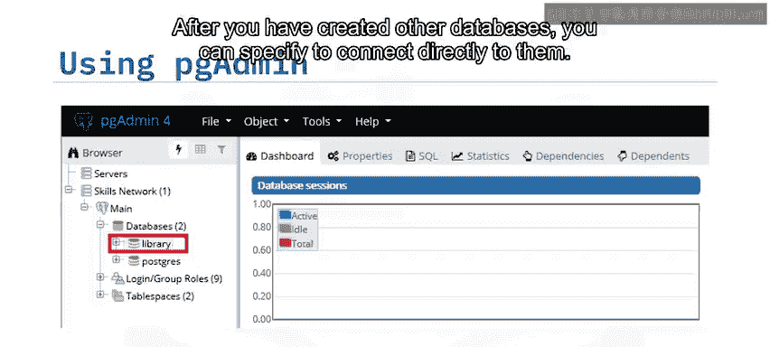

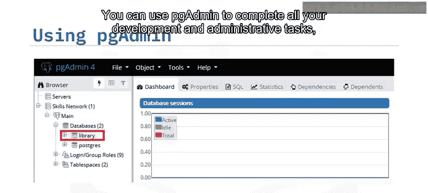

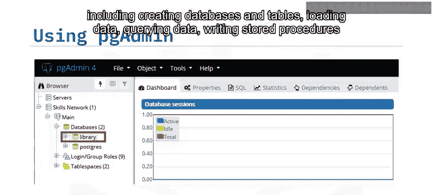

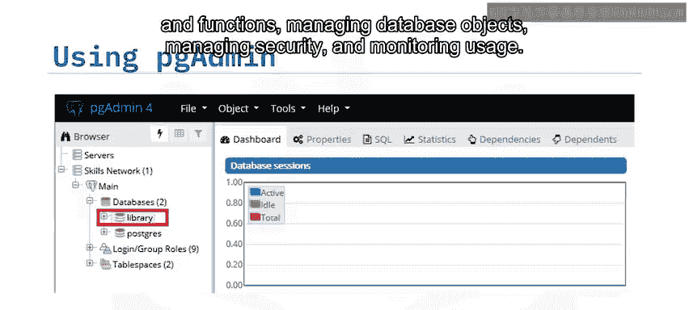

PG admin includes the query tool that you can use to run SQL commands and view or interact with their results in the upper pane。

 you can type or paste SQL queries and the results are shown below。 If the results are editable。

 you can use this area to edit the database you can also use the tabs to see an explanation of the query plan Ser messages and a synchronous server notifications in this lower pane PG admin also includes an ERD tool that you can use to create an ERD for an existing database or to create a new ERD and generate the SQL statements for creating the underlying database objects to create an entity relationship diagram from an existing database right。

 click the database and then click generate ERD。 The tool reviews your database structure and generates a visual diagram。

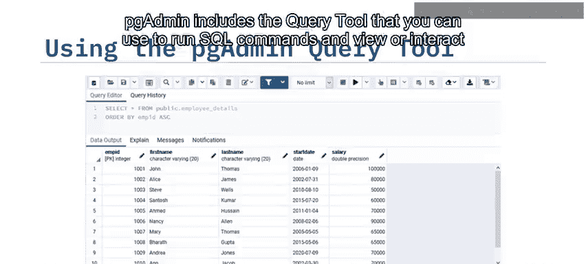

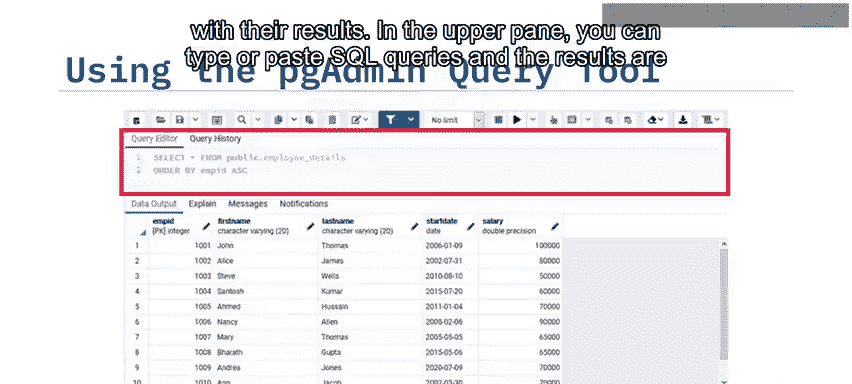

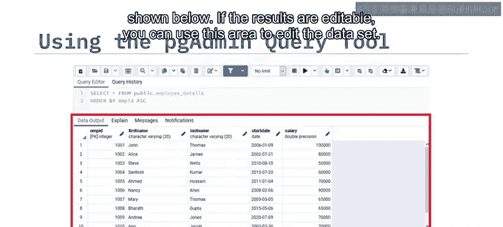

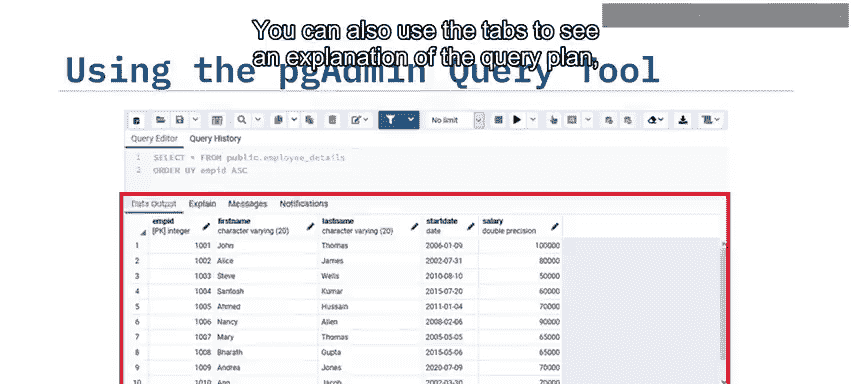

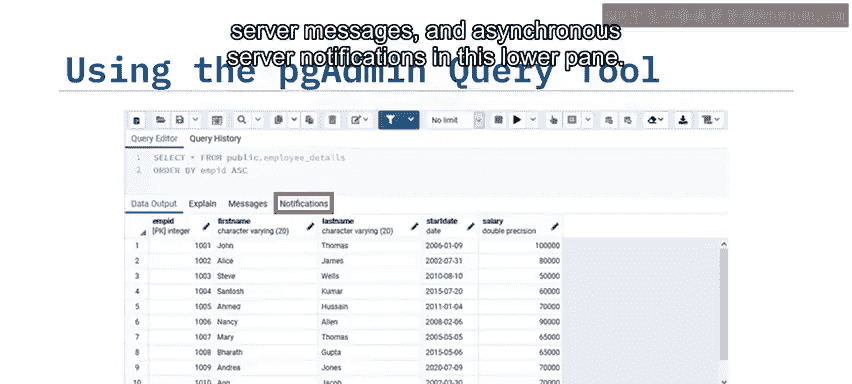

Of the tables in the database and the relationships between them， you can reorganize the tables， add。

 edit and delete relationships， add notes， and generate SQL statements in the tool。

In this video you learned that you can install PostgresQL on your own servers or work with it in the cloud PSQL provides a command line interface to a Postgres server and PG admin is a popular database management tool for PostgresQL。

 which includes objectject navigation， the query tool and the ERD tool。

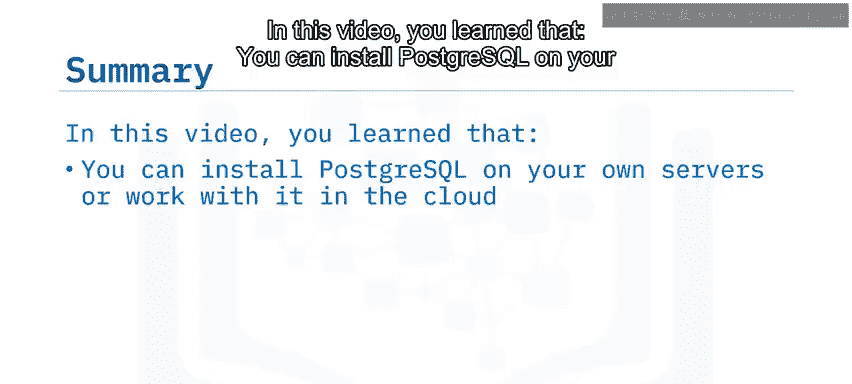