# IBM数据工程专业证书课程4：《关系数据库导论（RDBMS）》｜introduction-to-relational-databases｜ - P30：29_在 postgresql 中创建数据库和加载数据.zh_en - GPT中英字幕课程资源 - BV1Mj4116716

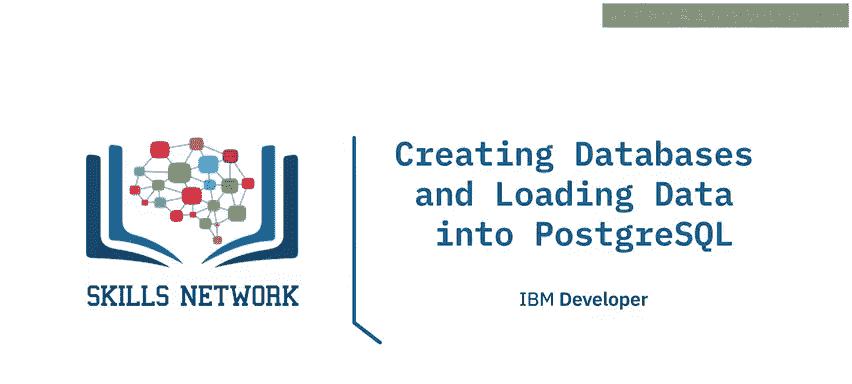

Welcome to Cating databases and loading data into PostgresQL。

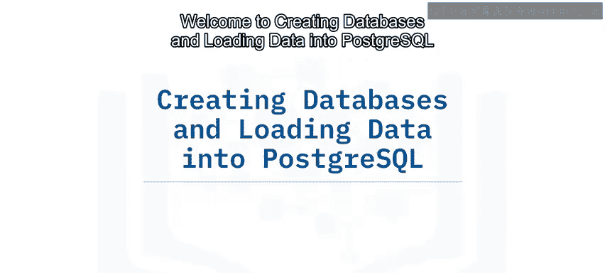

After watching this video， you will be able to create databases and tables at the command line and using PG admin。

 backup and restore databases， and import data to and export data from tables。

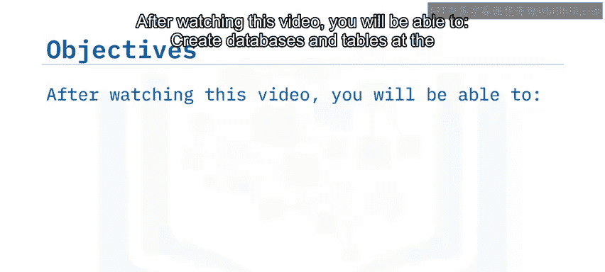

As with many RDBMS， you can create databases and tables and load data into Postgres by using a command line interface。

 a graphical user interface， or API calls。

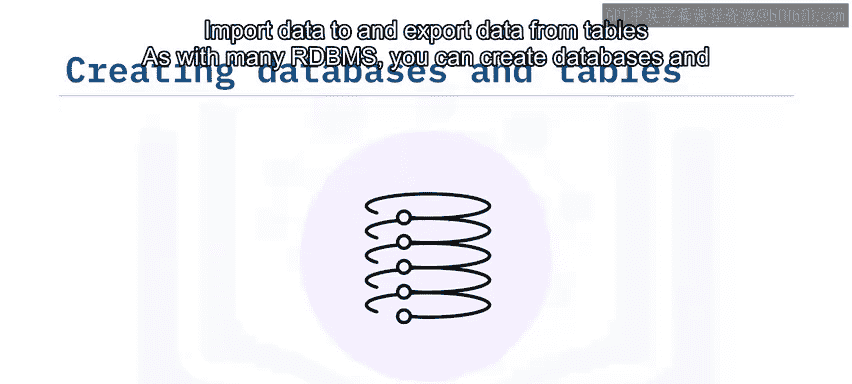

In this video you will see how to perform these tasks using the PSQL command line interface and the PG admin graphicphal user interface。

 you will see how to create the database， then the table and how to define and edit the columns in that table then you'll see how to load data into your database。

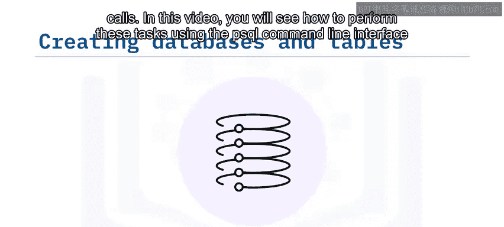

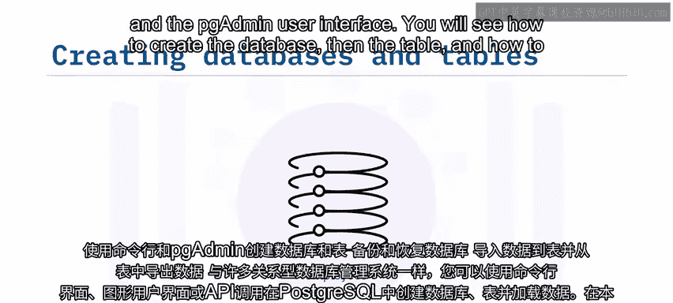

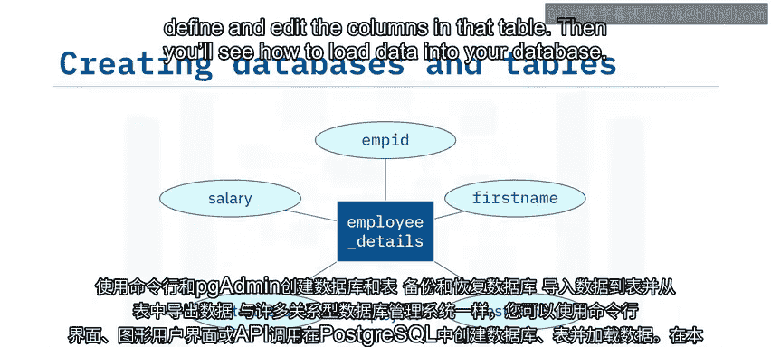

You can use PSQL to issue commands to create and interact with database objects and data use the createate database command to create the database and create table for tables specifying column names and data types you can use the backslash Dcom to show the structure of the newly created table and after you've created the database。

 you'll likely want to load data into it at the command line。

 you can use PSQL to restore a database that was previously backed up using PG underscore dump Just specify the name of the destination database and the name of the dump file This will recreate the tables and any other database objects as well as the data that was present when the dump file was created。

Alternatively， you can use PG admin to create the same database。

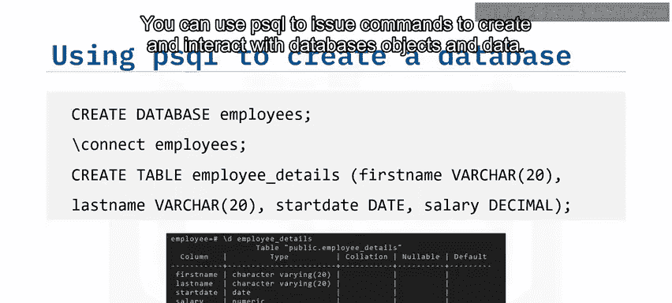

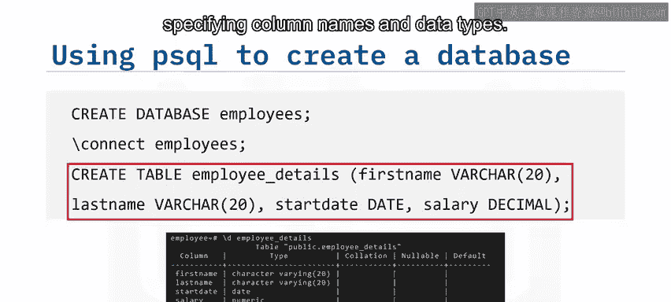

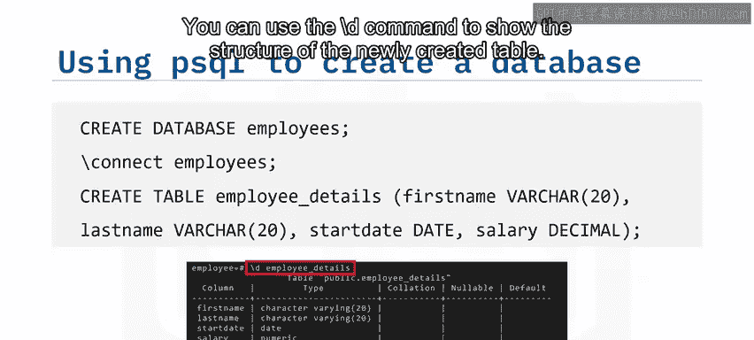

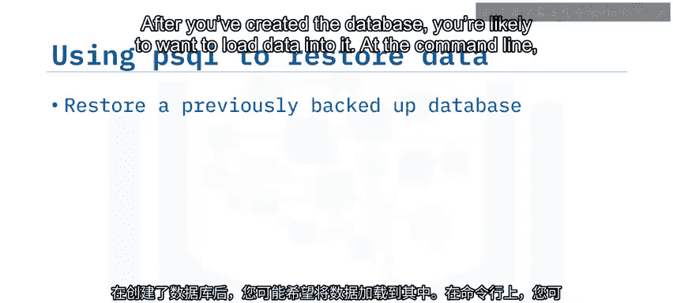

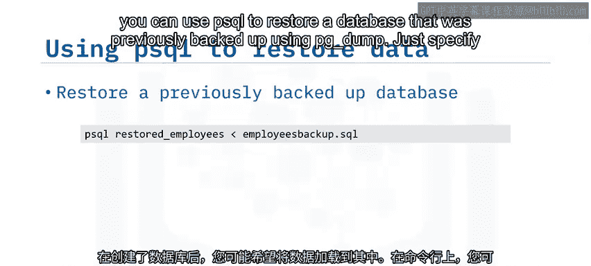

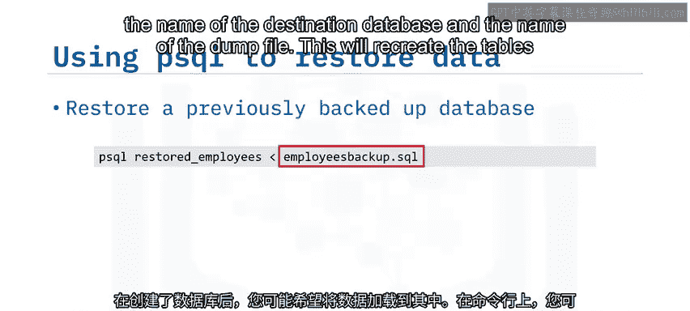

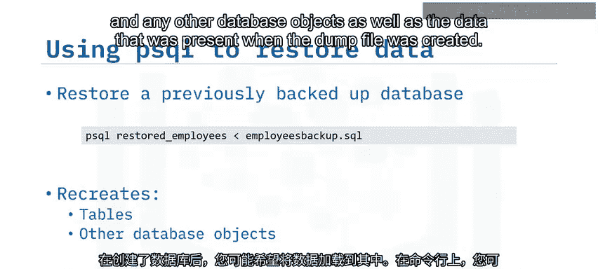

PG admin is a web based visual tool you can use to work with Postgres to create the database in the treeview in the left hand pane。

 right click databases， click createate， and then click database。

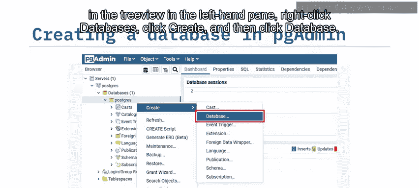

Enter the name for the new database and then click save If you want to restore the whole database from a dump file。

 select the database that you want to restore to in the treeview。

 Click restorestore and then in the restorestore box。 enter the location of your dump file。

 This runs the SQL statements contained in that file to recreate the database objects and data in the current database。

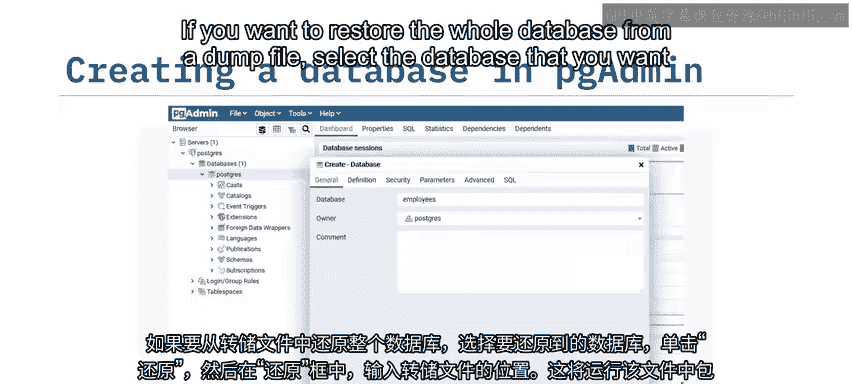

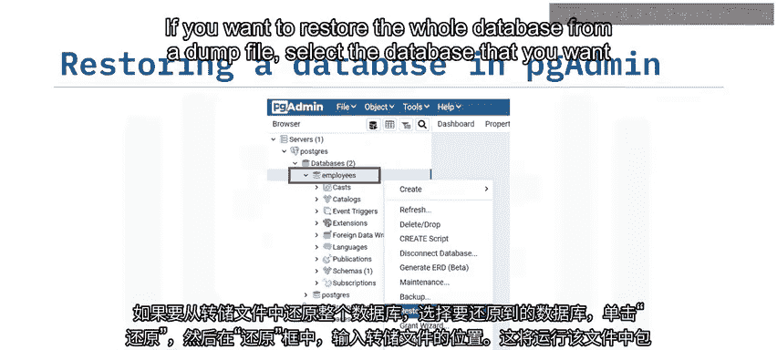

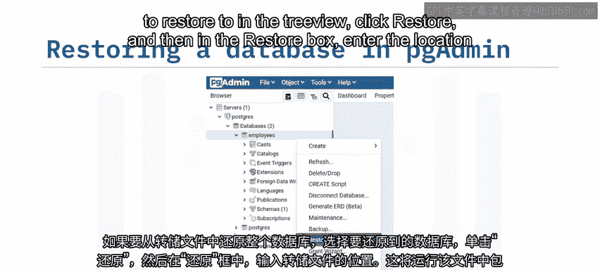

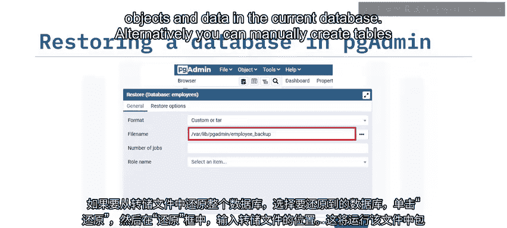

Alternatively， you can manually create tables using PG admin in the Treview， right click tables。

 click createreate and then click table on the general page enter the name for your table In this case。

 employee underscore details and then on the Cols tab enter the details for your columns and click saveve you'll then see your table and columns in the tables section of the Tview pane from here。

 you can use the import export function to load data into your new table。

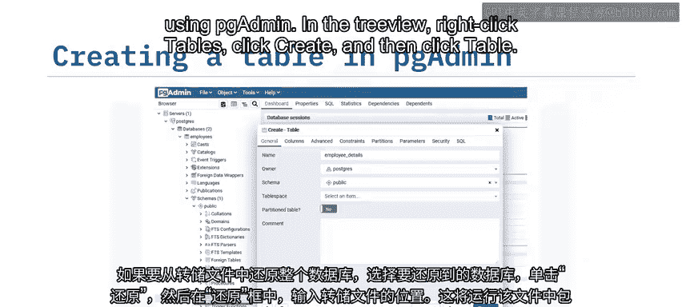

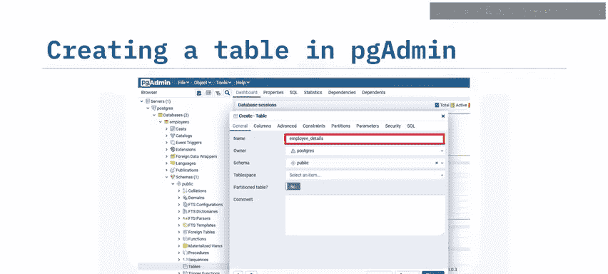

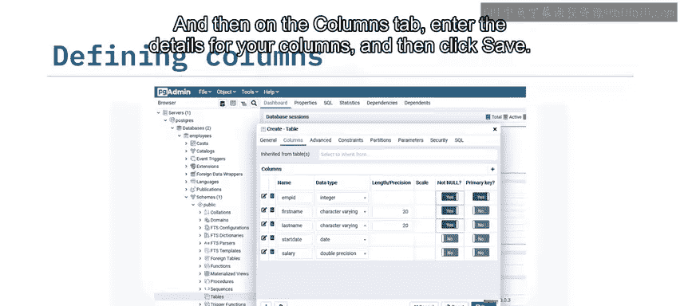

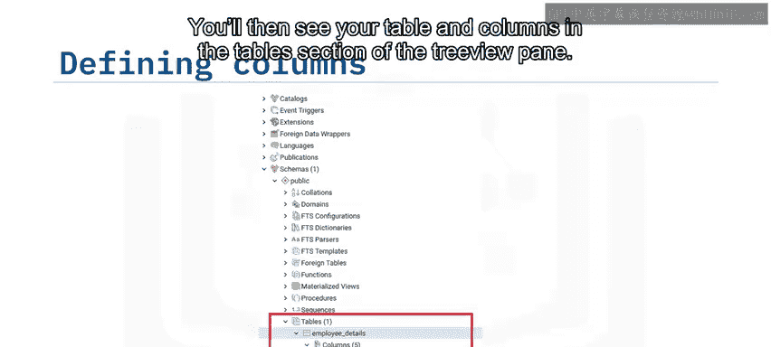

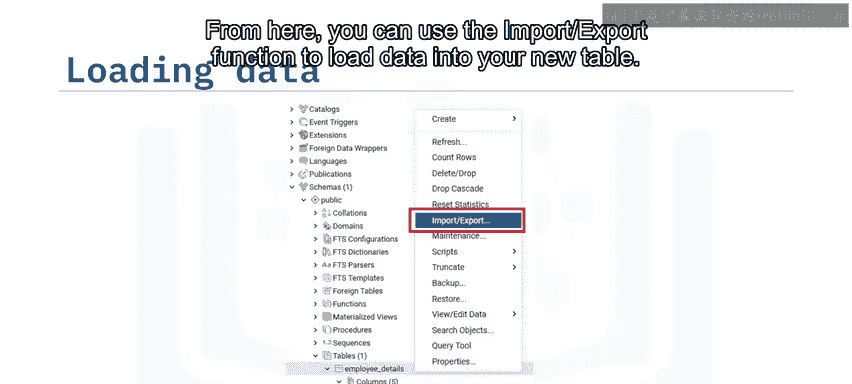

In the import export data box， select import， then enter the location and file name for your data file。

 If you're loading data from a CSV file， you do not need to specify the delimiter because it's the default option for CSV files。

 You can then use the viewedit data option to review the loaded data。

 This runs an SQL query to display the data in the selected table。

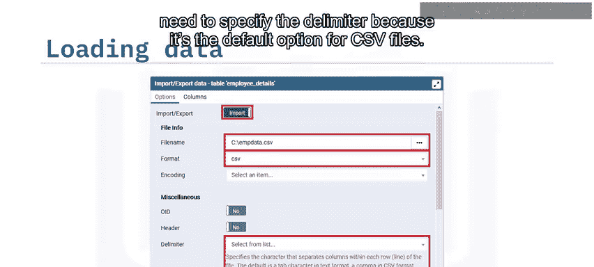

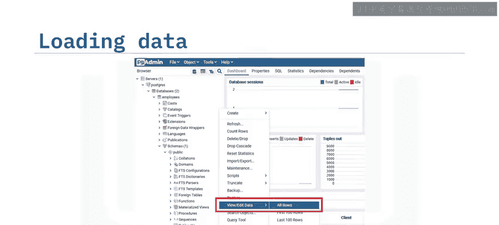

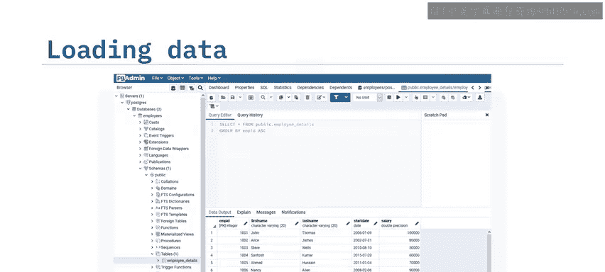

You can also use the import export function to export existing data in your database to a CSv file for use elsewhere。

 CSv is the default format so you can just specify the file name and click OK If you want to back up the entire database you can use the PG_ D utility The syntax of this is similar to restoring data using PSQL specify the database name and the file name for the D file By default PG underscore D creates an SQL file containing a script that describes all the objects and data in the database。

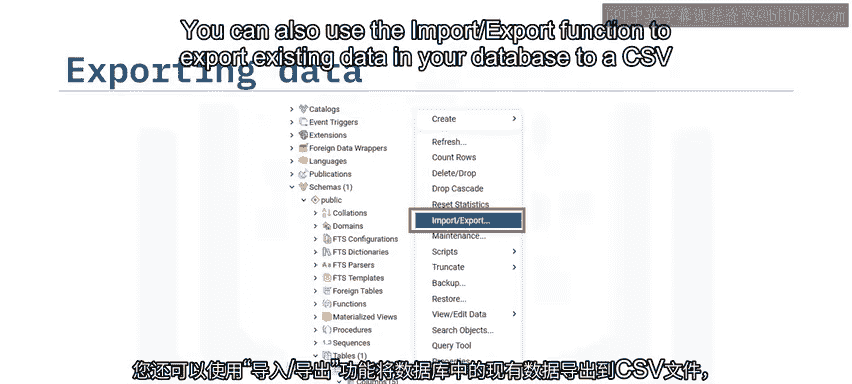

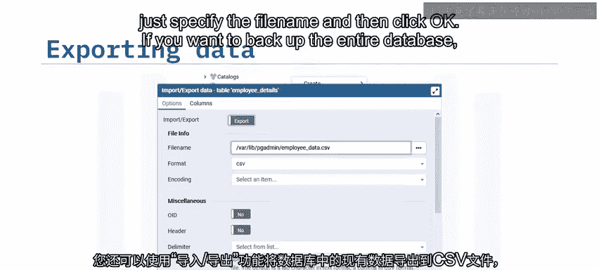

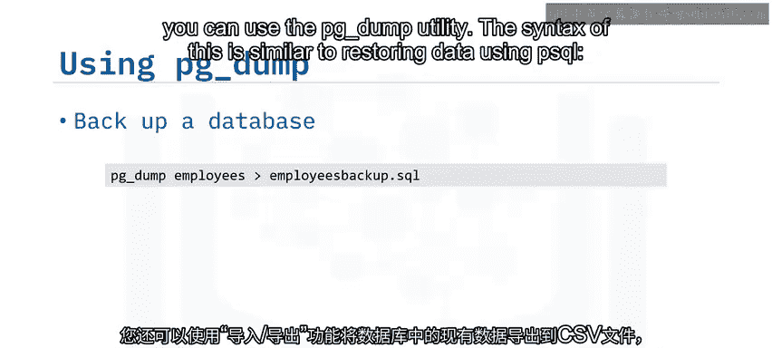

You can also customize the command to output to a compressed archive file instead by default PG_ D backs up the entire schema and data in the database。

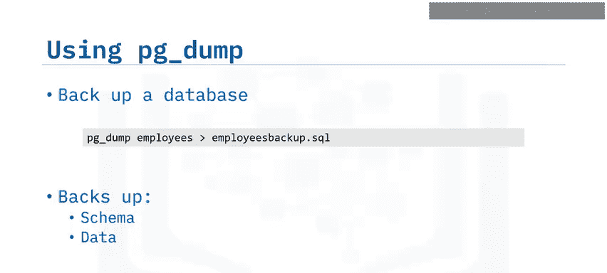

In this video， you learned that you can use many tools to create Postgres objects。

 including the PSQL command line utilityity and PG admin。

You can use PG_ Dump to back up databases and PSQL to restore them。

 and finally you can use the PG admin Iport Export tool to load data into and export data from tables。

