# IBM数据工程专业证书课程4：《关系数据库导论（RDBMS）》｜introduction-to-relational-databases｜ - P31：30_意见.zh_en - GPT中英字幕课程资源 - BV1Mj4116716

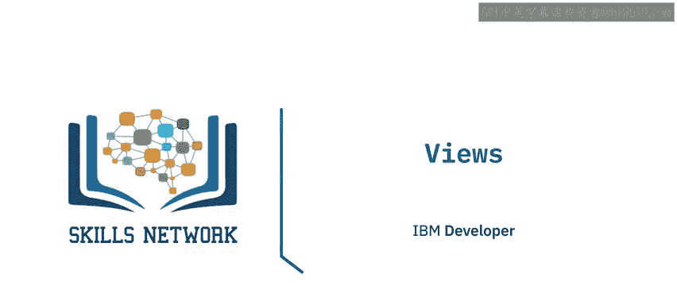

Welcome to Views After watching this video you will be able to describe views， create and use a view。

 explain how materialized views differ from regular views， and create and use a materialized view。

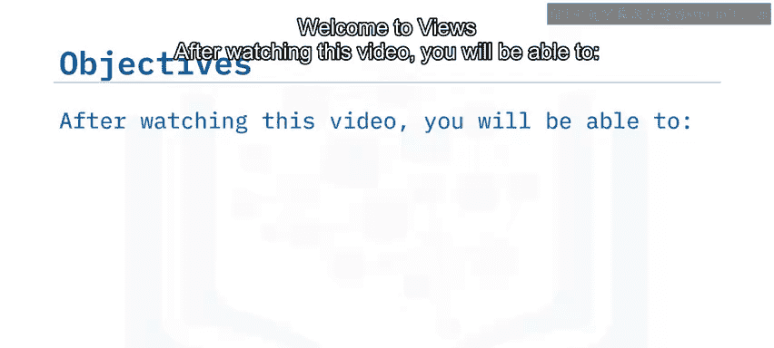

A view is an alternative way of representing data from one or more tables or other views。

 You can interact with views in the same way as you interact with tables， inserting。

 updating and deleting data as required。

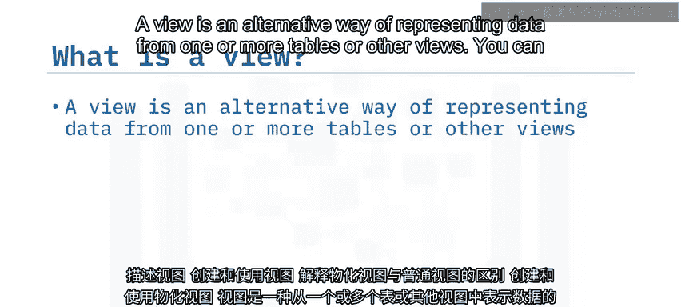

Views are a useful way of limiting access to sensitive data， simplifying data retrieval。

 and reducing access to underlying tables。For example。

 you could create a view to include the name and the email columns from these two tables。

Users can then easily access this data without needing to know that it is stored into different tables and without being given access to the sensitive salary information in Pg admin。

 you create views within a schema。 So in the tree view on the left hand side。 right click views。

 click create， and then click view。 This opens the create view box in which you first need to name the view and then on the code page you enter the SQL code that defines the view and then click save。

 You'll then see your view in the View folder and you can expand the view to display the columns included in it。

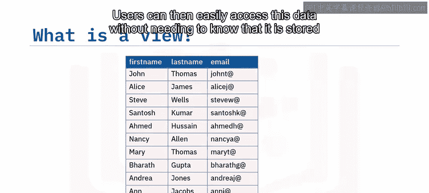

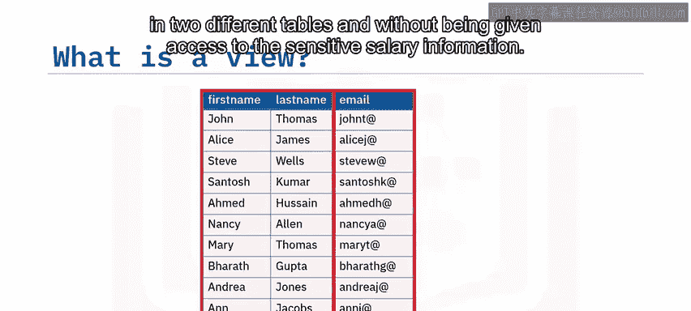

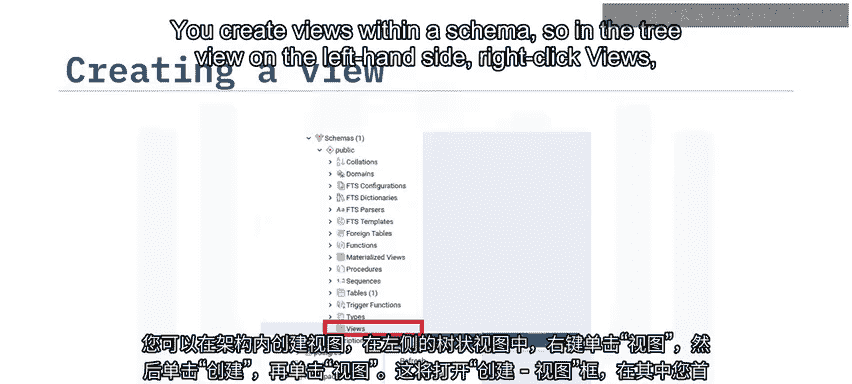

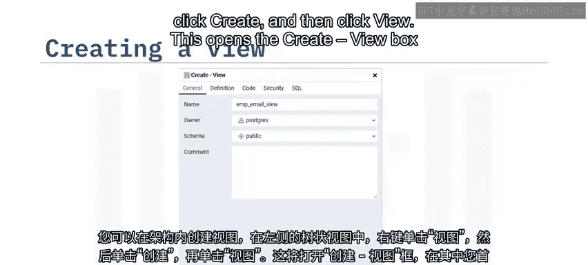

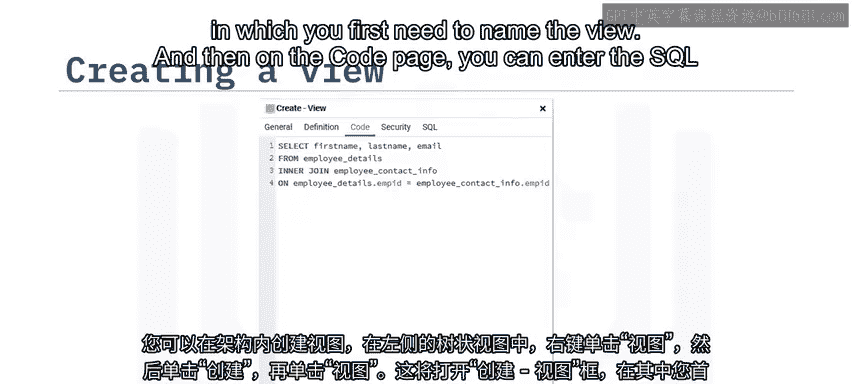

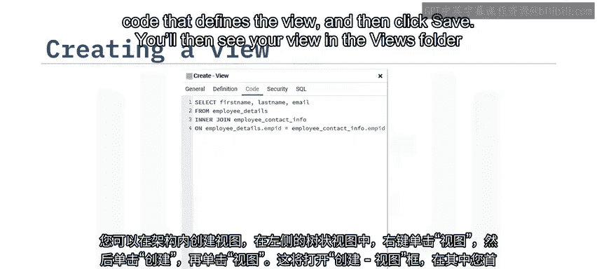

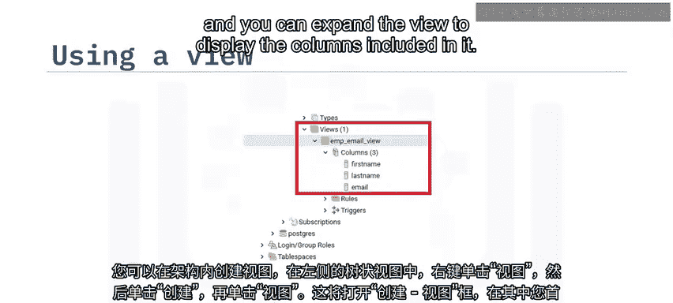

To run the view， right click the view name， click View Edit data， and then click All rows。

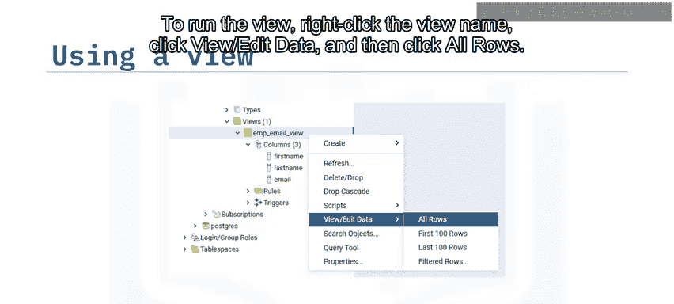

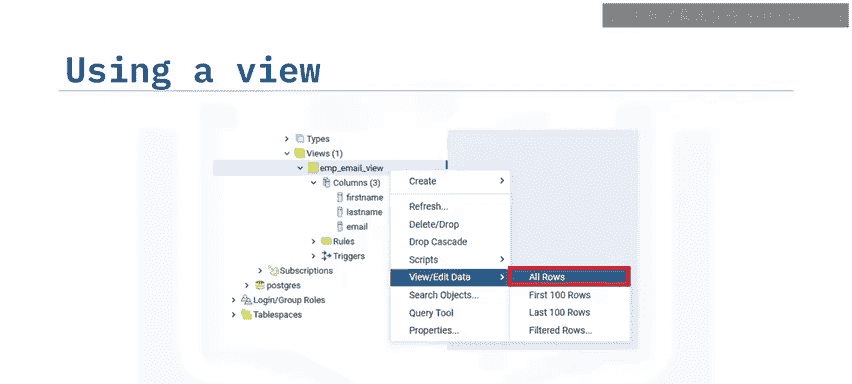

You will then see all the rows included in the view。PostgresQL also supports another type of view。

 a materialized view。

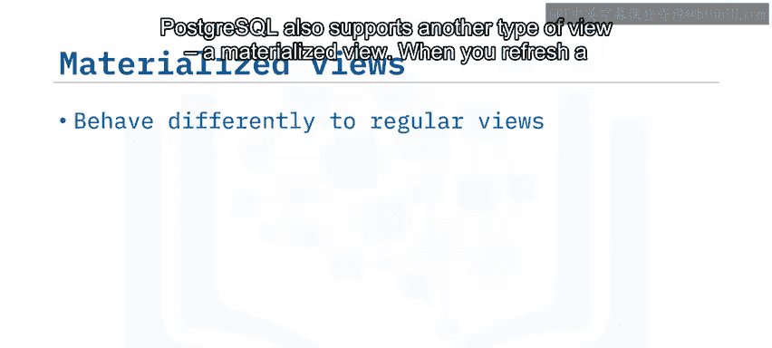

When you refresh a materialized view for the first time。

 the results set is materialized or saved for future use。

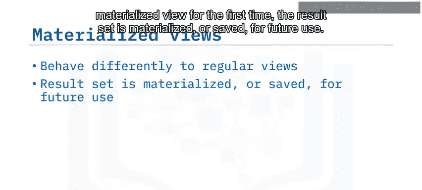

This materialization does mean that you can only query the data and cannot update or delete it。

However， it also enhances performance for future querying of the view because the results set is readily available。

 often stored in memory。Creating a materialized view is a similar process to creating a regular view。

 but you must ensure that you start in the materialized View folder in the tree View。

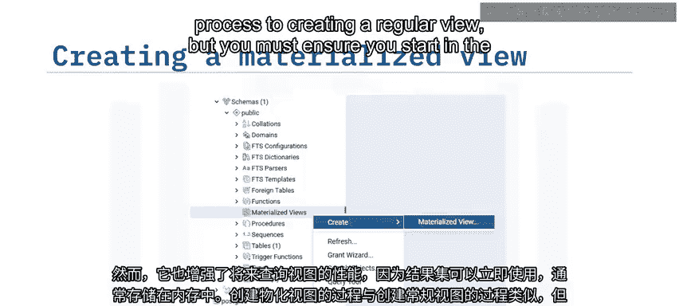

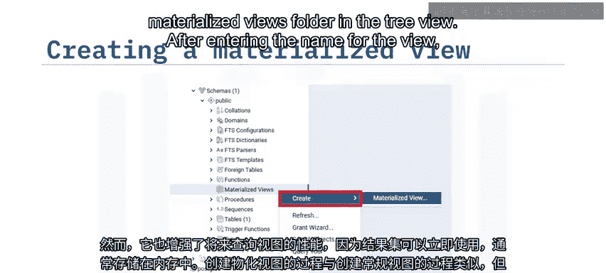

After entering the name for the view on the definition page， enter the code to define the view。

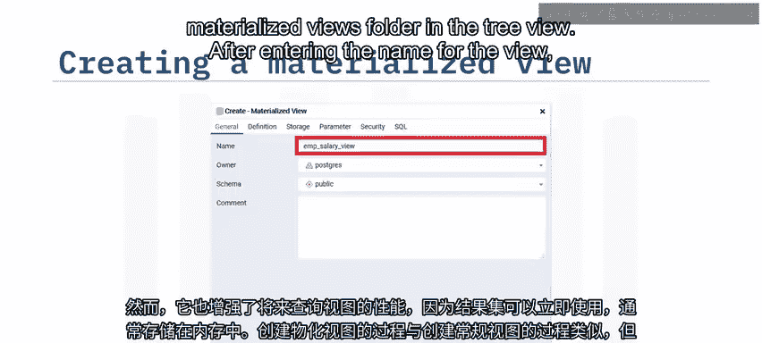

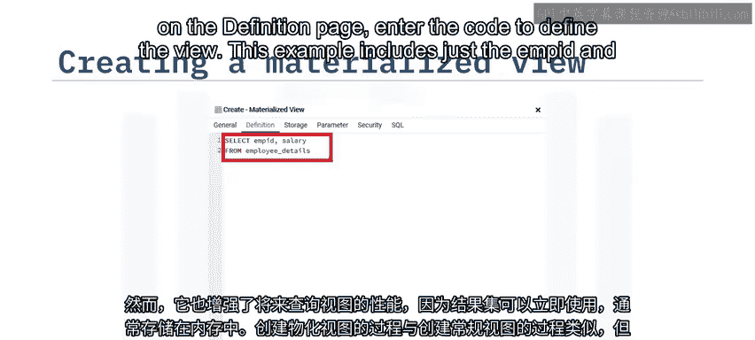

This example includes just the employee ID and salary columns from theEmploy_ detailstail table to anonymize the salary information。

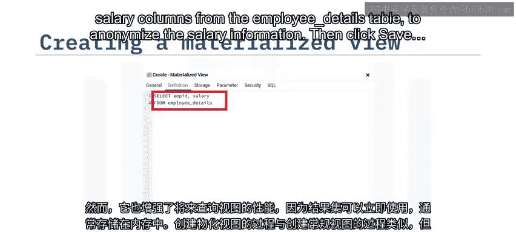

Then click saveve and the materialized view is added to the folder。

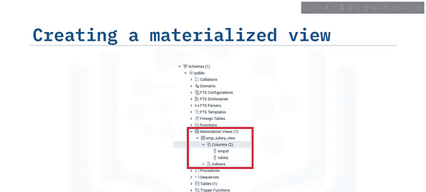

Because the view stores the data before using it， you need to refresh it with the current rows。

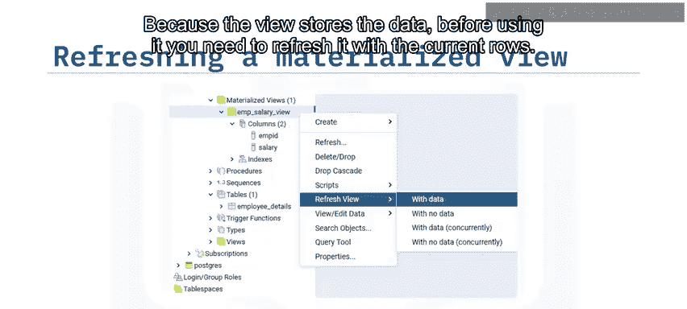

And then you can use the view to access the data it holds。

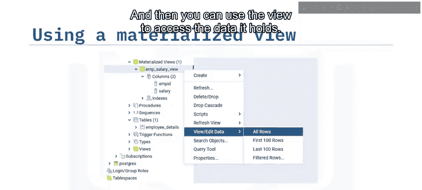

You can refresh the data in the view at any time to update it with the data in the underlying tables。

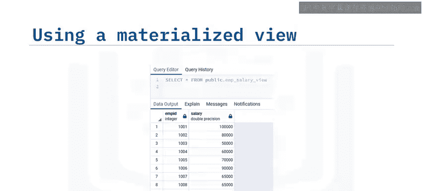

In this video， you learned that views are an alternative way of representing data。

 you can use views to limit access to sensitive data and simplify data retrieval。

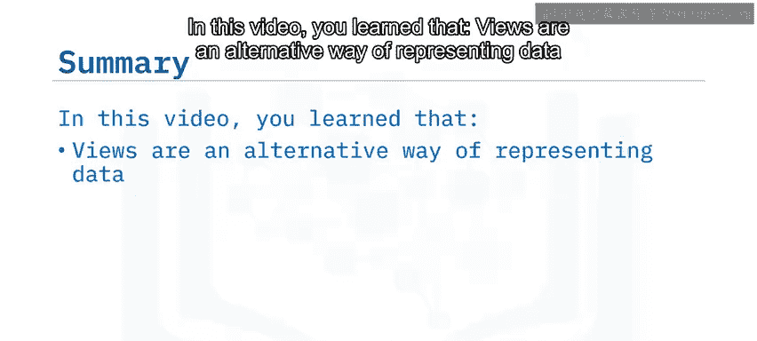

Materialized views store the results set for quicker， subsequent access。And you can insert。

 update or delete rows via a materialized view。

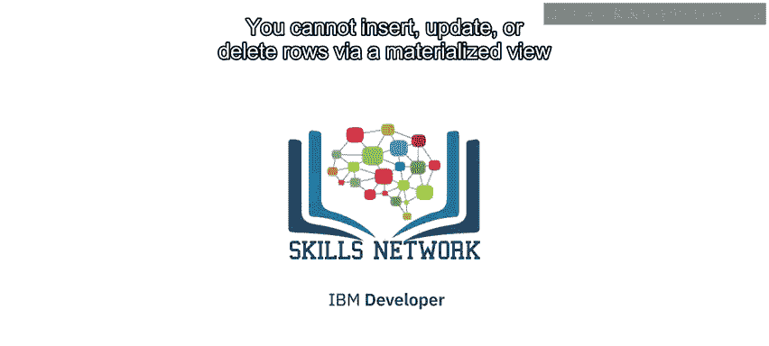