# IBM数据工程专业证书课程4：《关系数据库导论（RDBMS）》｜introduction-to-relational-databases｜ - P3：2_关系类型.zh_en - GPT中英字幕课程资源 - BV1Mj4116716

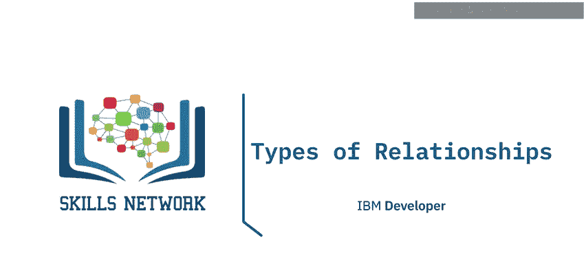

Welcome to T of relationships After watching this video。

 you will be able to describe the building blocks of a relationship。

 explain the symbols used in a relationship set， and describe the difference between the one to one and many to many relationships。

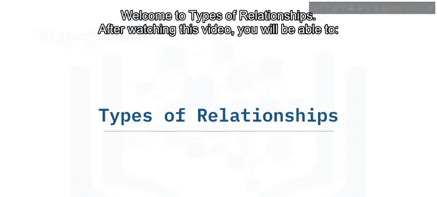

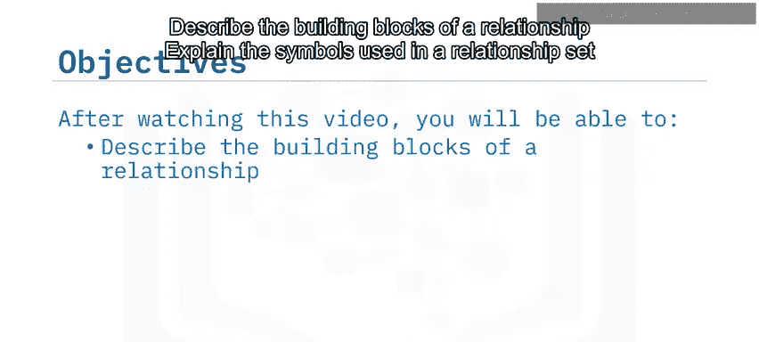

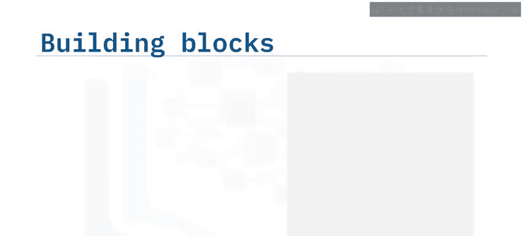

The building blocks of a relationship are entities， relationship sets and crowfoot notations。

 Enity sets are represented by a rectangle。 Reship sets are represented by a diamond with lines connecting associated entities。

 Different techniques are used in representing relationships for ease and understanding。

 this video uses the crow foot notations。 Some of these are the greater than symbol。

 the less than symbol and a vertical line。 An entity relationship diagram or E R diagram for the entity book would look like this。

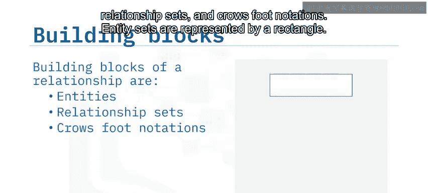

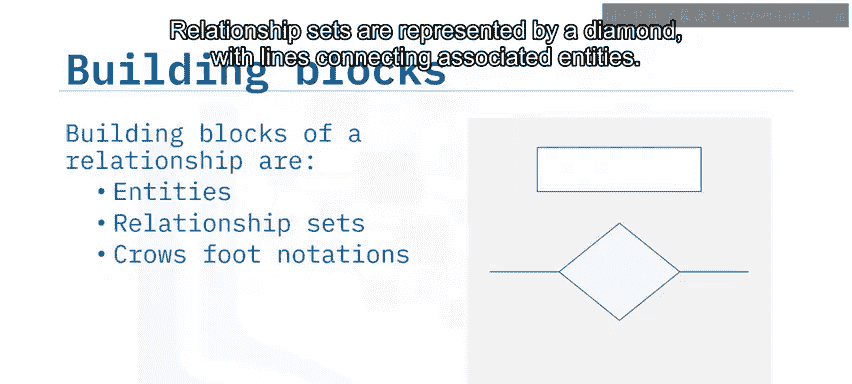

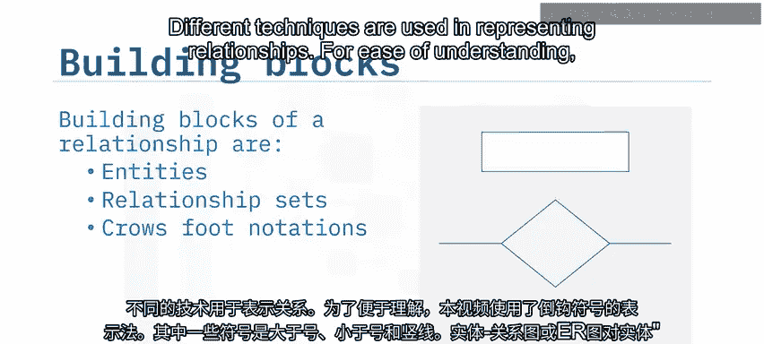

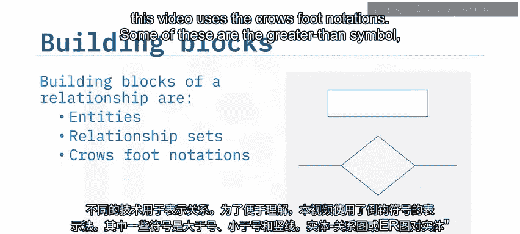

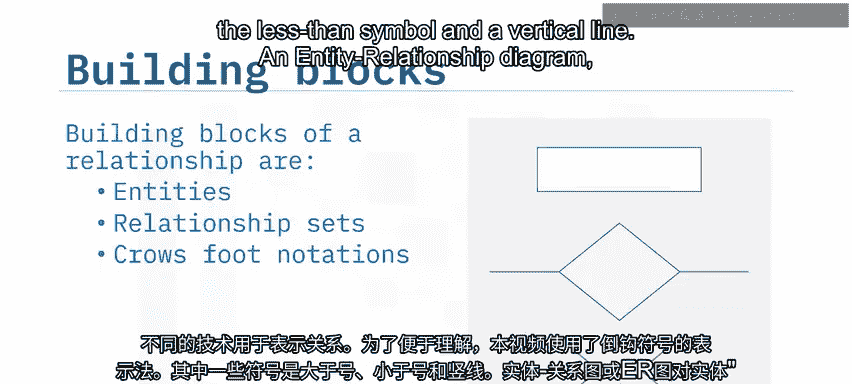

The entity book is drawn as a rectangle， and the attributes are drawn as ovals。

 Attributs are certain properties of that entity。 For example， title， edition， year， price。

 etc cetera。 Atbutes are connected to exactly one entity。

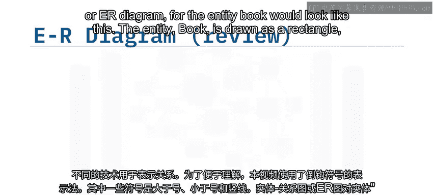

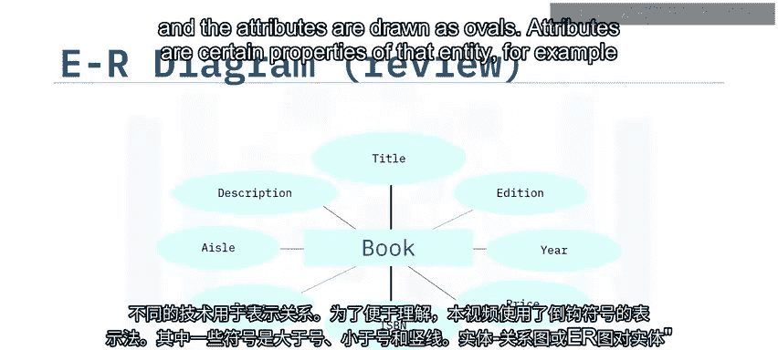

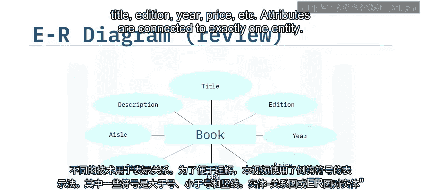

For the entity author， the E R diagram would look like this。

 The entity author has attributes last name， first name， email， city， country and author I D。

 Let us see how the entity's book and author relate to each other。

 A book must be written by at least one author。 However， a book can be written by two authors。

 It can also have many authors。 As another example， one author can write just one book。

 Two books or multiple books。 In both cases， there is a relationship between the book and the author。

 In these examples， you see that a book needs at least one author。

 The relationship set that comes here is authored by One book must be written by one author。

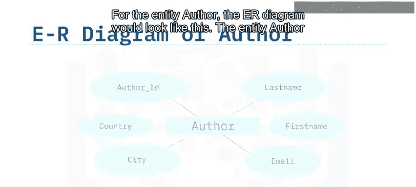

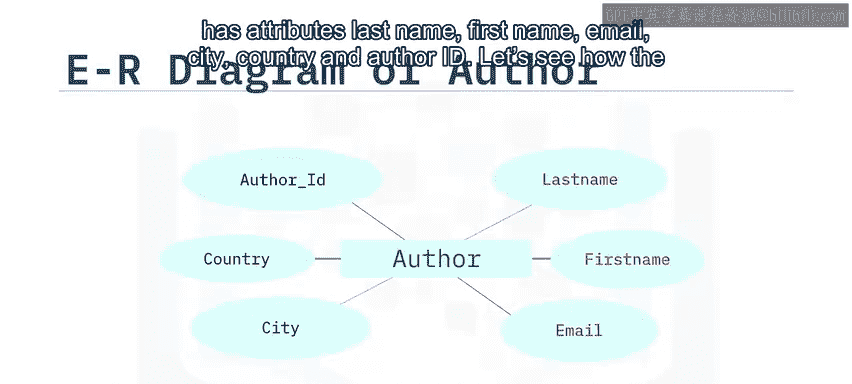

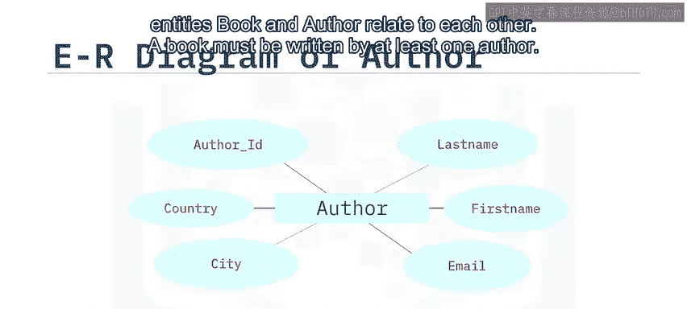

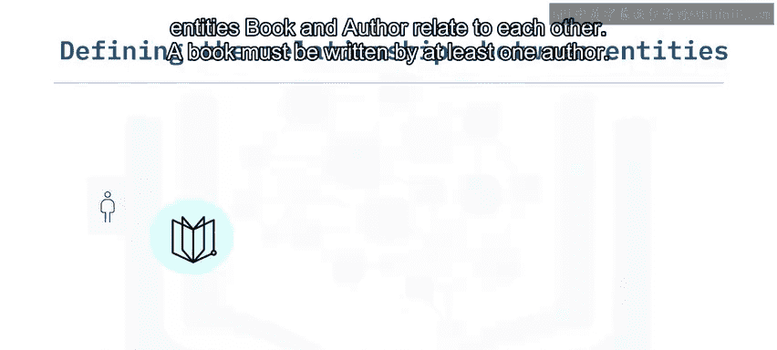

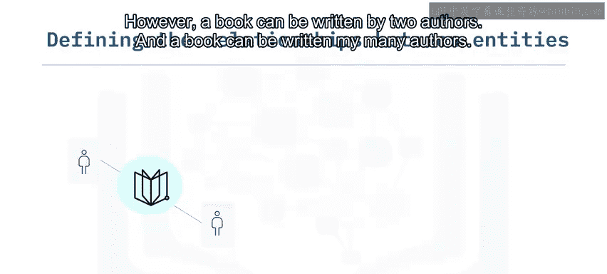

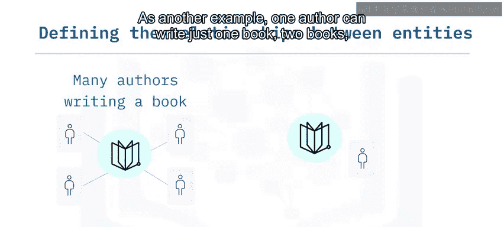

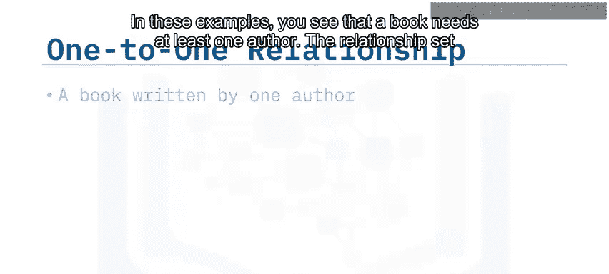

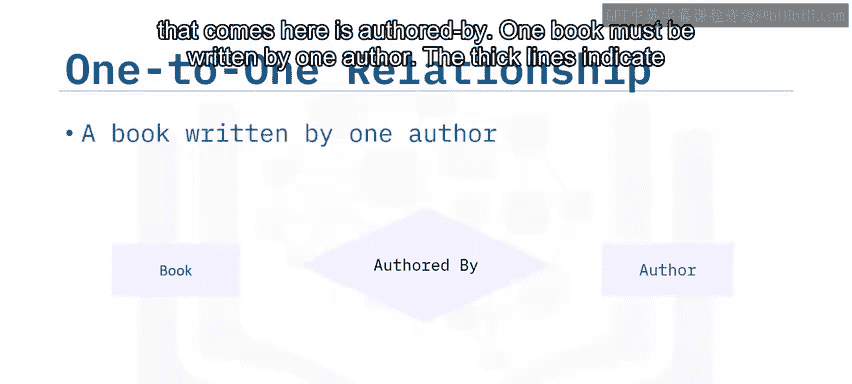

The thick lines indicate each entity in the entity set is involved in at least one and exactly one relationship。

 This is called a one to one relationship。 Only entities are used in the relationship diagrams。

 Attributs are omitted because they can clutter the diagrams。

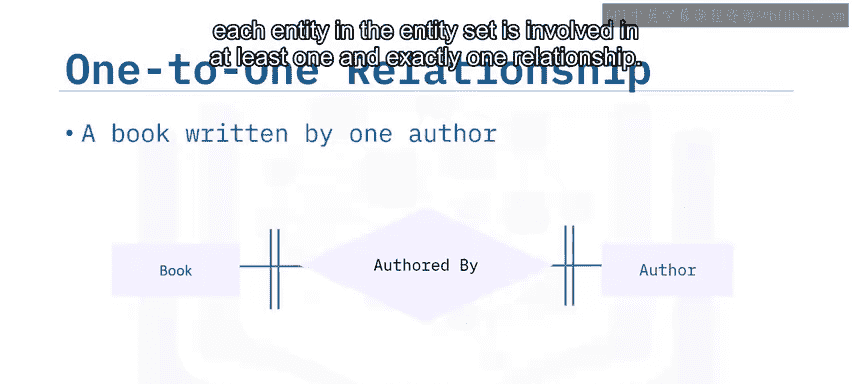

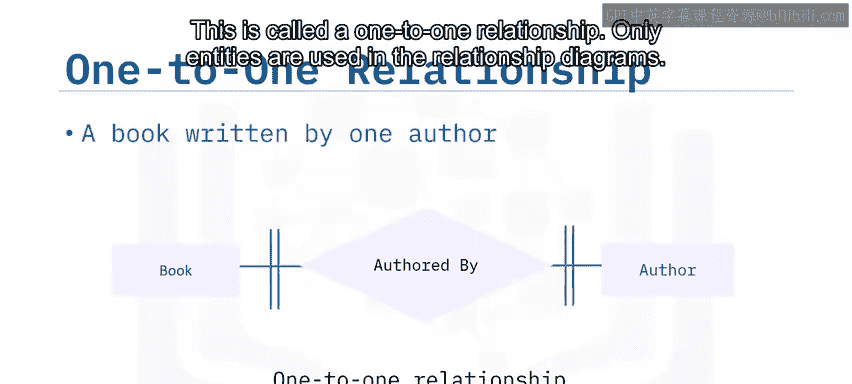

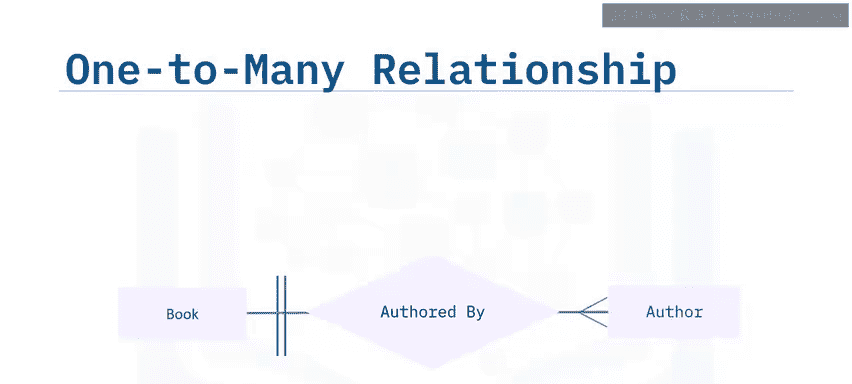

Earlier， you saw that more than one author can write a book。

 This can be represented with a different notation called crfoot notation。 In this case。

 a less than symbol。 This indicates that one book entity is participating in more than one relationship in the relationship set。

 This is called a one to many relationship。 This could also be called a many to one relationship in that many authors write a single book。

 to represent many authors writing many books use the greater than and less than symbols on either side of the relationship set。

 This is called a many to many relationship。 Each entity in the entity set is participating in more than one relationship。

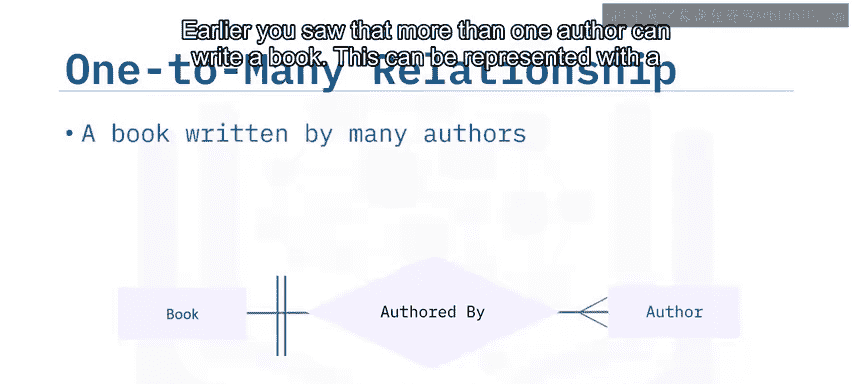

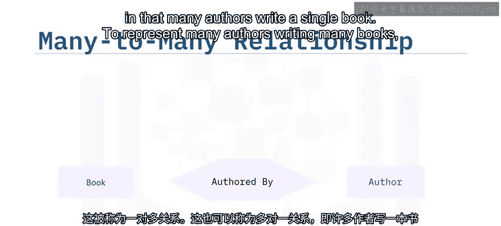

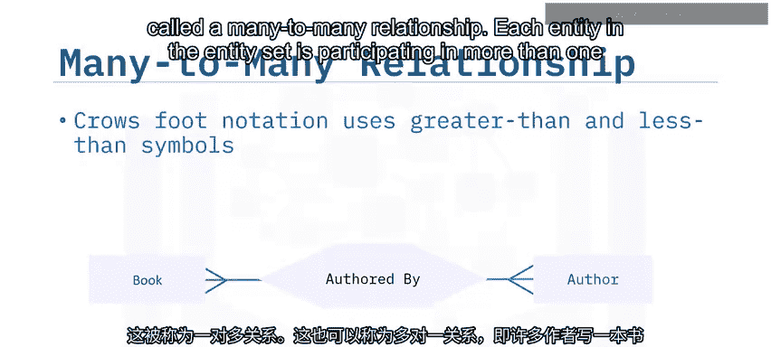

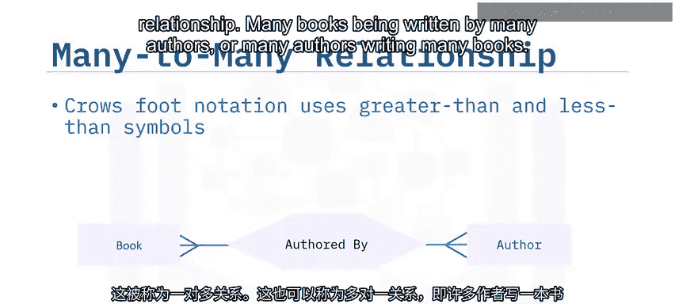

Many books being written by many authors or many authors writing many books。In this video。

 you learned that the building blocks of a relationship are entities。

 relationship sets and crowsfoot notations in a one to one relationship。

 one entity is associated with one and only one instance of another entity。 For example。

 when one book has only one author， In a one to many relationship。

 one entity is associated with one or more instances of another entity。 For example。

 when one book has many authors and in a many to many relationship。

 many instances of an entity are associated with many instances of another entity。 For example。

 when many authors write many different books。😊。

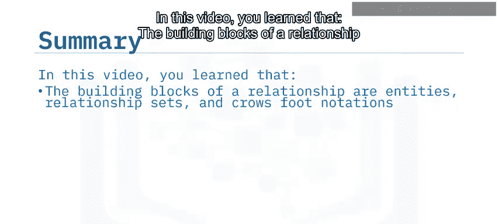

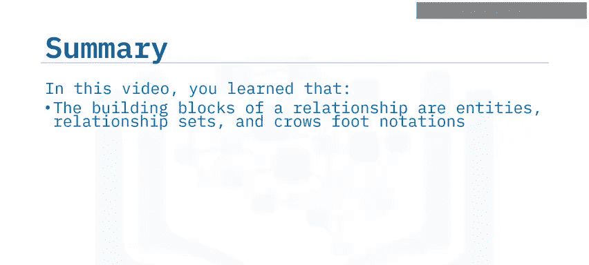