# IBM数据工程专业证书课程4：《关系数据库导论（RDBMS）》｜introduction-to-relational-databases｜ - P4：3_将实体映射到表.zh_en - GPT中英字幕课程资源 - BV1Mj4116716

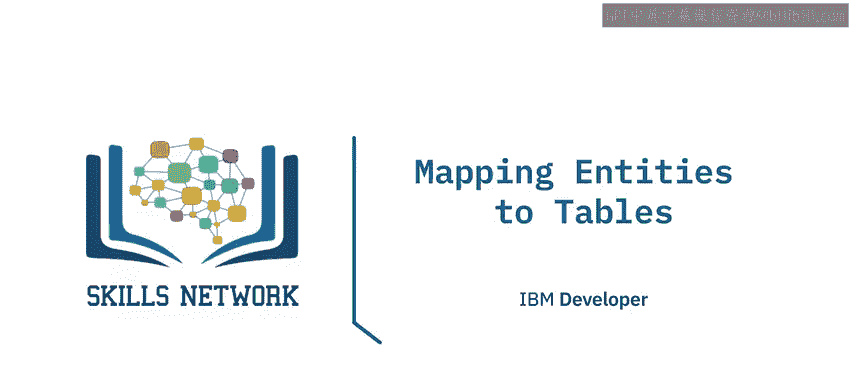

Welcome to mappingapping Entities to Tables。

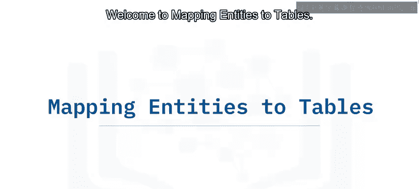

After watching this video， you will be able to explain how an ER diagram translates into a relational database table with rows and columns。

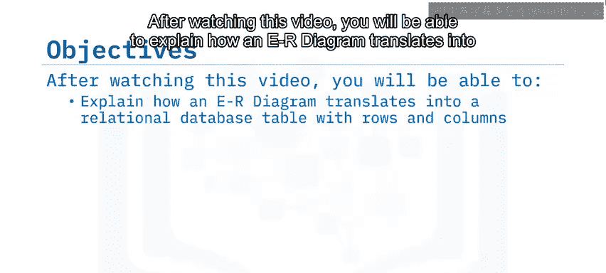

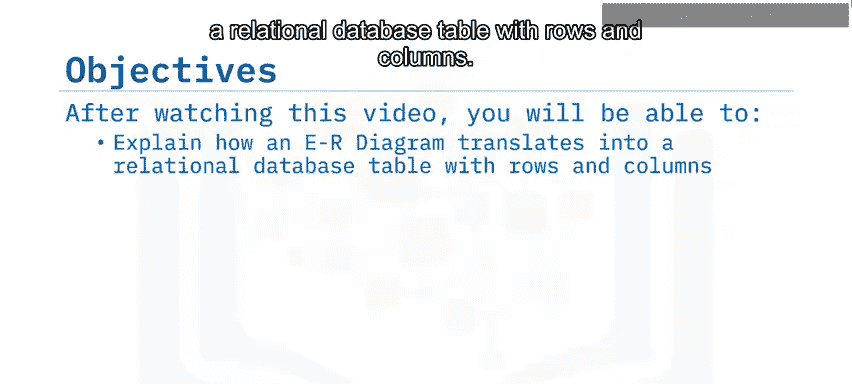

Entity relationship diagrams are the basic foundation for designing a database in the relational database design。

 begin with an ER diagram or ERD。 and later map the ERD to the tables in a database。

 This example uses the ER D for the entity book。 The entity book has several attributes。

 The entity and its attributes will be mapped to a table。 for ease of understanding。

 let's separate the entity from the attributes。 In this case。

 the entity book becomes a table with the same name book。

 All the attributes translate into columns in the table。

 You will now see how a table would be represented in a relational database model。

 A table is a combination of rows and columns。 While mapping， the entity becomes the table。

 And having said that the table has not yet taken the form of rows and columns。 The attributes get。

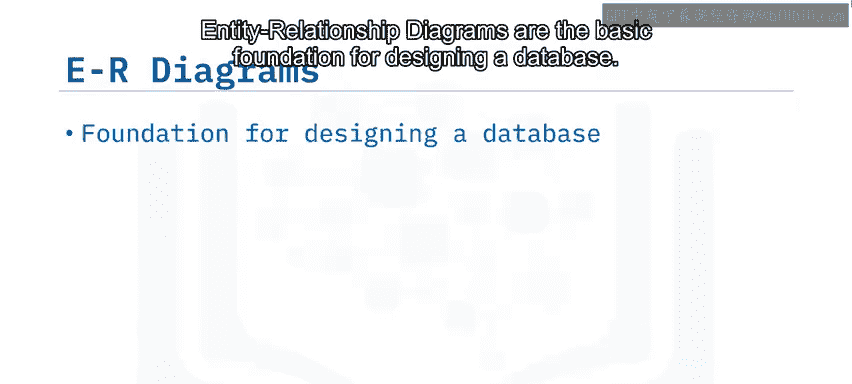

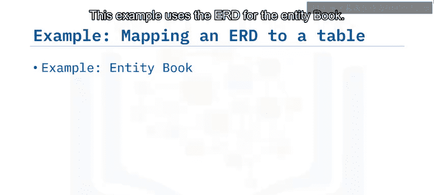

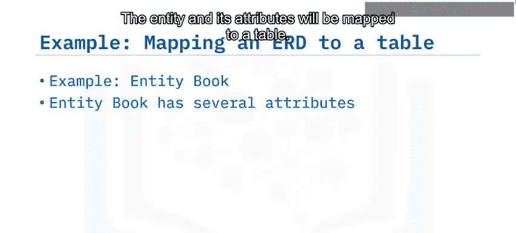

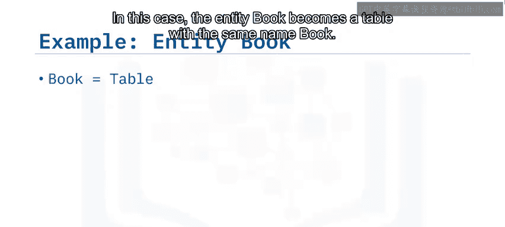

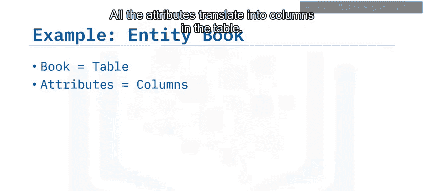

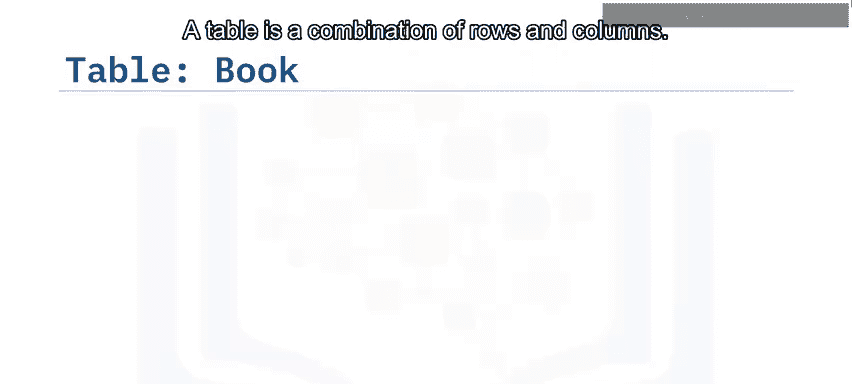

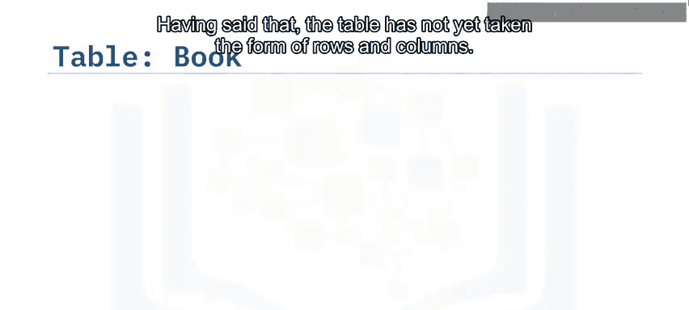

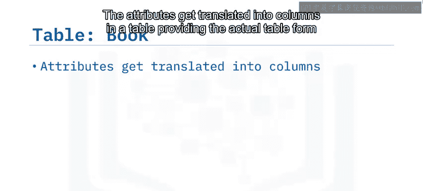

transranslated into columns in a table， providing the actual table form of rows and columns Later you can add some data values to each of the columns which completes the table form for the author example。

 the entity author becomes the table and the attributes get translated to columns in the table and adding data values into the columns completes the table。

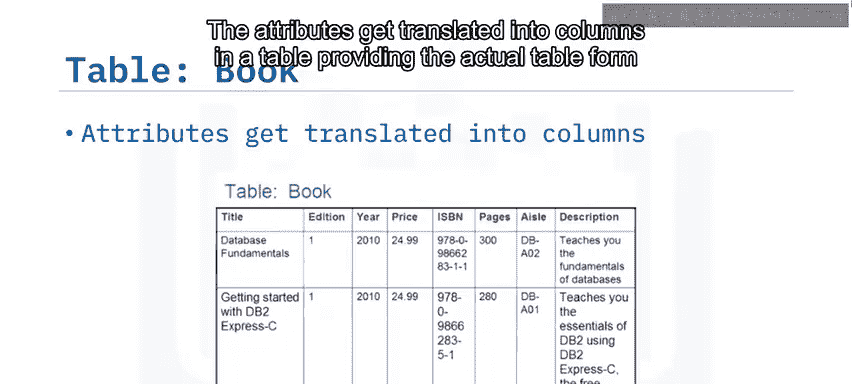

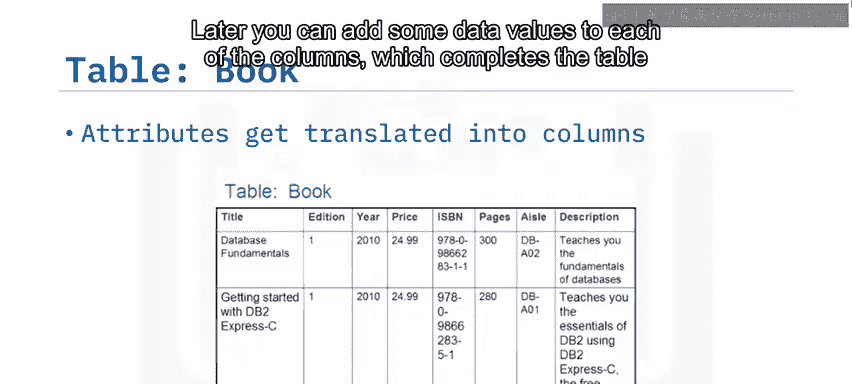

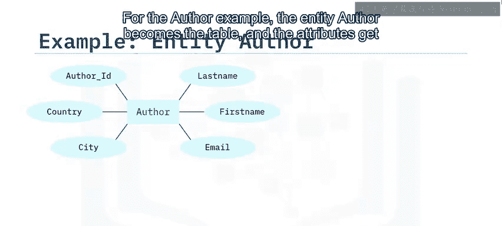

In this video， you learned that En relationship diagrams or ERD are the basic foundation for designing a database and to translate an ERD into a relational database table。

 the entity becomes the table and the attributes become columns in the table。

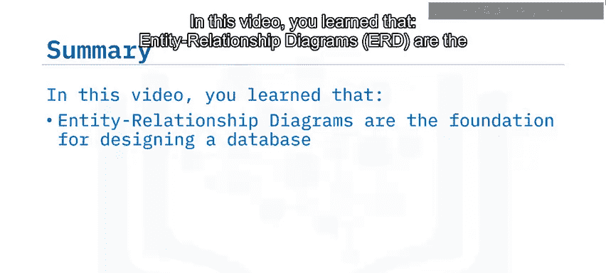

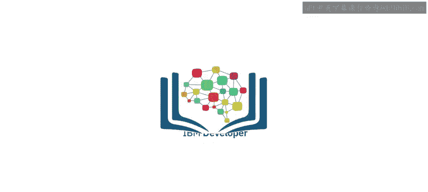