# IBM数据工程专业证书课程4：《关系数据库导论（RDBMS）》｜introduction-to-relational-databases｜ - P6：5_关系模型概念.zh_en - GPT中英字幕课程资源 - BV1Mj4116716

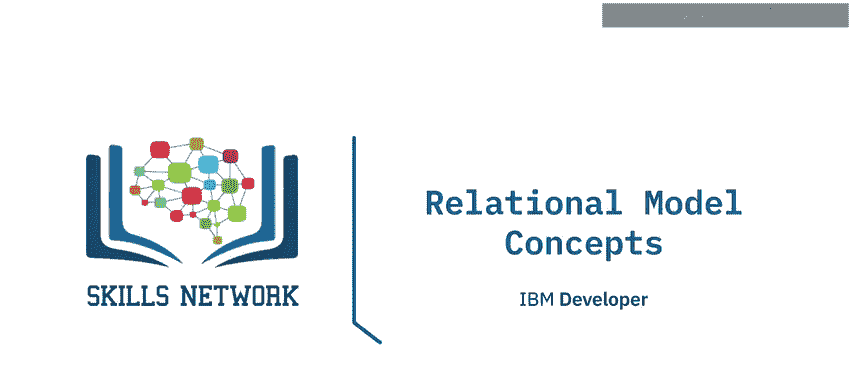

Welcome to Relational Model Concepts。

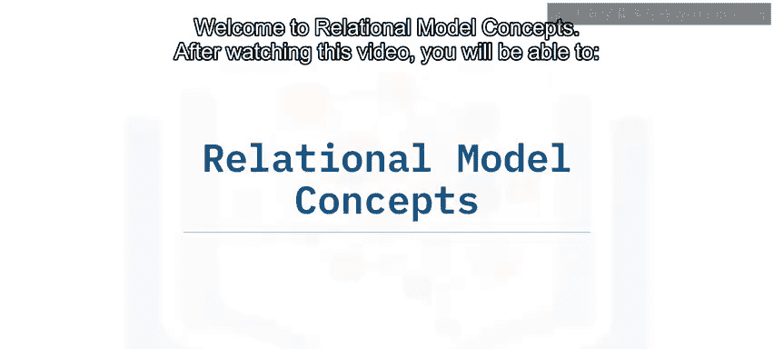

After watching this video， you will be able to define relational terms such as relation。

 degree and Carinality， and explain the difference between a relational schema and a relational instance。

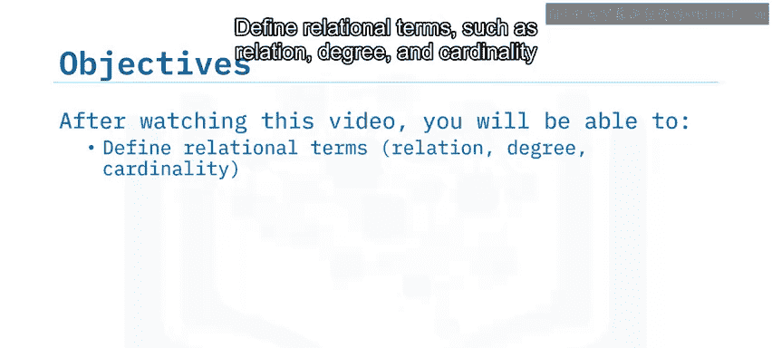

The relational model was first proposed in 1970 and is based on a mathematical model and mathematical terms。

 The building blocks of the relational model are relation and sets。

 The relational model of data is based on the concept of relation。

 A relation is a mathematical concept based on the idea of sets。

 A set is an unordered collection of distinct elements。 It is a collection of items of the same type。

 It would have no order and no duplicates。

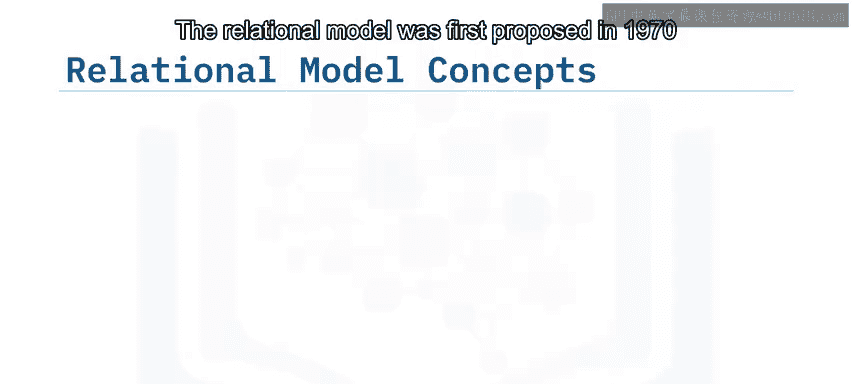

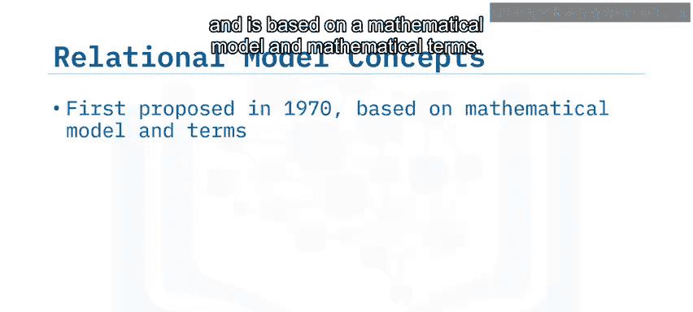

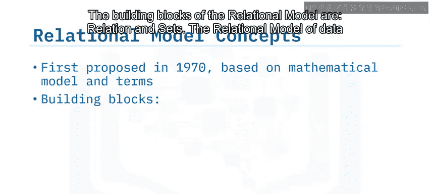

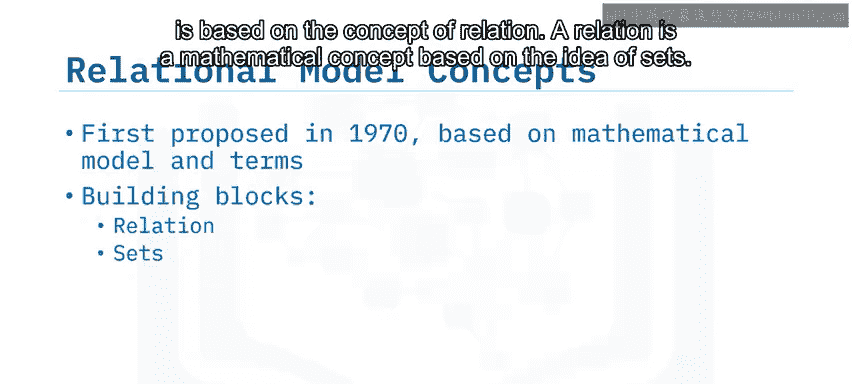

A relational database is a set of relations。 A relation is also the mathematical term for a table。

 A table is a combination of rows and columns。 A relation is made up of two parts。

 relation schema and relation instance。 A relation schema specifies the name of a relation name and type of each of the columns。

 which are the attributes。

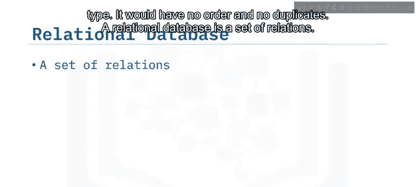

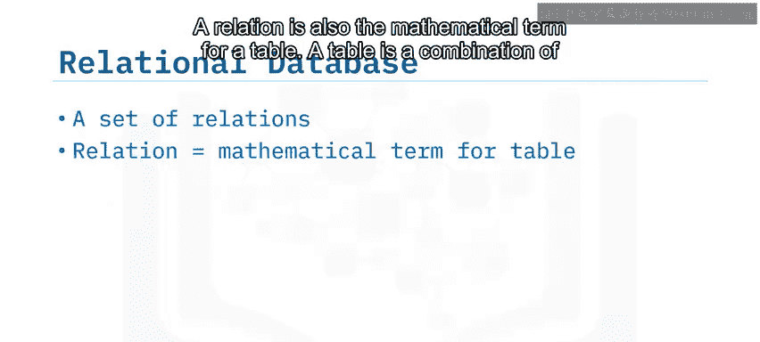

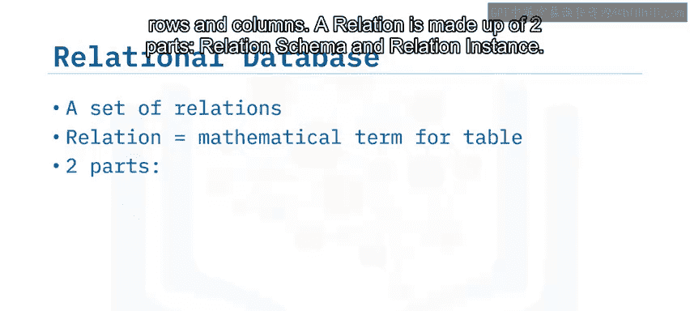

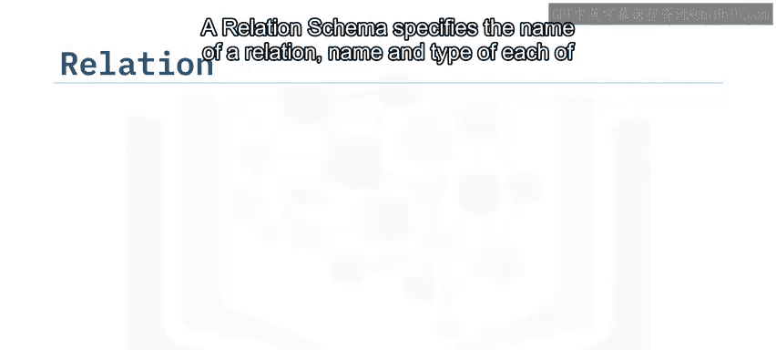

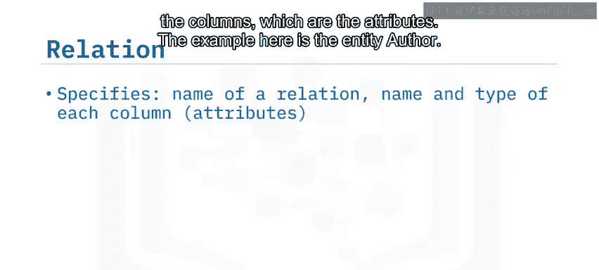

The example here is the entity author。 author is the name of the relation。

 author underscore I D is an attribute which can hold the data type car。

 which is a character string of a fixed length。 Likewise， last name， first name。

 email and city have the data type var car， which is a character string of a variable length。

 The last attribute， country also has a data type of car。 This constitutes the relation schema。

 A relation instance is a table made up of rows and columns。

 The columns are the attributes or fields。 The rows are topples。

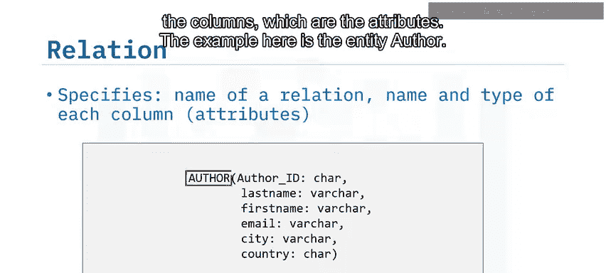

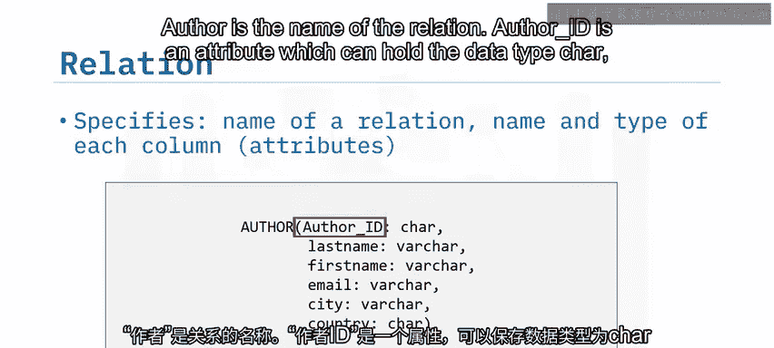

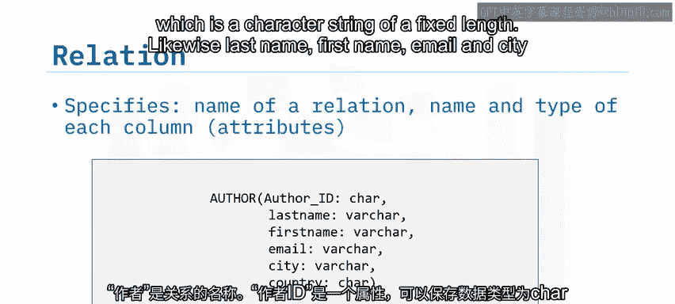

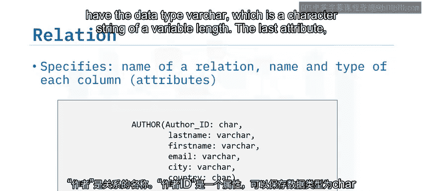

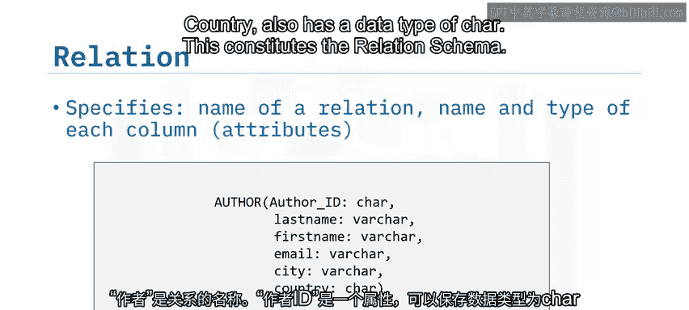

Degree refers to the number of attributes or columns in a relation。

 Carinality refers to the number of tuples or rows。 In this example。

 the degree is 6 because there are  six columns and the cardinality is 5 because there are five tuples or rows。

In this video， you learned that relational model of data is based on the concept of relation。

 Re is a mathematical term for table， and a relation schema specifies the name of a relation While a relation instance is a table made up of the attributes or columns and tuples or rows degree refers to the number of attributes or columns in a relation。

 Carinality refers to the number of tuples or rows in a relation。

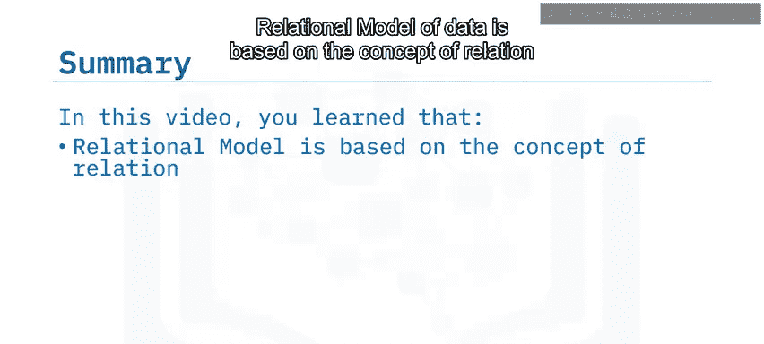