# IBM数据工程专业证书课程4：《关系数据库导论（RDBMS）》｜introduction-to-relational-databases｜ - P7：6_数据库体系结构.zh_en - GPT中英字幕课程资源 - BV1Mj4116716

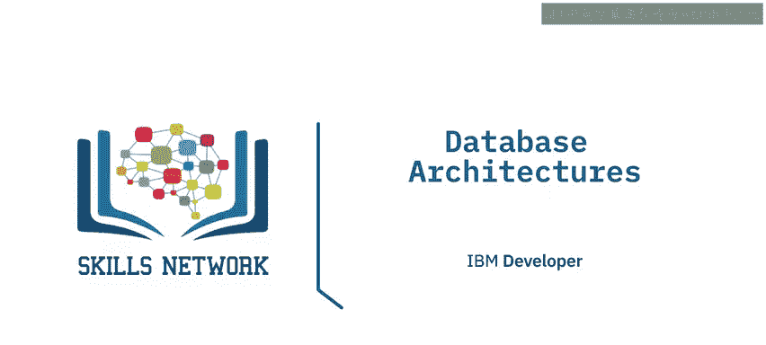

Welcome to database architectures After watching this video。

 you will be able to describe deployment topologies for databases and explain two tier and three tier architectures。

 including their layers such as database drivers， interfaces and As。

 The deployment topology you use for your database is determined by how it will be used and access。

 For example， you can deploy a small database， which requires limited user access on a local desktop。

 The database resides on the user system and access is often limited to a single user。

 This deployment topology is sometimes known as single tier architecture。

 It is useful for development and testing， or when the database is embedded in a local application。

 You can deploy a larger database that many users must access in a client server architecture。

 In this scenario， the database resides on。

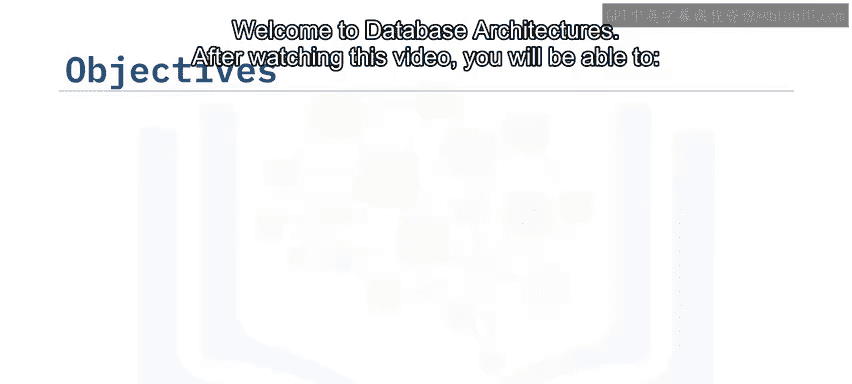

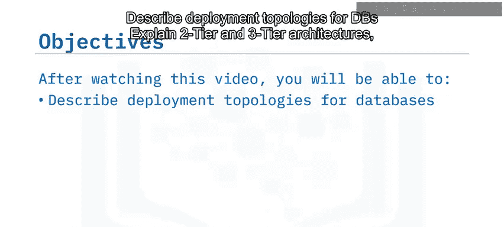

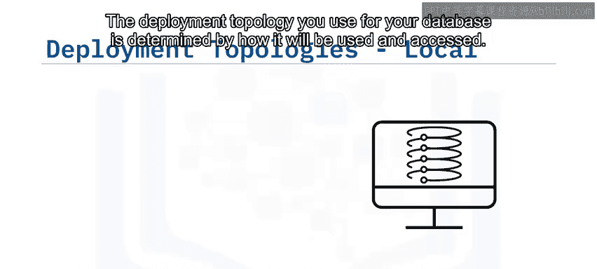

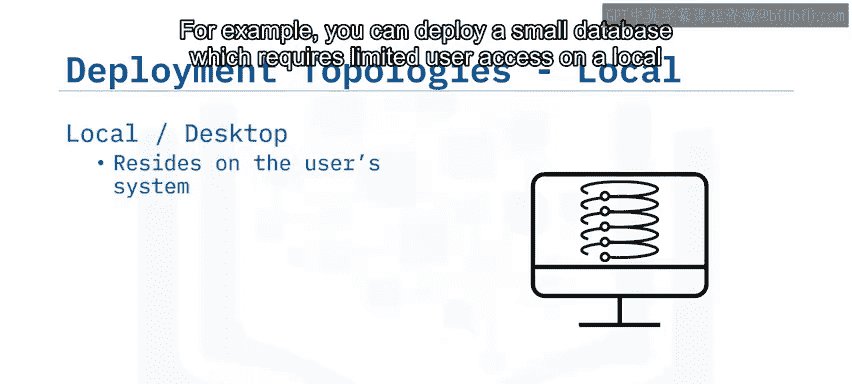

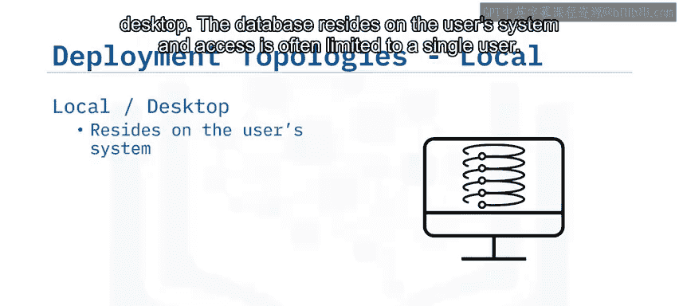

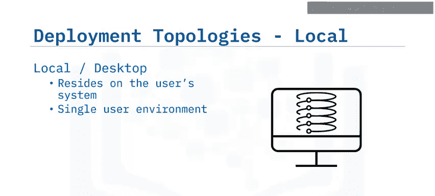

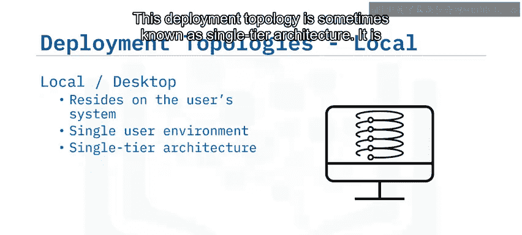

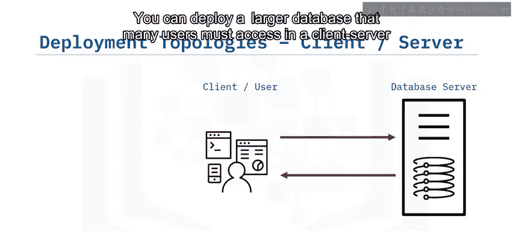

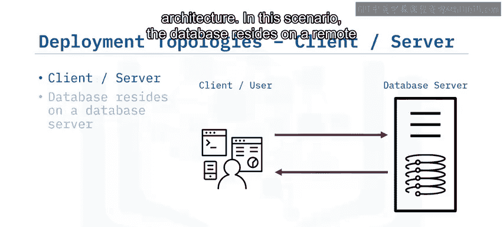

Remote server and users access it from client systems often through a web page or local application。

 Some scenarios employ a middle tier or an application server layer between the application client and the remote database server。

 These client server deployments are commonly used for multius scenarios and are typical for production environments。

Deploying a database in the cloud is an increasingly popular option in a cloud deployment。

 the database resides in a cloud environment and has all the advantages of a cloud-based service。

 You do not have to download or install the database software。

 you do not have to maintain the supporting infrastructure and it is easy for users to access from wherever they are or whatever they are doing so long as they have in internet connection in cloud deployments。

 client apps and users typically access the database through an application server layer or interface in the cloud。

 Cloud deployments are very flexible。 you can use them for development testing and full production environments。

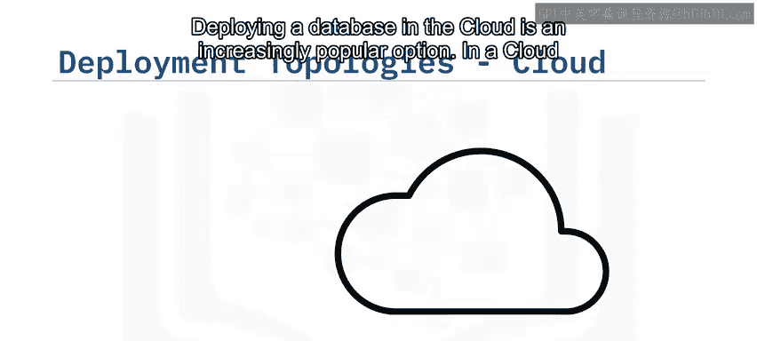

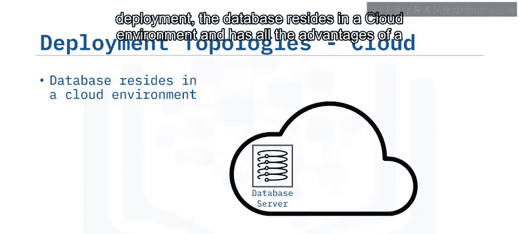

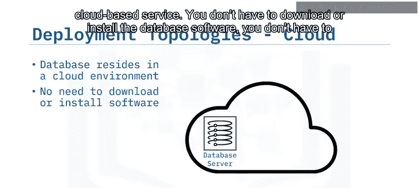

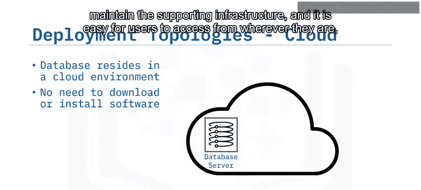

Let's look more closely at the client server topology。

 It is also referred to as a two tier architecture in a twoter database architecture。

 the database server and the application run in two separate tiers。

 The application in the client tier connects to the database server through some sort of database interface。

 such as an API or framework which can be dependent on the programming language the application is written in。

 The database interface communicates with the database server through a database client or API that is installed on the client system。

 the database management system software DBMS on the server includes multiple layers。

 which on a high level can be categorized as Data access layer database engine layer and database storage layer。

 The database access layer server includes interfaces for different types of clients， which can。

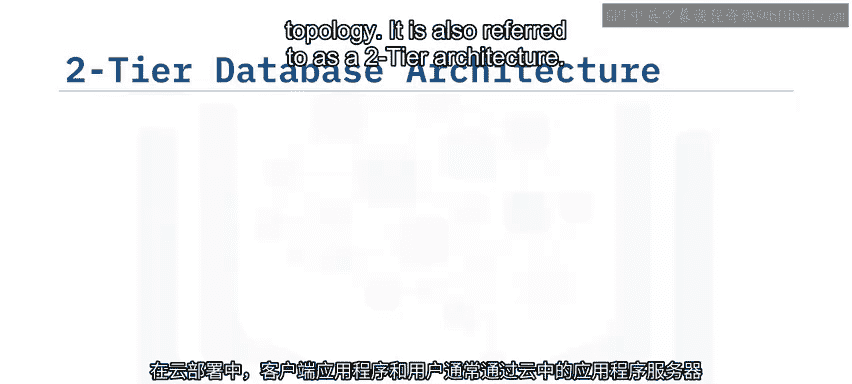

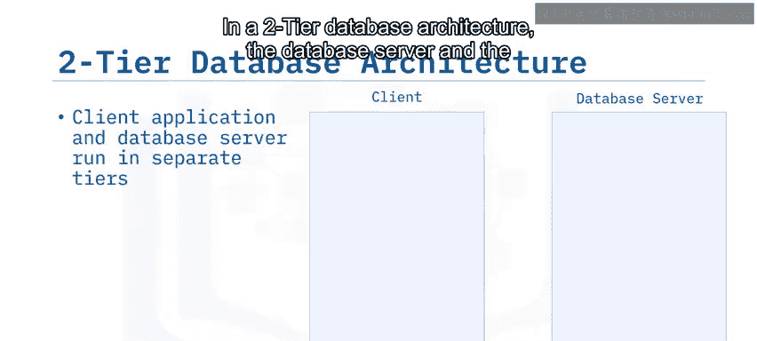

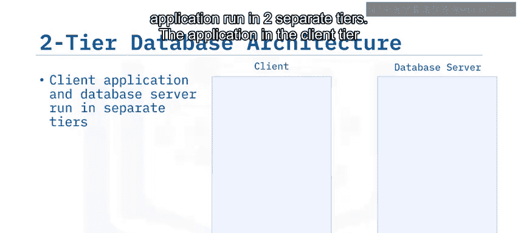

Data industrytry standard APIs such as JDBC and ODBC Command line processor or CLP interfaces。

 as well as vendor specific or proprietary interfaces。

The database server also contains an engine which compiles queries and retrieves and processes the data。

 then returns the results set The database storage or persistence layer is where the data is stored。

 which may be on local storage on the same device or reside physically on network storage or specialized storage appliances。

In most production environments， especially in the last 20 to 25 years。

 the database server is typically not accessed directly， except by administrators。

 The client application and users typically go through a middle tier。

 such as a web application server。 A BI server， etc cetera。

 and hence is referred to as three tier architecture。 in this architecture。

 the application presentation layer and the business logic layer reside in different tiers。

 The presentation layer is the interface with which end users interact。

 which could be a traditional desktop application。 A web browser or a mobile application。

 The client application communicates with an application server over the network。

 The application server encapsulates the application and business logic and communicates with the database server through a database API or driver。

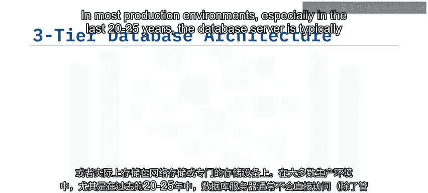

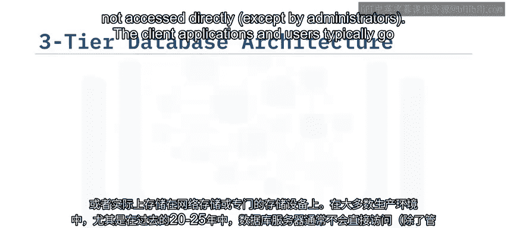

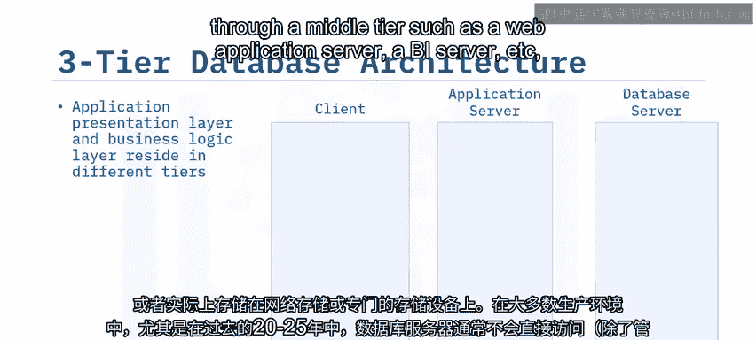

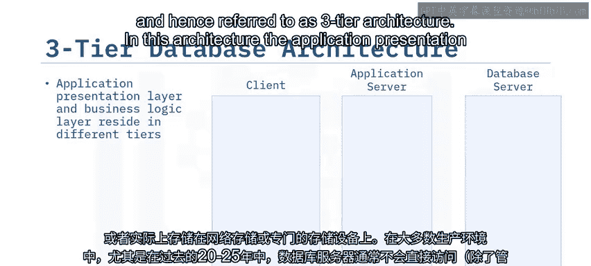

As an example， let's say the client application is an internet banking app or mobile phone。

 the app connects to a banking application server， which in turn connects with the bank's database servers where the user's account data is stored。

In this video you learned that databases are deployed in different topologies depending on which best suits the processing and access requirements。

 a single tier topology is one where the database is installed on a user's local desktop。

 it is useful for small databases that only require single user access。

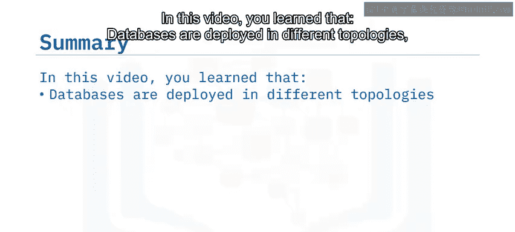

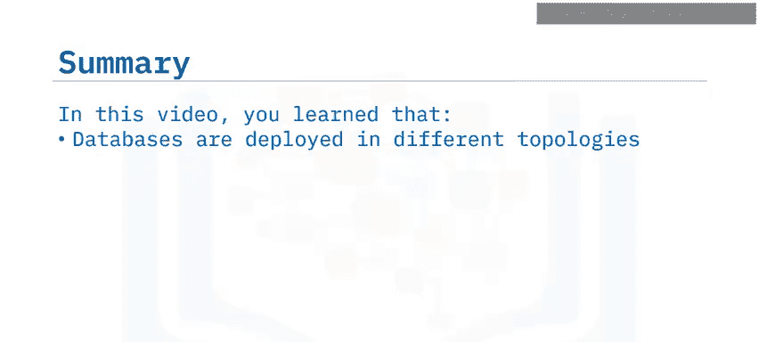

In two tier database topologies， the database resides on a remote server and users access it from client systems。

In three tier database apologies， the database resides on a remote server and users access it through an application server or a middle tier。

 and finally in cloud deployments， the database resides in the cloud and users access it through an application server layer or another interface that also resides in the cloud。

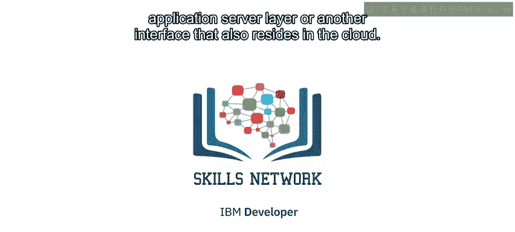